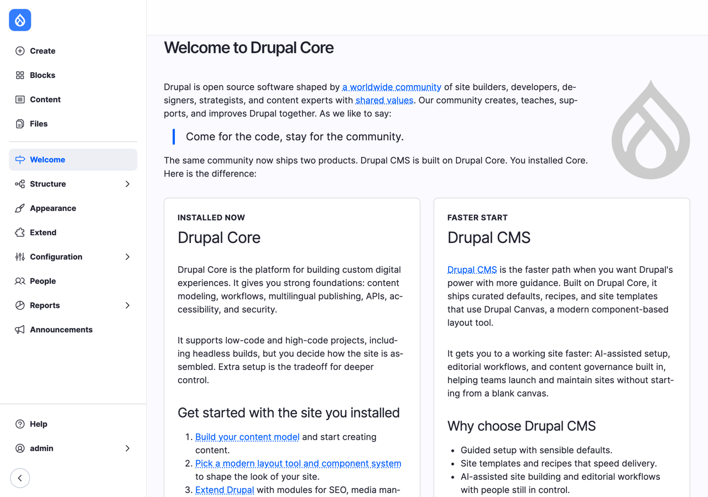
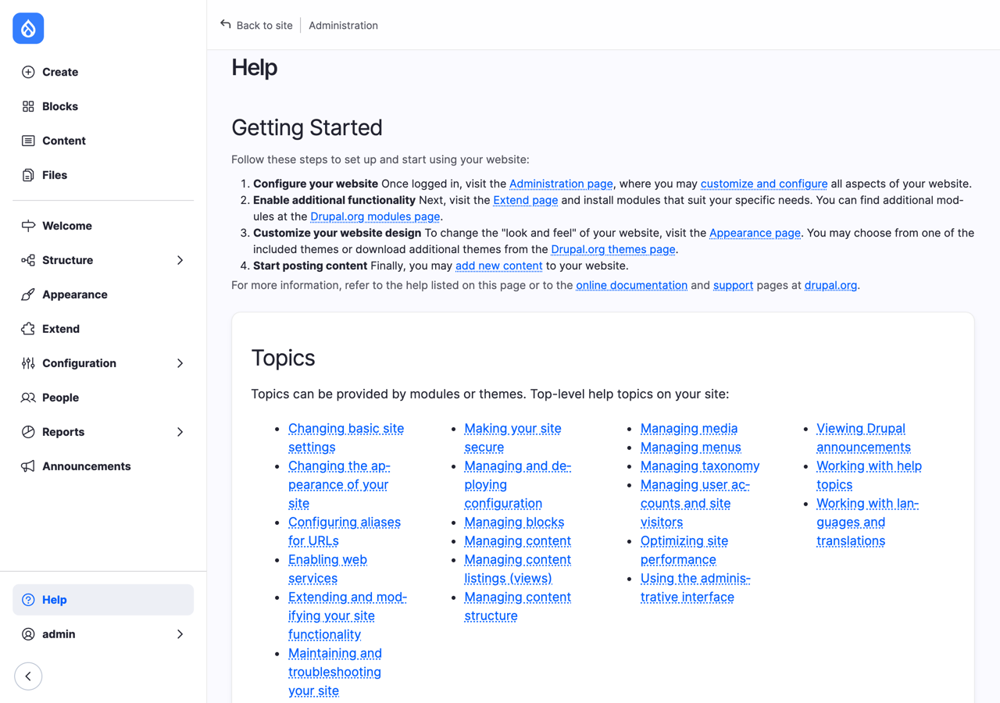
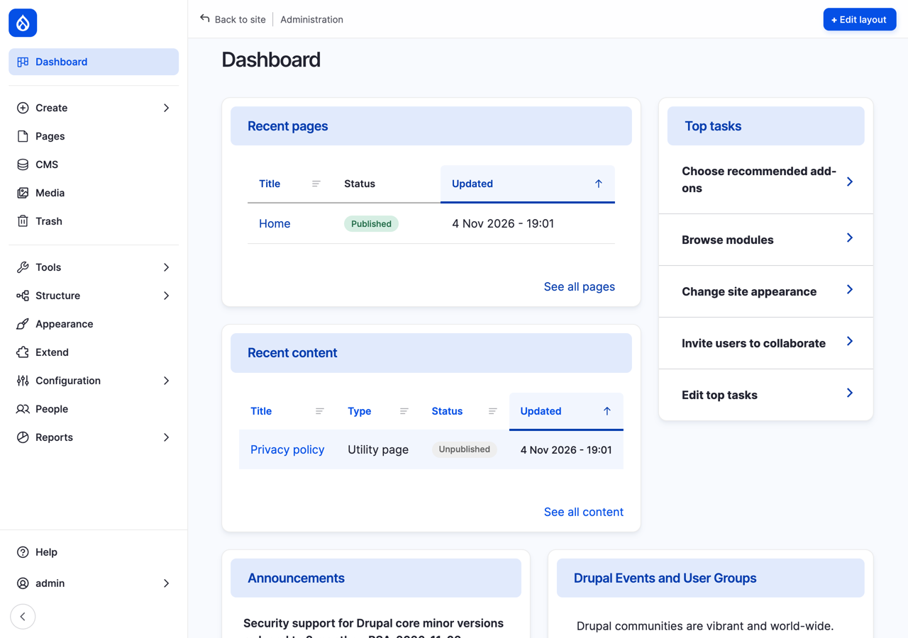
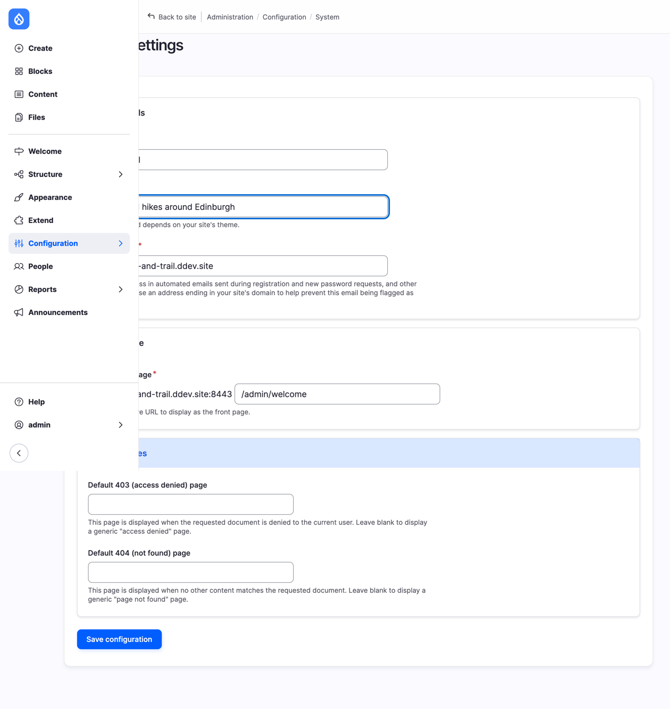
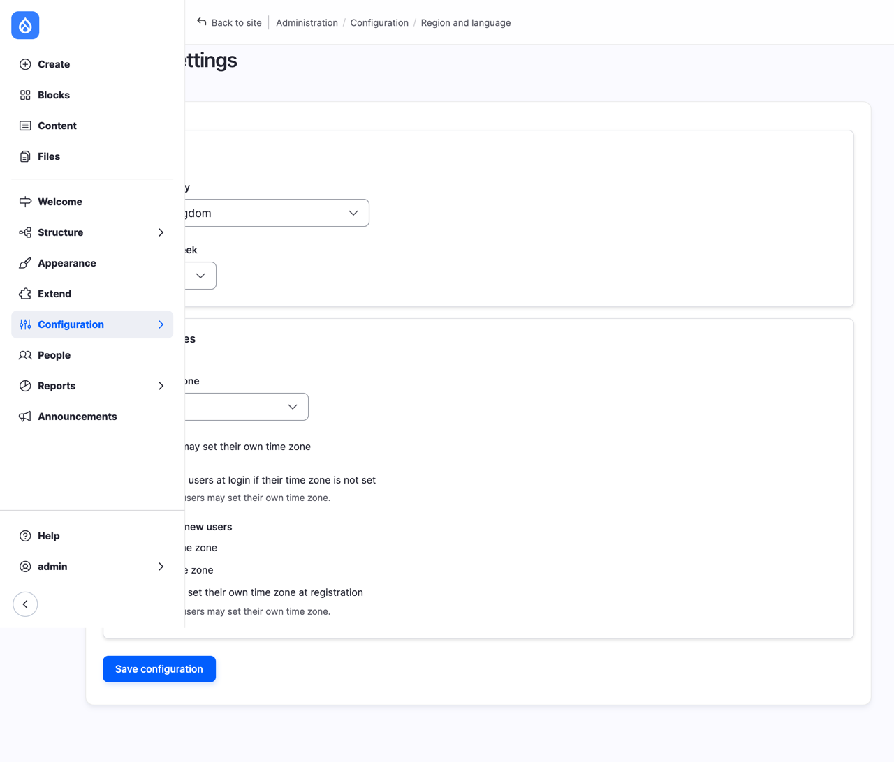
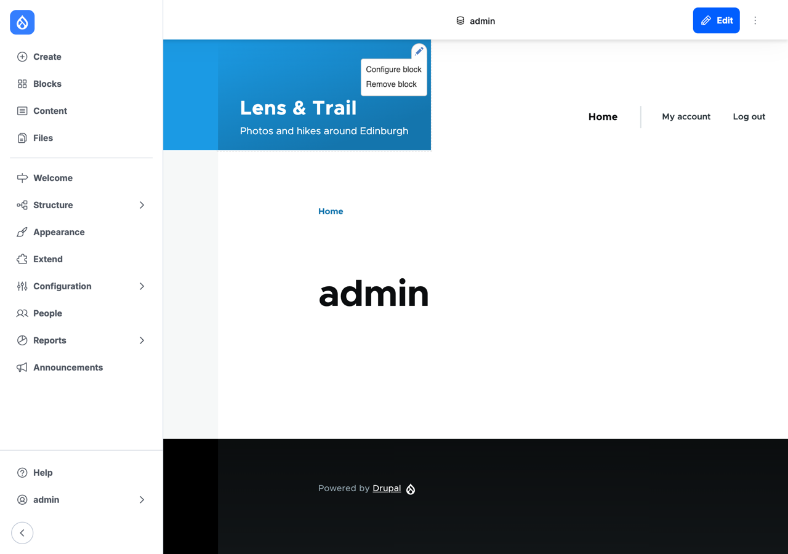
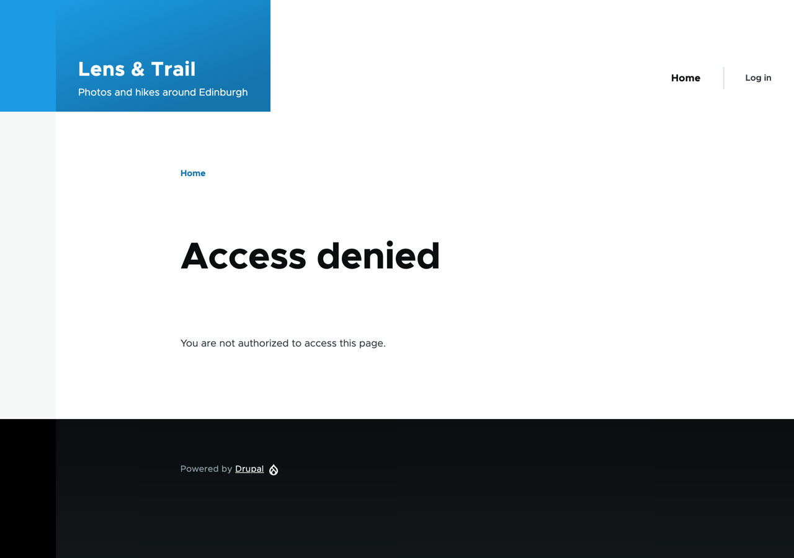

# Finding Your Way Around

When you log in to a new Drupal site, what you see can be a little intimidating: a sidebar full of words like *Structure*, *Extend* and *Configuration*, each hiding a long list of pages with even more cryptic names. Don't worry. In this chapter we go through the sidebar item by item: what's behind each one, why it's there, and which chapter of this book comes back to it. You don't need to remember all of it. The point is that when a later chapter says "go to **Structure** > **Menus**", you'll know roughly where you're going, and why.

We also make our first changes to the Lens & Trail site: the club gets a slogan, and Drupal learns that the club is in the United Kingdom, where the week starts on a Monday. We start where Chapter 4 left us: Drupal 12 installed, Olivero as the theme for visitors, and you logged in as `admin`.

## Two sides of one site

A Drupal site has two sides, and you'll move between them all the time.

- **The site itself**, what visitors see: the club's pages, in the Olivero theme.
- **The administration pages**, where you build and manage the site, in the Default Admin theme. Their addresses start with `/admin`.

They're the same website, at the same address. You don't log in to a separate "back end": when you're logged in as an administrator, you see the site as visitors do, plus the tools to change it. Let's start with those tools.

## The Navigation sidebar

*Figure 5.1: The Navigation sidebar*

The sidebar on the left is called **Navigation**, and it's there on every page when you're logged in, both on the administration pages and on the site itself. It has three parts: content at the top, the site's structure and settings in the middle, and help and your own account at the bottom. Items with an arrow (**>**) open a submenu.

At the very bottom, the arrow button (**<**) collapses the sidebar to a narrow strip of icons, when you need the room. Select it again to bring the labels back.

Let's go through it from the top.

### The Drupal logo

The blue drop at the top isn't a menu item: it takes you to the site's front page, whatever page you're on. When you're completely lost in the administration pages and want to see something familiar, this is the way home. 🙂

### Create

**Create** is a shortcut for adding new content: it lists every *content type* on the site, the kinds of content you can create, such as a page, a hike or a news item. Right now the site has none, so it only says "You have not created any content types yet." We create the first one, Basic page, in Chapter 6, and content types get a chapter of their own in Chapter 7.

### Blocks

**Blocks** lists the site's *content blocks*: small pieces of content, such as a box with the club's opening hours, that you can place in the sidebars, the footer and other places on the site's pages. There are none yet. Blocks are the subject of Chapter 13.

### Content

**Content** (`/admin/content`) is where you'll spend most of your time, once the site is up and running: a list of every piece of content on the site, which you can filter by type and status, and edit or delete. It's empty now; we fill it from Chapter 6 on.

### Files

**Files** lists every file that has been uploaded to the site: photos, documents, and so on, and where each is used. Files and photos come in Chapter 9.

### Welcome

**Welcome** is the page you landed on after the installation, the one that explains Drupal core and Drupal CMS. It has nothing to manage, so once you've read it, you can forget about it.

### Structure

**Structure** is where you build the site: the kinds of content, the menus, the lists, and where things go on the page. Its submenu:

| Item | What it's for | Chapter |
|---|---|---|
| **Block layout** | Which blocks appear in which part of each page, the *regions* of the theme | 12 |
| **Block types** | The kinds of content blocks, and their fields | 12 |
| **Content types** | The kinds of content, and their fields | 7 |
| **Display modes** | Different ways to show the same content, such as in full or as a short teaser | 6 and 7 |
| **Menus** | The site's menus, such as the main menu at the top of every page | 12 |
| **Taxonomy** | Categories and tags, such as places and photo themes | 9 |
| **Views** | Lists of content, such as "upcoming hikes" or "latest photos" | 11 |

### Appearance

**Appearance** (`/admin/appearance`) lists the site's themes, which decide what the site looks like. You were here in Chapter 4, to install Olivero. Themes are the subject of Chapter 15.

### Extend

**Extend** (`/admin/modules`) lists the *modules*: the building blocks that each add a feature to Drupal. Drupal core comes with dozens of them, some installed and some not, and thousands more are on drupal.org. Have a look at the list, but don't install anything yet: Chapter 11 explains how to choose a module, and how to add one.

### Configuration

**Configuration** (`/admin/config`) is the site's settings, grouped by subject: **People**, **System**, **Content authoring**, **User interface**, **Development**, **Media**, **Search and metadata**, **Region and language**, and **Web services**. Every module you install can add its own settings here, so this list grows with the site. Each chapter in this book visits the settings it needs, and in this chapter we change two of them, in "Settings for the club" below.

### People

**People** (`/admin/people`) lists the site's user accounts, and has tabs for their *roles* and *permissions*: who may do what. There's only one user so far: you. Users, roles and permissions are the subject of Chapter 14.

### Reports

**Reports** is where Drupal tells you how it's doing:

- **Status report**: everything Drupal knows about its own health, with errors and warnings at the top. You saw it in Chapter 4.
- **Available updates**: new versions of Drupal and of your modules and themes. Chapter 19 is about updates.
- **Recent log messages**: everything the site has recorded, from logins to errors. When something goes wrong, look here first.
- **Field list**, **Top 'access denied' errors**, **Top 'page not found' errors** and **Views plugins**: more specialized reports, which you'll rarely need.

### Announcements

**Announcements** shows news from drupal.org: new releases, security announcements, DrupalCon dates. It's worth a glance now and then, because it's where you'll hear about important changes first.

### Help

**Help** (`/admin/help`) is Drupal's own manual, built into the site. It starts with a short "Getting Started", then lists **Topics**, such as *Changing basic site settings* or *Managing menus*, with step-by-step instructions, and **Module overviews**, a page about each installed module. When this book doesn't answer a question, the Help page often does, and it always matches the version of Drupal you're running.

*Figure 5.2: Drupal's built-in Help*

### Your account

At the very bottom, the item with your username, **admin**, opens a submenu with **View profile**, **Edit profile** and **Log out**. **Edit profile** is where you change your own email address and password.

You are user number 1, the account created during the installation. User 1 is special in Drupal: it can do everything, whatever the permissions say. That's what you need while you build the site, but it also means the account must be well protected on a live site, and that nobody should use it for day-to-day work. We come back to this in Chapter 14, when the club's members get accounts of their own.

> **On Drupal CMS:** the sidebar has the same parts, with more in it. You land on a **Dashboard** (`/admin/dashboard`) instead of the Welcome page, with recent pages and content, a list of **Top tasks** and the announcements. Under **Content** there are **Pages**, **Media** and **Trash** (deleted content can be restored), and a **Tools** menu has commands developers use, such as clearing caches. **Configuration** has many more settings, because Drupal CMS comes with more modules: SEO, email, workflows, and others. And the administration pages use the Gin theme, which looks a little different from Default Admin, though Gin and Default Admin are close relatives.
>
> 
> *Figure 5.3: The Dashboard in Drupal CMS*

## Settings for the club

Now let's change something. Two pages under **Configuration** hold settings that every site needs, and the club's site needs them right from the start.

### Basic site settings

Go to **Configuration** > **System** > **Basic site settings** (`/admin/config/system/site-information`).

*Figure 5.4: Basic site settings*

1. Under **Site details**, check the **Site name**, `Lens & Trail`, and the **Email address**, `hello@lens-and-trail.ddev.site`. You filled them in during the installation, and this is where you change them later.
2. In **Slogan**, type `Photos and hikes around Edinburgh`. The slogan is a short line that describes the site. Where it appears depends on the theme: Olivero shows it under the site's name, at the top of every page.
3. Leave the rest as it is for now. **Front page** decides which page visitors see at the site's address; we change it in Chapter 6, when the club has a page to show. **Error pages** let you replace Drupal's plain "Access denied" and "Page not found" pages with pages of your own.
4. Select **Save configuration**.

### Regional settings

Go to **Configuration** > **Region and language** > **Regional settings** (`/admin/config/regional/settings`).

*Figure 5.5: Regional settings*

1. Set **Default country** to **United Kingdom**. The installer didn't ask for it, so it's empty. Modules that work with countries, such as address fields, use it as the default.
2. Set **First day of week** to **Monday**. It's Sunday out of the box, as in the United States, but in the United Kingdom, and most of Europe, the week starts on a Monday. Calendars on the site use this setting, so when the club gets a hike calendar, its weeks will start on the right day.
3. Check that **Default time zone** is **London**, as you set it in Chapter 4.
4. Leave the settings under **Time zones** for users as they are. They decide whether members may choose their own time zone; we look at them in Chapter 14.
5. Select **Save configuration**.

## The site, as you see it and as visitors see it

Now go to the site itself: select the Drupal logo at the top of the sidebar. The front page still says Access denied (we fix that in Chapter 6), but look at the top: Lens & Trail, with the slogan under it.

When you're logged in, the site has two things visitors don't see: the Navigation sidebar, and a bar at the top, with the name of the page and, on pages you can change, an **Edit** link. On the front page of your own account, for example (select **admin** > **View profile**), **Edit** takes you straight to the form for your account.

### Contextual links: the pencils

Move the mouse over the site's name, Lens & Trail. A pencil icon appears in the corner of the box around it. Select it, and a small menu opens with **Configure block** and **Remove block**.

*Figure 5.6: A contextual link on the Site branding block*

These are *contextual links*: shortcuts from something on the page straight to the settings for it, without hunting through the sidebar. The box with the name and slogan is a block, called **Site branding**, so its pencil offers the block's settings. Menus, lists of content and the content itself have their own pencils, with their own links, so what the menu offers depends on what you're pointing at.

> **Try it:** Select the pencil on the Site branding block, then **Configure block**. You get a form with checkboxes for **Site logo**, **Site name** and **Site slogan**: you could hide the slogan here, without deleting it from Basic site settings. Don't change anything: go back with your browser's Back button.

### As visitors see it

Open the site's address in a private browser window, where you're not logged in. No sidebar, no top bar, no pencils: only the site, with a **Log in** link at the top where you had **My account** and **Log out**. That's what the club's visitors see, and it's worth checking regularly as you build: something that looks right while you're logged in as user 1 may look quite different, or not be there at all, for a visitor.

*Figure 5.7: The site, as a visitor sees it*

## Summary

You can now:

- tell the administration pages and the site apart, and know they're the same site;
- find your way through the Navigation sidebar, and know which chapter of this book covers each part;
- find Drupal's built-in Help, the Status report, the log messages and the announcements;
- change the site's name, slogan and email address in **Basic site settings**;
- set the site's country, first day of the week and time zone in **Regional settings**;
- use contextual links to go from something on the page straight to its settings;
- check what visitors see, in a private browser window.

## Exercises

1. Find these five pages using only the sidebar, without typing an address: **Text formats and editors**, **Image styles**, **Maintenance mode**, **Date and time formats** and **Recent log messages**. For each, write down where it is in the sidebar, and what you think it's for.
2. On the front page, use the pencil on the main menu (the one with **Home**) to reach the menu's settings. Which links does the menu have? Go back without changing anything.
3. Compare the front page logged in and in a private window. Write down everything that's different.
4. In **Help**, open the topic *Changing basic site settings*, and compare it with what we did in this chapter. Does it mention anything we skipped?
5. *(challenge)* If you installed the Drupal CMS site in Chapter 4, compare its sidebar with the core site's, item by item. What does Drupal CMS add, and where? Which of the extra items do you think the club will need?

## Want to know more?

- [The Drupal User Guide](https://www.drupal.org/docs/user_guide/en/index.html), drupal.org's free book about building a site with Drupal core; [Concept: Administrative Overview](https://www.drupal.org/docs/user_guide/en/config-overview.html) and [Editing Basic Site Information](https://www.drupal.org/docs/user_guide/en/config-basic.html) go with this chapter.
- **Help** (`/admin/help`) on your own site, which always matches your version of Drupal.
