# Your First Page

Up to now, the Lens & Trail site has been an empty house: a name, a slogan, and a front page that tells visitors "Access denied". In this chapter we move in. The club gets its first three pages, *About the club*, *How to join*, and a *Welcome* page that visitors see when they arrive. On the way, you'll learn how Drupal keeps track of every change to a page, how to work on a draft while the old version stays online, and the two ways of laying out a page: Layout Builder in Drupal core, and Drupal Canvas in Drupal CMS.

We start where Chapter 5 left us: Drupal 12 with Olivero, the club's slogan in place, and you logged in as `admin`.

## Content, content types, and nodes

Everything a site's editors write (a page about the club, a news item, a hike) is *content*. Drupal sorts content into *content types*: the kinds of content a site has. Each content type decides which pieces of information its content holds, such as a title, a text, a date or a photo, and each of those pieces is called a *field*. A hike has a date and a meeting place; a page about the club has only a title and a text. That's why they're different content types.

A new Drupal 12 site has no content types at all. You saw this in Chapter 4, and the **Create** menu in the sidebar still says so. That's new: for many years, Drupal's Standard installation came with two content types, *Basic page* and *Article*, but since Drupal 11.4 it leaves the choice to you. So the first thing we build is a content type of our own, Basic page, for pages that rarely change, such as *About the club*. In Chapter 7 we look at content types and fields in depth, and build the club's *Hike* and *News* types.

> **Drupalism: node.** Drupal calls a piece of content a *node*. You'll see the word in addresses, such as `/node/1` for the first page you create, and in older documentation. When this book says "a page" or "a content item", Drupal often says "node". They're the same thing.

## Creating the Basic page content type

Go to **Structure** > **Content types** (`/admin/structure/types`), and select **Add content type**.

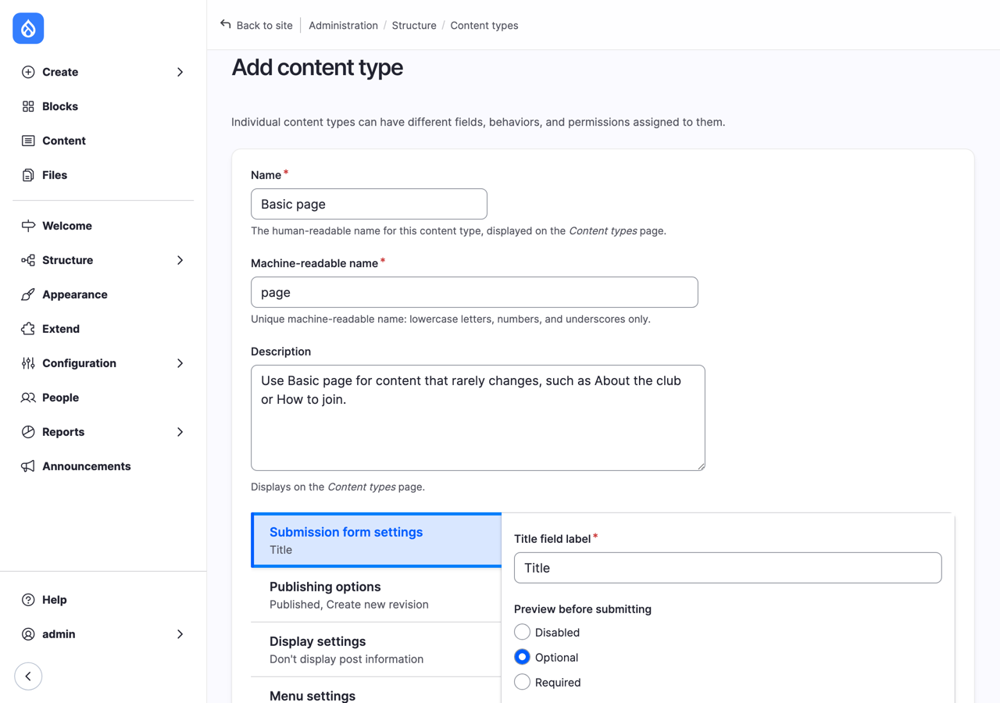
*Figure 6.1: Adding the Basic page content type*

1. In **Name**, type `Basic page`. This is what editors see, in the **Create** menu and on the Content page.
2. Next to the name, Drupal shows a *machine name*: `basic_page`. The machine name is the name Drupal itself uses for the content type, in addresses and in the database, and it can't be changed once the content type is saved. Select **Edit** next to it, and change it to `page`. You don't have to, but for many years Drupal's own Basic page had the machine name `page`, and most documentation and tutorials use it. Keeping it the same makes them easier to follow.
3. In **Description**, type `Use Basic page for content that rarely changes, such as About the club or How to join.` The description helps editors choose the right content type when there are many.

Below the description are four tabs of settings. Go through them one by one.

**Submission form settings** decides what the form for writing a page looks like. **Title field label** is what the title field is called on that form. Every content type has a title, because Drupal uses it as the page's heading, in lists of content, and in the browser tab. But "Title" isn't always the right word for it. On an *Employee* content type, the title is the person's name, so the label should be **Full name**; on a content type for the club's photo competitions, it might be **Competition name**. Changing the label only changes what editors see on the form, so they know what to type. Drupal still treats the field as the title. For Basic page, "Title" is the right word, so leave it. **Preview before submitting** decides whether editors may, or must, preview a page before saving it; leave it at **Optional**. **Explanation or submission guidelines** is a text shown at the top of the form, for house rules such as "Write in short paragraphs". Leave it empty for now.

**Publishing options** are the defaults for every new page of this type:

- **Published**: whether a new page is visible to visitors as soon as it's saved. Leave it on. We come back to drafts later in this chapter.
- **Promoted** and **Sticky at top of lists**: two flags that lists of content can use. *Promoted* marks content as featured, and *sticky* content stays at the top of a list. In older versions of Drupal, Promoted was called "Promoted to front page", because Drupal's front page used to be a list of promoted content. Most sites today have a front page of their own, as Lens & Trail will by the end of this chapter, so leave both off. We meet them again when we build lists of content in Chapter 11.
- **Create new revision**: whether Drupal keeps the old version of a page every time it's changed. Leave it on; it's what makes "Revisions" later in this chapter work.

**Display settings** has one checkbox, **Display author and date information**. On a news item, "Submitted by Ana on 4 May" is useful. On *About the club* it isn't, so uncheck it.

**Menu settings** lists the menus that pages of this type can be added to. **Main navigation**, the menu at the top of every page, is already checked, and that's what we want.

Select **Save and manage fields**.

## Adding a body field

Drupal saves the content type and takes you to its **Manage fields** tab, which says "No fields are present yet." Every content type has a title, but the text of the page needs a field of its own. Traditionally, it's called the *body*.

> **"No fields" is only half true.** Every piece of content already has a set of fields that Drupal itself provides, called *base fields*: the title, the author, when it was created and last changed, whether it's published, its URL alias, and a few more. You'll see them on the form in a moment, but not here, because **Manage fields** only lists the fields you add yourself. We look at base fields in Chapter 7.

1. Select **Create a new field**. A window opens with the types of field Drupal knows about: **Plain text**, **Formatted text**, **Number**, **Reference**, **Date and time**, and more. Select **Formatted text**: text with formatting, such as bold, links and lists, written in a text editor.

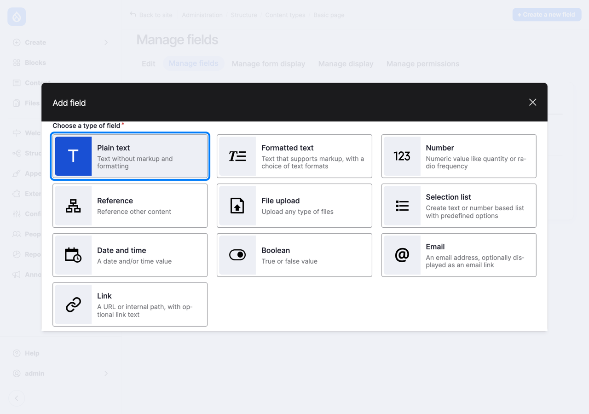
*Figure 6.2: Choosing a type of field*

2. In **Label**, type `Body`. Next to it, Drupal makes the machine name `field_body`; fields you add get `field_` at the front, so you can tell them apart from Drupal's own.
3. Under **Choose a field type**, select **Long text**, for a text of any length, and select **Continue**.

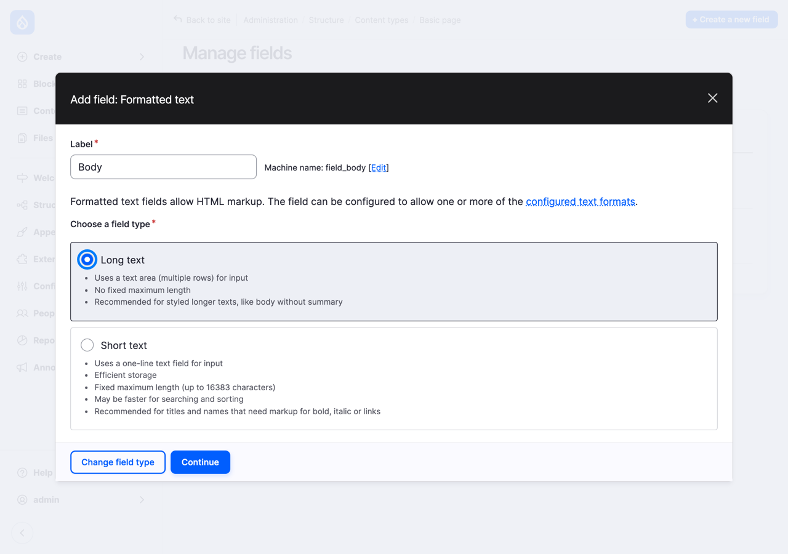
*Figure 6.3: Naming the field, and choosing Long text*

4. Drupal now shows the field's settings. **Allowed number of values** decides whether a page can have one body or several; one is right. **Help text** is shown under the field on the form; **Required field** makes it impossible to save a page without it; and **Allowed text formats** (further down) limits which formats editors may use, which we explain in "Writing the first page". Leave them all as they are, and select **Save**.

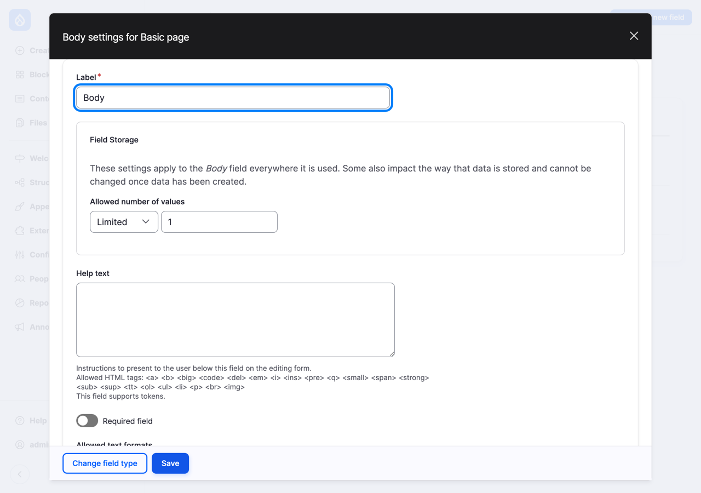
*Figure 6.4: The field's settings*

5. Drupal closes the window, and **Manage fields** now lists **Body**, with its machine name and its type, Long text. **Edit** takes you back to its settings, if you need to change them later.

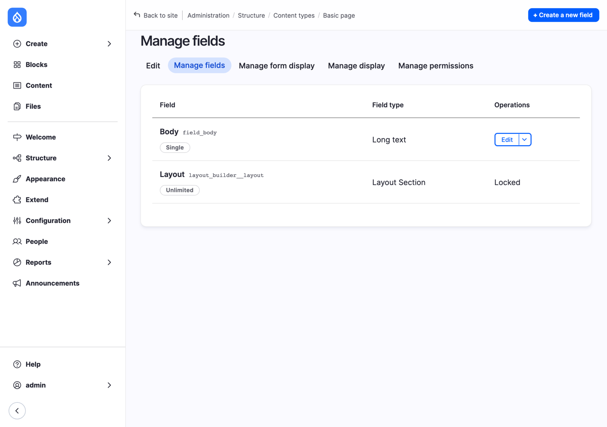
*Figure 6.5: Basic page, with its Body field. (The Layout field appears later in this chapter, when we turn on Layout Builder.)*

The Basic page content type is ready, with a title and a body. We'll come back to its **Manage display** tab in a moment.

> **On Drupal CMS:** you don't need to build anything. Drupal CMS comes with a content type for this, called **Utility page** (with the machine name `page`), and with a second way to make pages, Drupal Canvas, which we look at later in this chapter.

## Writing the first page

Select **Create** > **Basic page** in the sidebar, or go to `/node/add/page`.

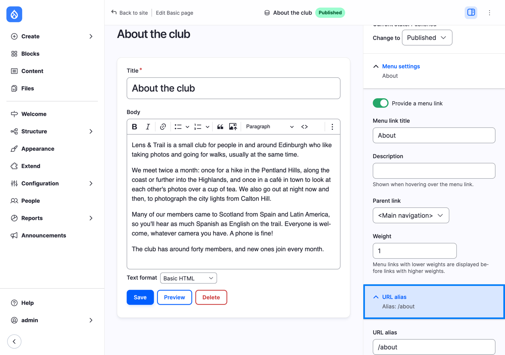
*Figure 6.6: Writing the About the club page*

The form has two parts. On the left is the content itself: **Title** and **Body**. The body field is a text editor, called CKEditor, with buttons for bold, italic, links, lists, quotes, images and headings, much like a word processor's. Under it, **Text format** decides which formatting is allowed. **Basic HTML**, the default, allows the usual formatting and nothing that could break the page or the site's security; **Full HTML** allows everything, and should only be given to people you trust completely. Chapter 13 decides who may use which format.

On the right is everything *about* the content:

- **Revision log message**: a note about what you changed, for yourself and your fellow editors. We come back to it in "Revisions" below.
- **Published**: whether visitors can see the page.
- **Menu settings**: turn on **Provide a menu link** to add the page to the Main navigation. **Menu link title** is the text in the menu, which can be shorter than the page's title. **Weight** decides the order: links with lower weights come first.
- **URL alias**: the page's address. Without one, the page lives at an address such as `/node/1`; with one, it can be `/about`. The alias must start with a slash.
- **Authoring information**: who wrote the page, and when. Drupal fills these in for you.

> **Try it:** Write the club's first page.
>
> 1. **Title**: `About the club`.
> 2. **Body**, in three paragraphs: "Lens & Trail is a small club for people in and around Edinburgh who like taking photos and going for walks, usually at the same time." "We meet twice a month: once for a hike in the Pentland Hills, along the coast or further into the Highlands, and once in a café in town to look at each other's photos over a cup of tea." "Many of our members came to Scotland from Spain and Latin America, so you'll hear as much Spanish as English on the trail. Everyone is welcome, whatever camera you have. A phone is fine!"
> 3. Under **Menu settings**, turn on **Provide a menu link**, type `About` as the **Menu link title**, and set **Weight** to `1`.
> 4. Under **URL alias**, type `/about`.
> 5. Select **Save**.

Drupal shows you the new page, at `/about`, with **About** in the menu at the top. Congratulations: the club has its first page! 🙂

Look closely, though. Above the text, Olivero shows the word **Body**: the field's *label*. Drupal shows field labels by default, which makes sense for a field such as "Meeting place", but not for the body. Let's hide it.

1. Go to **Structure** > **Content types**, and select **Manage display** for Basic page.
2. Drupal lists the *view modes* of the content type: the ways a page can be shown. **Default** is the only one in use; select **Manage** next to it.
3. In the row for **Body**, set **Label** to **- Hidden -**, and select **Save**.

Reload the About page: the label is gone. **Manage display** decides how every page of the content type is shown: which fields appear, in which order, and how. We use it again for Layout Builder later in this chapter, and Chapter 7 explains view modes.

> **Try it:** Create two more Basic pages.
>
> - `How to join`, with the body "Come along to one of our hikes or photo evenings first, to see whether the club is for you. You don't need to tell us in advance." "If you'd like to become a member, talk to the secretary on the day, or send an email to hello@lens-and-trail.ddev.site." "Membership is £20 a year (£10 for students). It covers the room for the photo evenings and the club's insurance for the hikes." Give it a menu link titled `Join us`, with **Weight** `2`, and the URL alias `/join`.
> - `Welcome to Lens & Trail`, with the body "We're a photography and hiking club in Edinburgh. We walk, we take photos, and we share them." "Read more about the club, or find out how to join." No menu link, and the URL alias `/welcome`.
>
> Then go to **Content** (`/admin/content`). All three pages are there, with their type, author, status, and when they were last changed.

> **On Drupal CMS:** a module called *Pathauto* makes the URL alias for you, from the page's title, so you rarely type one. Drupal core doesn't have it; we add it to the core site in Chapter 15, which is about addresses and search engines.

## Setting the front page

The site's front page is still the Welcome page from the installation, which visitors aren't allowed to see. Let's make the club's own Welcome page the front page.

First, find the Welcome page's number. Go to **Content**, and move the mouse over its **Edit** button: your browser shows the link's address at the bottom of the window, something like `/node/3/edit`. The number in the middle, here 3, is the page's number, and `/node/3` is its address that never changes.

1. Go to **Configuration** > **System** > **Basic site settings** (`/admin/config/system/site-information`).
2. Under **Front page**, set **Default front page** to `/node/3` (with your own page's number).
3. Select **Save configuration**.

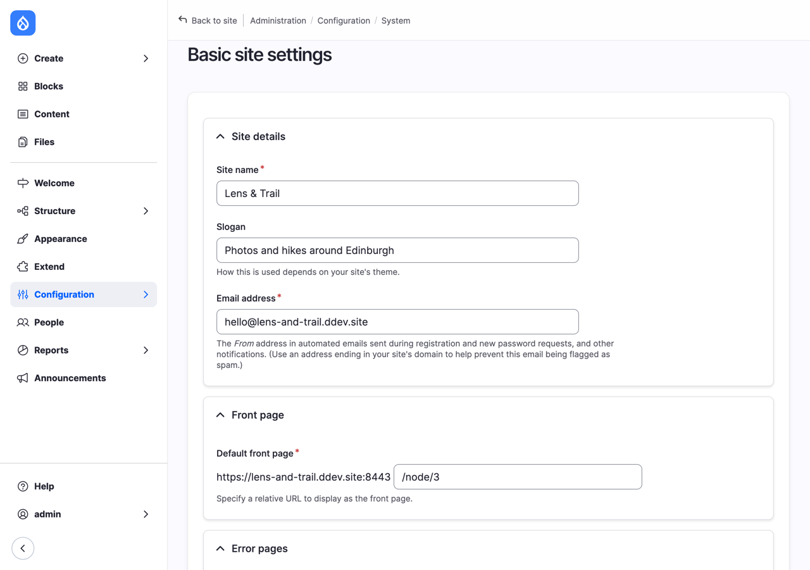
*Figure 6.7: The front page setting*

Why `/node/3`, and not `/welcome`? Drupal accepts both, but it stores exactly what you type. If an editor ever changes the Welcome page's alias, say to `/welcome-to-lens-and-trail`, a front page set to `/welcome` breaks, while `/node/3` keeps working.

Now open the site in a private browser window. Instead of "Access denied", visitors see the club's Welcome page, with **Home**, **About** and **Join us** in the menu.

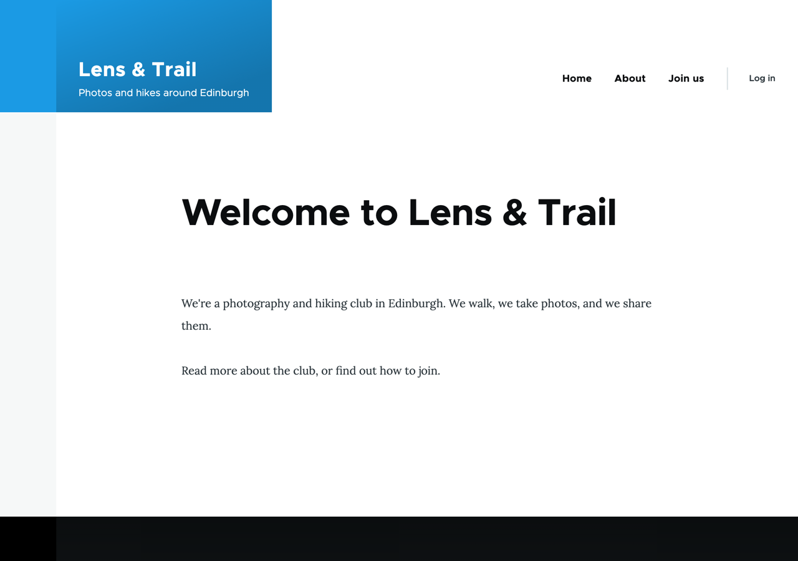
*Figure 6.8: The new front page, as a visitor sees it*

The Welcome page is short for now. When the club has hikes and photos, we'll give the front page lists of the next hikes and the newest photos, in Chapter 11.

## Revisions

Every time you save a page, Drupal can keep the previous version, called a *revision*. That's what **Create new revision** in the content type's settings was about. Revisions are a safety net: when someone deletes a paragraph by mistake, or writes something that shouldn't have gone online, you can go back.

> **Try it:** Edit *About the club*. At the end of the second paragraph, add "We also go out at night now and then, to photograph the city lights from Calton Hill." In **Revision log message**, type `Added the night walks.`, and select **Save**.

Now select the **Revisions** tab at the top of the page. (On the site itself, it's under the **More actions** menu, the three dots in the top bar.)

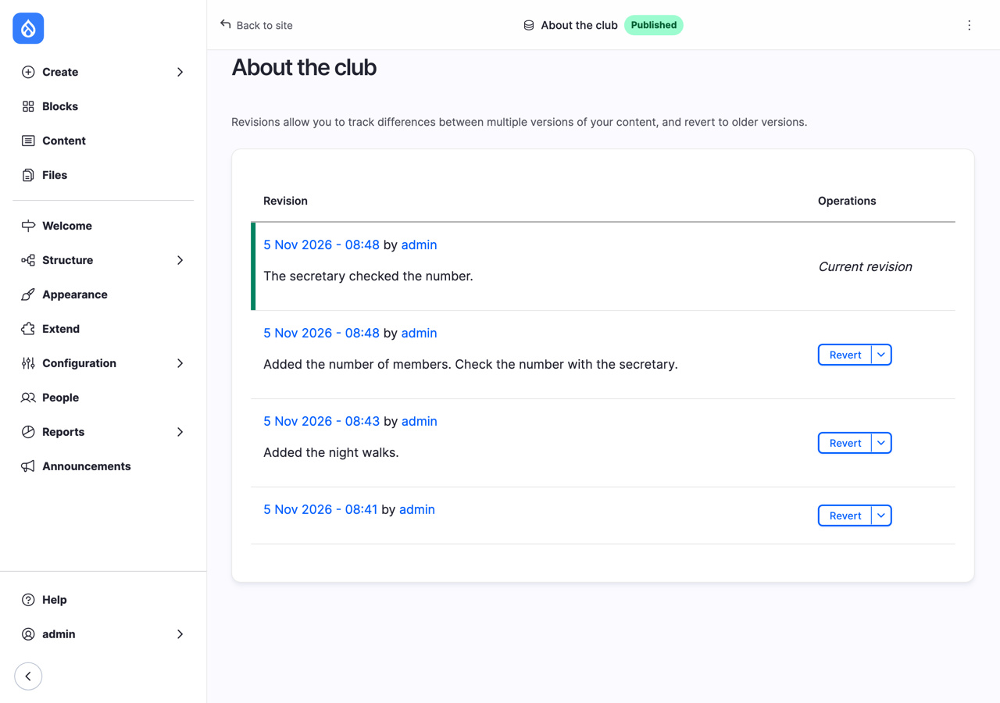
*Figure 6.9: The page's revisions*

The list has one line per revision, the newest first: when, by whom, and the log message. That's why the log message matters: "Added the night walks." tells your fellow editors what changed, months later, without having to compare the two versions. Select the date of an older revision to see the page as it was then, and **Revert** to make that version the current one again. Reverting doesn't delete anything: Drupal saves the old version as a new revision, so you can always change your mind again.

The list only shows revisions that changed the content itself. If you only change the page's menu link, Drupal saves a revision, but doesn't list it.

> **Drupal core can't compare revisions side by side.** To see exactly which words changed between two revisions, you need a contributed module called *Diff*. Chapter 10 shows how to add modules like it.

## Drafts and reviews: content moderation

The **Published** switch has two positions: online or not. That's enough for a small site, but it has a gap. Say the secretary wants to rewrite *How to join*, and have someone check the new text before it goes online. If they switch the page to unpublished, the page disappears from the site while they work on it. If they leave it published, every change goes online the moment they save.

*Content moderation* fills the gap. With it, a page has a *state*, such as Draft or Published, and a published page can have a draft of its next version: visitors keep seeing the published version, while the editors work on the draft.

Content moderation is part of Drupal core, but it isn't installed. Let's install it.

1. Go to **Extend** (`/admin/modules`).
2. Find **Content Moderation** (type "moderation" in the filter at the top), check it, and select **Install**. Content Moderation needs another core module, **Workflows**, so Drupal installs it too; if it asks first, select **Continue**.

A *workflow* is a set of states, and the steps between them, called *transitions*. Installing Content Moderation creates one for you, called **Editorial**. Go to **Configuration** > **Workflow** > **Workflows** (`/admin/config/workflow/workflows`), and select **Edit** for it.

- Its **States** are **Draft**, **Published** and **Archived**. An archived page is no longer online, but it isn't deleted either.
- Its **Transitions** are the moves between them: **Create New Draft**, **Publish**, **Archive**, **Restore to Draft** and **Restore**. In Chapter 13, we decide who may make which move: hike leaders may write drafts, for example, and only the secretary may publish them.
- Under **This workflow applies to**, select **Select** next to **Content types**, check **Basic page**, and select **Save**. Then select **Save** at the bottom of the page.

Now edit *About the club*. The **Published** switch is gone. In its place, the form shows the page's **Current state**, Published, and a **Change to** list with Draft, Published and Archived.

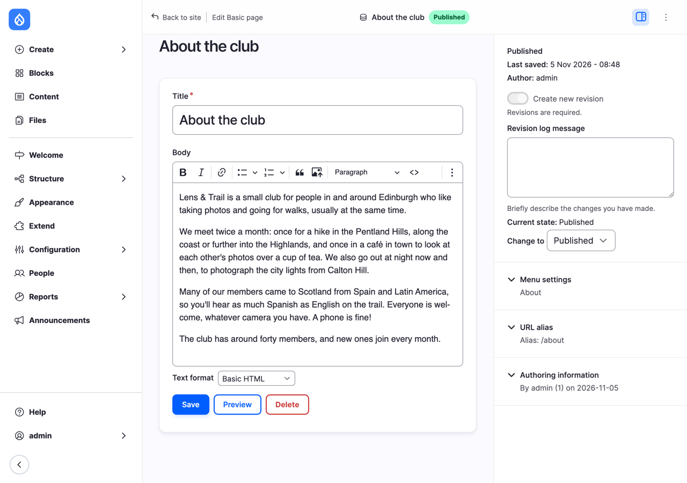
*Figure 6.10: The moderation state on the form*

> **Try it:** Add a fourth paragraph to *About the club*: "The club has around forty members, and new ones join every month." Set **Change to** to **Draft**, write the log message `Added the number of members. Check the number with the secretary.`, and select **Save**.
>
> Now look at the page in a private window: visitors still see the published version, without the new paragraph. Logged in, you see a **Latest version** tab with the draft, and at the bottom of it a small form: **Change to** **Published**, a **Log message**, and **Apply**. Type `The secretary checked the number.` and select **Apply**. The draft is now the published version.

To see every draft on the site, go to **Content**, and select the **Moderated content** tab (`/admin/content/moderated`).

> **On Drupal CMS:** content moderation is already installed, with a workflow called **Basic editorial** for Utility pages. Drupal CMS also comes with the *Scheduler* module, which publishes or unpublishes content at a time you choose, such as the morning the hike programme goes online.

## Laying out a page

So far, every Basic page looks the same: the title, then the body. That's because of **Manage display**: it decides, for every page of the content type, which fields are shown, and in what order. This is the classic way to build a Drupal site, and for content with a fixed structure, such as a hike, it's still the best way: every hike looks the same, and editors fill in fields instead of arranging the page.

Sometimes, though, you want to arrange a page yourself: two columns, a box on the side, a big photo at the top. Drupal has two tools for this, and you'll meet both in real projects:

- **Layout Builder**, part of Drupal core. You divide the page into *sections* with columns, and place *blocks* in them: the page's own fields, menus, lists, or boxes of text. It works on a content type's display, and, if you allow it, on a single page.
- **Drupal Canvas**, the page builder that comes with Drupal CMS. You build the page in a visual editor, from *components* such as headings, texts, cards and grids, and see the result as you work.

Neither is the "right" one. Canvas is newer and more visual, and it's where Drupal CMS is heading. Layout Builder has been in core since Drupal 8.7, and many developers prefer it, or prefer plain field displays, because they keep pages consistent. We build *How to join* both ways, and you can judge for yourself.

### Layout Builder

Layout Builder is already installed on your site: the Navigation sidebar uses it, so Drupal installs it with the sidebar. We only have to turn it on for Basic page.

1. Go to **Structure** > **Content types** > **Manage display** for Basic page, and **Manage** the **Default** view mode.
2. At the bottom, under **Layout options**, check **Use Layout Builder**.
3. Check **Allow each content item to have its layout customized**. Without it, every Basic page shares one layout, which you design once for the content type, its *template*. With it, each page can also have a layout of its own.
4. Select **Save**.

The field list disappears, and a **Manage layout** button takes its place: from now on, the layout decides how a Basic page is shown. Every page still uses the template, which shows the body, so nothing changes on the site yet.

Now let's give *How to join* two columns: the text on the left, and the club's meeting times in a box on the right.

1. Go to the *How to join* page, and select **Layout** in the **More actions** menu (or go to `/node/2/layout`). You see the page in editing mode, with the message "You are editing the layout for this Basic page content item."
2. Select **Add section** at the top. A panel opens on the right, with the layouts to choose from: **One column**, **Two column**, **Three column** and **Four column**. (**Navigation layout** is the sidebar's own, and of no use on a page.) Select **Two column**.
3. Set **Column widths** to **67%/33%**, and select **Add section**.
4. In the new section, select **Add block** in the **Second region**, then **Create content block**. Type `When and where` as the **Title**, and as the **Body**: "Hikes: every other Saturday, at 9:30. We send the meeting place to everyone who is coming a week before." and "Photo evenings: the first Thursday of the month, at 19:00, in the back room of a café in Leith." Select **Add block**.
5. Select **Add block** in the **First region**. Under **Content fields**, select **Body**, set **Label** to **- Hidden -**, and select **Add block**.
6. The old one-column section is still below, with the body in it a second time. Select **Remove Section 2**, and confirm with **Remove**.
7. At the top, write `Two columns, with the meeting times on the right.` in **Revision log message**, and select **Save layout**.

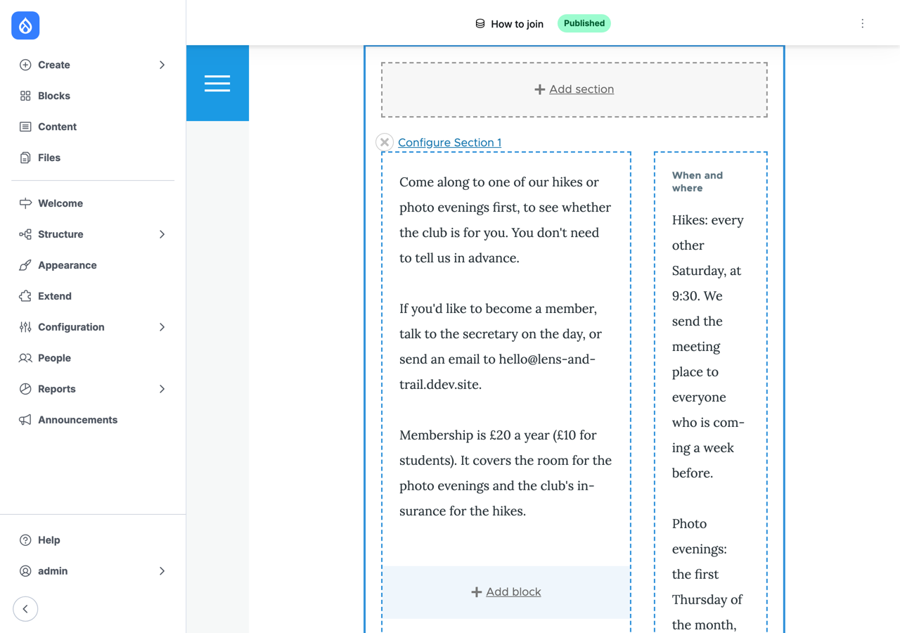
*Figure 6.11: Editing the layout of How to join*

Until you select **Save layout**, nothing changes for visitors: Layout Builder keeps your work as a draft, and says "You have unsaved changes." **Discard changes** throws the draft away. **Revert to defaults** removes the page's own layout, so it uses the content type's template again.

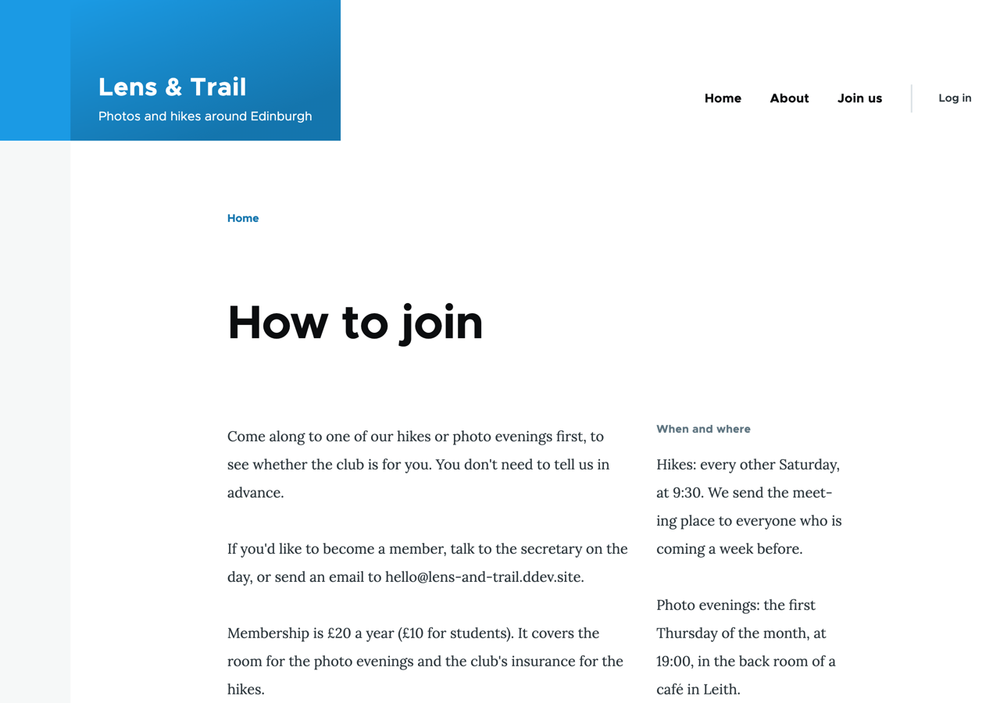
*Figure 6.12: How to join, laid out with Layout Builder*

The *When and where* box is a block that belongs to this page only. Chapter 12 is about blocks you can reuse on many pages, such as a box in every page's footer.

### Drupal Canvas

> **On Drupal CMS:** Canvas is part of Drupal CMS, but it doesn't support Drupal 12 yet: its newest version, 1.12.0, needs Drupal 11.3 or later, but not 12. So we build the Canvas version of *How to join* on the Drupal CMS site from Chapter 4, if you made one.
>
> In Canvas, a page isn't a node with a body field. It's a kind of content of its own, called **Page**, with its own list under **Pages** in the sidebar (`/admin/content/pages`). Select **Add Page**, and the Canvas editor opens.
>
> 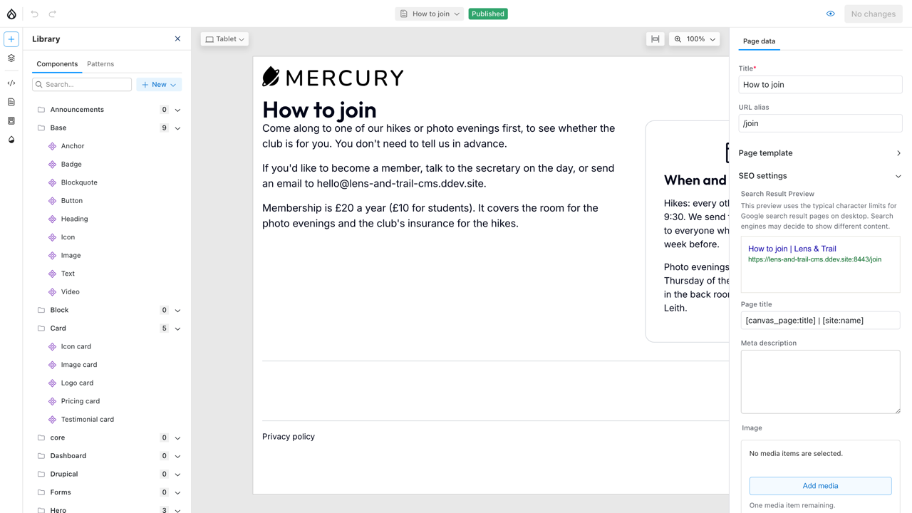
> *Figure 6.13: The Canvas editor*
>
> In the middle is the page, as visitors will see it, in the site's theme (Mercury, on the Starter template). Above it, you can switch between desktop, tablet and phone sizes. On the left is a row of buttons:
>
> - **Library**: the *components* you can put on the page. **Base** has the simple ones, such as **Heading**, **Text**, **Image** and **Button**; **Card** and **Hero** have bigger boxes; **Layout** has **Grid**, **Section** and **Group**, which hold other components.
> - **Layers**: the page's components as a tree, which is often the easiest way to select one, or to see what's inside what.
> - **Code**, **Pages**, **Templates** and **Brand kit**: writing your own components, the list of pages, the templates pages are built on, and the site's colors and fonts. We leave them for now; building your own component is a topic for later.
>
> On the right, **Page data** has the page's **Title**, **URL alias** and **SEO settings**, and when you select a component, a **Settings** tab with that component's settings.
>
> To build *How to join*:
>
> 1. In **Page data**, type `How to join` as the **Title** and `/join` as the **URL alias**.
> 2. Open the **Library**, and drag a **Heading** onto the page, where it says "Place items here". Its settings open on the right: type `How to join` as the **Heading**, and set **Heading level** to **1**.
> 3. Drag a **Grid**, from **Layout**, onto the page below the heading. Set **Columns** to **2 columns 67%-33%**.
> 4. Drag a **Text** into the grid, and replace the example text with the three paragraphs of *How to join*.
> 5. Drag an **Icon card** into the grid, after the text. Set **Icon name** to `calendar-dots`, **Heading** to `When and where`, **Description** to the meeting times, and **Text alignment** to **Left**.
> 6. Canvas saves your work as you go, as a draft. When the page looks right, select **Review 1 change** at the top right, check **How to join**, and select **Publish 1 selected**.
>
> If a component lands in the wrong place, and with drag and drop it will, right-click it in **Layers**, and use **Move** > **Move up**, **Move down**, or **Move into**, to put it inside the grid.
>
> 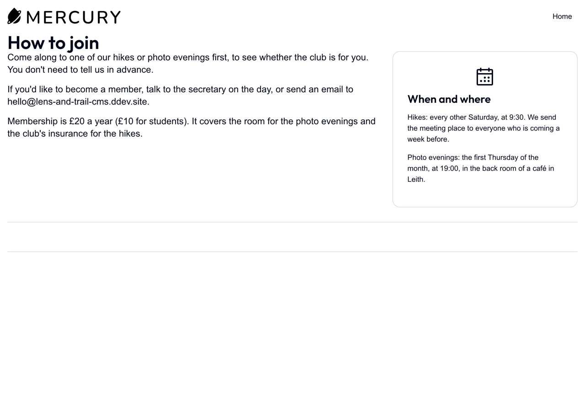
> *Figure 6.14: How to join, built with Canvas*

### Which one should I use?

| | Field display | Layout Builder | Drupal Canvas |
|---|---|---|---|
| Where it comes from | Drupal core | Drupal core | Drupal CMS (a contributed module) |
| Who arranges the page | The site builder, once per content type | The site builder for the template; editors per page, if allowed | Editors, per page |
| What you arrange | Fields | Sections and blocks | Components |
| Best for | Content with a fixed structure: hikes, news, events | Content types where some pages need their own layout | Landing pages and one-off pages |

Many sites use more than one: plain field displays for hikes and news, and Canvas or Layout Builder for the front page and a few special pages.

> **Coming from WordPress?** Canvas will feel familiar: like the WordPress block editor, you build a page from pieces (Canvas calls them components, WordPress calls them blocks) and see the result as you go. Two differences matter. A Drupal *block* is something else, a box placed on the page, closer to a WordPress widget (see the box in Chapter 1). And in Drupal, structured content such as a hike usually isn't laid out by hand at all: it has fields, and the content type's display decides how every hike looks.

## Deleting content, and the Trash

To delete a page, edit it and select **Delete** at the bottom of the form. On Drupal core, Drupal asks you to confirm, and warns that "This action cannot be undone." It means it: the page and all its revisions are gone.

Before you delete, think about unpublishing instead. An unpublished page, or an archived one with content moderation, disappears from the site, but you can bring it back whenever you like.

> **On Drupal CMS:** deleting moves content to the **Trash** (in the sidebar, or `/admin/content/trash`), where you can **Restore** it, or delete it for good. The confirmation says so: "Deleting this content item will move it to the trash." Trash is a contributed module, and it supports Drupal 12, so if you'd like a safety net on the core site too, you can add it there. Chapter 10 shows how.
>
> 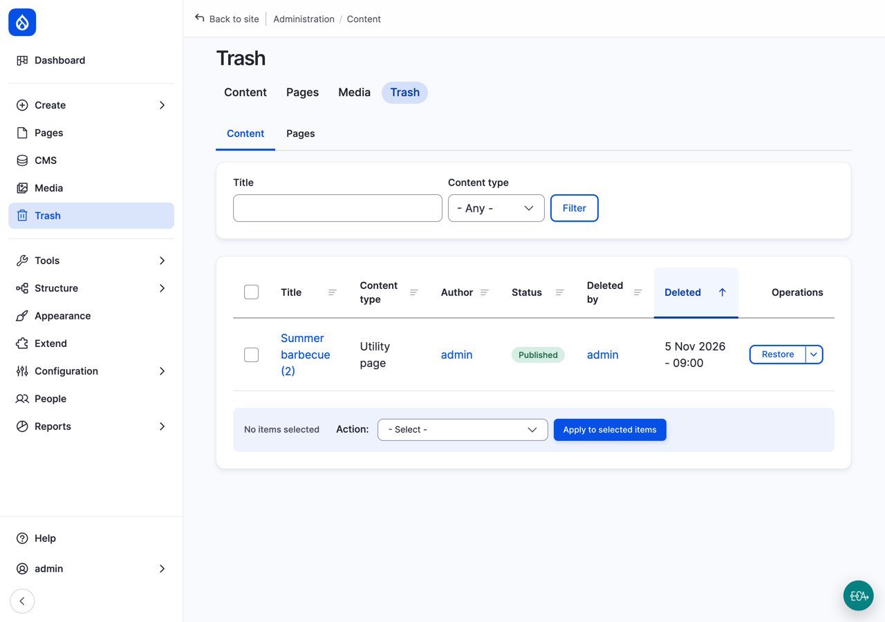
> *Figure 6.15: The Trash in Drupal CMS*

## Summary

You can now:

- create a content type, and add a body field to it;
- write a page, with a menu link and a URL alias;
- hide a field's label in the content type's display;
- set the site's front page, by the page's own address;
- see a page's revisions, and go back to an older one;
- install Content Moderation, and work on a draft while the published version stays online;
- lay out a page with Layout Builder, and, on Drupal CMS, with Canvas;
- tell when to use a field display, Layout Builder, or Canvas;
- delete content, and know when it can and can't be restored.

## Exercises

1. Create a fourth Basic page, *Photo tips for beginners*, with three tips of your own, a menu link with **Weight** `3`, and the alias `/photo-tips`. Check that it appears in the menu, in the right place.
2. Edit *Photo tips for beginners* three times, with a log message each time. Then revert it to the first version. How many revisions does the page have now, and why?
3. Change the Welcome page's URL alias to `/welcome-to-lens-and-trail`. Does the front page still work? What would have happened if the front page had been set to `/welcome`?
4. With content moderation, archive *Photo tips for beginners*. What do visitors see at `/photo-tips` now? Where can you find the page, and how do you bring it back?
5. Use Layout Builder to give *About the club* a layout of its own, with a box on the side that says when the club was founded (make up a year). Then select **Revert to defaults**. What happens to the box?
6. *(challenge)* Change the Basic page *template*, at **Manage display** > **Manage layout**, so that every page has a one-line box at the bottom: "Questions? Write to hello@lens-and-trail.ddev.site." Which pages get the box, and which don't? Why?

## Want to know more?

- The Drupal User Guide, drupal.org's free book about Drupal core: [Adding a Content Type](https://www.drupal.org/docs/user_guide/en/structure-content-type.html), [Creating a Content Item](https://www.drupal.org/docs/user_guide/en/content-create.html), [Editing a Content Item](https://www.drupal.org/docs/user_guide/en/content-edit.html), and [Designating a Front Page for your Site](https://www.drupal.org/docs/user_guide/en/menu-home.html).
- [Layout Builder](https://www.drupal.org/docs/8/core/modules/layout-builder), drupal.org's documentation of the module, with templates and per-page layouts.
- [Content Moderation](https://www.drupal.org/docs/8/core/modules/content-moderation/overview) and [Workflows](https://www.drupal.org/docs/8/core/modules/workflows/overview), on drupal.org.
- [Drupal Canvas](https://www.drupal.org/project/canvas) and [Trash](https://www.drupal.org/project/trash), the project pages of the two contributed modules, with their newest versions and the Drupal versions they support.
- [The WordPress Block Editor](https://wordpress.org/documentation/article/wordpress-block-editor/), on wordpress.org, if you'd like to compare.
