# Everything Is an Entity

In Chapter 6, the club got its first pages: a content type, Basic page, with one field of its own, the body. That's enough for *About the club*, but not for the heart of the site, the hikes. In this chapter we build the club's **Hike** content type, with a field for every piece of information a hike has, and a **News** content type next to it. On the way, you'll learn what Drupal means by an *entity*, the idea that the title of this chapter is about, which kinds of field Drupal has, and how to shape the form editors fill in.

We start where Chapter 6 left us: the Basic page content type with its Body field, the pages *About the club*, *How to join* and *Welcome*, and content moderation with the Editorial workflow.

## Why a hike isn't a Basic page

We could write the hikes as Basic pages. The title would be the hike's name, and the body would say something like "Saturday 21 November, 9:30, Flotterstone car park, about 11 km, some climbing." It would work, for a while.

The trouble is that Drupal can't read. To Drupal, that body is a block of text. It doesn't know which part is the date, so it can't show the next five hikes in date order, or hide the ones that are over. It can't list only the easy hikes for beginners, or every hike Ana leads. And every editor writes the details a little differently: one writes "21/11", another "Sat 21st", and a third forgets the meeting place altogether.

So we give each piece of information its own *field*: a date field for the date, a number for the distance, a list to choose the difficulty from. Editors fill in a form, Drupal checks what they type (a date must be a date), and because Drupal knows what each piece is, it can sort, filter and display it. This is called *structured content*, and it's what Drupal is best at. We use it to build lists of hikes in Chapter 12.

## Entities: the things Drupal stores

A Drupal site stores many kinds of things: pages and hikes, but also the people who log in, the tags on a photo, the photos themselves, and the boxes of text placed on a page. Drupal has one name for all of them: each of these things is an *entity*. A kind of entity is an *entity type*. A hike is an entity of the entity type *Content*; Ana's user account is an entity of the type *User*.

The reason this matters to you, and the reason for this chapter's title, is that entity types work alike. Once you know how to add a field to a content type, you know how to add one to a user account or a photo, because it's the same screen and the same steps. Learn it once, and you can use it everywhere. These are the entity types you'll meet in this book:

| Entity type | What it is | Its kinds are called | In this book |
|---|---|---|---|
| Content | Pages, hikes, news | Content types | Chapters 6 to 8 |
| User | A person with an account on the site | (only one kind) | Chapter 14 |
| Taxonomy term | A category or a tag, such as "Pentland Hills" | Vocabularies | Chapter 10 |
| Media | A photo, a video, a document | Media types | Chapter 9 |
| Content block | A box of content placed on pages | Block types | Chapters 8 and 13 |

Most entity types can be divided into kinds, as content is divided into content types, and each kind can have fields of its own: a hike has a date, a news item doesn't. A user has only one kind, but it can still have fields. Say the club wants a phone number for every member: you add a field to the user account, with the same steps as for a hike.

Here's an example of how far that goes. Say the club adds an **Email** field to its *How to join* page, for the secretary's address, and also stores every member's email address on their user account. Both are fields of the same field type, Email, so they behave the same: Drupal checks that what you type looks like an email address, and can show it as a link that opens your email program. If you later want every email address on the site shown as "hello [at] lens-and-trail.ddev.site", to make life harder for spammers, you change it once for that field type, not once per place.

Not everything in Drupal is an entity you can add fields to. Files, URL aliases and menu links are entities too, but Drupal manages their structure itself.

> **Drupalism: bundle.** Drupal's general word for "a kind of entity within an entity type" is *bundle*. A content type is a bundle of Content; a vocabulary is a bundle of Taxonomy term; a media type is a bundle of Media. You'll see the word in documentation and error messages, rarely on screen. When you do, read "content type, vocabulary, or media type, whichever fits".

> **A content type holds no content.** A content type is a set of rules: which fields a hike has, what the form looks like, how a hike is displayed. The hikes themselves are the content. Drupal stores the rules as *configuration*, the site's settings, and the hikes as *content*, and treats the two differently: when you move a site from your computer to a server, you move the configuration, while the content is written on the live site. We do exactly that in Chapter 20.

### Fields you add, and fields Drupal adds

In Chapter 6, we met *base fields*: the fields every content item has, because Drupal itself provides them, such as the title, the author, and when it was created. The fields you add yourself are listed on **Manage fields**, and their machine names start with `field_`. Both kinds are fields in the same sense: they hold a value, have a widget on the form, and are displayed in the same way. The difference is who decides they exist: Drupal, for every content type, or you, for one content type at a time.

## The field types

When you select **Create a new field**, Drupal asks you to choose a *field type*: what kind of information the field holds. The field type decides how the value is stored, what the form shows, and what Drupal checks. Most types have a second choice once you've picked them. Here's what Drupal 12 offers, with an example from the club for each:

| Field type | Its choices | For example |
|---|---|---|
| **Plain text** | Short text, Long text | A hike's meeting place |
| **Formatted text** | Long text, Short text | The body of a page, with bold, links and lists |
| **Number** | Integer (whole numbers), Decimal | The maximum number of participants; a hike's distance |
| **Reference** | Content, Taxonomy term, User, Other | The member who leads a hike |
| **File upload** | File, Image | A route description as a PDF |
| **Selection list** | Text, Integer | A hike's difficulty: Easy, Moderate or Hard |
| **Date and time** | Datetime, Timestamp | The day and time of a hike |
| **Boolean** | | "Dogs welcome": yes or no |
| **Email** | | The secretary's email address |
| **Link** | | A link to the route on a map |

A *reference* field is the most powerful of them. Instead of holding a value, it points to another entity: a hike points to the user who leads it, and later, a photo will point to the hike it was taken on. That's how Drupal connects things.

Modules add more field types. Drupal core has modules for **Telephone**, **Date range** and **Comments** that aren't installed on our site; installing one adds its field type to the list. The **Media** module (Chapter 9) adds a reference to media. Contributed modules add many more, such as *Address*, for postal addresses with the right format for each country. We look at installing modules in Chapter 11.

## Building the Hike content type

Let's build it. The first steps are the same as for Basic page in Chapter 6, so we go through them more quickly.

1. Go to **Structure** > **Content types** (`/admin/structure/types`), and select **Add content type**.
2. Type `Hike` as the **Name**. The machine name becomes `hike`.
3. As the **Description**, type `A hike or photo walk the club organizes, with its date, meeting place, distance and difficulty.`
4. Under **Display settings**, uncheck **Display author and date information**. "Submitted by admin" says nothing useful about a hike: we'll have a field for the hike leader instead.
5. Under **Menu settings**, uncheck **Main navigation**. These checkboxes decide which menus a hike *may* be placed in. Hikes come and go every two weeks, and they don't belong in the main menu: they'll be in a list, which we build in Chapter 12. With no menu checked, editors don't even see the menu settings on the hike form, which is one less thing to get wrong.
6. Select **Save and manage fields**.

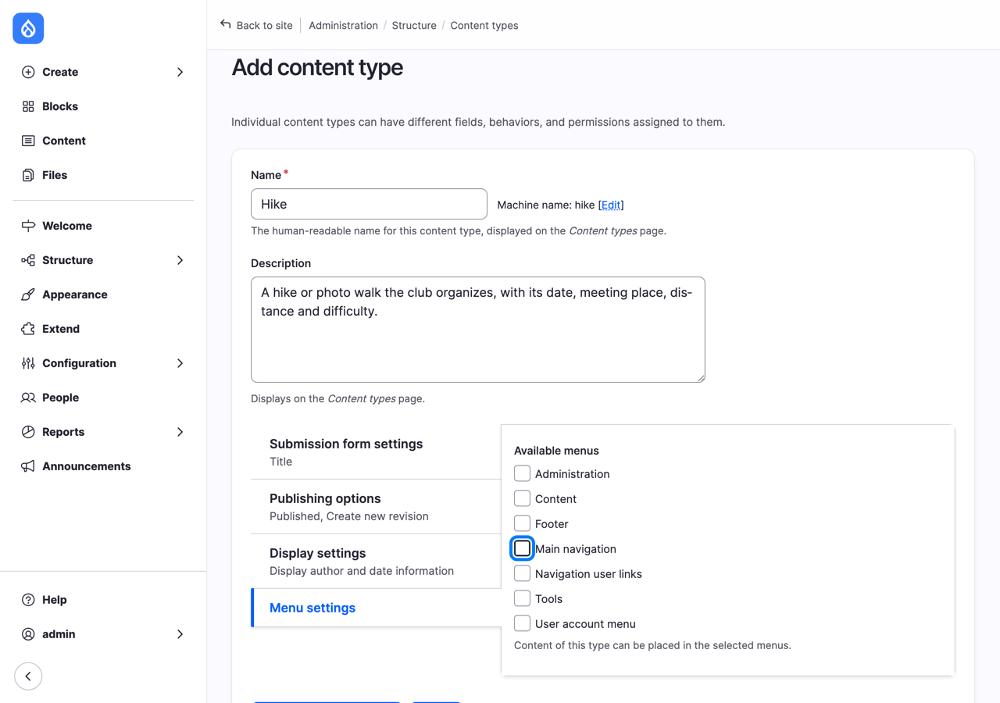
*Figure 7.1: Adding the Hike content type*

### Re-using the Body field

A hike needs a text that describes it: the route, the views, what to bring. Basic page already has a field for that, the body. Instead of creating a new one, we re-use it.

1. On **Manage fields** for Hike, select **Re-use an existing field**. A window opens with the fields that other content types have, and Hike doesn't yet. There's one: `field_body`, a **Long text**, and the content types that use it, so far only Basic page.

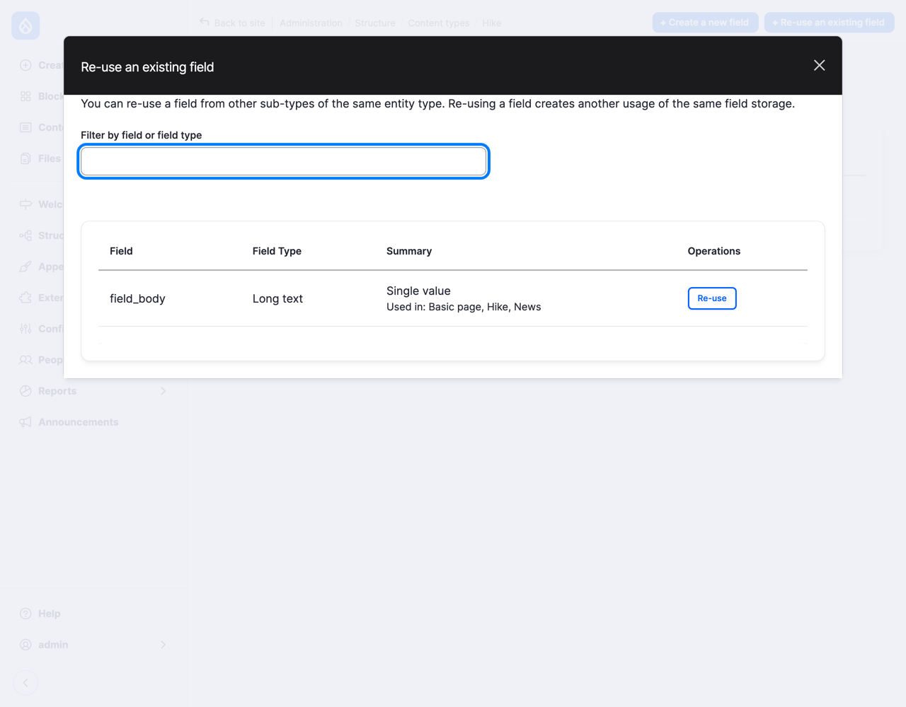
*Figure 7.2: Re-using the Body field*

2. Select **Re-use**. Drupal adds the field to Hike, and takes you to its settings.
3. Change the **Label** to `Description`: on a hike, that's the better word. As the **Help text**, type `What the hike is like: the route, the views, and what to bring.`
4. Select **Save settings**.

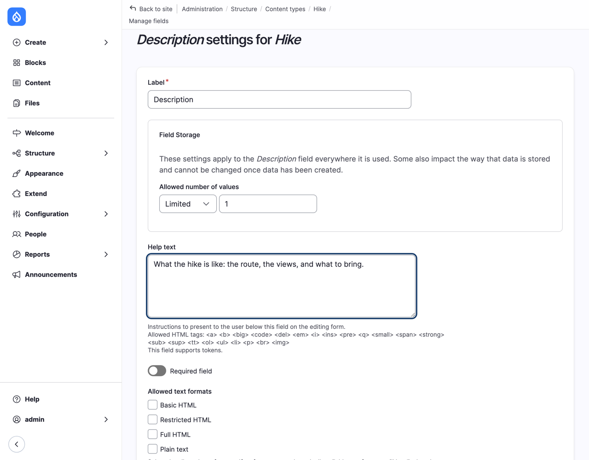
*Figure 7.3: The re-used field, renamed Description*

Look at the settings page again, and you'll see it's in two parts. The **Field Storage** part says "These settings apply to the Body field everywhere it is used": here, that's **Allowed number of values**. Change it on Hike, and you've changed it on Basic page too. Everything below it, the label, the help text, whether the field is required, the allowed text formats, belongs to this content type only. So the same field is "Body" on a Basic page and "Description" on a hike.

> **Drupalism: field storage.** Drupal splits a field in two. The *field storage* is the field itself: its machine name (`field_body`), its type, and the settings that decide how the values are stored in the database, shared by every content type that uses the field. Each content type then has its own *field settings* for it: label, help text, required or not. Some storage settings can't be changed once there is content in the field, because the database would have to change with them. Drupal greys them out, and tells you why.

Why re-use, instead of creating a new field? Because a field that means the same thing everywhere is easier to work with later. When we build a list of everything new on the site in Chapter 12, or a search, one `field_body` is simpler than a `field_body`, a `field_description` and a `field_text` that all hold the same kind of thing. The rule of thumb: re-use a field when it holds the same kind of information, and create a new one when it doesn't, even if the type is the same. A hike's date and a news item's "valid until" date are both dates, but they're not the same thing.

> **Machine names are forever.** Drupal makes the machine name from the label you type: "Meeting place" becomes `field_meeting_place`. The label can change whenever you like; the machine name can't, once the field exists. That's worth a thought if you work in another language than English. A Spanish-speaking committee would type "Lugar de encuentro", and get `field_lugar_de_encuentro`. That works, but many teams have a rule that machine names are in English, so that anyone, including a developer from another country, can read them. If that's your rule, select **Edit** next to the machine name, and type your own, before you continue.

### Adding the hike's own fields

Now the fields only a hike has. Each one starts the same way as the Body field in Chapter 6: on **Manage fields**, select **Create a new field**, choose the field type, type the **Label**, choose the field type's sub-choice, and select **Continue**. Then fill in the settings, and select **Save**.

**Date.** Choose **Date and time**, type `Date` as the label, and choose **Datetime**.

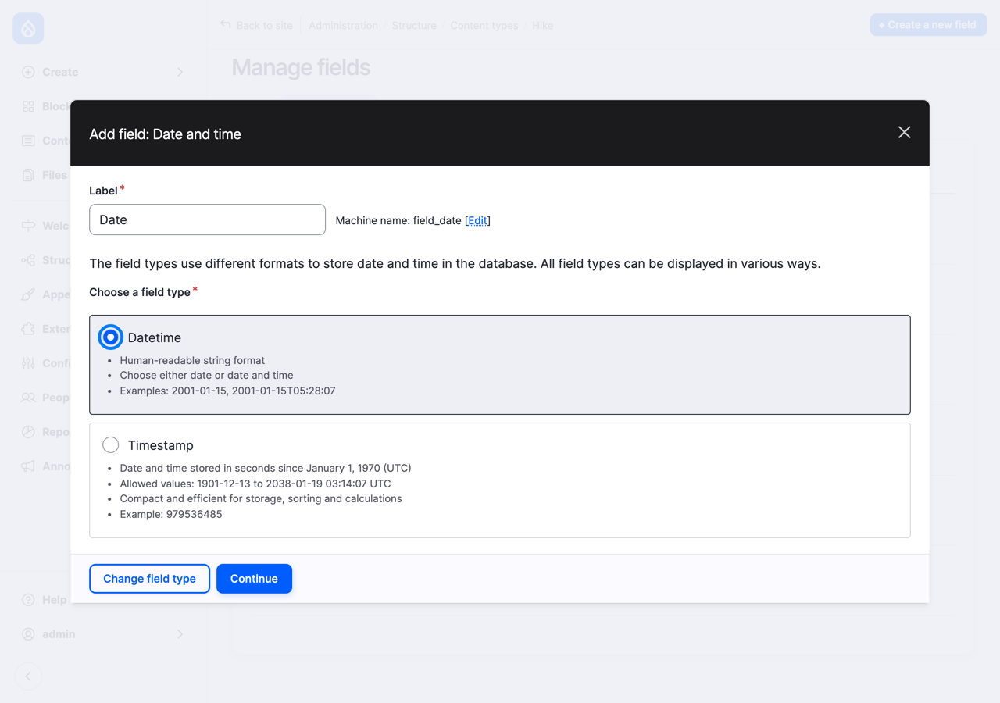
*Figure 7.4: The Date field, as a Datetime*

*Timestamp* is for moments the site records itself, such as when a page was saved; it can only store dates between 1901 and 2038. *Datetime* is for dates people type in, and that's what a hike's date is.

In the settings, leave **Date type** at **Date and time**: we need the time we meet, not only the day. As the **Help text**, type `The day and time we meet.`, and check **Required field**: a hike without a date is no use to anyone.

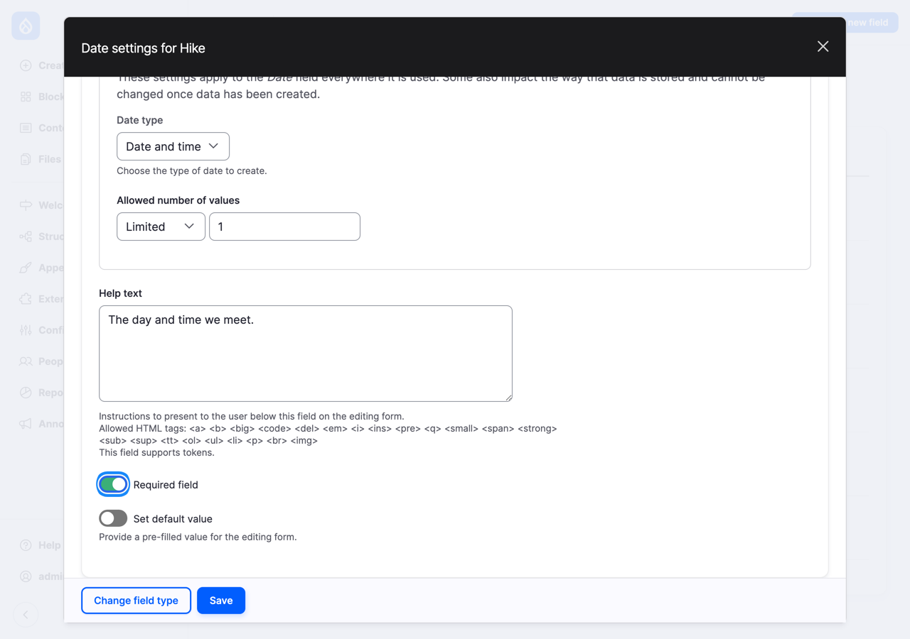
*Figure 7.5: The Date field's settings*

**Meeting place.** Choose **Plain text**, type `Meeting place`, and choose **Short text**: a place name fits on one line. As the **Help text**, type `Where we meet, for example: Flotterstone car park.`, and check **Required field**. A help text with an example is the quickest way to show editors what you expect.

**Distance.** Choose **Number**, type `Distance`, and choose **Decimal**, because hikes aren't always a whole number of kilometers. In the settings:

- **Precision** is the total number of digits, and **Scale** the number of digits after the decimal point. Leave **Precision** at 10, and set **Scale** to `1`: 11.5 km is precise enough for a hike.
- **Help text**: `The length of the walk, in kilometers.`
- **Minimum**: `0`. Drupal won't accept a negative distance.
- **Suffix**: ` km`, with a space before it. Drupal shows the suffix after the number, on the form and on the hike.

Leave **Required field** unchecked: sometimes the route isn't decided yet.

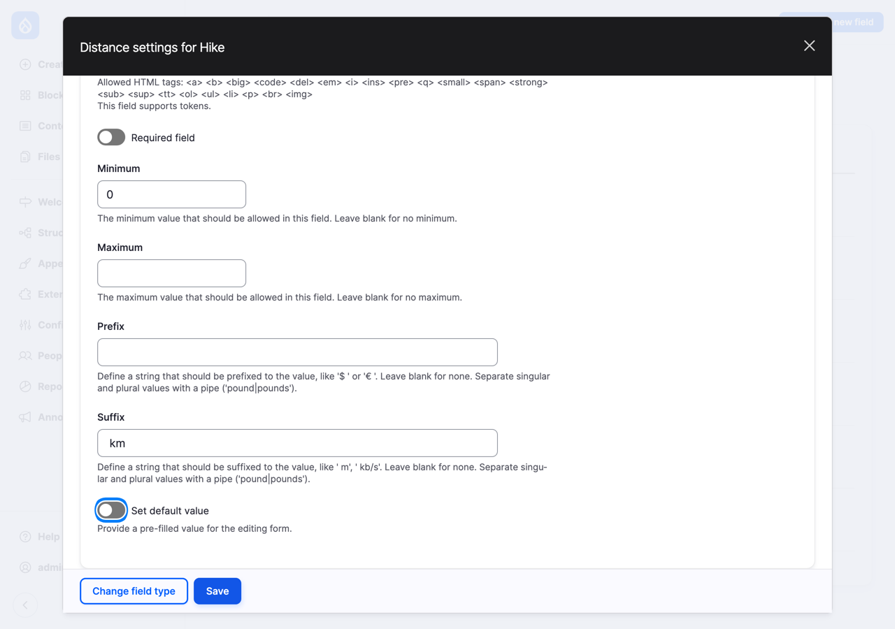
*Figure 7.6: The Distance field's settings*

**Difficulty.** Choose **Selection list**, type `Difficulty`, and choose **Text**. A selection list gives editors a fixed set of choices, so every hike uses the same three words, and we can later list "all easy hikes". Under **Allowed values**, type `Easy` as the first **Name**. Drupal makes a machine name for it, `easy`, and shows it under the name. Select **Add another item**, and add `Moderate` and `Hard` in the same way.

The *name* is what people see; the machine name is the *value* Drupal stores. You can change a name later, say "Hard" to "Challenging", and every hard hike shows the new word. You can't change a value once hikes use it, because it's stored in every one of them.

As the **Help text**, type `Easy: short and flat. Moderate: some climbing. Hard: long, steep, or rough ground.`, and check **Required field**.

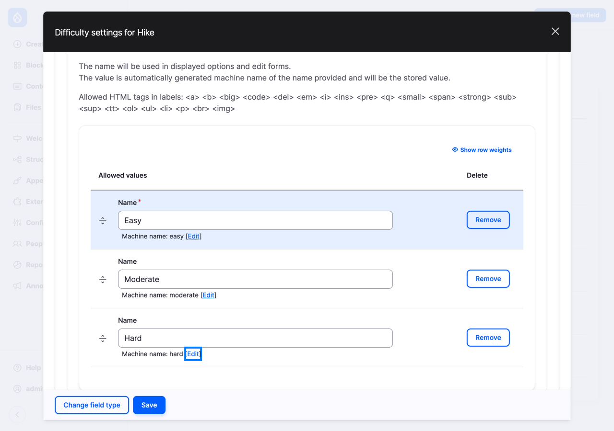
*Figure 7.7: The Difficulty field's allowed values*

**Hike leader.** Choose **Reference**, type `Hike leader`, and choose **User**: the hike leader is one of the site's users. In the settings:

- As the **Help text**, type `The member who leads the hike.`
- Under **Reference type**, set **Sort by** to **Name**, so the list of members is in alphabetical order.
- Uncheck **Include the anonymous user**. The "anonymous user" is how Drupal refers to visitors who aren't logged in, and they can't lead a hike.

**Filter by** can limit the list to users with a certain role. Right now, the only user is you, and there's no "hike leader" role yet. We create one in Chapter 14, and can come back here then.

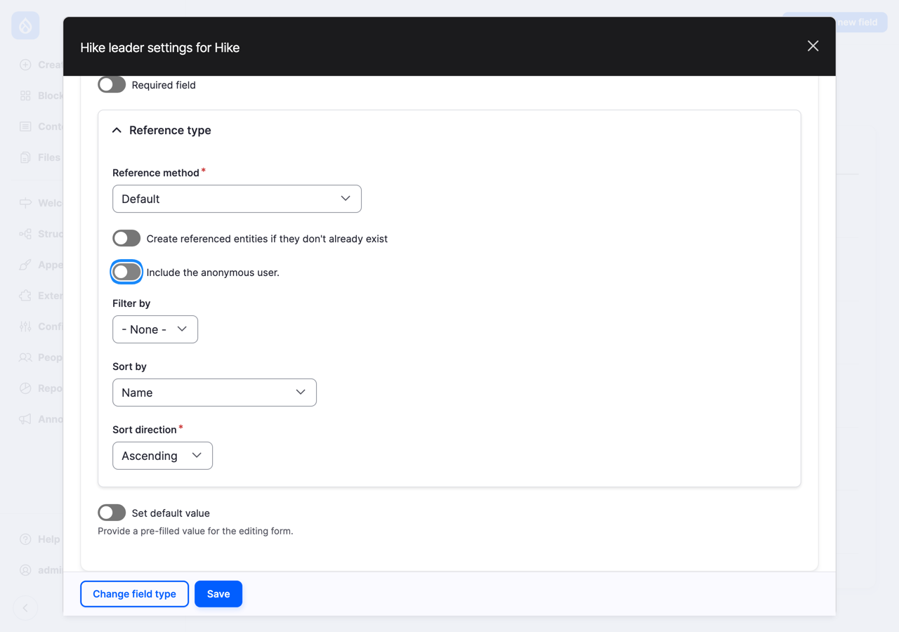
*Figure 7.8: The Hike leader field's settings*

**Manage fields** now lists the six fields of a hike, in alphabetical order, with their machine names and types.

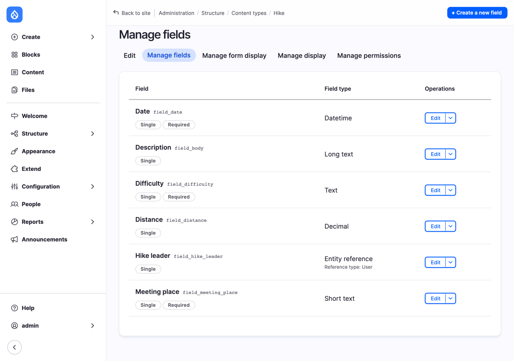
*Figure 7.9: The Hike content type's fields*

> **Try it:** If you did Exercise 5 in Chapter 1, where you planned the information a hike needs, compare your plan with these six fields. Did you think of something we left out? A field for the maximum number of participants, perhaps? Exercise 1 at the end of this chapter adds it.

## Shaping the form: Manage form display

The order of **Manage fields** is alphabetical, and it's not the order an editor thinks in. The form for a hike should start with the essentials, *when* and *where*, and end with the description. That's what the **Manage form display** tab is for. It lists every field on the form, base fields included, in the order the form shows them, and for each one, its *widget*.

A *widget* is the part of the form for one field: a text box, a date picker, a list to choose from, checkboxes. A field type usually has several widgets to choose from. A Selection list, for example, can be a drop-down list or a row of radio buttons, and a Reference can be a drop-down list or a box that suggests names as you type.

1. Go to **Manage form display** for Hike.
2. Drag the fields, by the cross on the left of each row, into this order: **Title**, **Date**, **Meeting place**, **Distance**, **Difficulty**, **Hike leader**, **Description**. If dragging is awkward, select **Show row weights** at the top: each row then gets a number, and fields with lower numbers come first.
3. For **Difficulty**, set the widget to **Check boxes/radio buttons**. With three choices, radio buttons show them all at once, and choosing takes one click instead of two. (Because the field allows only one value, Drupal shows radio buttons, not checkboxes.)
4. For **Hike leader**, set the widget to **Select list**. The default, **Autocomplete**, is a text box that suggests names as you type; it's the right choice when a site has hundreds of users, but the club has a handful of hike leaders, and a list shows them all.
5. Select **Save**.

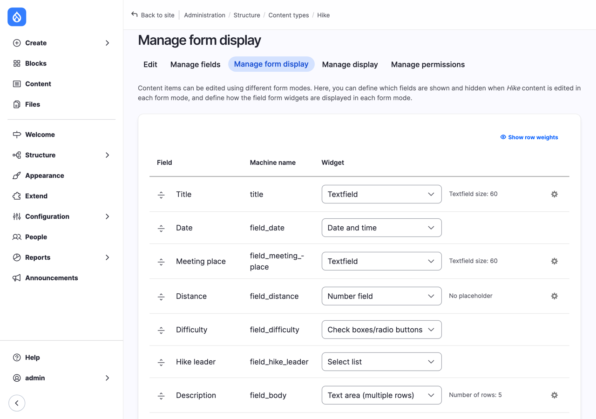
*Figure 7.10: The form for a hike, arranged*

The cog at the end of a row opens the widget's own settings, such as the size of a text box or a placeholder text shown in an empty field. The summary next to the widget tells you what's set. Fields in the **Disabled** part at the bottom aren't on the form at all; on Drupal 12, **Promoted** and **Sticky at top of lists** start there, as we saw in Chapter 6. And Drupal puts some base fields, such as **Authored by** and **URL alias**, in the form's sidebar, whatever their place in the list.

### Drafts for hikes too

In Chapter 6, we applied the Editorial workflow to Basic page. Hikes need it even more: in Chapter 14, hike leaders will write their hikes as drafts, and the secretary will publish them. Go to **Configuration** > **Workflow** > **Workflows**, **Edit** the Editorial workflow, select **Select** next to **Content types**, check **Hike**, select **Save**, and then **Save** at the bottom of the page.

## Writing the first hike

> **Try it:** Select **Create** > **Hike**, and fill in the club's first hike.
>
> 1. **Title**: `Turnhouse Hill and Carnethy Hill`.
> 2. **Date**: a Saturday a few weeks from now, at `09:30`.
> 3. **Meeting place**: `Flotterstone car park`.
> 4. **Distance**: `11.5`.
> 5. **Difficulty**: **Moderate**.
> 6. **Hike leader**: yourself, **admin**.
> 7. **Description**, in two paragraphs:
>
>    Two of the best-known tops in the Pentland Hills, with views over Edinburgh and the Firth of Forth on a clear day. We climb steadily from Flotterstone to Turnhouse Hill, follow the ridge to Carnethy Hill, and come back down through the glen.
>
>    Bring boots, a waterproof jacket, something warm, lunch, and your camera. The path is steep in places and can be muddy.
>
> 8. Under **URL alias**, type `/hikes/turnhouse-hill`.
> 9. Set **Save as** to **Published**, and select **Save**.

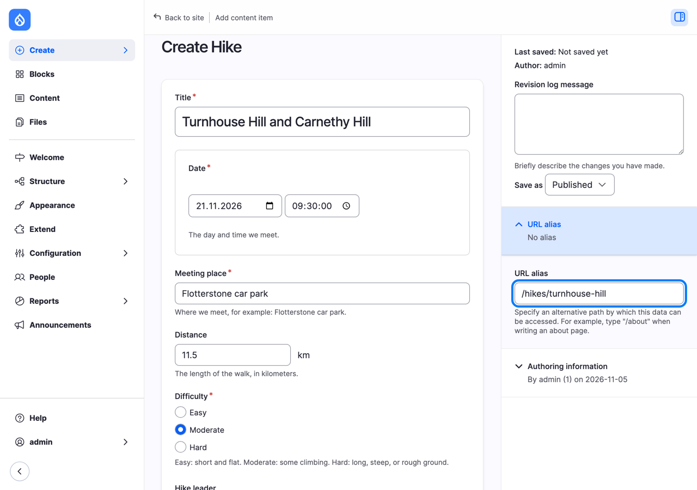
*Figure 7.11: Writing the first hike*

Try leaving the date empty, or typing `-3` as the distance, before you save: Drupal refuses, and tells you what's wrong. That's the structure at work.

Now look at the hike as a visitor sees it.

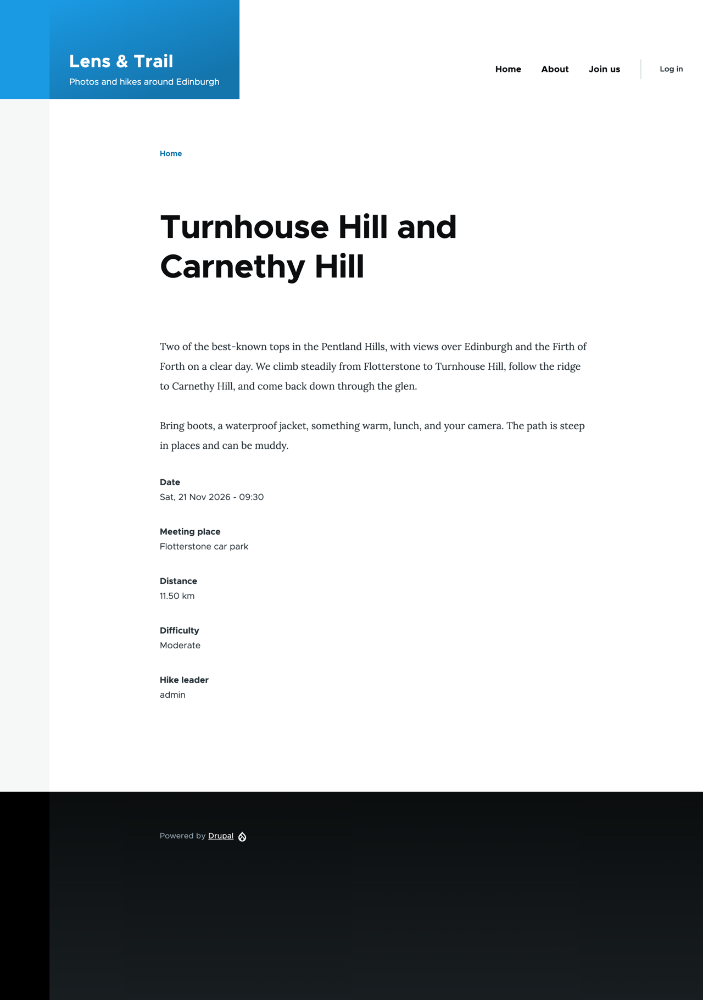
*Figure 7.12: The first hike, as Drupal shows it for now*

All the information is there, but it's not pretty. The description comes first and the date last, the other fields each have a label, and the distance says "11.50 km", with two decimals, although we stored one. How a hike *looks* is decided somewhere else, on the **Manage display** tab, and that's the subject of Chapter 8.

## Who may create hikes: Manage permissions

The last tab of a content type, **Manage permissions**, shows the permissions that belong to this content type: who may create hikes, edit their own or anyone's hikes, delete them, and see or revert their revisions. Because Hike uses the Editorial workflow, the workflow's transitions are listed too, such as who may publish.

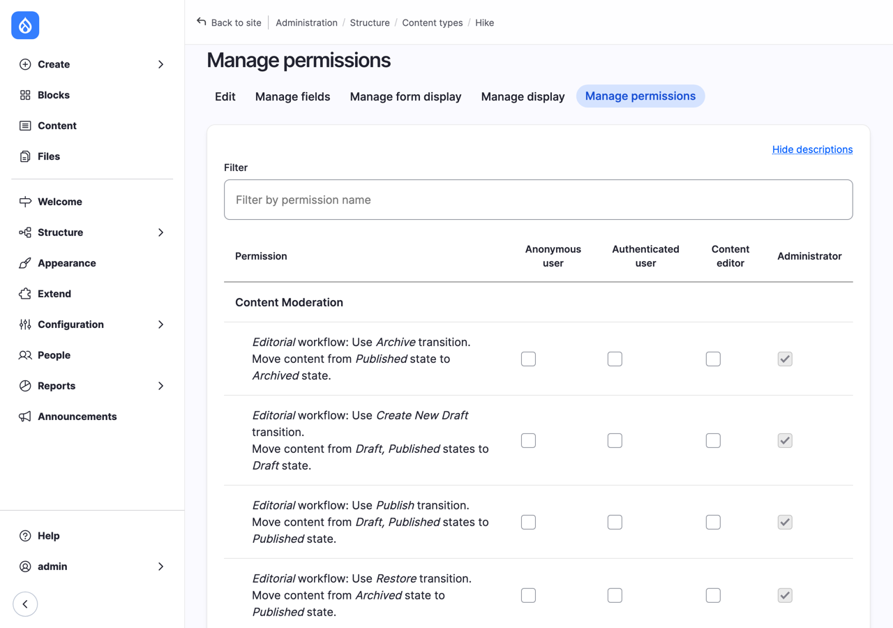
*Figure 7.13: The permissions for hikes*

There's a column for each *role*, a group of users with the same permissions: **Anonymous user** (visitors who aren't logged in), **Authenticated user** (everyone who is), and the two roles Drupal's installation created, **Content editor** and **Administrator**. Leave them as they are for now. In Chapter 14, we create the club's own roles, such as hike leader and secretary, and come back to this tab.

## Try it: the News content type

The club also needs news: trip reports, competition results, announcements. A news item is simpler than a hike, so this one is up to you.

> **Try it:** Create a content type for news.
>
> 1. **Name**: `News`. **Description**: `News from the club: trip reports, competition results, and announcements.`
> 2. Leave **Display author and date information** checked this time. On a news item, "By Ana, 5 November" is exactly what readers want to know.
> 3. Under **Menu settings**, uncheck **Main navigation**, as for hikes.
> 4. Save it, and re-use the Body field. Drupal fills in the settings from a content type that already uses it, and it picks Hike (the first by machine name), so the **Label** says `Description`, with the hike's help text. Change the label back to `Body`, empty the **Help text**, and select **Save settings**.
> 5. Add News to the Editorial workflow, as you did for Hike.
> 6. Write the first news item: the title `The club has a website`, and this body:
>
>    Lens & Trail finally has a website of its own. From now on, you'll find the hike program, news from the club, and the members' best photos here.
>
>    The website is new, and we're building it as we go. If something is missing or wrong, tell the secretary.
>
> News gets a photo in Chapter 9, and tags in Chapter 10.

> **On Drupal CMS:** the Starter template comes with one content type, **Utility page**, and it already has more fields than our Basic page: **Content** (the body), a required **Description** (a short summary, used by search engines), a **Featured image**, **Tags**, and four SEO fields that decide how the page looks in search results and when it's shared. Other site templates bring more content types; Byte, for example, comes with a blog. You add fields to them, and arrange their forms, with the same tabs as on Drupal core.
>
> 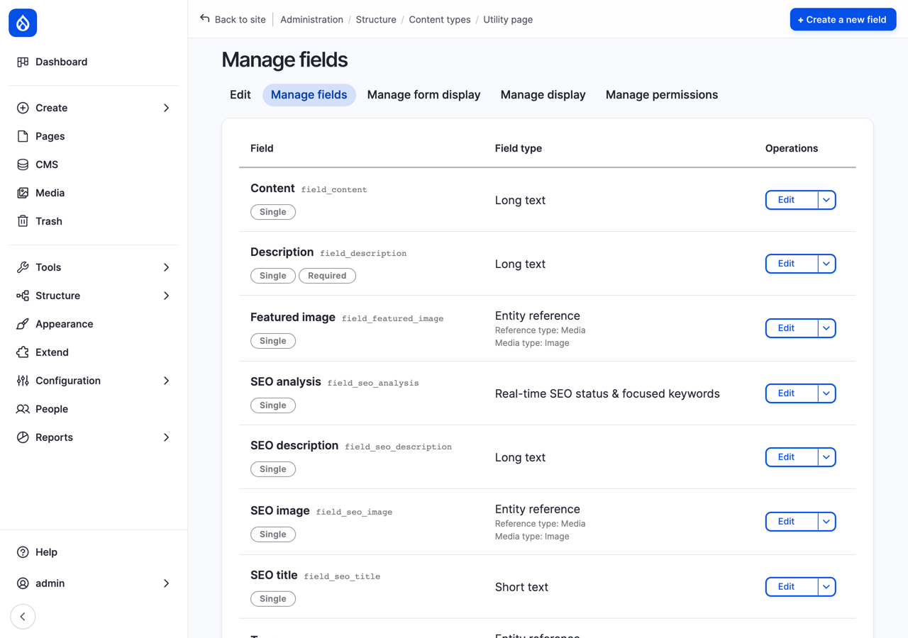
> *Figure 7.14: Utility page's fields on Drupal CMS*

> **Coming from WordPress?** What Drupal calls a content type is closest to a WordPress *custom post type*, and Drupal's fields are closest to what the *Advanced Custom Fields* (ACF) plugin adds. The difference is where they come from. WordPress core registers custom post types in code, with `register_post_type()`, usually in a plugin, and its own custom fields are free-form pairs of a name and a value, hidden in the block editor until you turn them on, and shown on the site through the theme's code. That's why so many WordPress sites use ACF, which has field groups, more than 30 field types, and lately a screen for post types too. In Drupal, all of this is part of core, in the administration interface: content types, typed fields that Drupal checks, widgets for the form, and, as you'll see in Chapter 8, display settings for every field.

## Summary

You can now:

- explain why structured content, with a field for each piece of information, is better than one block of text;
- tell an entity, an entity type and a bundle apart, and name the entity types you'll meet in this book;
- choose the right field type for a piece of information;
- re-use a field on another content type, and know which of its settings are shared;
- add text, number, list, date and reference fields, with help texts and checks;
- arrange the form for editors, and choose a widget for each field;
- find the permissions that belong to a content type.

## Exercises

1. Add a **Maximum participants** field to Hike: a whole number, at least 1, not required. Put it after **Difficulty** on the form. Which field type and sub-choice did you use, and why not Decimal?
2. Write two more hikes: an easy one, a sunset photo walk along Portobello beach (5 km, meeting at Portobello Town Hall), and a hard one of your own choosing. Then go to **Content** and filter the list by **Content type**: Hike.
3. Change the name of the difficulty **Hard** to **Challenging**. Look at the hard hike you wrote in Exercise 2: what does it say now? Then try to change the *value* `hard` as well. What does Drupal tell you, and why?
4. The club wants a page for each committee member, with their name, their role on the committee (such as "Secretary"), and one or more email addresses. Create a **Committee member** content type for it. What should the **Title field label** be (remember Chapter 6)? Which field allows more than one email address, and where did you set that?
5. *(challenge)* The club runs a photo competition every spring. Plan a **Photo competition** content type on paper: which fields does it need, which field type is each one, and which of them could re-use an existing field? Which information would be better as a reference to another entity than as a field of its own?

## Want to know more?

- The Drupal User Guide, drupal.org's free book about Drupal core: [Concept: Content Entities and Fields](https://www.drupal.org/docs/user_guide/en/planning-data-types.html), [Adding a Content Type](https://www.drupal.org/docs/user_guide/en/structure-content-type.html), [Adding Basic Fields to a Content Type](https://www.drupal.org/docs/user_guide/en/structure-fields.html), [Setting Up a Reference Field](https://www.drupal.org/docs/user_guide/en/structure-reference-fields.html), and [Changing Content Entry Forms](https://www.drupal.org/docs/user_guide/en/structure-form-editing.html).
- [Registering Custom Post Types](https://developer.wordpress.org/plugins/post-types/registering-custom-post-types/) and [Assign custom fields](https://wordpress.org/documentation/article/assign-custom-fields/), on wordpress.org, and the [Advanced Custom Fields](https://wordpress.org/plugins/advanced-custom-fields/) plugin, if you'd like to compare.
