# Laying Out Pages

In Chapter 6, the club got its first pages, and in Chapter 7 its first real content types, with fields of their own. Every page so far looks the way Drupal decides: the title, then the fields, one under the other. In this chapter we take control of how content looks. First with **Manage display**, the classic Drupal way, which decides how every item of a content type is shown. Then with the two tools for laying out a page by hand: Layout Builder in Drupal core, and Drupal Canvas in Drupal CMS.

We start where Chapter 7 left us: the Basic pages *About the club*, *How to join* and *Welcome*, the *Hike* and *News* content types, and content moderation on Basic page.

## How content is displayed: Manage display

## Laying out a page by hand

**Manage display** shows the fields one under the other, in the same way for every item of a content type. This is the classic way to build a Drupal site, and for content with a fixed structure, such as a hike, it's still the best way: every hike looks the same, and editors fill in fields instead of arranging the page. But it can't put two things side by side, and it can't give one page a layout of its own.

Sometimes, though, you want to arrange a page yourself: two columns, a box on the side, a big photo at the top. Drupal has two tools for this, and you'll meet both in real projects:

- **Layout Builder**, part of Drupal core. You divide the page into *sections* with columns, and place *blocks* in them: the page's own fields, menus, lists, or boxes of text. It works on a content type's display, and, if you allow it, on a single page.
- **Drupal Canvas**, the page builder that comes with Drupal CMS. You build the page in a visual editor, from *components* such as headings, texts, cards and grids, and see the result as you work.

Neither is the "right" one. Canvas is newer and more visual, and it's where Drupal CMS is heading. Layout Builder has been in core since Drupal 8.7, and many developers prefer it, or prefer plain field displays, because they keep pages consistent. We build *How to join* both ways, and you can judge for yourself.

## Layout Builder

Layout Builder is already installed on your site: the Navigation sidebar uses it, so Drupal installs it with the sidebar. We only have to turn it on for Basic page.

1. Go to **Structure** > **Content types** > **Manage display** for Basic page, and **Manage** the **Default** view mode.
2. At the bottom, under **Layout options**, check **Use Layout Builder**.
3. Check **Allow each content item to have its layout customized**. Without it, every Basic page shares one layout, which you design once for the content type, its *template*. With it, each page can also have a layout of its own.
4. Select **Save**.

The field list disappears, and a **Manage layout** button takes its place: from now on, the layout decides how a Basic page is shown. Every page still uses the template, which shows the body, so nothing changes on the site yet.

Now let's give *How to join* two columns: the text on the left, and the club's meeting times in a box on the right.

1. Go to the *How to join* page, and select **Layout** in the **More actions** menu (or go to `/node/2/layout`). You see the page in editing mode, with the message "You are editing the layout for this Basic page content item." Because the site has content moderation, there's also **Current state** and **Change to**, as on the edit form; leave it at **Published**, so the new layout goes online when you save it.

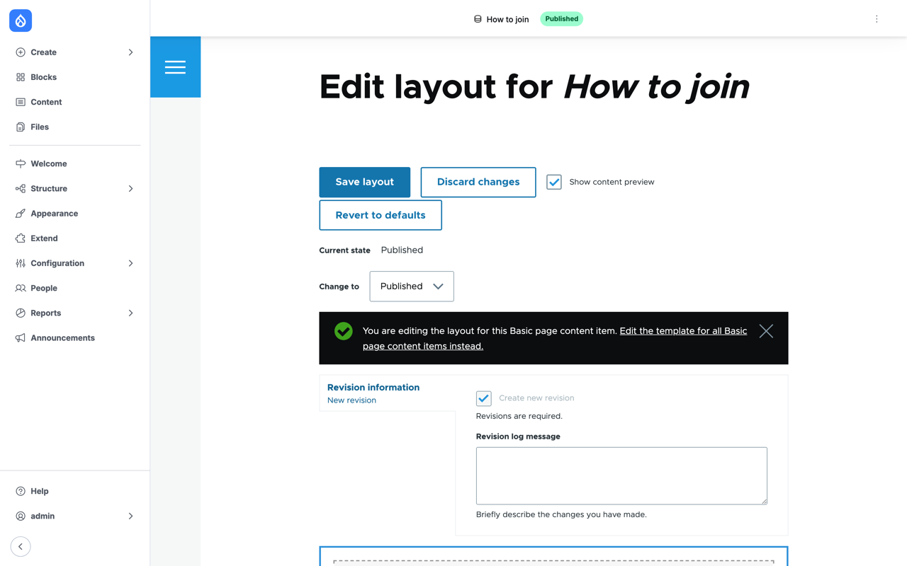
*Figure 8.1: Editing the layout of How to join*

2. Select **Add section** at the top. A panel opens on the right, with the layouts to choose from: **One column**, **Two column**, **Three column** and **Four column**. (**Navigation layout** is the sidebar's own, and of no use on a page.) Select **Two column**.

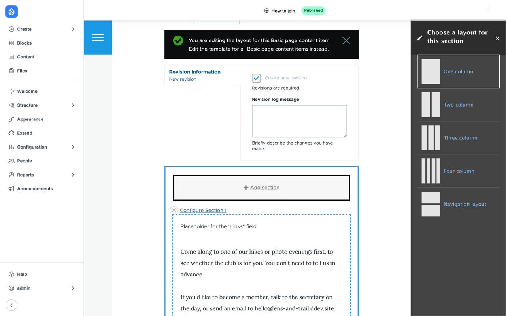
*Figure 8.2: Choosing a layout for the new section*

3. Set **Column widths** to **67%/33%**, and select **Add section**.

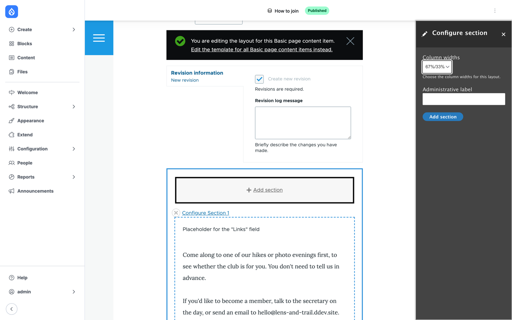
*Figure 8.3: The section's column widths*

4. In the new section, select **Add block** in the **Second region**. The panel lists the blocks you can place; select **Create content block** at the top.

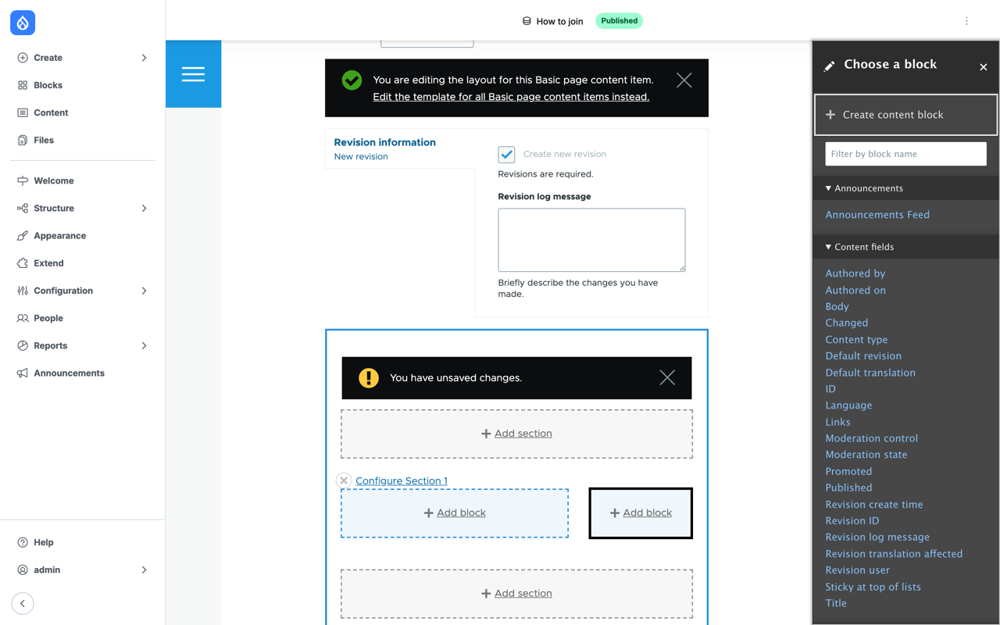
*Figure 8.4: Choosing a block for the second region*

5. Type `When and where` as the **Title**, and this as the **Body**:

   Hikes: every other Saturday, at 9:30. We send the meeting place to everyone who is coming a week before.

   Photo evenings: the first Thursday of the month, at 19:00, in the back room of a café in Leith.

   Then select **Add block**.

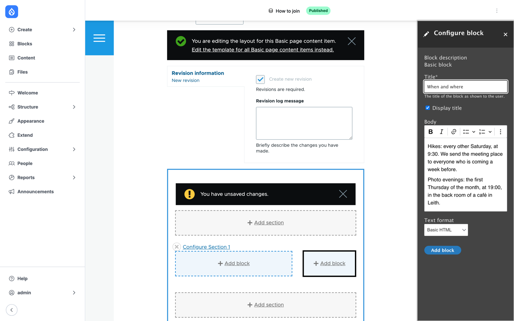
*Figure 8.5: The When and where block*

6. Select **Add block** in the **First region**. Under **Content fields**, select **Body**, set **Label** to **- Hidden -**, and select **Add block**.

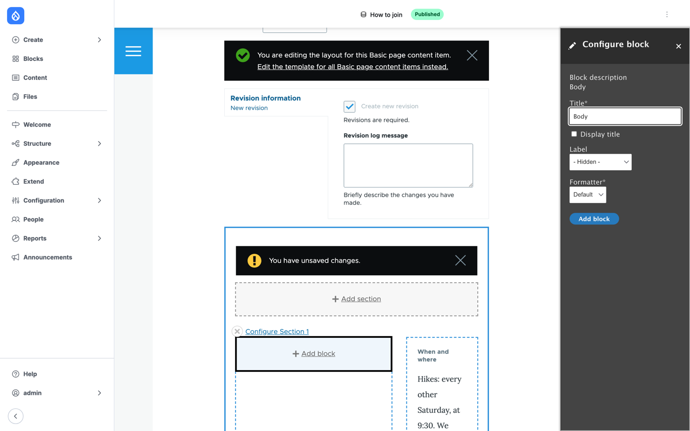
*Figure 8.6: Placing the body in the first region*

7. The old one-column section is still below, with the body in it a second time. Select **Remove Section 2**, and confirm with **Remove**.

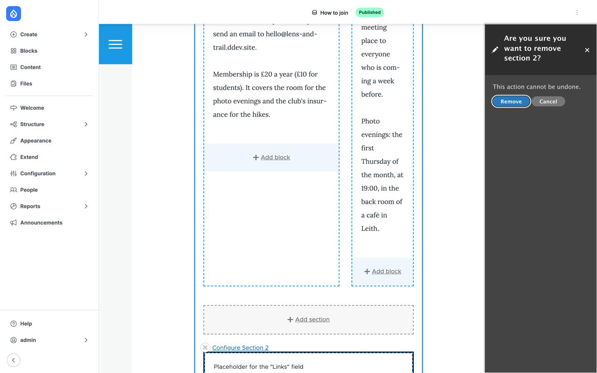
*Figure 8.7: Removing the old section*

8. At the top, write `Two columns, with the meeting times on the right.` in **Revision log message**, and select **Save layout**.

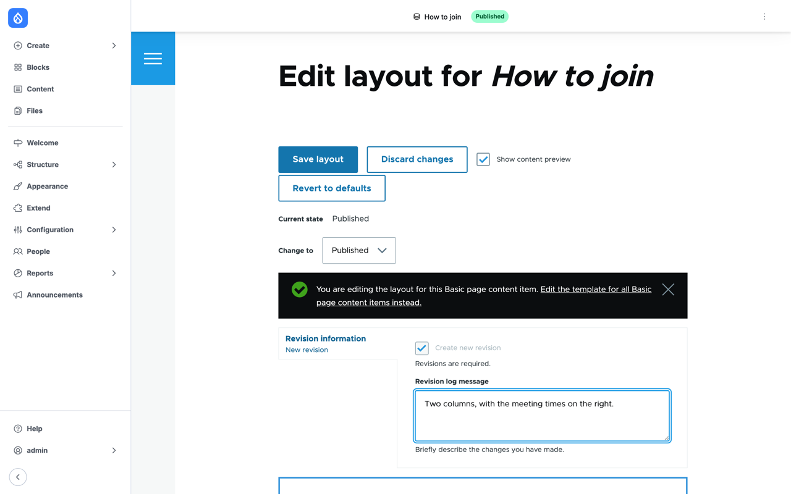
*Figure 8.8: Saving the layout*

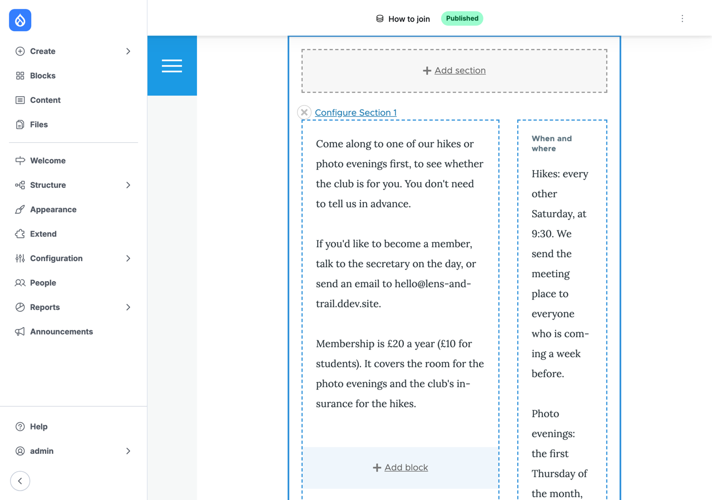
*Figure 8.9: The finished layout*

Until you select **Save layout**, nothing changes for visitors: Layout Builder keeps your work as a draft, and says "You have unsaved changes." **Discard changes** throws the draft away. **Revert to defaults** removes the page's own layout, so it uses the content type's template again.

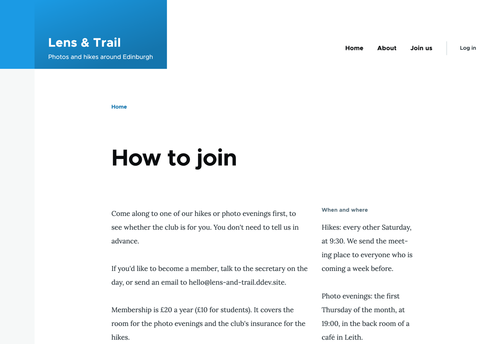
*Figure 8.10: How to join, laid out with Layout Builder*

The *When and where* box is a block that belongs to this page only. Chapter 13 is about blocks you can reuse on many pages, such as a box in every page's footer.

## Drupal Canvas

> **On Drupal CMS:** Canvas is part of Drupal CMS, but it doesn't support Drupal 12 yet: its newest version, 1.12.0, needs Drupal 11.3 or later, but not 12. So we build the Canvas version of *How to join* on the Drupal CMS site from Chapter 4, if you made one.
>
> In Canvas, a page isn't a node with a body field. It's a kind of content of its own, called **Page**, with its own list under **Pages** in the sidebar (`/admin/content/pages`). Select **Add Page**, and the Canvas editor opens.
>
> 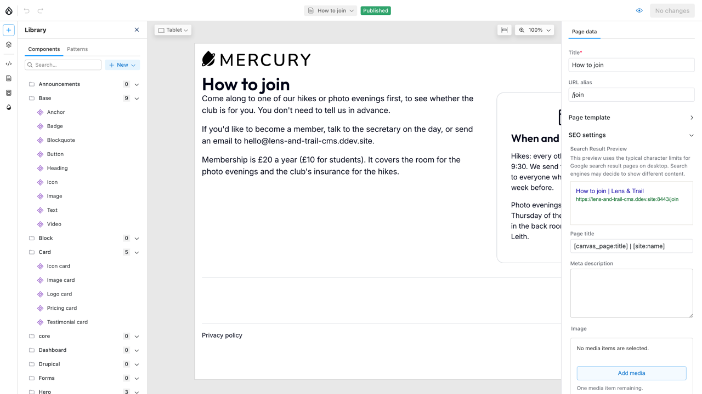
> *Figure 8.11: The Canvas editor*
>
> In the middle is the page, as visitors will see it, in the site's theme (Mercury, on the Starter template). Above it, you can switch between desktop, tablet and phone sizes. On the left is a row of buttons:
>
> - **Library**: the *components* you can put on the page. **Base** has the simple ones, such as **Heading**, **Text**, **Image** and **Button**; **Card** and **Hero** have bigger boxes; **Layout** has **Grid**, **Section** and **Group**, which hold other components.
> - **Layers**: the page's components as a tree, which is often the easiest way to select one, or to see what's inside what.
> - **Code**, **Pages**, **Templates** and **Brand kit**: writing your own components, the list of pages, the templates pages are built on, and the site's colors and fonts. We leave them for now; building your own component is a topic for later.
>
> On the right, **Page data** has the page's **Title**, **URL alias** and **SEO settings**, and when you select a component, a **Settings** tab with that component's settings.
>
> To build *How to join*:
>
> 1. In **Page data**, type `How to join` as the **Title** and `/join` as the **URL alias**.
>
> 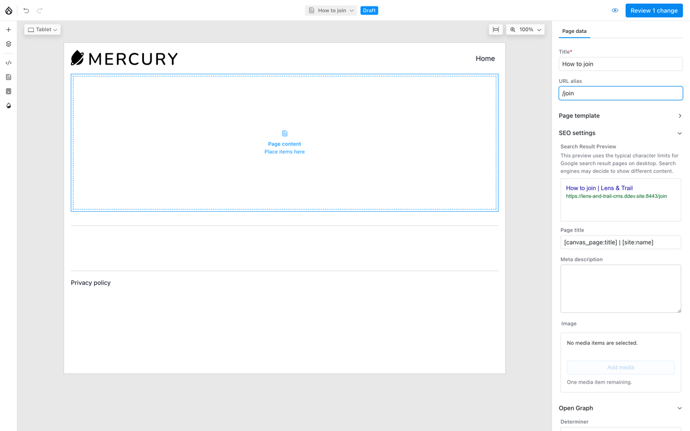
> *Figure 8.12: The page's title and URL alias*
>
> 2. Open the **Library**, and drag a **Heading** onto the page, where it says "Place items here". Its settings open on the right: type `How to join` as the **Heading**, and set **Heading level** to **1**.
>
> 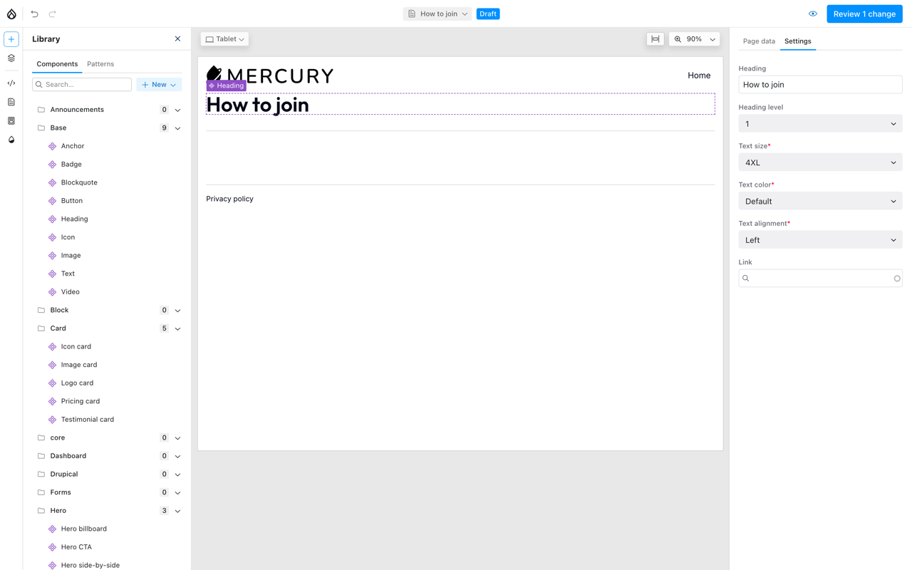
> *Figure 8.13: The heading, at level 1*
>
> 3. Drag a **Grid**, from **Layout**, onto the page below the heading. Set **Columns** to **2 columns 67%-33%**. The grid is empty for now, a thin box below the heading.
>
> 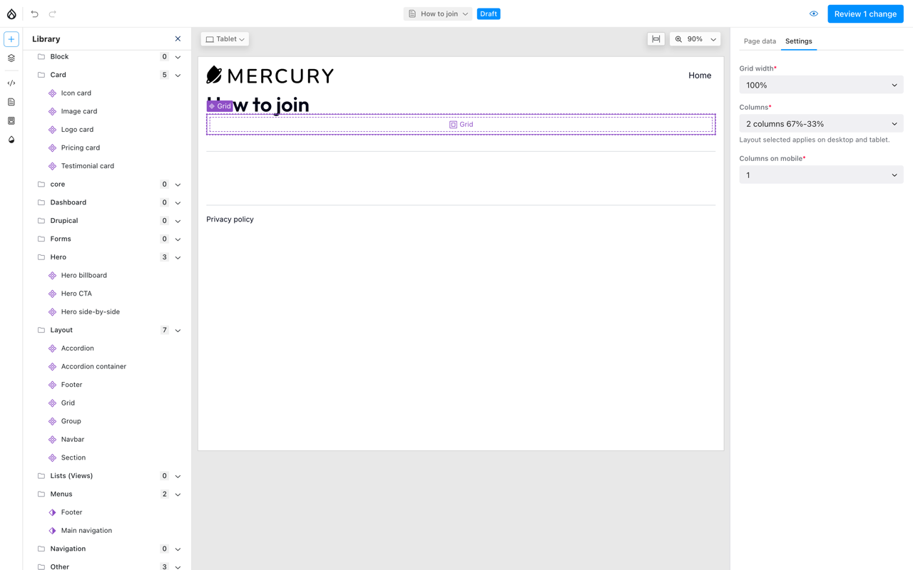
> *Figure 8.14: The grid, with two columns*
>
> 4. Drag a **Text** into the grid, and replace the example text with the three paragraphs of *How to join*.
>
> 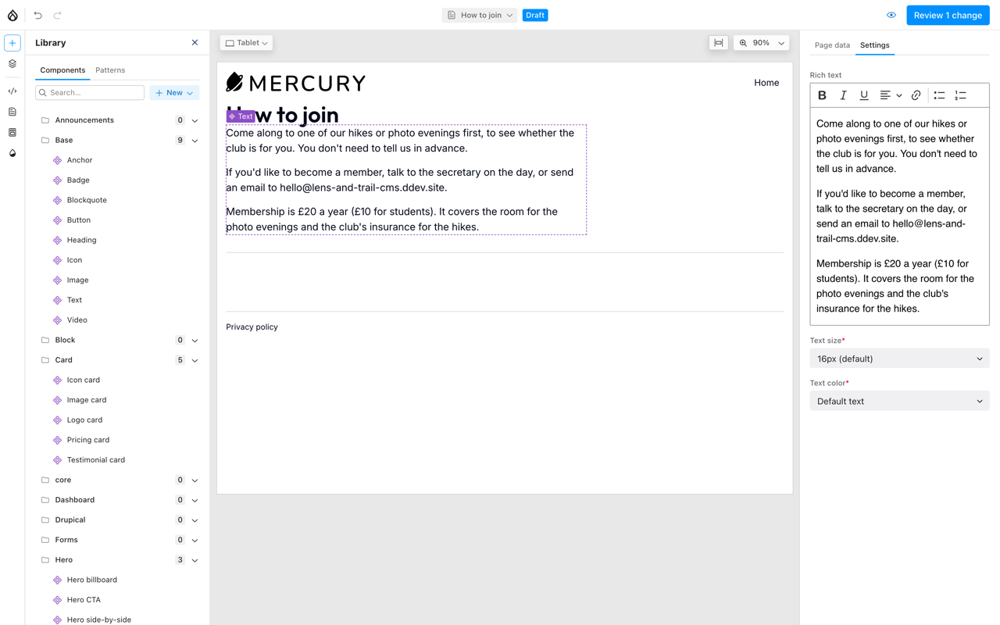
> *Figure 8.15: The text, in the grid*
>
> 5. Drag an **Icon card**, from **Card**, into the grid, after the text. This is the fiddly part: drag and drop puts it in the wrong place more often than not, for example after the grid instead of inside it. Don't worry, you can put it right in **Layers**. Right-click the **Icon card** there, and select **Move** > **Move into** > **Grid (Grid)**. That puts the card first in the grid, so right-click the **Text** and select **Move** > **Move up**, to put the text back on the left.
>
> 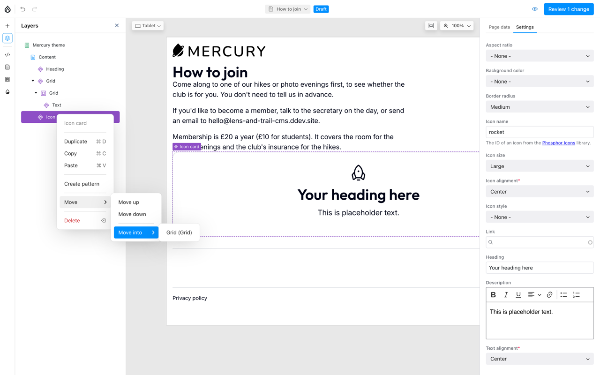
> *Figure 8.16: Moving the card into the grid*
>
> 6. Select the **Icon card**, and set **Icon name** to `calendar-dots`, **Heading** to `When and where`, **Description** to the meeting times, and **Text alignment** to **Left**.
>
> 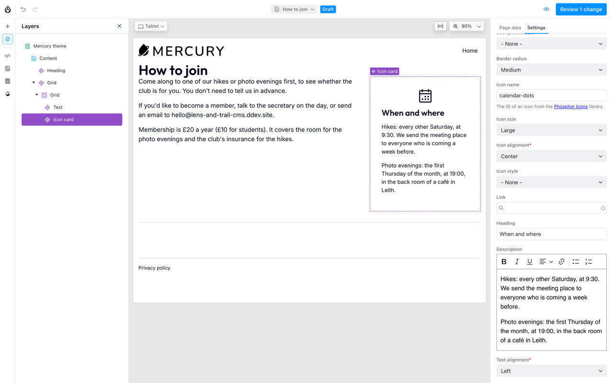
> *Figure 8.17: The When and where card*
>
> 7. Canvas saves your work as you go, as a draft. When the page looks right, select **Review 1 change** at the top right, check **How to join**, and select **Publish 1 selected**.
>
> 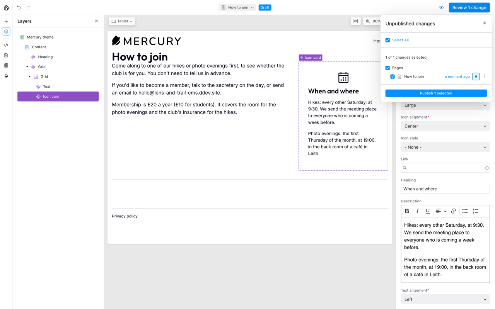
> *Figure 8.18: Publishing the page*
>
> The same right-click menu works for every component: **Move up**, **Move down** and **Move into** put a component that landed in the wrong place where you want it.
>
> 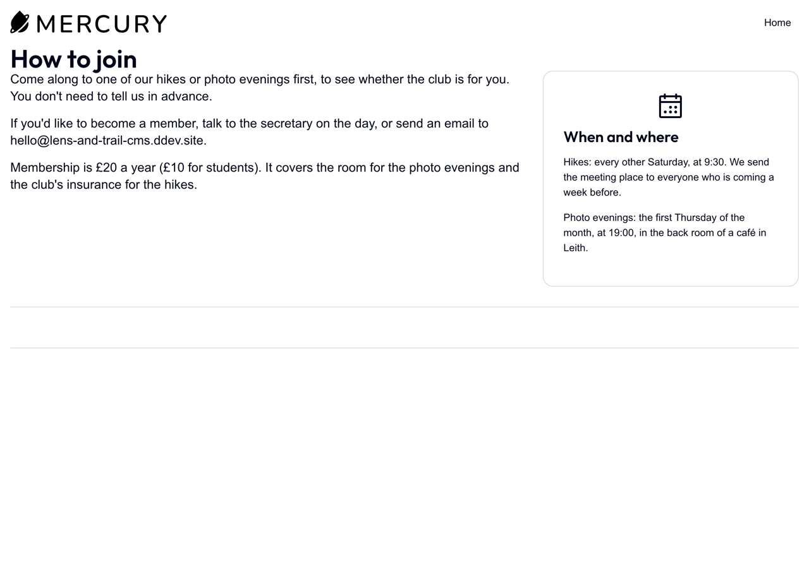
> *Figure 8.19: How to join, built with Canvas*

## Which one should I use?

| | Field display | Layout Builder | Drupal Canvas |
|---|---|---|---|
| Where it comes from | Drupal core | Drupal core | Drupal CMS (a contributed module) |
| Who arranges the page | The site builder, once per content type | The site builder for the template; editors per page, if allowed | Editors, per page |
| What you arrange | Fields | Sections and blocks | Components |
| Best for | Content with a fixed structure: hikes, news, events | Content types where some pages need their own layout | Landing pages and one-off pages |

Many sites use more than one: plain field displays for hikes and news, and Canvas or Layout Builder for the front page and a few special pages.

> **Coming from WordPress?** Canvas will feel familiar: like the WordPress block editor, you build a page from pieces (Canvas calls them components, WordPress calls them blocks) and see the result as you go. Two differences matter. A Drupal *block* is something else, a box placed on the page, closer to a WordPress widget (see the box in Chapter 1). And in Drupal, structured content such as a hike usually isn't laid out by hand at all: it has fields, and the content type's display decides how every hike looks.

## Summary

You can now:

- decide which fields a content type shows, in which order, and with which labels and formatters;
- use view modes to show the same content in different ways;
- lay out a page with Layout Builder, and, on Drupal CMS, with Canvas;
- tell when to use a field display, Layout Builder, or Canvas.

## Exercises

1. Use Layout Builder to give *About the club* a layout of its own, with a box on the side that says when the club was founded (make up a year). Then select **Revert to defaults**. What happens to the box?
2. *(challenge)* Change the Basic page *template*, at **Manage display** > **Manage layout**, so that every page has a one-line box at the bottom: "Questions? Write to hello@lens-and-trail.ddev.site." Which pages get the box, and which don't? Why?

## Want to know more?

- [Layout Builder](https://www.drupal.org/docs/8/core/modules/layout-builder), drupal.org's documentation of the module, with templates and per-page layouts.
- [Drupal Canvas](https://www.drupal.org/project/canvas), the project page of the contributed module, with its newest version and the Drupal versions it supports.
- [The WordPress Block Editor](https://wordpress.org/documentation/article/wordpress-block-editor/), on wordpress.org, if you'd like to compare.
