# Media and Image Styles

A photography club without photos is a strange club. ;-) In this chapter the club's site gets its pictures: a photo at the top of every hike and news item, and photo albums from the club's outings. On the way, you'll learn how Drupal handles images and other files as *media*, why the same photo is stored once and used in many places, and how Drupal makes the right size of each photo for every place it appears, from a small thumbnail to a wide banner on a large screen.

We start where Chapter 8 left us: the *Hike* and *News* content types with their displays, Teaser and Card view modes, and a *Day, date and time* date format.

## Why media, and not an image field?

When you add a photo to a hike, you could add an **Image** field to the content type, and upload the photo straight into it. Drupal has that field type, and many older Drupal sites use it. But on this site we won't, and I almost never do. Here's why.

An image field belongs to one piece of content. The photo you upload into a hike belongs to that hike, and nothing else can use it. Upload the same photo for a news item, and Drupal stores it twice. Change its description, and you have to change it twice. Delete the hike, and the photo goes with it.

*Media* turns this around. A photo becomes something of its own: a **media item**, with a name, the file, its alternative text, and any fields you like, such as who took it and under which license. Content then *refers* to the media item, in the same way a hike refers to its hike leader. One photo, stored once, can appear on a hike, a news item and in an album, and when you correct its credits, they're correct everywhere. Editors find photos in the **Media Library**, a searchable collection of everything uploaded so far, instead of hunting for the file on their computer again.

Drupal itself says so. When you create a Media field, the window reads: "Use Media reference fields for most files, images, audio, videos, and remote media. Use File or Image reference fields when creating your own media types, or for legacy files and images created before installing the Media module." The plain Image field is still there, and Drupal uses it *inside* media: an image media item stores its file in an Image field. You'll rarely add one to a content type yourself. (The user's picture, in Exercise 1 of Chapter 8, is one of the few places where a plain Image field makes sense: nobody will reuse it anywhere else.)

> **Drupalism: media.** A media item is an entity, like a node or a user (see Chapter 7). Its *media types* (Image, Document, Remote video, and others) are its bundles, just as content types are the bundles of content. So everything you learned about fields, form displays and displays works on media too.

## Installing Media

The Media module comes with Drupal core, but the Standard installation doesn't turn it on. We need two modules: **Media**, which adds media items, and **Media Library**, which adds the library editors choose from.

1. Go to **Extend**. In **Filter**, type `media`.
2. Check **Media** and **Media Library**, and select **Install** at the bottom.

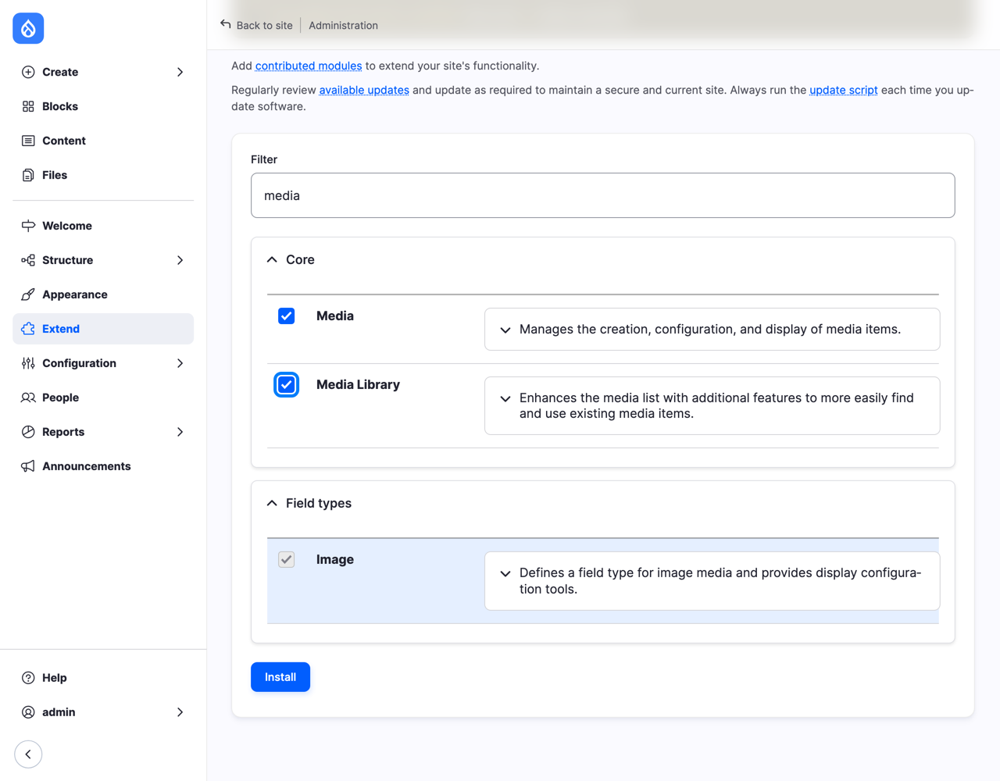
*Figure 9.1: Installing Media and Media Library*

Chapter 11 is all about modules: where they come from, how to install the ones that aren't part of core, and how to choose them. For now, all you need to know is that **Extend** turns on the modules that are already there.

Media brings five media types with it. Go to **Structure** > **Media types** to see them.

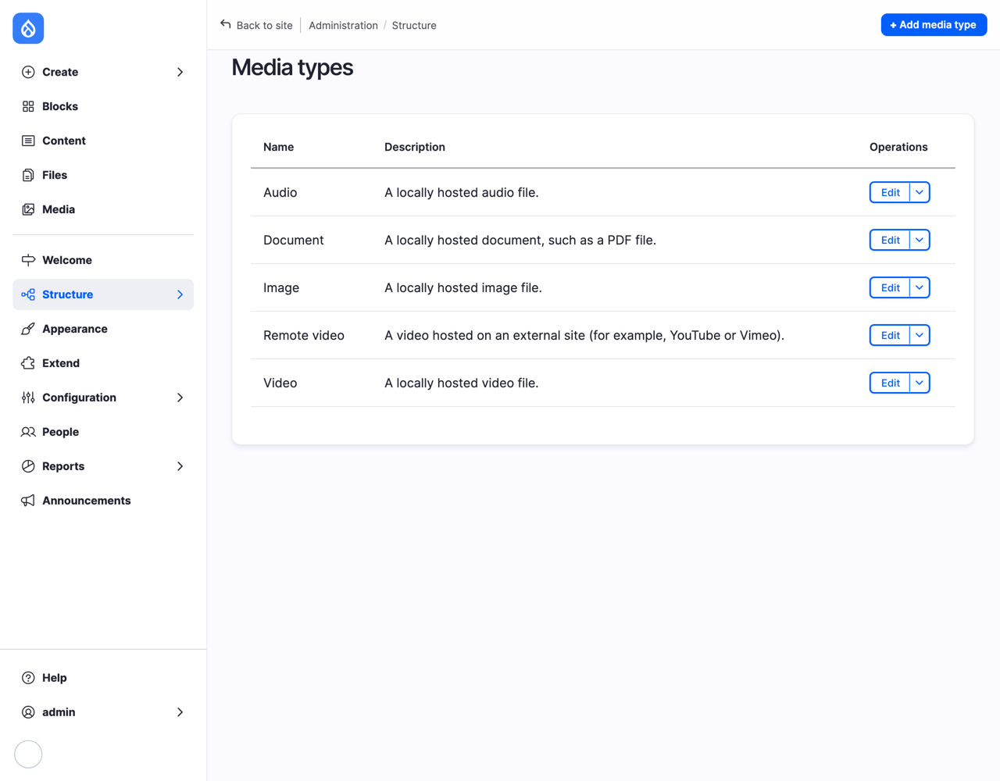
*Figure 9.2: The media types*

- **Image**: a photo or another picture, uploaded to the site.
- **Document**: a file such as a PDF, for the membership form, say.
- **Remote video**: a video on YouTube or Vimeo. Drupal stores only its address, and shows the video from there.
- **Audio** and **Video**: sound and video files, uploaded to the site. Videos are big; most sites put them on YouTube or Vimeo and use Remote video instead.

## Credits on every photo

Most of the club's photos will be the members' own, but some will come from elsewhere, and every photo needs to say who took it, and under which license we may use it. That's a job for fields, and because credits belong to the photo, not to the hike, we add them to the **Image** media type.

Select **Manage fields** for **Image**. There's one field already: **Image**, the file itself. We add three, in the same way as we added fields to Hike in Chapter 7.

**Photographer.** Choose **Plain text**, type `Photographer`, choose **Short text**, and select **Continue**. As the **Help text**, type `The photographer's name, as they want to be credited.`, and select **Save**.

**License.** Choose **Selection list**, type `License`, choose **Text**, and select **Continue**. Add these allowed values, one per row (select **Add another item** for each new row):

- `CC BY-SA 4.0`
- `CC BY-SA 2.0`
- `CC BY 4.0`
- `CC0`
- `All rights reserved, used with permission`

As the **Help text**, type `The license the photo is published under. Use only photos you're allowed to publish.`, check **Required field**, and select **Save**. A photo without a license is a photo we don't know we may use.

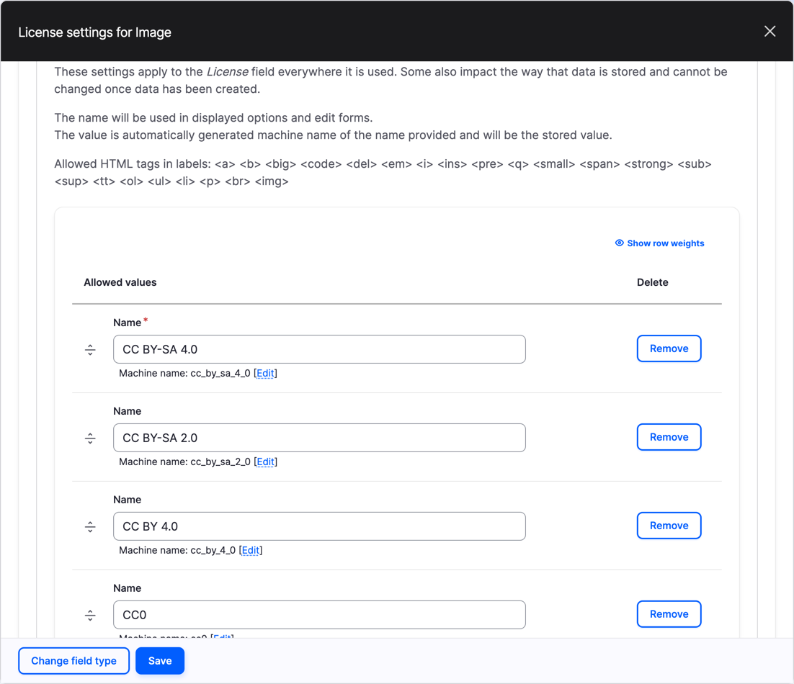
*Figure 9.3: The licenses a photo can have*

**Source.** Choose **Link**, type `Source`, and select **Continue**. Set **Allowed link type** to **External links only** and **Allow link text** to **Optional**, and as the **Help text**, type `Where the photo comes from, such as its page on Wikimedia Commons.` Select **Save**.

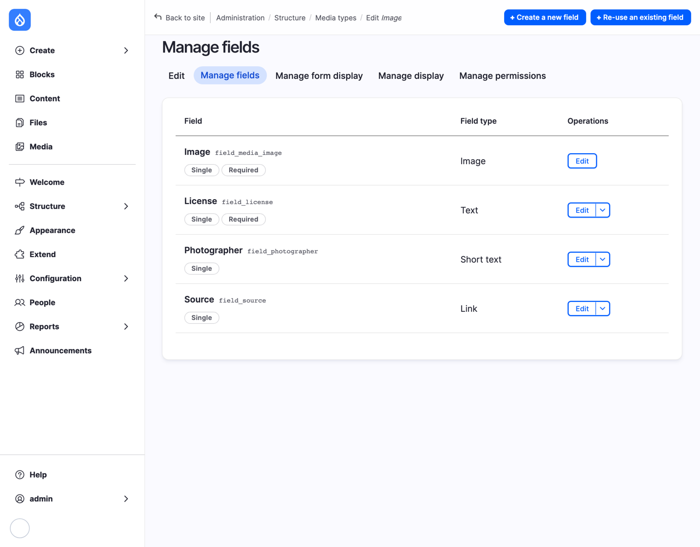
*Figure 9.4: The Image media type with its credit fields*

> **Where to find photos you may use.** Until the members' own photos come in, the club can use openly licensed ones. [Wikimedia Commons](https://commons.wikimedia.org) has millions of photos, and [Openverse](https://openverse.org) searches Commons and many other collections at once. Look at the license of every photo: a Creative Commons license such as CC BY-SA or CC BY lets you use the photo if you credit the photographer, CC0 asks for nothing, and "All rights reserved" means you need to ask. The photos in this book are from Wikimedia Commons; you'll find them, with their credits, in the book's `examples/photos/` folder. That's also why we gave every photo a Photographer, a License and a Source: with them, the site can credit each photo where it's shown.

### Two forms for one media type

There's one more thing to do, and it's one people often miss. Media has two forms. The **Default** form is the one you see when you add a media item at **Content** > **Media**. The **Media library** form is a shorter one, used when an editor uploads a photo from inside the library, while editing a hike. Drupal added our new fields to the Default form, but not to the Media library form, so an editor uploading from a hike couldn't fill in the credits. And both forms hide the **Name**, which Drupal then makes from the file name ("turnhouse-hill-glencorse.jpg"). A name such as "Turnhouse Hill across Glencorse Reservoir" is much easier to find in the library.

1. Select **Manage form display** for **Image**. You see two tabs: **Default** and **Media library**. These are *form modes*, the form's counterpart of the view modes from Chapter 8.
2. On **Default**, drag **Name** out of **Disabled**, to below **Image**, and select **Save**.
3. On **Media library**, drag **Name**, **Photographer**, **License** and **Source** out of **Disabled**, in that order, below **Image**, and select **Save**.

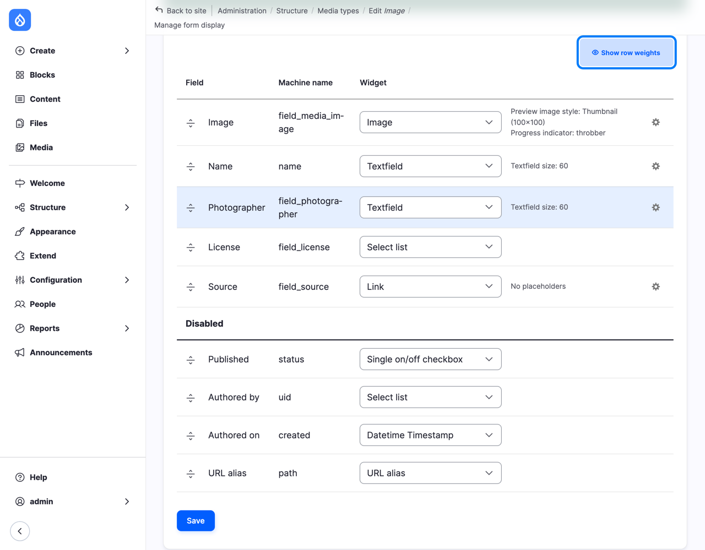
*Figure 9.5: The Media library form, with the credits*

## The first photo

Now let's add a photo to the library: a view of Turnhouse Hill, for our hike.

1. Go to **Content** > **Media**, select **Add media**, and choose **Image**.
2. Under **Image**, choose the file. (I use `turnhouse-hill-glencorse.jpg` from the book's `examples/photos/` folder; any photo of yours will do.)
3. Drupal uploads the file at once, shows it, and asks for the **Alternative text**. Type `Turnhouse Hill seen across Glencorse Reservoir, with a rowing boat at the landing stage`.
4. As the **Name**, type `Turnhouse Hill across Glencorse Reservoir`.
5. Fill in the credits: **Photographer** `dave souza`, **License** **CC BY-SA 4.0**, and as the **Source**, the photo's page on Wikimedia Commons as the **URL**, and `Wikimedia Commons` as the **Link text**.
6. Select **Save**.

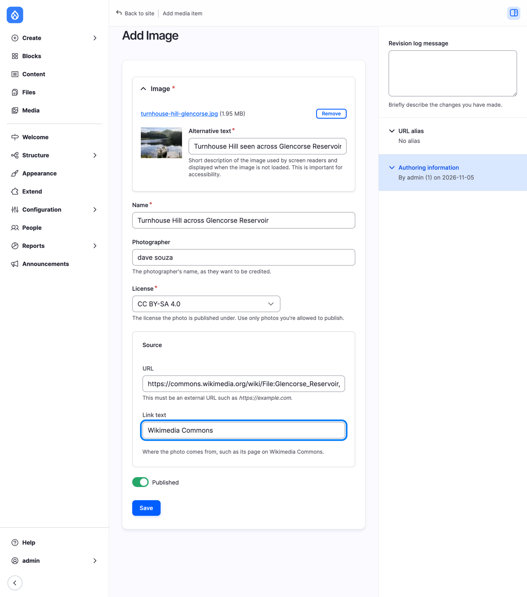
*Figure 9.6: Adding the first photo*

> **Alternative text matters.** The alternative text is what a screen reader reads out instead of the photo, and what a browser shows when the photo can't load. Describe what the photo shows, in a sentence, as you would to someone on the phone: not "photo" or "IMG_2041", and not the name of the photo again. That's why Drupal requires it.

The photo is now in the library. **Content** > **Media** lists it, with a thumbnail, its type and its author; the **Grid** tab shows the same as a wall of thumbnails.

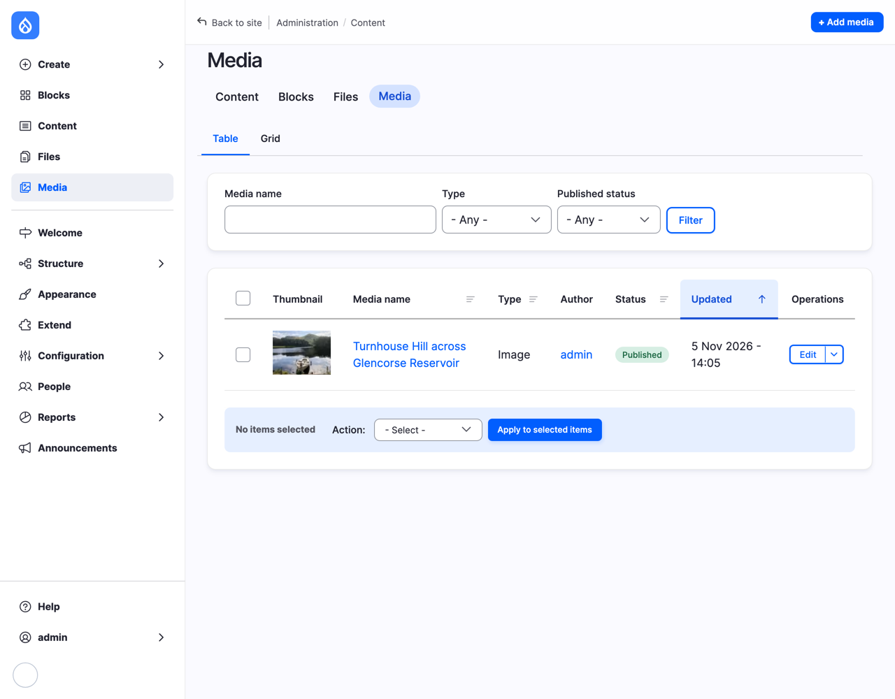
*Figure 9.7: The library, with one photo*

## A Photo field on Hike

Now the hike can refer to the photo. On Hike's **Manage fields**, select **Create a new field**. In the list of field types, there's a new group since we installed Media: **Media**. It sits next to **File upload**, where the plain Image field lives. You know now why we pick Media.

1. Choose **Media**, and type `Photo` as the **Label**. Drupal shows the advice we quoted earlier. Select **Continue**.

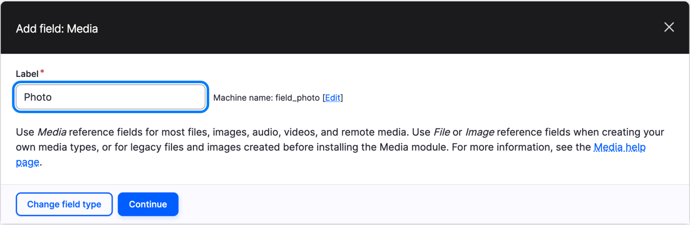
*Figure 9.8: A Media field called Photo*

2. Under **Media type**, check **Image**: a hike's photo is a photo, not a video or a document. As the **Help text**, type `A photo of the hike's area, shown at the top of the hike.`, and select **Save**.

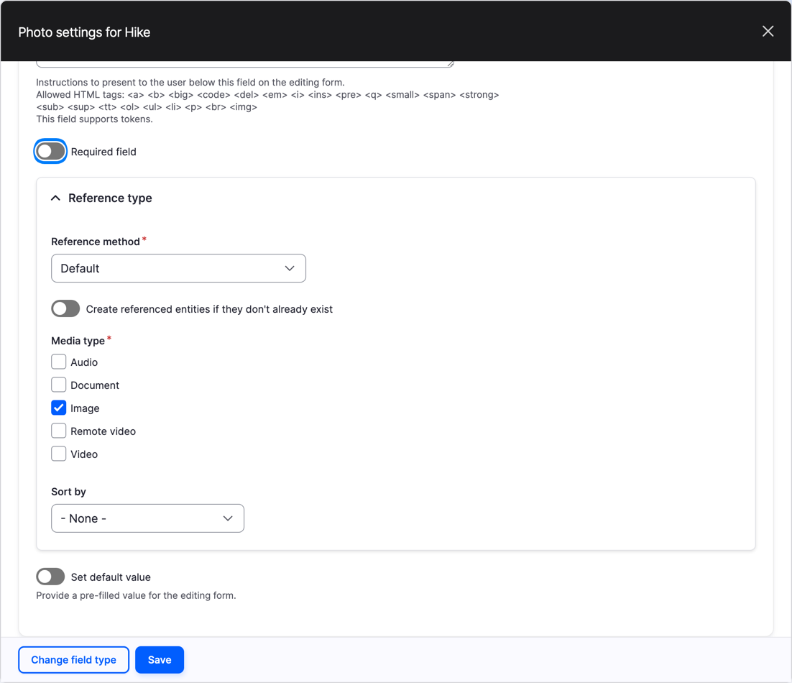
*Figure 9.9: Only images for the hike's photo*

Now edit the hike *Turnhouse Hill and Carnethy Hill*. At the bottom of the form, there's the **Photo** field, with an **Add media** button.

3. Select **Add media**. The **Add or select media** window opens: at the top, you can upload a new photo, and below, you see the library. Check the photo of Turnhouse Hill, and select **Insert selected**.

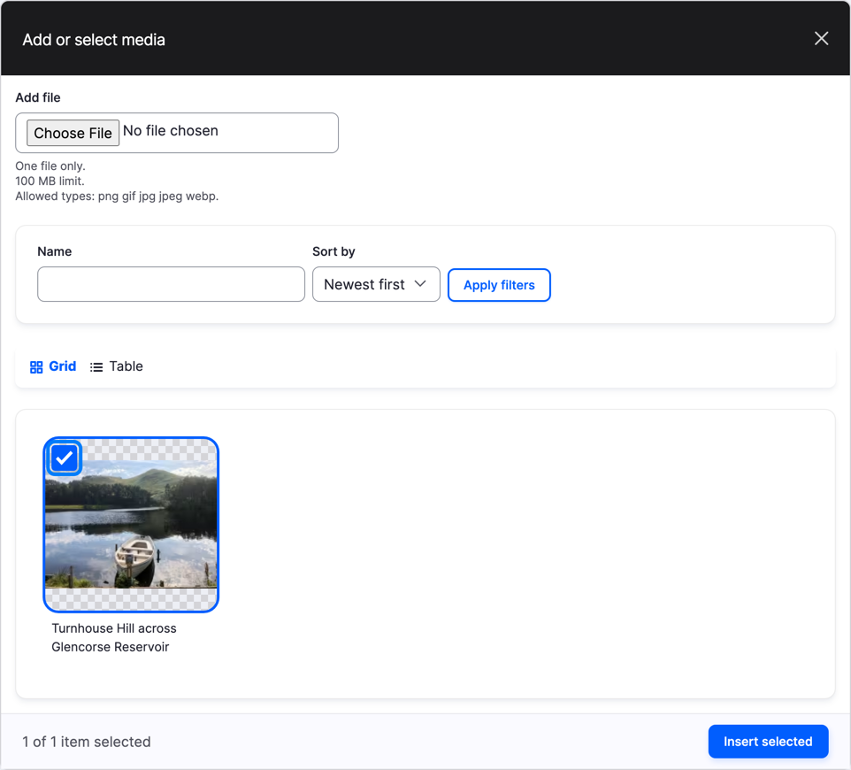
*Figure 9.10: Choosing the photo from the library*

4. The photo appears in the field, with a cross to remove it. Set **Change to** to **Published**, and select **Save**.

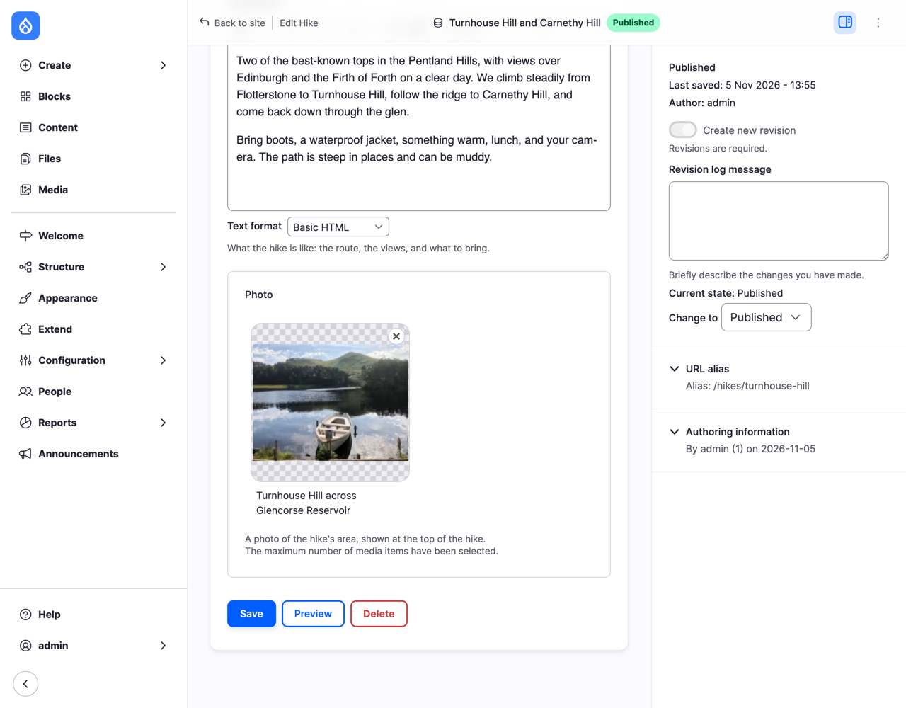
*Figure 9.11: The hike, with its photo*

Last, the photo should be the first thing on the hike page. On Hike's **Manage display**, **Manage** the **Default** display, drag **Photo** to the top, set its **Label** to **- Hidden -**, and select **Save**. (Drupal added the new field at the bottom of the display, with its label above, as it does with every new field.)

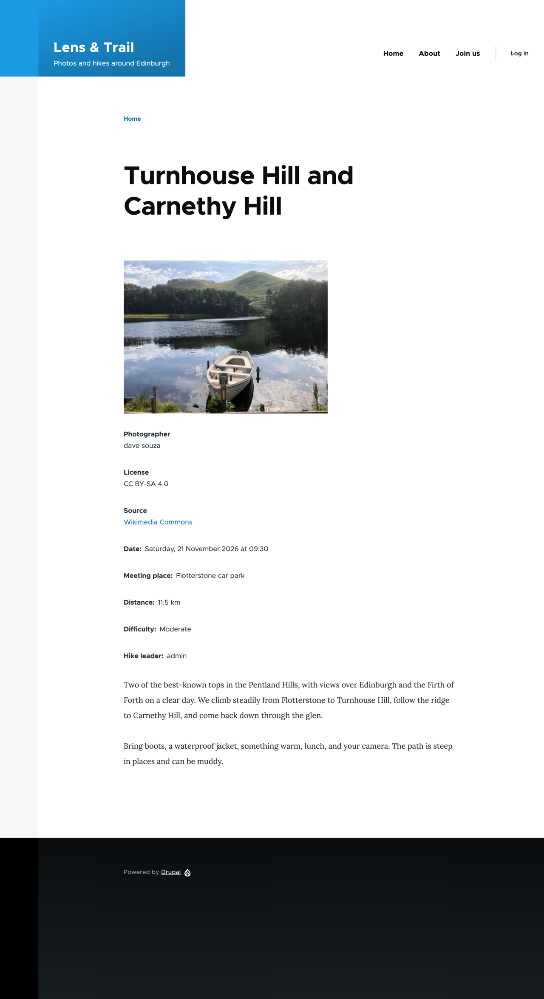
*Figure 9.12: The hike with its photo*

The photo is there, but it's small, and the credits below it take up a lot of room. Both come from the *media item's* display, not the hike's: the hike's Photo field uses the formatter **Rendered entity**, which shows the media item the way its own **Default** display does. You'll remember this from Chapter 8: one reference, shown through the other entity's view mode. The media item's display uses an *image style* called **Large**. Let's see what that is.

## Image styles

Didn't we upload a big photo? We did: the file is 3840 by 2880 pixels, and 2 MB. If Drupal sent that file to every visitor, the hike page would load slowly on a phone, and eat into people's mobile data, to show a photo that's 480 pixels wide on screen. It doesn't. Right-click the photo on the hike page and open it in a new tab, and look at its address: it's in a folder called `styles/large`, and it ends in `.avif`. That file is 480 by 360 pixels, and 19 KB: about a hundredth of the original.

That's an *image style* at work. An image style is a recipe for a copy of a photo: scale it to 480 pixels, crop it to a square, make it black and white, save it in a smaller format. You upload a photo once, at the best quality you have, and Drupal makes the copies the site needs, each from the original, the first time a page asks for it. The original is never changed.

Go to **Configuration** > **Media** > **Image styles**. Drupal comes with five.

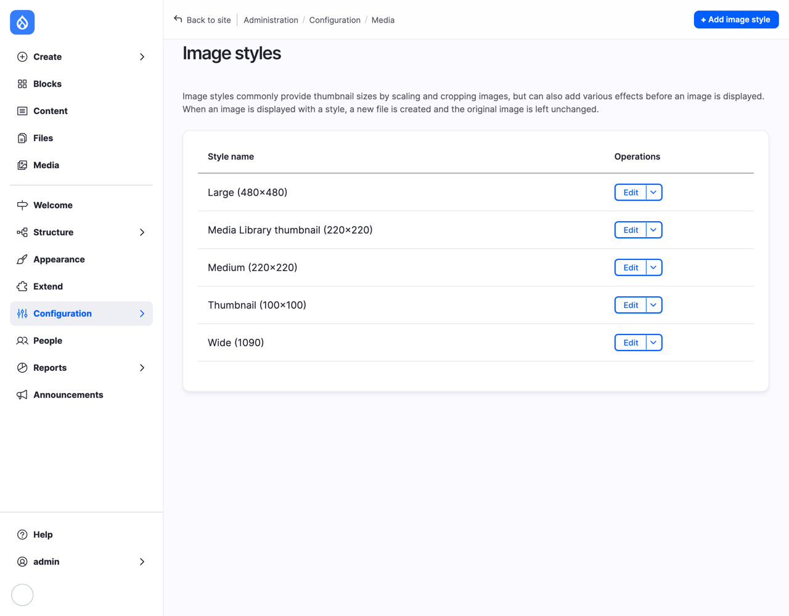
*Figure 9.13: Drupal's image styles*

Select **Edit** for **Wide (1090)** to see how one is made. It has two *effects*, applied in order: **Scale** to 1090 pixels wide, and **Convert to AVIF**, with WebP as the fallback. AVIF and WebP are image formats made for the web: a photo in AVIF is often less than half the size of the same photo as a JPEG, and looks the same. Drupal uses AVIF when the server can make it, and WebP when it can't.

These are the effects you can use:

- **Scale**: makes the photo smaller (or larger, if you allow it) until it fits a width, a height, or both, and keeps its shape. A tall photo stays tall.
- **Scale and crop**: scales the photo until it fills an exact size, and cuts off what sticks out. Every photo ends up the same shape, which is what you want in a row of cards, or in a banner.
- **Crop**: cuts out a part of the photo, without scaling.
- **Resize**: forces the photo to an exact size, and stretches it if it must. You rarely want this.
- **Desaturate**, **Rotate**, **Convert** and **Convert to AVIF**: black and white, a turn, and a different file format.

### A Banner style

For the hike page, we want the photo wide, across the whole column, and always the same shape: 16:9, like a wide screen.

1. On **Image styles**, select **Add image style**. Type `Banner` as the **Image style name**, and select **Create new style**.
2. Under **Effect**, choose **Scale and crop**, and select **Add**. Set **Width** to `1280` and **Height** to `720`, and select **Add effect**.
3. Choose **Convert to AVIF**, select **Add**, set **Fallback format** to **WEBP**, and select **Add effect**.
4. Select **Save**.

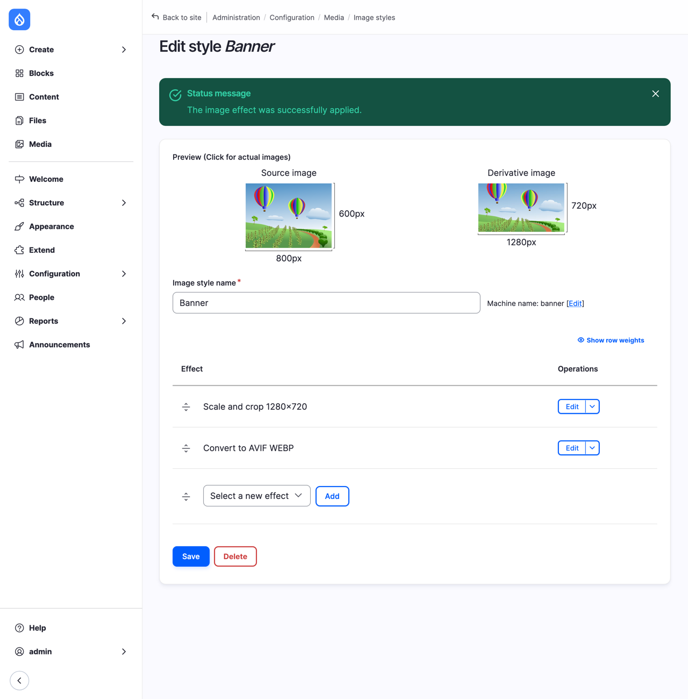
*Figure 9.14: The Banner image style*

At the top, Drupal shows what the style does to a sample image: the original on the left, the copy on the right. If you ever change a style, Drupal throws away the copies it made with the old recipe, and makes new ones as pages ask for them. Nothing to do for you.

### A Banner view mode for media

We could tell the media item's Default display to use the Banner style. But the Default display is used everywhere the photo appears, and not everywhere wants a wide banner. So we do what we learned in Chapter 8, and give media a view mode of its own.

1. Go to **Structure** > **Display modes** > **View modes**, and select **Add view mode** for **Media**.
2. Type `Banner` as the **Name**, and `A wide photo with its credits, at the top of a page.` as the **Description**. Check **Image**, and select **Save**.
3. Go to **Structure** > **Media types**, select **Manage display** for **Image**, and **Manage** the **Banner** display.
4. Set the **Label** of **Image** to **- Hidden -**. Select its cog, set **Image style** to **Banner**, and select **Update**.
5. Set the **Label** of **Photographer**, **License** and **Source** to **Inline**, and select **Save**.

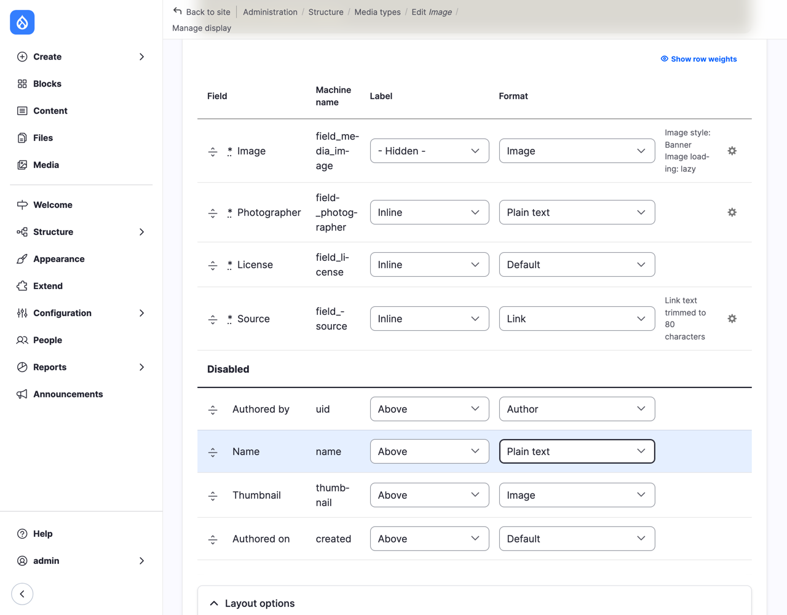
*Figure 9.15: The Banner display of an image*

6. Back on Hike's **Default** display, select the cog for **Photo**, set **View mode** to **Banner**, select **Update**, and then **Save**.

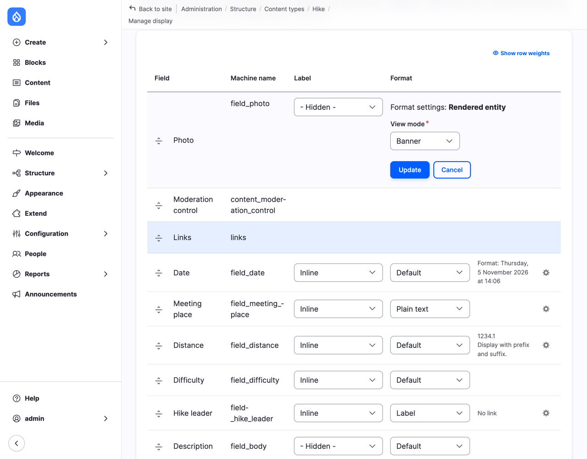
*Figure 9.16: The hike shows its photo as a banner*

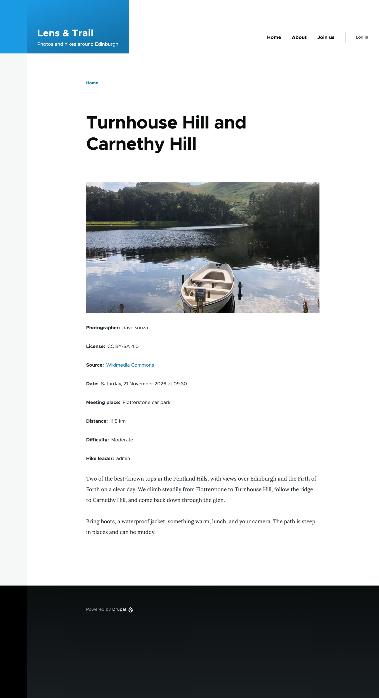
*Figure 9.17: The hike with its banner*

That's a hike page. And because the credits are part of the media item's Banner display, every hike's photo is credited, in the same way, without anyone remembering to do it.

> **Try it:** Make a style called `Black and white`, with **Scale** to a width of `800` and **Desaturate**. You'll find it useful for the club's yearly black-and-white photo competition. Try it on the hike by choosing it in the media's Banner display; what happens to the shape of the photo, and why? Then put **Banner** back.

## Responsive images

The Banner is 1280 pixels wide. On a large screen that's right, but a phone shows the hike's column about 350 pixels wide: it gets a photo that's far bigger than it needs. On the other hand, a very large, sharp screen could use more than 1280 pixels. The browser knows how wide the screen is, and how sharp; Drupal doesn't. So instead of choosing one copy, Drupal can offer the browser several, and let it pick. That's a *responsive image*.

Responsive images come with core, in the **Responsive Image** module. Go to **Extend**, filter on `responsive`, check **Responsive Image**, and select **Install**. The module brings four image styles of its own, **Max 325x325** to **Max 2600x2600**, which scale a photo without cropping it.

We need two more banner sizes. Make them as you made **Banner**, with the same two effects:

- **Banner small**: **Scale and crop** to `640` by `360`.
- **Banner large**: **Scale and crop** to `1920` by `1080`.

Now we tie them together in a *responsive image style*.

1. Go to **Configuration** > **Media** > **Responsive image styles**, and select **Add responsive image style**.
2. Type `Banner` as the **Label**.
3. Set **Breakpoint group** to **Responsive Image**. (More on breakpoints below.)
4. Open **1x Viewport Sizing**, and choose **Select multiple image styles and use the sizes attribute**.
5. As **Sizes**, type `(min-width: 1130px) 905px, 100vw`.
6. Under **Image styles**, check **Banner small**, **Banner** and **Banner large**.
7. Set **Fallback image style** to **Banner**, and select **Save**.

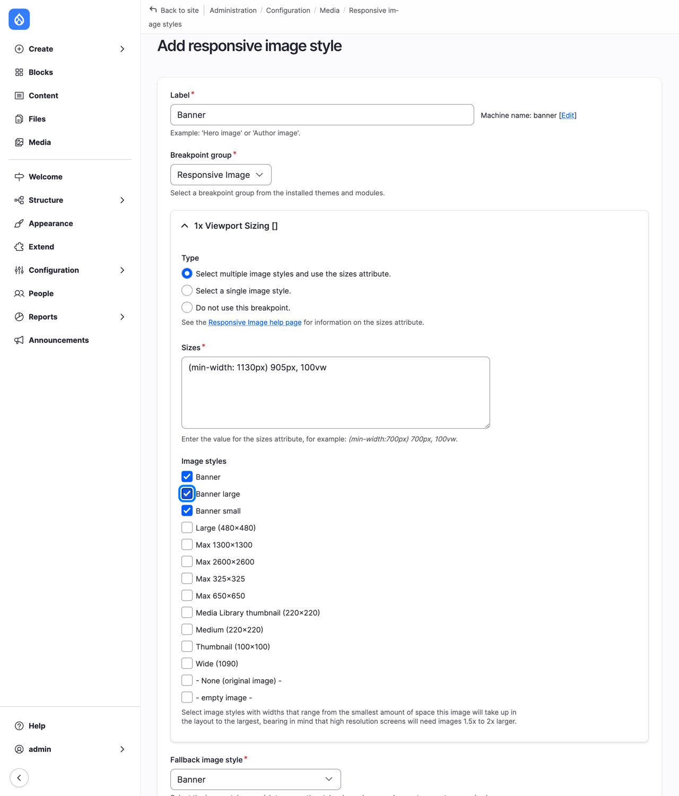
*Figure 9.18: The Banner responsive image style*

The **Sizes** line is the only hard part, so let's read it. It tells the browser how wide the photo will be on screen, before the page is even laid out: "on a screen of at least 1130 pixels, the photo is 905 pixels wide; on anything smaller, it's as wide as the screen" (`100vw` is 100% of the viewport, the browser window). I measured this on Olivero: its content column is never wider than about 905 pixels, and on smaller screens it's a little narrower than the window. If your guess is a bit too large, no harm done: the browser picks a slightly larger copy than it needs. The browser then takes the width, multiplies it by the screen's sharpness (a phone often has 2 or 3 pixels for every point), and picks the smallest copy that's large enough.

Last, the media's Banner display has to use it.

8. On the **Banner** display of **Image**, set the **Format** of **Image** to **Responsive image**. Select the cog, set **Responsive image style** to **Banner**, select **Update**, and then **Save**.

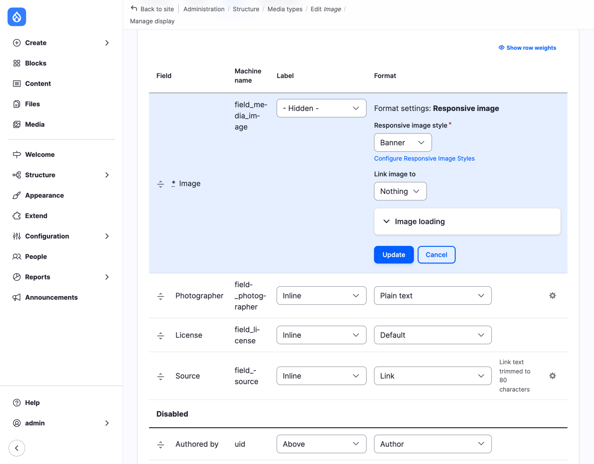
*Figure 9.19: The banner, responsive*

The hike looks the same as before on your screen. The difference is in the page's HTML. If you look at the page's source, the photo is now:

```html

```

Three copies to choose from, the sizes line, and the Banner copy for browsers that don't understand any of it.

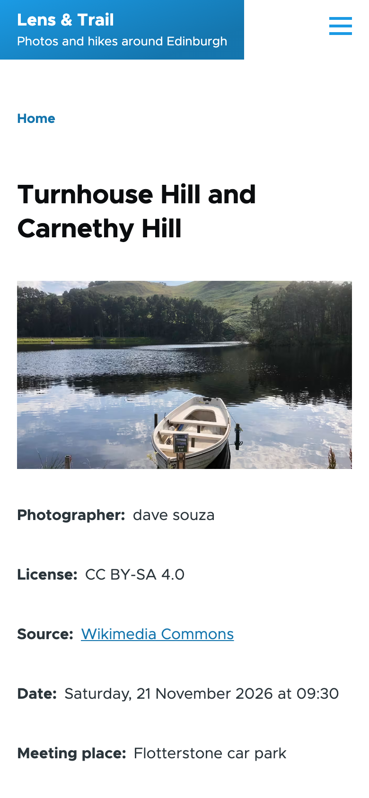
*Figure 9.20: The hike on a phone*

> **Breakpoints.** A *breakpoint* is a screen width at which a theme changes its layout: the menu becomes a button, columns stack. Themes declare theirs, in a *breakpoint group*: Olivero has one, and the Responsive Image module has a simple one of its own, **Responsive Image**, with no widths at all. With a theme's group, you can give each breakpoint its own image style, for example a square photo on phones and a wide one on computers (that's called *art direction*). For the same photo in different sizes, the **sizes** approach we used is simpler, and it doesn't depend on the theme: we'll keep it if we change themes in Chapter 15.

> **Try it:** Give News a photo too. On News's **Manage fields**, select **Re-use an existing field**, and re-use **Photo**. Then edit *The club has a website*, select **Add media**, and this time upload a new photo from inside the window: I use `edinburgh-skyline.jpg`, Edinburgh's Old Town from Calton Hill, by Jim Barton, CC BY-SA 2.0. Because we added the credits to the **Media library** form, you can fill them in right there. Then give News's display the same treatment as Hike's: Photo at the top, label hidden, **Banner** view mode.

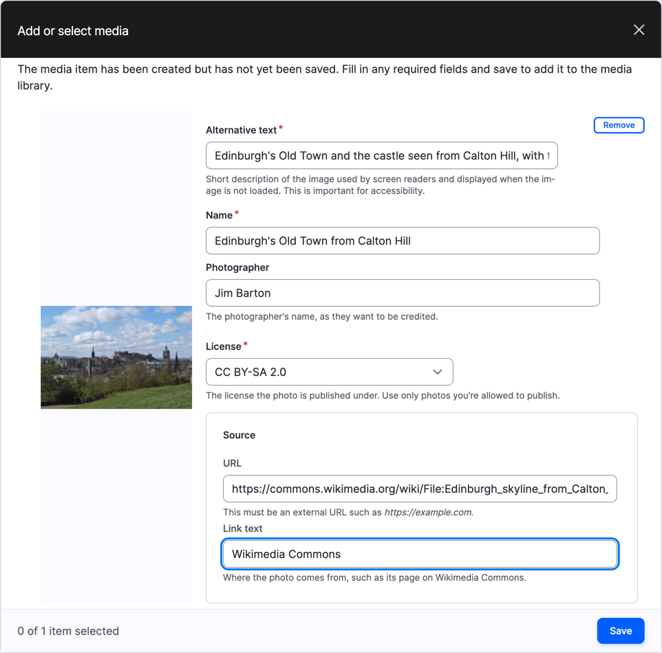
*Figure 9.21: Uploading a photo from inside the library*

## Media in the text editor

Sometimes an editor wants a photo inside the text: in the middle of a trip report, say. The text editor can do that with media too.

Before we do it, though, my own view, after many years of building Drupal sites: I hardly ever offer it. A photo inside a text box is part of that text. Its size and place are whatever the editor made them, it's hard to keep consistent across a site, and it breaks quietly when someone edits the text. A **Photo** field, shown by the display, or a page laid out with Layout Builder or Canvas, as in Chapter 8, keeps text and images apart, and the site looks the same everywhere. So think of this as a tool for the odd exception, not for every page. You may well decide to leave it off.

The text editor of **Basic HTML**, the text format our Body and Description fields use, has an **Upload image** button. Like a plain Image field, it uploads a picture that isn't media: no credits, no library, no reuse. So we swap it for media.

1. Go to **Configuration** > **Text formats and editors**, and select **Configure** for **Basic HTML**.
2. Under **Toolbar configuration**, **Active toolbar** shows the buttons editors have. Drag **Upload image** (the picture icon) up to **Available buttons**, to remove it.
3. Drag **Drupal Media** (the picture with a music note) from **Available buttons** down into the **Active toolbar**, where **Upload image** was. If dragging is awkward: select a button and use the arrow keys; down adds it, up removes it, left and right move it.
4. Under **Enabled filters**, check **Embed media**. (Drupal reminds you if you forget: the button needs the filter.)
5. In the **Embed media** tab below, check **Image** under **Media types selectable in the Media Library**, and set **Default view mode** to **Banner**.
6. Select **Save configuration**.

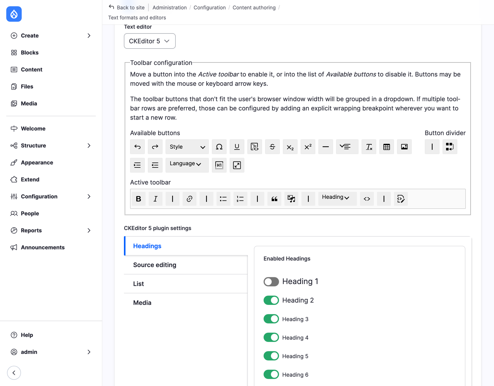
*Figure 9.22: The Drupal Media button in the toolbar*

Editors now have a media button in the editor. It opens the same **Add or select media** window, and puts the photo into the text, shown in the **Banner** view mode, with its credits.

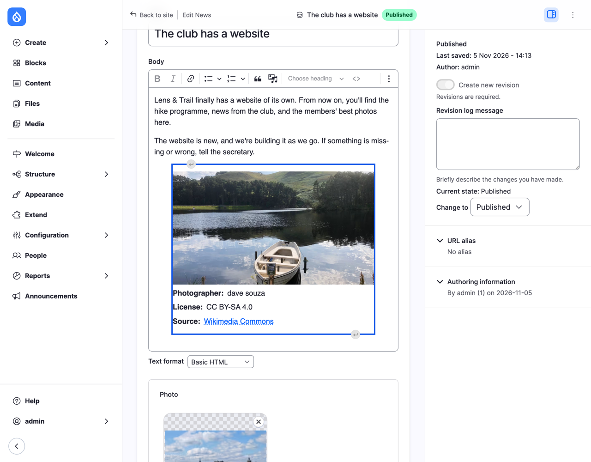
*Figure 9.23: A photo inside the text*

## Galleries: albums of the club's outings

After every hike, the members have photos to share. The club wants an album per outing: "Pentlands, 21 November", with the photos from that day, and a link to the hike. That's a content type, with a Media field that takes as many photos as you like.

1. Go to **Structure** > **Content types**, and select **Add content type**. Type `Gallery` as the **Name**, and `A photo album from one of the club's hikes or photo evenings.` as the **Description**.
2. Under **Display settings**, uncheck **Display author and date information**, and under **Menu settings**, uncheck **Main navigation**, as for hikes.
3. Select **Save and manage fields**.
4. **Re-use an existing field**: **Body**. Drupal fills in the label and help text from Hike (see Chapter 7), so the **Label** already says `Description`. Change the **Help text** to `What the album is about: where and when, and anything worth knowing.`, and select **Save settings**.
5. **Create a new field**: **Media**, labeled `Photos`. In its settings, set **Allowed number of values** to **Unlimited**, check **Image** as the media type, type `Upload several photos at once: select them all in the file window.` as the **Help text**, check **Required field**, and select **Save**.
6. **Create a new field**: **Reference**, labeled `Hike`, and choose **Content**. Under **Content type**, check **Hike**, type `The hike the photos are from, if they're from one.` as the **Help text**, and select **Save**.

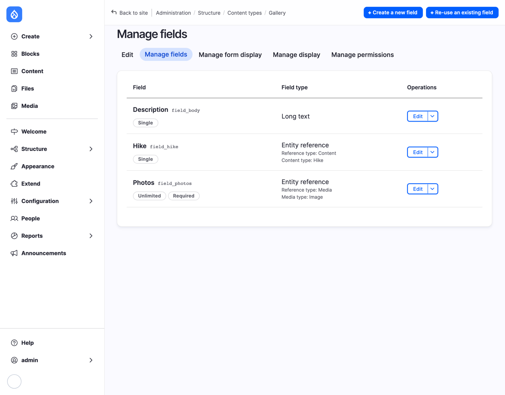
*Figure 9.24: The Gallery content type*

An album shows its photos whole: a tall photo should stay tall, so no **Scale and crop** here.

7. Add a view mode for media called `Album`, for **Image**, as you did for **Banner**. On its display, hide the **Image** label, set the image style to **Max 1300x1300** (one of Responsive Image's styles, which scales without cropping), and set the credits' labels to **Inline**.
8. On Gallery's **Default** display, put **Hike** first, with an **Inline** label, then **Description**, then **Photos**, with its label hidden and **Album** as its **View mode**.

Now the first album.

9. Go to **Create** > **Gallery**. Type `Pentlands, 21 November` as the **Title**, write a line as the **Description**, and type `Turn` in **Hike**: Drupal suggests *Turnhouse Hill and Carnethy Hill*.
10. Under **Photos**, select **Add media**. In the window, choose several files at once in the file dialog (with Ctrl or ⌘ held down). Drupal uploads them all, and shows a form for each. Fill in each photo's alternative text, name and credits, and select **Save**.

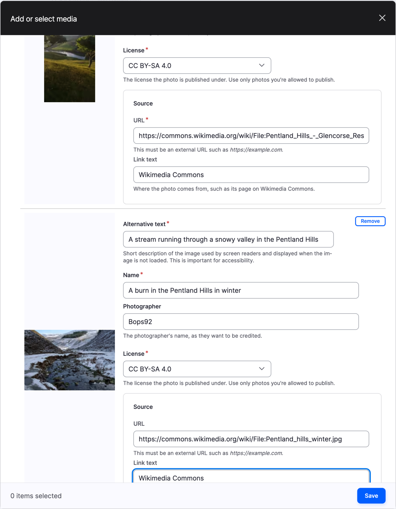
*Figure 9.25: Uploading the album's photos at once*

11. The new photos are selected for you. Select **Insert selected**, and **Save** the album.

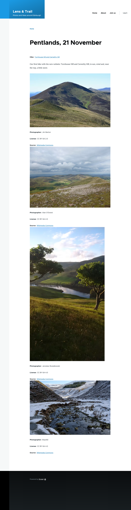
*Figure 9.26: The first album*

The photos come one under the other, each with its credits; the tall photo of Glencorse Reservoir stays tall. A grid of thumbnails, where you select a photo to see it large, is something a theme does (Chapter 15) or a view (Chapter 12), and that's also where the list of all albums, at `/galleries`, will come from. Every photo in the album is in the library too, so a hike leader can use one of them as the photo of next year's hike.

> **Try it: video and documents.** Media isn't only photos. Add a **Remote video**: at **Content** > **Media** > **Add media** > **Remote video**, paste the address of a YouTube video, such as `https://www.youtube.com/watch?v=zHgHQD-mL5s` (the Drupal Association's keynote from DrupalCon Atlanta 2025). Drupal fetches the title and a thumbnail from YouTube, and shows the video from there. Then add a **Document**: the club's membership form, `membership-form.pdf` from the book's `examples/` folder. Where would you put the form on the site?

> **On Drupal CMS:** Drupal CMS has media set up from the start: Image, Document, Remote video, Video, and **SVG Image** for logos and icons. Its text editor has the media button, and no Upload image button, for the reasons above. Two things go further than what we built. First, the **Focal Point** module: when you upload a photo, you click the most important spot in it (the crosshair in Figure 9.27), and every **Scale and crop** keeps that spot in the picture, so a banner never cuts off the hiker's head. Second, Drupal CMS comes with more than 60 image styles, named after their shape and size, such as "16:9 | 1312x738 | Focal Point | WebP", and responsive image styles that use them. Its Featured image field shows a photo through media view modes, as we did with **Banner**. You can add Focal Point to a core site too, as a contributed module (Chapter 11).

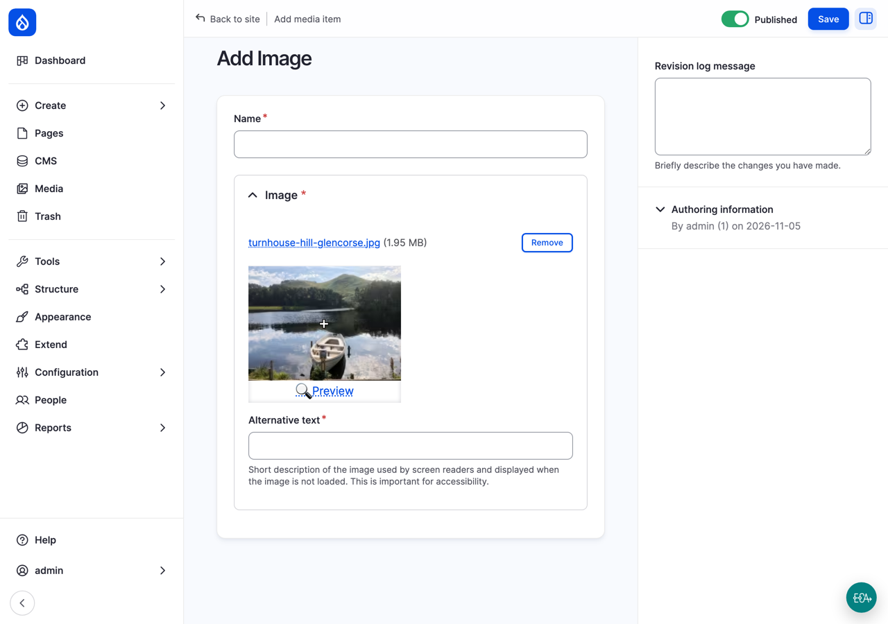
*Figure 9.27: Focal Point on Drupal CMS*

> **Coming from WordPress?** The Media Library will feel familiar: in WordPress, every upload is an *attachment* in the Media Library, and a post's *featured image* is a reference to one. Drupal's media items are the same idea, with fields of your own, such as our credits. Two differences are worth knowing. WordPress makes its image sizes (thumbnail, medium, medium_large and large) at the moment you upload, so when you change a size, only new uploads get it, and the old ones need a plugin such as Regenerate Thumbnails. Drupal makes an image style's copy the first time a page asks for it, and remakes them when you change the style. And WordPress adds `srcset` to images by itself (since version 4.4); in Drupal, you decide which copies to offer, with a responsive image style, as we did.

## Summary

You can now:

- explain why a site uses media instead of plain image fields;
- install Media and Media Library, and add fields, such as credits, to a media type;
- use form modes to decide which fields the Media Library's upload form shows;
- add a Media field to a content type, and choose or upload photos in the Media Library;
- make image styles with effects, and use them through a media view mode;
- set up a responsive image style, so browsers get the size of photo they need;
- put the media button in the text editor, and decide whether to offer it;
- build a content type for photo albums.

## Exercises

1. Add the photo of Portobello beach (`portobello-beach.jpg` in `examples/photos/`) to the library, with its credits from `examples/photos/CREDITS.md`. Then use it as the photo of one of the Portobello hikes from Chapter 7's exercises.
2. Give the Hike's **Card** view mode from Chapter 8 a photo: a square one. Make an image style `Square` (**Scale and crop** to `400` by `400`), a media view mode `Square` that uses it (without the credits), and show the Photo in the Card display with that view mode. Is it all right to leave out the credits here? Where would a visitor find them?
3. Edit the photo of Turnhouse Hill in the library (at **Content** > **Media**), and correct its name to `Turnhouse Hill from Glencorse`. Where does the change show up? What would have happened if the hike had a plain Image field instead?
4. Delete the Video media type from **Structure** > **Media types**. Why might the club not want members to upload videos to the site itself?
5. *(challenge)* Add a second album, for a photo evening, without a hike. Which of the club's photos would you reuse, and which fields would you want to add to Gallery for photo evenings? (Think about Chapter 10, where categories come in.)

## Want to know more?

- [Media module overview](https://www.drupal.org/docs/8/core/modules/media/overview), drupal.org's documentation of the Media module.
- [Concept: Image styles](https://www.drupal.org/docs/user_guide/en/structure-image-styles.html), in the Drupal User Guide.
- [Concept: Responsive Image Styles](https://www.drupal.org/docs/user_guide/en/structure-image-responsive.html), in the Drupal User Guide.
- [Responsive images](https://developer.mozilla.org/en-US/docs/Web/HTML/Guides/Responsive_images), on MDN: how `srcset` and `sizes` work in the browser.
- [Focal Point](https://www.drupal.org/project/focal_point), the module Drupal CMS uses to keep the important part of a photo in every crop.
- [Wikimedia Commons](https://commons.wikimedia.org) and [Openverse](https://openverse.org), for openly licensed photos.
