# Taxonomy

The club's site is filling up: hikes, news, photos and albums. Soon a visitor will want to ask it questions. Which hikes are in the Pentland Hills? Are there any photos of water, or of winter? To answer them, the site needs *categories*: a shared list of places, and a shared list of photo themes, that hikes, albums and photos can point to. In Drupal, categories are called *taxonomy*.

In this chapter we build two: **Areas**, a list of the places the club goes, from regions down to single hills, and **Photo themes**, a list of what a photo shows, that members add to as they upload. We start where Chapter 9 left us: hikes and news with photos, a media library with credits, and a Gallery content type with the first album.

## Vocabularies and terms

The word *taxonomy* comes from biology, where it's the science of sorting living things into groups. Drupal uses it for any kind of sorting, and it has two words you need to know:

- A **vocabulary** is a list of categories for one purpose: *Areas*, *Photo themes*, *Tags*, *Audiences*. You decide which vocabularies a site has.
- A **term** is one category in a vocabulary: *Pentland Hills*, *Turnhouse Hill*, *Winter*. Terms are what editors pick when they fill in a hike or a photo.

Terms can sit under other terms, in a tree: *Turnhouse Hill* under *Pentland Hills*, *Portobello* under *Edinburgh*. That's called a *hierarchy*, and it's up to you whether a vocabulary uses one.

A hike gets its area through a field, in the same way it gets its hike leader. In Chapter 7, the Hike leader field refers to a user; the Area field we'll add refers to a term. Each term then has a page of its own, which lists everything that refers to it: the page for *Turnhouse Hill* lists the hikes and albums from Turnhouse Hill.

> **Drupalism: terms are entities.** You'll remember from Chapter 7 that nearly everything in Drupal is an entity. Terms are too: a *taxonomy term* is an entity type, and its vocabularies are its bundles, in the same way content types are the bundles of content and media types are the bundles of media. That's why a vocabulary has **Manage fields**, **Manage form display** and **Manage display**, just like a content type, and why an area can have a photo.

## A list, a vocabulary or a content type?

Before we build anything, a question that comes up on every site: when should something be a vocabulary, and when something else? In Chapter 7, we made **Difficulty** a list field (Easy, Moderate, Hard), and a hike its own content type. Areas could have been either. Here's how I think about it.

| | List field | Vocabulary | Content type |
|---|---|---|---|
| On the club's site | Difficulty | Areas, Photo themes | Hike, Gallery |
| Who changes the choices | The site builder, in the field's settings | Editors, as content | Editors, as content |
| Has a page of its own | No | Yes, listing what refers to it | Yes |
| Can have fields | No | Yes: a description, a photo, anything | Yes, as many as you need |
| Can sit in a tree | No | Yes | Not by itself |
| Revisions and workflow | No | Revisions, and published or not | Revisions, and moderation (Chapter 6) |

A **list field** is right for a short set of choices that rarely changes, and that only the people who build the site should change: three difficulties will be three difficulties for years. Its values are part of the site's configuration, not its content (more about that difference in Chapter 21).

A **vocabulary** is right when editors should be able to add to the list, when each choice deserves a page that gathers everything about it, or when the choices form a tree. The club will hike in new places, and a visitor will want to see everything from the Pentland Hills in one place.

A **content type** is right when the thing is content in its own right, with a story to tell, its own photos, and an editor who writes and revises it. If you find yourself wanting a long text, a gallery and a workflow for a category, it wants to be a content type. Sometimes a site has both: a *Pentland Hills* page written as content, and an *Areas* vocabulary to sort hikes by.

Sometimes we have to follow our guts. Don't worry if you choose one and later wish you'd chosen the other: you can change your mind, and Exercise 4 at the end of this chapter does just that, with Difficulty.

## The Areas vocabulary

1. Go to **Structure** > **Taxonomy**. There are no vocabularies yet: Drupal 12's Standard installation doesn't make any.
2. Select **Add vocabulary**. Type `Areas` as the **Name**, and `Regions, and the hills and places in them.` as the **Description**.
3. Leave **Create new revision** off. (With it on, every change to a term is kept as a revision, as with content. For a list of places, we don't need that.)
4. Select **Save**.

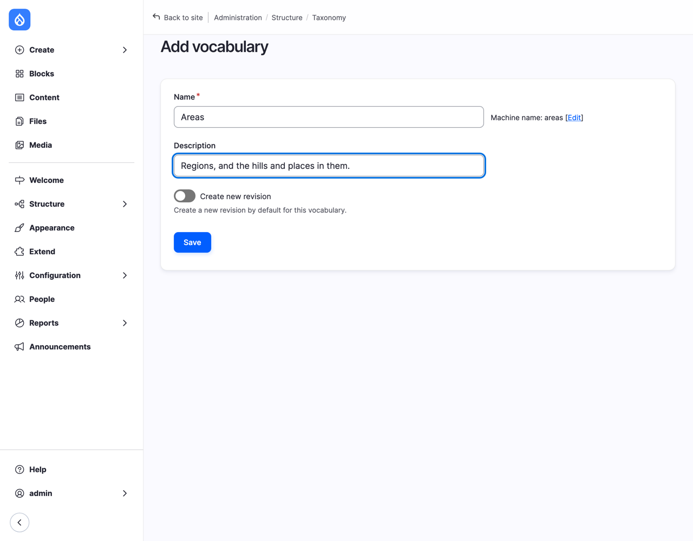
*Figure 10.1: A vocabulary for the club's areas*

Drupal takes you to the vocabulary's list of terms, which is empty. Notice that there's no setting for a hierarchy: a vocabulary has one as soon as a term has a parent.

### Adding terms

Start with the regions. Select **Add term**, type `Pentland Hills` as the **Name**, and, as the **Description**, a line about the area for visitors: `A range of hills south-west of Edinburgh, most of it a regional park. The club's favourite: a bus from the city centre takes you to the foot of the hills.` Select **Save**. Add `Edinburgh` and `East Lothian` in the same way.

Then the places in them. Add `Turnhouse Hill`, and before you save, open **Relations**. **Parent terms** lists the terms you have so far, and **&lt;root&gt;**, which means "no parent". Choose **Pentland Hills**, and select **Save**.

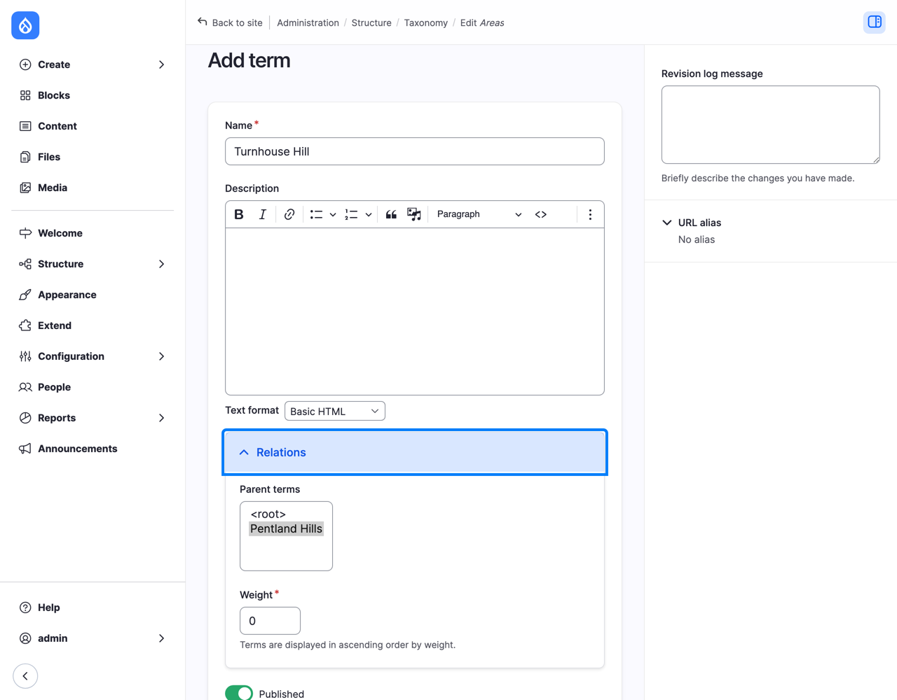
*Figure 10.2: Turnhouse Hill, under Pentland Hills*

Add these too, each with its region as the parent:

- under **Pentland Hills**: `Carnethy Hill`, `Glencorse Reservoir`;
- under **Edinburgh**: `Arthur's Seat`, `Calton Hill`;
- under **East Lothian**: `North Berwick Law`.

And add `Portobello`, Edinburgh's beach, but this time leave its parent at **&lt;root&gt;**: we'll fix that by dragging.

> **Tip:** **Save** on the term form keeps the form open for the next term, and **Save and go to list** takes you back to the list.

### Ordering and nesting by dragging

Select the **List** tab of Areas. The terms are in a tree, regions first, places indented under them, each level in alphabetical order. Two things to change:

1. The Pentland Hills are the club's favorite, so they should come first. Drag **Pentland Hills** by its handle (the cross) above **East Lothian**. Its places come with it.
2. **Portobello** is at the bottom, with no parent. Drag it up below **Calton Hill**, and then a little to the right: it's indented, and now it's under Edinburgh.

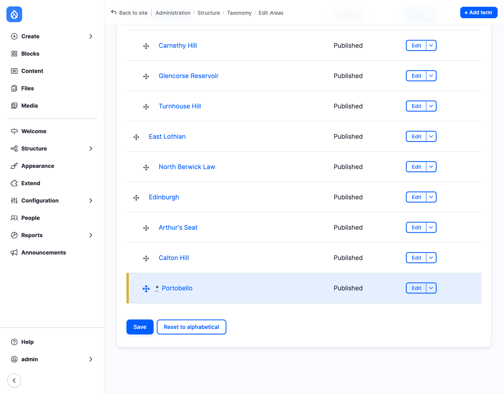
*Figure 10.3: Dragging terms into place*

Drupal marks what you've moved with an asterisk, and warns you that the changes aren't saved yet. Select **Save**.

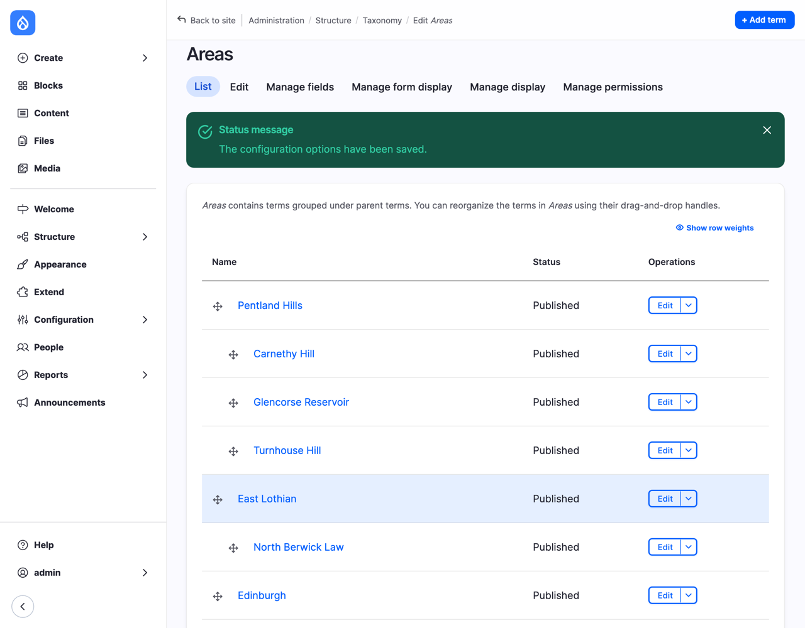
*Figure 10.4: The Areas vocabulary*

If you prefer, **Show row weights** gives you numbers instead of handles, as on **Manage display** in Chapter 8; and **Reset to alphabetical** puts every level back in alphabetical order. You can also change a term's parent in its own form, under **Relations**.

## Fields on terms: a photo for each area

An area's page is a page visitors will see, so it should look like one. Let's give each area a photo, shown at the top of its page, with the description below it.

1. On Areas, select the **Manage fields** tab. There are no fields: the **Name** and the **Description** are built into every term, the way the **Title** is built into content.
2. Select **Create a new field**, choose **Media**, and type `Photo` as the **Label**. Select **Continue**.
3. Check **Image** as the media type, type `A photo of the area, shown at the top of its page.` as the **Help text**, and select **Save**.

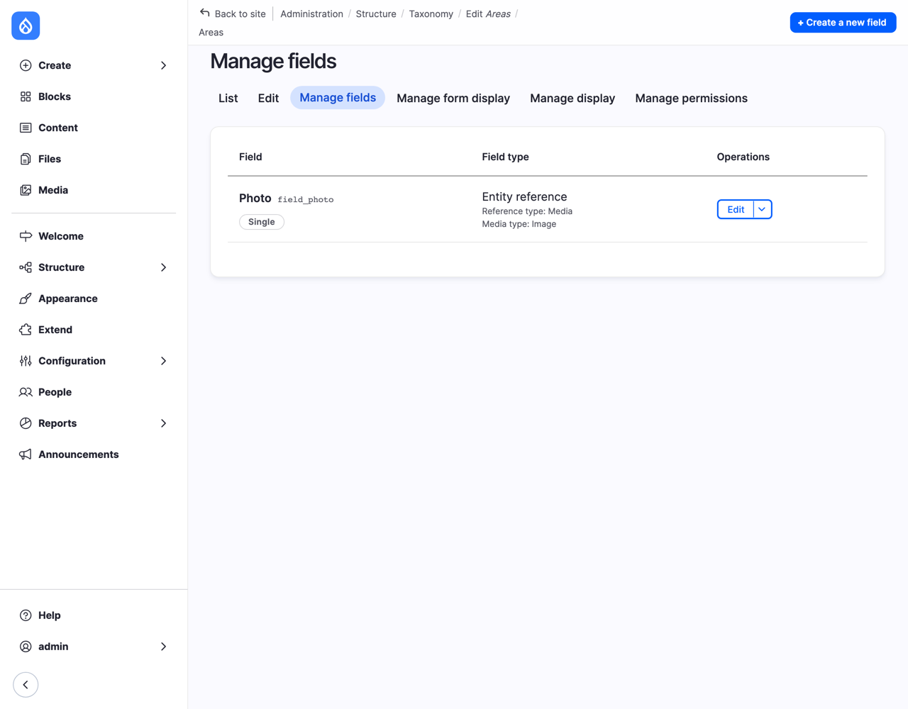
*Figure 10.5: Areas, with a Photo field*

Why not **Re-use an existing field**? Hike and News already have a Photo field. But a field's storage belongs to one entity type (Chapter 7 explains field storage), and terms are a different entity type from content. So the term's Photo is a new field, with the same name, `field_photo`, and you can't re-use content fields on terms, or the other way round.

4. On the **Manage display** tab, **Manage** the **Default** display. Drag **Photo** to the top, set its **Label** to **- Hidden -**, select its cog, set **View mode** to **Banner** (the media view mode from Chapter 9), select **Update**, and then **Save**.
5. Back on the **List** tab, select **Edit** for **Pentland Hills**. Under **Photo**, select **Add media**, and choose a photo from the library: I use *The view from Carnethy Hill*, one of the album's photos from Chapter 9. Select **Insert selected**, and **Save**.

Now select the name **Pentland Hills** in the list to see the term's page.

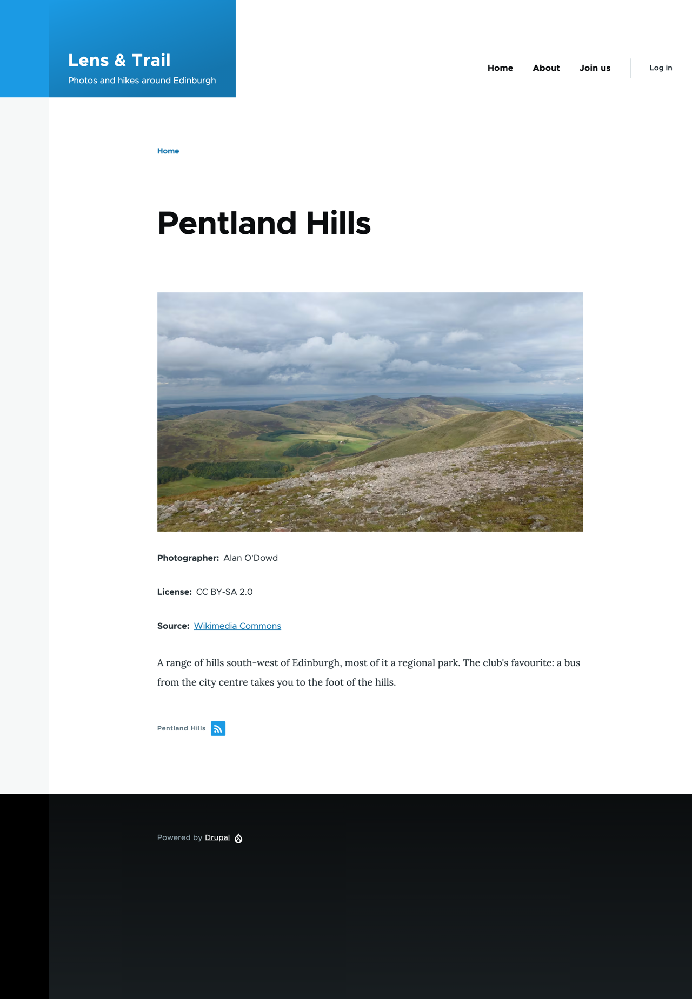
*Figure 10.6: The page of an area*

A photo, its credits, and the description: a page for the Pentland Hills, made from one photo the club already had. Its address is `/taxonomy/term/` followed by the term's ID, a number; in Chapter 17, we'll give term pages addresses such as `/areas/pentland-hills`. At the bottom, the small square icon is a *feed*: the same list of content, for feed readers.

## Areas on hikes

Now hikes can point to an area. On Hike's **Manage fields**:

1. Select **Create a new field**, choose **Reference**, type `Area` as the **Label**, choose **Taxonomy term**, and select **Continue**.
2. Under **Vocabulary**, check **Areas**. As the **Help text**, type `Where the hike is. Choose the hill or place; choose the region only if no place fits.`
3. Leave **Create referenced entities if they don't already exist** off. We'll come back to that setting below. Select **Save**.

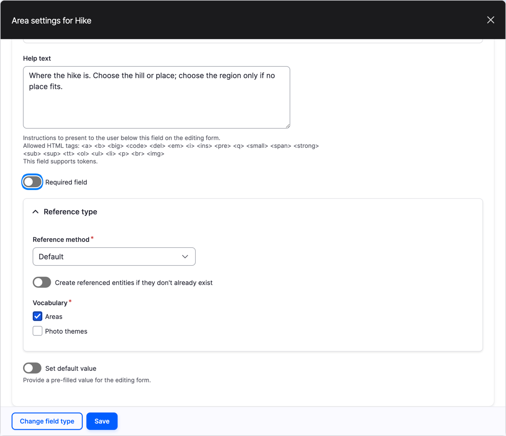
*Figure 10.7: The Area field refers to the Areas vocabulary*

A hike is in one area, so we keep the **Allowed number of values** at 1.

Drupal gives a new reference field an autocomplete box, where you type the start of a name. For a short list of places, a list you can see is friendlier.

4. On **Manage form display**, set the widget of **Area** to **Select list**, drag **Area** to below **Meeting place**, and select **Save**.
5. On **Manage display**, **Manage** the **Default** display: drag **Area** to below **Meeting place**, set its **Label** to **Inline**, and select **Save**.

Now edit the hike *Turnhouse Hill and Carnethy Hill*. The **Area** list shows the whole tree, with a dash before each place to show which region it's in. Choose **-Turnhouse Hill**, set **Change to** to **Published**, and select **Save**.

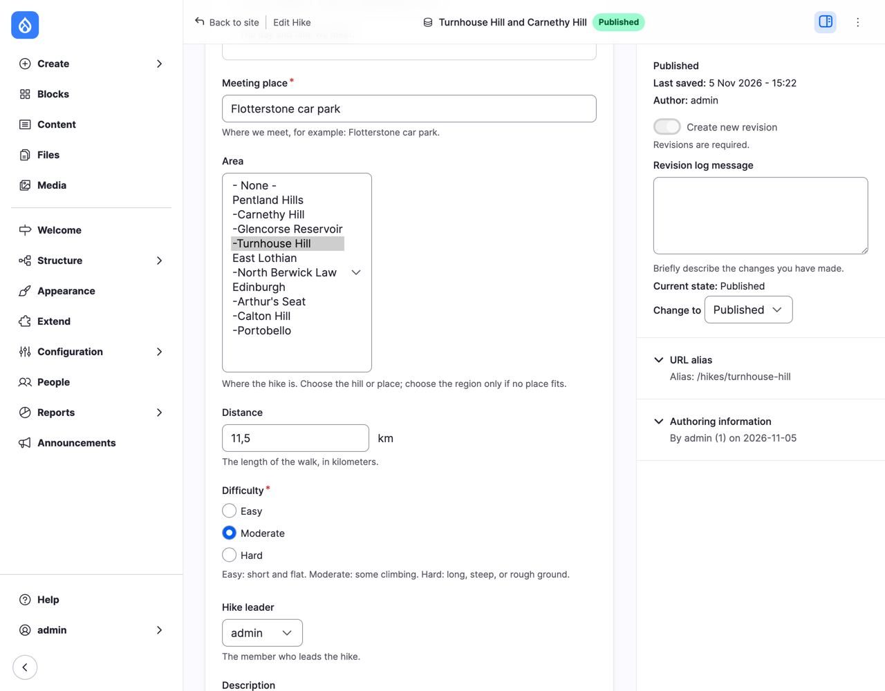
*Figure 10.8: Choosing the hike's area*

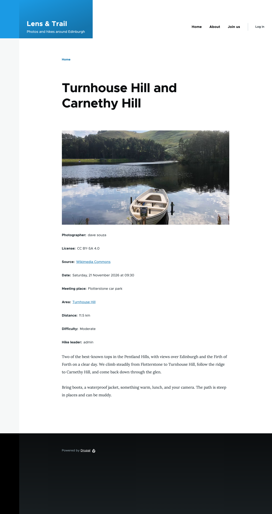
*Figure 10.9: The hike, in its area*

**Area: Turnhouse Hill** is a link to the term's page, and the term's page now lists the hike.

> **Try it:** Albums come from places too. On Gallery's **Manage fields**, **Re-use an existing field**: **Area** (this time re-use works: Gallery is content, like Hike). Give it the help text `Where the photos were taken.`, use the **Select list** widget, and show it **Inline** on the display. Edit the album *Pentlands, 21 November*, and choose **-Turnhouse Hill**.
>
> Then look at the page of Turnhouse Hill. The album is listed in full, all four photos with their credits, because Gallery has no Teaser display, and term pages list content in its Teaser view mode. You know how to fix that from Chapter 8: on Gallery's **Manage display**, **Enable** the **Teaser**, then disable **Hike** and **Photos** in it, and trim the **Description** to 200 characters.

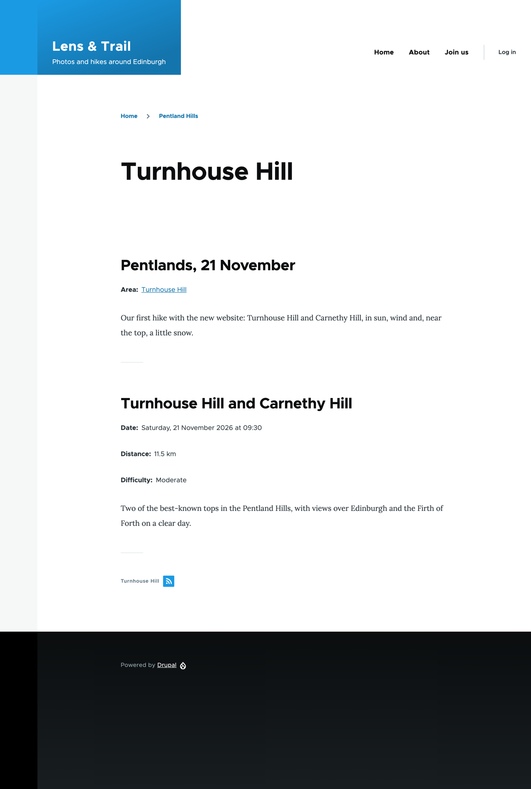
*Figure 10.10: Everything from Turnhouse Hill*

Now look at the page of **Pentland Hills** again. The hike isn't there. A term page lists only the content that refers to that exact term, and our hike refers to Turnhouse Hill, not to the Pentland Hills. A visitor would expect the Pentland Hills to include its hills, and in Chapter 13 we'll change the list that term pages use, so that it does (in Views, this is called *depth*). Until then, the hierarchy already helps editors find the right place in the list, and visitors see where they are in the breadcrumb: *Home > Pentland Hills* above Turnhouse Hill.

## Photo themes: letting members add terms

Areas is a *controlled* vocabulary: the site builder or the secretary decides which places there are, and editors choose from them. That keeps it tidy. If anyone could add an area while editing a hike, the club would soon have *Pentlands*, *Pentland hills* and *The Pentlands* next to *Pentland Hills*, and the hikes would be scattered over all four.

Photo themes are different. Nobody knows in advance what members will photograph, and asking the secretary for every new theme would mean nobody uses them. So we let members type themes as they upload: existing ones are suggested as they type, and new ones are added to the vocabulary. That's called *free tagging*, and it's what most sites call *tags*.

1. Add a vocabulary called `Photo themes`, with the description `What a photo shows. Anyone who uploads a photo can add a theme.`, and give it a few terms to start with: `Landscape`, `Water`, `Winter` and `City`. No hierarchy this time.
2. Go to **Structure** > **Media types**, and select **Manage fields** for **Image**. Themes belong to the photo, so the field goes on the media type, not on the content.
3. Select **Create a new field**, choose **Reference**, type `Themes` as the **Label**, choose **Taxonomy term**, and select **Continue**.
4. A photo can show several things, so set **Allowed number of values** to **Unlimited**.
5. Under **Vocabulary**, check **Photo themes**, and turn on **Create referenced entities if they don't already exist**. That's the free tagging.
6. As the **Help text**, type `What the photo shows, such as Landscape or Winter. Separate themes with commas; a new theme is added to the list.`, and select **Save**.

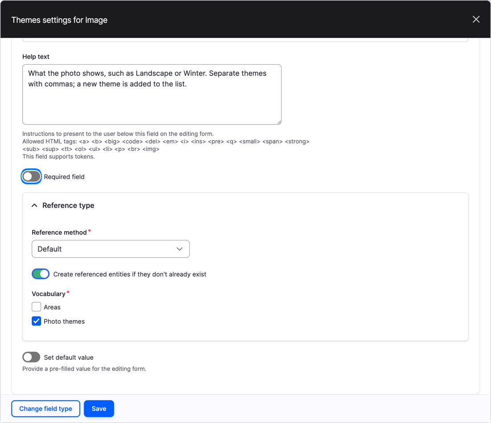
*Figure 10.11: Themes, with free tagging*

7. On **Manage form display**, set the widget of **Themes** to **Autocomplete (Tags style)** on the **Default** form, and select **Save**. On the **Media library** form, drag **Themes** out of **Disabled** too (see Chapter 9 for why media has two forms), give it the same widget, and select **Save**.

The **Tags style** autocomplete is one box for all the themes, separated by commas, instead of one box per theme with an **Add another item** button.

Now edit the photo *Turnhouse Hill across Glencorse Reservoir* (at **Content** > **Media**). In **Themes**, type `Lan`, and Drupal suggests *Landscape*; choose it. Type a comma, choose *Water* the same way, and then type `Hills`, which isn't in the list yet.

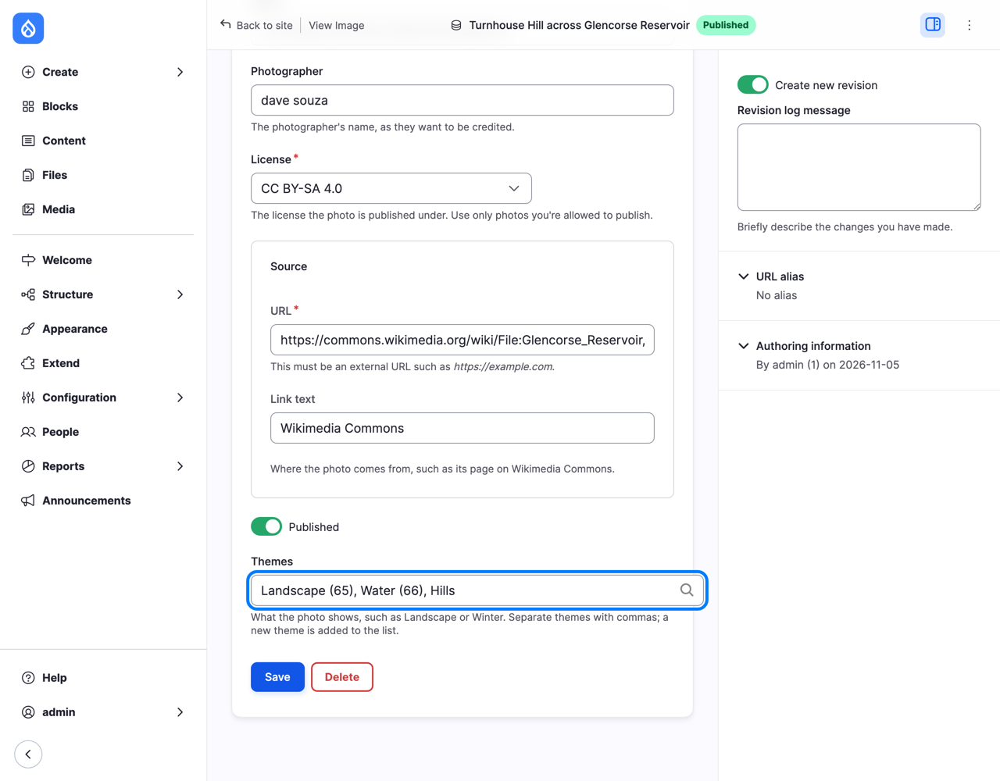
*Figure 10.12: Themes on a photo*

The numbers in brackets are the terms' IDs, which Drupal adds when you choose a suggestion, so it knows exactly which term you meant, even if two have the same name. *Hills* has no number: it's new. Select **Save**, and look at the list of **Photo themes**.

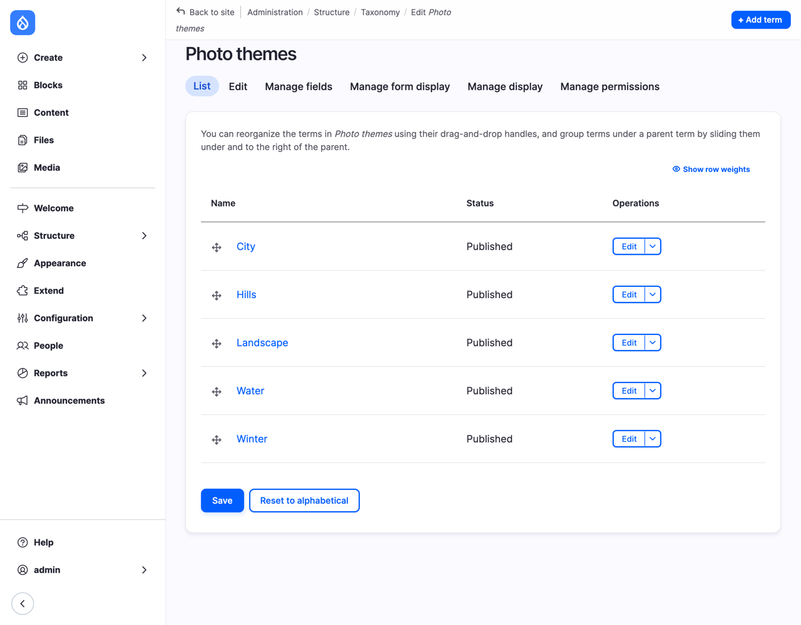
*Figure 10.13: Hills was added by saving the photo*

*Hills* is there, added by saving the photo. Every now and then, someone should look through a free-tagging vocabulary, and correct or delete the typos and doubles: that's the price of letting everyone add to it.

> **Try it:** Most news sites have tags. Add a vocabulary called `Tags`, and a field called `Tags` on News that refers to it, with free tagging and the **Autocomplete (Tags style)** widget. Tag *The club has a website* with `Club news`. Who on the club's site should be able to add new tags, and who should be able to add new areas?

> **On Drupal CMS:** Drupal CMS comes with one vocabulary, **Tags** ("Use tags to group articles on similar topics into categories."), and a **Tags** field on its Basic page, with free tagging on. Instead of a comma-separated box, its form uses the **Tagify** module: each tag becomes a small label with a cross to remove it, and you can drag the labels to change their order (Figure 10.14). Everything else, vocabularies, terms, fields on terms and term pages, works as on core.

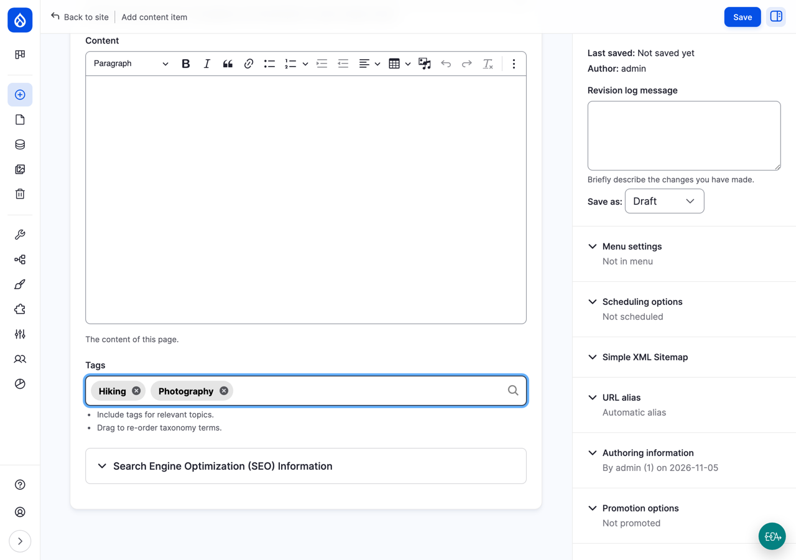
*Figure 10.14: Tags on Drupal CMS*

> **Coming from WordPress?** WordPress has two built-in taxonomies for posts: **categories**, which can have parents, and **tags**, which can't. In Drupal, those are two vocabularies, one with a hierarchy (like our Areas) and one with free tagging (like our Photo themes), and you can have as many more as you like, on any content type, on media and on users. In WordPress, more taxonomies are *custom taxonomies*, registered with code or a plugin; in Drupal, they're made in the interface, the same way. Two differences to know. Every WordPress post is filed under at least one category, and gets the default category if you don't choose one; a Drupal field is only required if you make it so. And the page of a WordPress parent category lists the posts in its sub-categories too; Drupal's term page lists only the content with that exact term, until you change it with Views (Chapter 13).

## Summary

You can now:

- explain vocabularies and terms, and that terms are entities with fields of their own;
- decide whether something should be a list field, a vocabulary or a content type;
- create a vocabulary, add terms, and arrange them in a hierarchy by dragging or under **Relations**;
- add fields to a vocabulary, and set up how a term's page looks;
- add a term reference field to content, and choose a widget that suits the vocabulary;
- let editors add terms as they type, with free tagging, and know when not to.

## Exercises

1. Give **Edinburgh** a description and a photo: the photo of Edinburgh's Old Town from Calton Hill, from Chapter 9, is in the library already. Then look at the page of Edinburgh. What's missing, compared to the Pentland Hills?
2. Give the Portobello hikes from Chapter 7's exercises an area. Which term do you choose, and does the hike appear on the page of Edinburgh?
3. Show the **Themes** of a photo in the album: on the **Album** display of the Image media type, put **Themes** below the credits, with an inline label. What happens when a visitor selects a theme? What would you need to make a page of "all winter photos" useful?
4. *(challenge)* Change your mind about Difficulty. Make a vocabulary `Difficulty` with the terms `Easy`, `Moderate` and `Hard`, and put the explanation from Chapter 7's help text into each term's description. Add a reference field `Difficulty level` to Hike, set it on every hike, and then delete the old **Difficulty** list field. What did you gain, and what was the cost? Would you do it on a site with 500 hikes?
5. *(challenge)* The **Meeting place** of a hike is plain text. Should it be a vocabulary, a content type, or stay as text? Think of what the club would want: the same place for many hikes, a map, directions by bus. Write down your choice and why; there's no single right answer.

## Want to know more?

- [Concept: Taxonomy](https://www.drupal.org/docs/user_guide/en/structure-taxonomy.html), in the Drupal User Guide.
- [Setting Up a Taxonomy](https://www.drupal.org/docs/user_guide/en/structure-taxonomy-setup.html), in the Drupal User Guide: a vocabulary and a reference field, step by step.
- [Posts Categories screen](https://wordpress.org/documentation/article/posts-categories-screen/), WordPress's own documentation of categories, for comparison.
