# Extending Drupal: Modules, Recipes, and Composer

Everything we've built so far came with Drupal core: content types, fields, media, taxonomy. Core goes a long way, but sooner or later every site needs something core doesn't do. In Chapter 6 I promised you a way to see exactly which words changed between two revisions of a page; core can't do that. And the club has asked for something new: members want to comment on each other's albums.

In this chapter we add both, in the three ways Drupal grows: *modules* you download from drupal.org, with a tool called *Composer*; modules you find with *Project Browser*; and *recipes*, which set up a whole feature in one go. We'll also look at a few modules that are only for building the site, not for running it. We start where Chapter 10 left us: hikes, news and albums, with areas and photo themes.

## Core, contributed and custom modules

A *module* is a package of code that adds a feature to Drupal. You met them in Chapter 5, on the **Extend** page. They come from three places:

- **Core modules** come with Drupal itself. **Extend** lists all of them, installed or not: Media, Taxonomy and Responsive Image were core modules we installed in Chapters 9 and 10.
- **Contributed modules** (*contrib*, for short) are written by the Drupal community and shared on drupal.org, under the same open source license as Drupal (Chapter 2). There are thousands of them, and **Extend** doesn't list them until you've downloaded them.
- **Custom modules** are written for one site, by its own developers. Appendix B says a little about how.

That gives every contributed module two steps: first you *download* its code into your site, and then you *install* it, on **Extend**, as with core modules. You can have a module downloaded without installing it, and when you remove one, you go the other way: uninstall it first, and then remove its code.

> **Drupalism: install, enable, download.** In older versions of Drupal, and in many blog posts, "installing" a module meant downloading it, and turning it on was called *enabling* it. Since Drupal 8, the button on **Extend** says **Install**, and the opposite is **Uninstall**, which also deletes the module's settings and data. If a tutorial says "enable the module", it means install it on **Extend**.

## Choosing a module

Before you add a module, look it up on drupal.org. Every project has a page at `drupal.org/project/` followed by its machine name; Diff's is [drupal.org/project/diff](https://www.drupal.org/project/diff). I look at the same things every time:

1. **Does it work with my Drupal?** Under **Releases**, each release says which Drupal versions it works with, such as `^10.5 || ^11 || ^12`. Diff's newest release works with Drupal 12; Focal Point, the module Drupal CMS uses to keep the important spot of a photo when it's cropped (Chapter 9), doesn't have a release for Drupal 12 yet, while I write this.
2. **Is it covered by the security team?** A shield icon, and the words "Stable releases for this project are covered by the security advisory policy", mean that the Drupal Security Team handles security problems in it, and announces fixes (more in Chapter 20). A project without the shield may be fine, but you're on your own.
3. **Is it maintained?** The **Maintenance status** ("Actively maintained", "Minimally maintained", "Seeking new maintainer") and the date of the last release tell you whether anyone is looking after it.
4. **Do other sites use it?** The usage count shows how many sites report using it. A module used by tens of thousands of sites has had most of its problems found by someone else.
5. **What does the issue queue say?** Every project has an issue queue, where people report bugs and post fixes. Lots of open issues is normal for a popular module; lots of open *bugs*, with nobody answering, is a warning.

Diff passes all five. One more piece of advice, from many years of looking after sites: every module you add is code someone has to keep up to date, for as long as the site lives. Add the ones you need, not the ones that might be nice.

## Composer: the site's shopping list

You could download a module as a zip file and unpack it into your site. Please don't. Many modules need other code to work, called *dependencies*: Diff, for example, needs a small library that compares texts, written by someone outside the Drupal community. Those dependencies need their own dependencies, and all of them have to be versions that work together, with each other and with your Drupal. Keeping track of that by hand would open up a can of worms that you would never reach the bottom of!

Because that's the job of **Composer**, the tool we met briefly in Chapter 4. Think of it as two lists, kept in your project's folder:

- **`composer.json`** is the shopping list: what *you* asked for. "Drupal core 12, Olivero, Drush, and Diff, version 2.1 or a later 2.x."
- **`composer.lock`** is the receipt: exactly which versions Composer chose, of everything on the list and everything they need, down to the last library.

Composer reads the shopping list, works out versions that fit together, downloads them, and writes the receipt. Anyone who installs the site from the same two files, a colleague or the live server, gets exactly the same code. Contributed modules end up in `web/modules/contrib/`, and the libraries they need in `vendor/`. You never change the code in either folder yourself: Composer would overwrite your changes the next time it runs.

On our site, Composer runs inside DDEV, so every command starts with `ddev composer`.

### Adding Diff

In the terminal, in the project's folder (`~/websites/lens-and-trail`, if you followed Chapter 4), run:

```bash
ddev composer require drupal/diff
```

`require` means "add this to the shopping list, and download it". Every Drupal project's Composer name is `drupal/` followed by its machine name. Composer prints what it does; the lines that matter are these:

```text
./composer.json has been updated
  - Installing mkalkbrenner/php-htmldiff-advanced (0.0.8): Extracting archive
  - Installing drupal/diff (2.1.1): Extracting archive
Using version ^2.1 for drupal/diff
```

It downloaded Diff, and the library Diff needs, and added a line to `composer.json`:

```json
"drupal/diff": "^2.1",
```

`^2.1` means "version 2.1 or any later 2.x". When Diff 2.2 comes out, Composer may update to it; when Diff 3.0 comes out, which may change how the module works, it won't, until you ask. (Appendix B explains these version rules, and more of Composer, for when you need them.)

Don't worry if Composer also prints something about "packages looking for funding" or "security vulnerability advisories". The first is open source projects asking for support. The second is worth reading, and Chapter 20 is about it.

> **Tip:** If your site shows an error after a Composer command, rebuild Drupal's cache: `ddev drush cache:rebuild` (or `ddev drush cr`). Composer rewrites the list of code files, and Drupal sometimes still remembers the old one.

### Installing Diff

Diff is now in your site's code, so **Extend** lists it.

1. Go to **Extend**. In **Filter**, type `diff`.
2. Check **Diff**, and select **Install**.

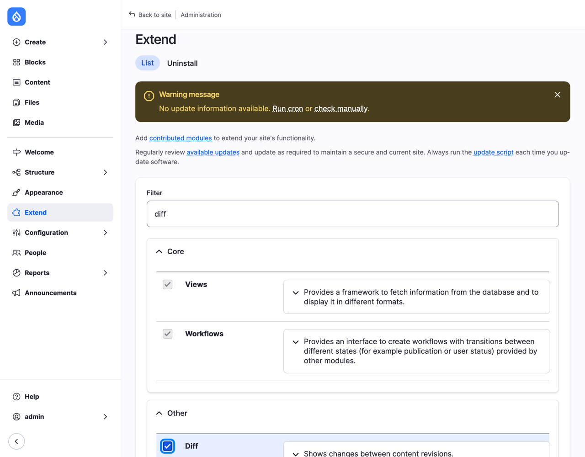
*Figure 11.1: Installing Diff*

Now let's see it work. Edit the hike *Turnhouse Hill and Carnethy Hill*, and add something to the description: I changed "and your camera." to "your camera, and a head torch: it gets dark before five in November." In **Revision log message**, type `Added a head torch to the list.`, set **Change to** to **Published**, and select **Save**.

Select the **Revisions** tab. It looks different from Chapter 6: every revision now has two radio buttons, **Source revision** and **Target revision**, and there's a **Compare selected revisions** button. Diff has chosen the newest revision and the one before it.

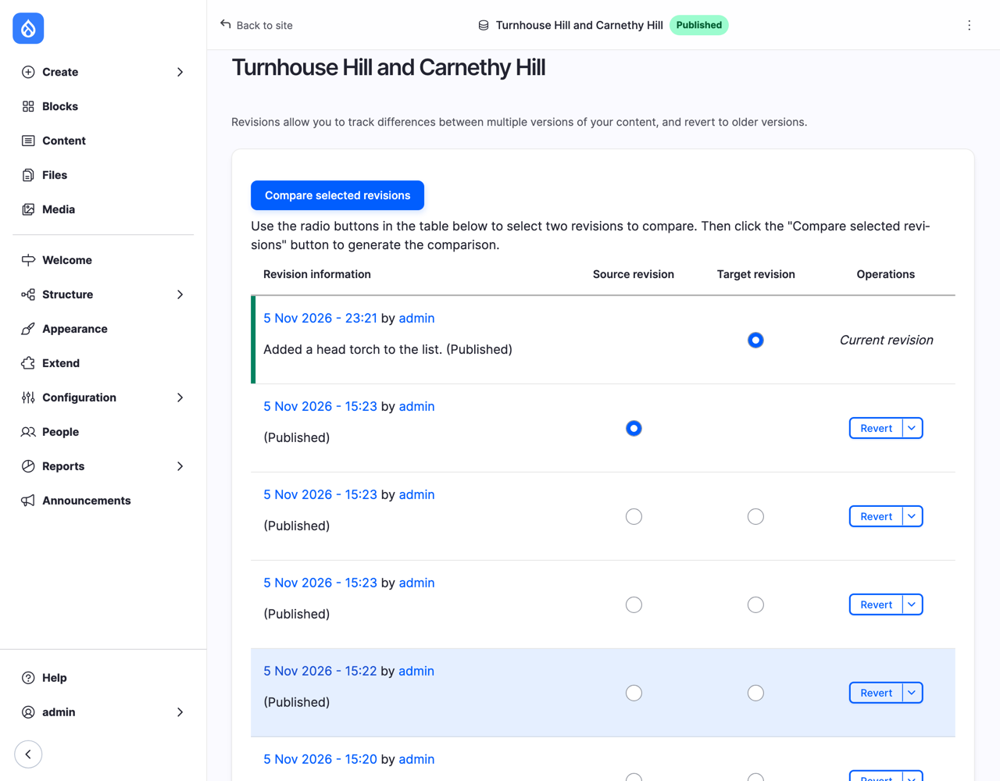
*Figure 11.2: Choosing two revisions to compare*

Select **Compare selected revisions**.

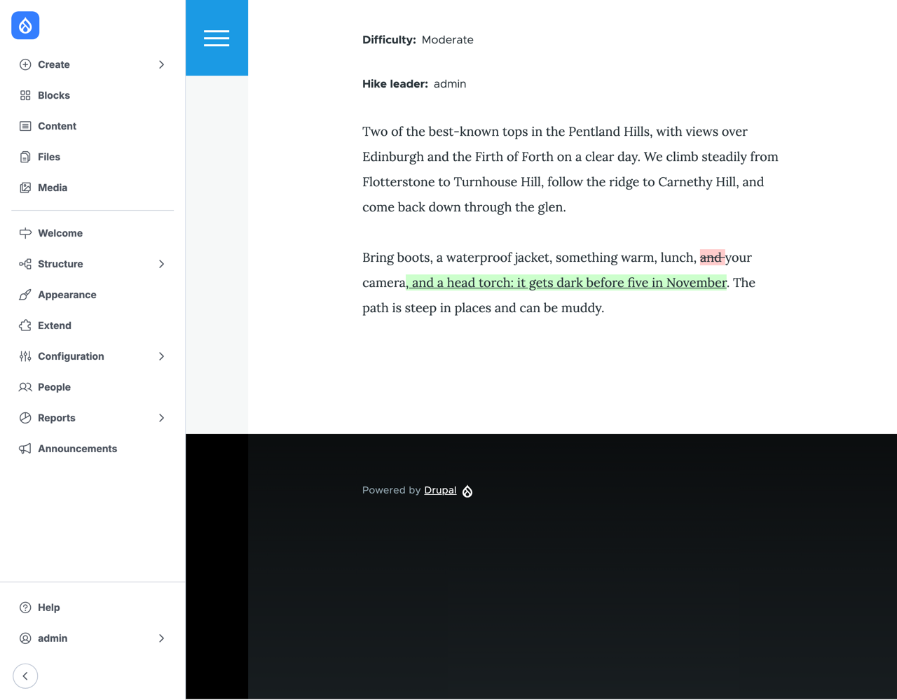
*Figure 11.3: What changed between the two revisions*

Removed words are struck through in red, and added words are underlined in green, in the hike as visitors see it. Above it (scroll up), you can switch to other layouts, such as the two revisions side by side, and step to the previous or next change. That's the promise from Chapter 6 kept.

## Project Browser: finding modules from inside the site

Searching drupal.org works, but there's a friendlier way: **Project Browser**, a module that brings the list of contributed modules into your site's administration. It's a contributed module itself, so we add it the same way:

```bash
ddev composer require drupal/project_browser
```

Then install it on **Extend** (filter on `project browser`). **Extend** now has more tabs: **List**, the page you know; **Recipes**, which we'll come to; **Browse modules**; and **Uninstall**.

Select **Browse modules**.


*Figure 11.4: Browsing modules from inside the site*

Notice the two switches: **Only show projects covered by a security policy** and **Only show actively maintained projects** are on from the start. Two of the five questions from "Choosing a module" are answered for you, and every card shows the number of installs, a shield if the security team covers it, and a wrench if it's actively maintained. Select a module's name to read its description, and a link to its project page.

The club's secretary finds the **Extend** list long. Let's add **Module Filter**, which sorts it into tabs. Type `module filter` in **Search**, and select **View Commands** on its card.

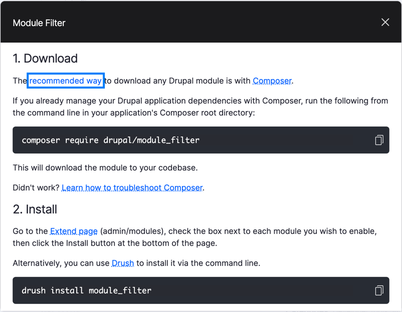
*Figure 11.5: Project Browser gives you the command*

On our site, Project Browser can't download modules itself; it gives you the command to copy. To download from the browser, Project Browser needs the *Automatic Updates* module, which doesn't have a release for Drupal 12 yet (its setting is **Allow installing via UI (experimental)**, under **Configuration** > **Development** > **Project Browser**). Drupal CMS has it; see the box below.

Copy the command, put `ddev` in front of it, and run it:

```bash
ddev composer require drupal/module_filter
```

Then install **Module Filter** on **Extend**, as you did with Diff. (Project Browser's card now shows an **Install** button too, because the module is downloaded. On our Drupal 12 test site it didn't respond, so I use **Extend**.)

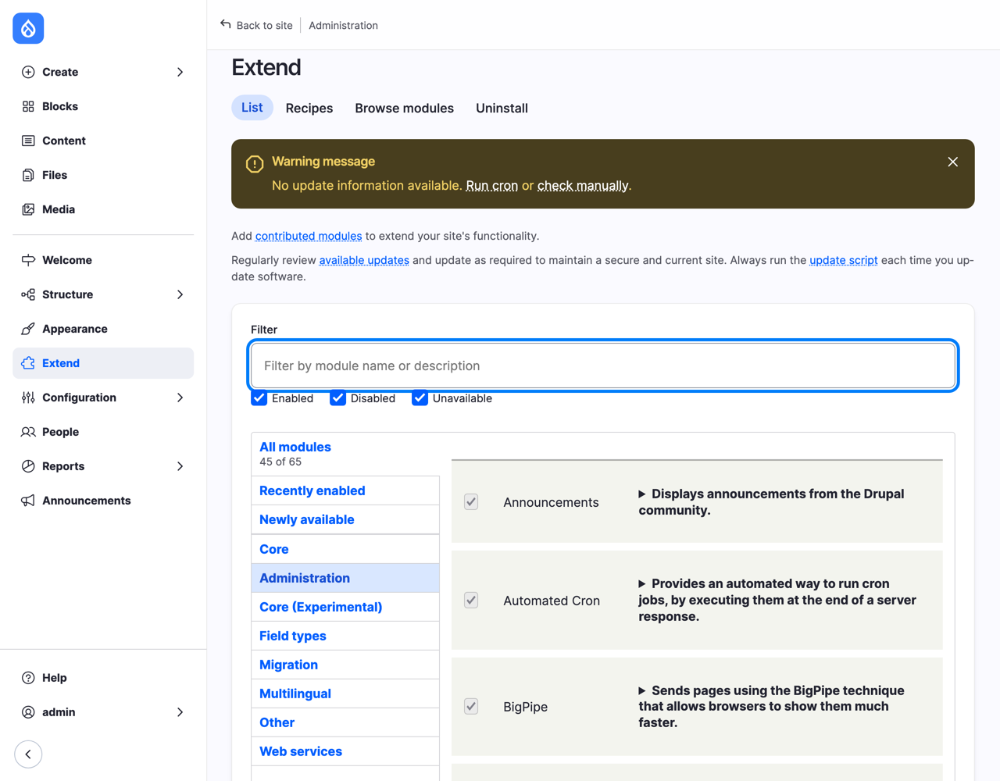
*Figure 11.6: Extend, sorted by Module Filter*

**Extend** now has tabs on the left, one per package, and **Recently enabled** and **Newly available** to find what you've just added.

## Recipes: a feature in one go

The club wants comments on albums. Comments need more than a module: a comment type, a field to put on albums, a view that lists comments for administrators, and permissions for who can read and write them. You could set all of that up by hand, as we did with media in Chapter 9. Or you can apply a *recipe*.

A **recipe**, as Chapter 1 explained, installs modules and sets them up for you, in one go, for one job. When it's done, the recipe is gone: there's nothing to uninstall, only the modules and the settings it left behind, which you can change like any others. Drupal core comes with about twenty recipes, for small jobs such as a media type, an editorial workflow, or comments. Drupal CMS is built from larger ones: the site templates you saw in Chapter 4 are recipes too.

Select the **Recipes** tab on **Extend**, and search for `comments`.

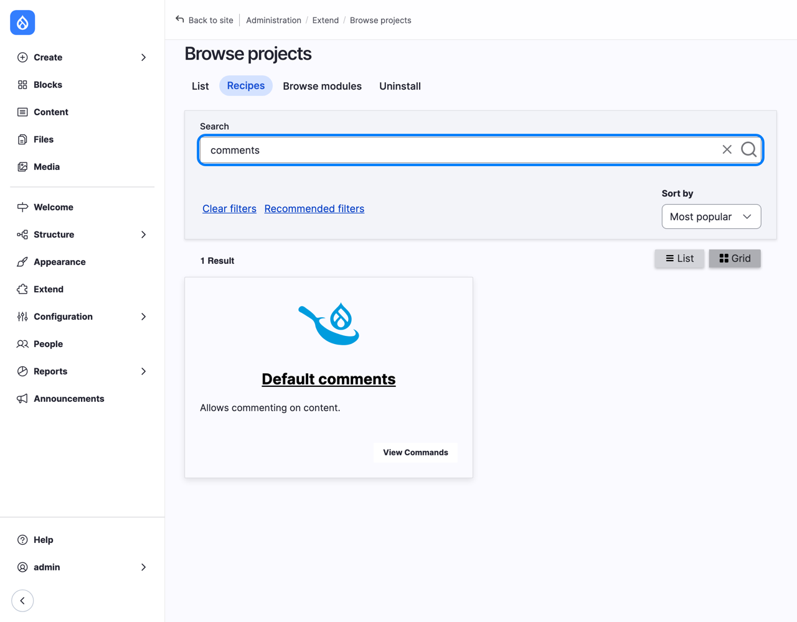
*Figure 11.7: Core's Default comments recipe*

Before you apply a recipe, read it: it says exactly what it will do. Recipes are text files called `recipe.yml`, and core's are in `web/core/recipes/`. Here's *Default comments*:

`web/core/recipes/comment_base/recipe.yml` ([source](../examples/recipes/comment_base/recipe.yml))

```yaml
name: 'Default comments'
description: 'Allows commenting on content.'
type: 'Comment type'
install:
  - comment
  - node
  - views
config:
  strict:
    # Treat field storages strictly, since they influence the database layout.
    - field.storage.comment.comment_body
    - field.storage.node.comment
  import:
    comment:
      - core.entity_view_mode.comment.full
      - field.storage.comment.comment_body
      - system.action.comment_delete_action
      - system.action.comment_publish_action
      - system.action.comment_save_action
      - system.action.comment_unpublish_action
      - views.view.comment
      - views.view.comments_recent
  actions:
    user.role.authenticated:
      grantPermissions:
        - 'access comments'
        - 'post comments'
        - 'skip comment approval'
    user.role.anonymous:
      grantPermission: 'access comments'
```

You don't need to understand every line. Under `install`, the modules it installs: Comment, and Node and Views, which we have already. Under `config`, the settings it brings along, such as the field for comments, and the views that list them. And under `actions`, changes to the site's existing settings: anonymous visitors may read comments, and logged-in users may read and post them, without waiting for approval. Keep that last one in mind; we'll come back to it in Chapter 15, when we sort out the club's roles.

Project Browser's **View Commands** shows a command for applying the recipe on the server. With DDEV, Drush does the same:

```bash
ddev drush recipe core/recipes/comment_base
```

```text
Applying recipe
Installed configuration for Default comments recipe.
Applied Default comments recipe.
 [OK] Default comments applied successfully
```

You can apply a recipe again, safely: it only adds what's missing. The `strict` line in the recipe decides what happens when the site already has something the recipe brings: here, it insists on its own version of the comment field, because the database depends on it, and leaves everything else as the site has it.

The recipe made a comment field, but didn't put it on any content type: that's for us to decide. On Gallery's **Manage fields**, select **Re-use an existing field**. The list has a new field, **comment**, of the type **Comments**, used nowhere yet.

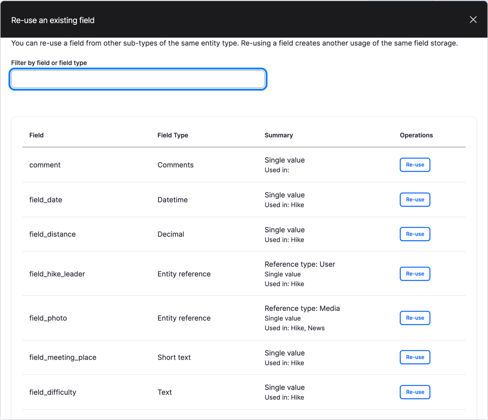
*Figure 11.8: The recipe's comment field, ready to re-use*

Select **Re-use** for **comment**, change the **Label** to `Comments`, and select **Save settings**. Open the album *Pentlands, 21 November*: at the bottom, there's a form to add a comment. Leave one.

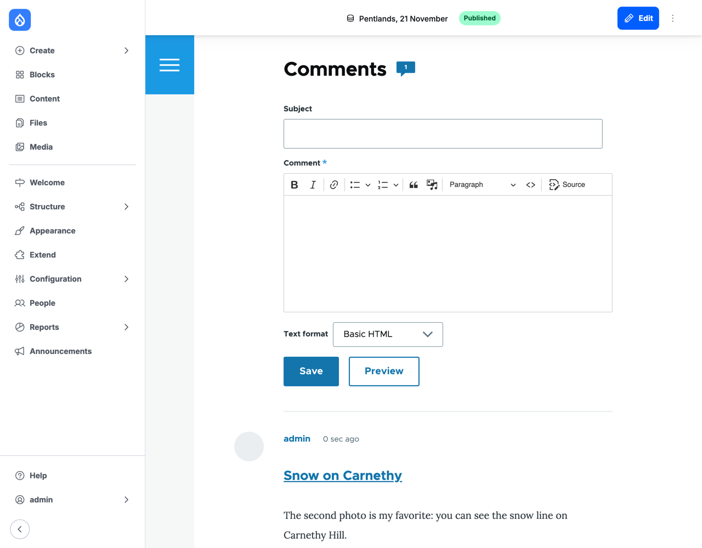
*Figure 11.9: Comments on the album*

> **Recipes and modules, side by side.** A *module* adds a capability: Comment knows how to store and show comments. A *recipe* uses capabilities: it installs modules and sets them up for a job. You uninstall a module; you don't un-apply a recipe. And a recipe only ever does what a site builder could do by hand, which is why reading it first is a good habit.

## Modules for building, not for running

Some modules help you *build* a site, and have no business on the live one. Composer keeps them on a separate list, `require-dev`, with the `--dev` option:

```bash
ddev composer require --dev drupal/devel
```

When the site goes live (Chapter 21), the server installs everything except the `require-dev` list.

**Devel** is the classic one. It comes with a submodule, **Devel Generate**, which fills a site with test content: nodes, terms, users and media, with Latin-looking titles and text. It's useful when you need to see how a list of fifty hikes looks before the club has written five.

Devel's Drupal 12 release is still on its way while I write this, so I tried it on the Drupal CMS site. After installing **Devel** and **Devel Generate** on **Extend**, go to **Configuration** > **Development** > **Generate content**, check a content type, choose how many items, and select **Generate**. (Or in the terminal: `ddev drush devel-generate:content 10`.)

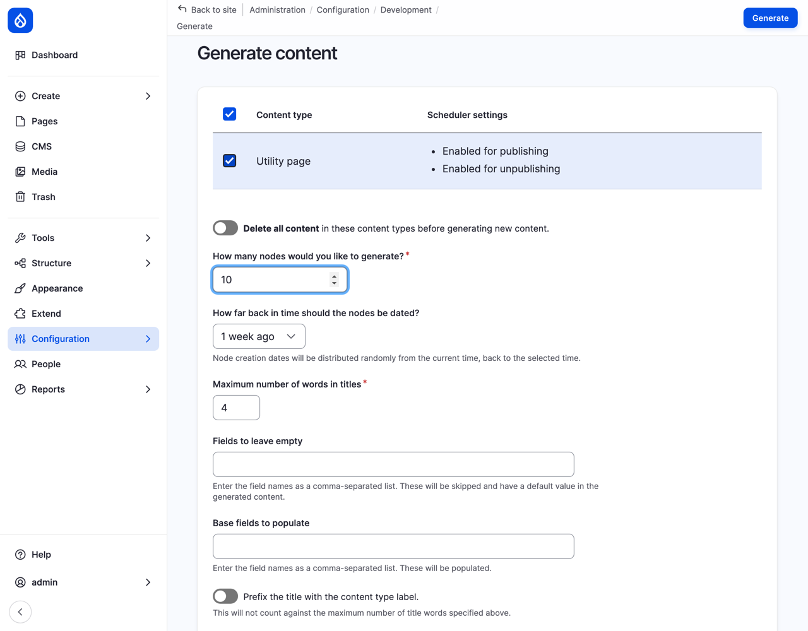
*Figure 11.10: Devel Generate's form*

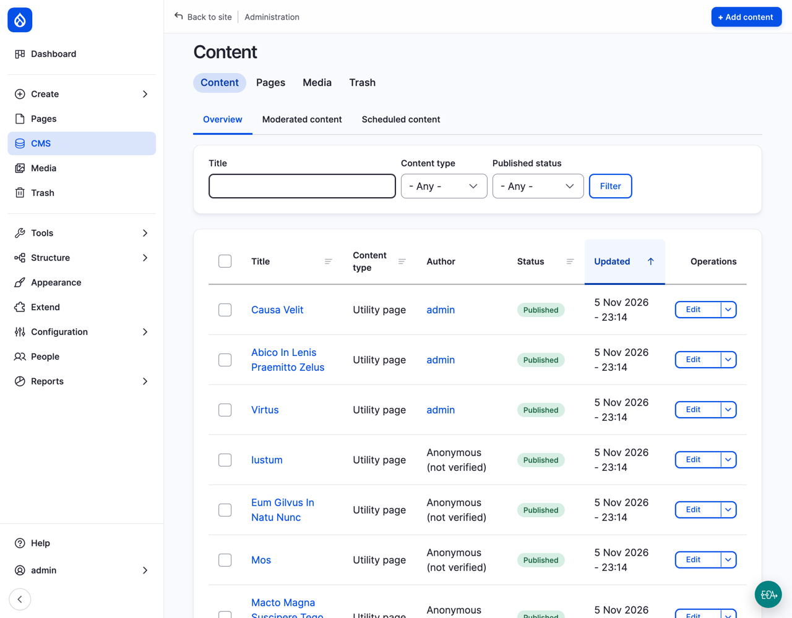
*Figure 11.11: Ten pages of test content*

Generated content is for testing: delete it when you're done, with the same form's **Delete all content** switch, or from **Content**. Never generate content on a live site.

**WebProfiler** is another one for developers, and for curious site builders. It adds a bar at the bottom of every page that shows how long the page took, how many database queries it needed, which blocks, views and caches were used, and much more; it's how you find out *why* a page is slow. I'd like to show it to you, but it doesn't run on either of our sites yet: it has no release for Drupal 12, and on Drupal CMS 2.2.8 it stopped the whole site with an error, because it clashes with Canvas. I uninstalled it at once. That's a good lesson in itself: try development modules on a copy of your site, never on the live one, and ask the five questions from "Choosing a module" before you do. And when something breaks, tell the people who can fix it: I couldn't find anyone who had reported the problem, so I opened an issue in WebProfiler's issue queue on drupal.org.  That's how open source gets better: a problem one person runs into becomes a fix for everyone. Chapter 22 shows how you can take part too.

> **On Drupal CMS:** Project Browser comes installed, and it can download modules itself: on a module's card, the button says **Install**, not **View Commands**. Select it, and Drupal CMS runs Composer for you, in the background: on my laptop, adding Module Filter took a little over a minute, and afterwards `composer.json` had the new line, just as if I'd typed the command. **Extend** also has a **Recommended add-ons** tab, a short list chosen by the Drupal CMS team, and an **Update** tab. And the site template you chose when you installed Drupal CMS (Chapter 4) is a recipe, applied by the installer.

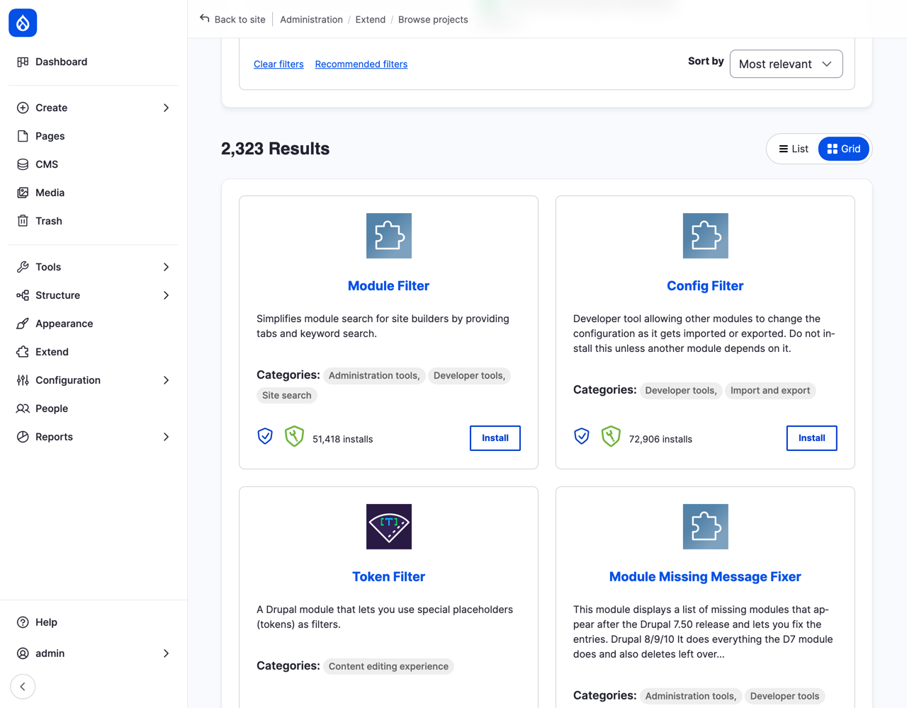
*Figure 11.12: On Drupal CMS, the button says Install*

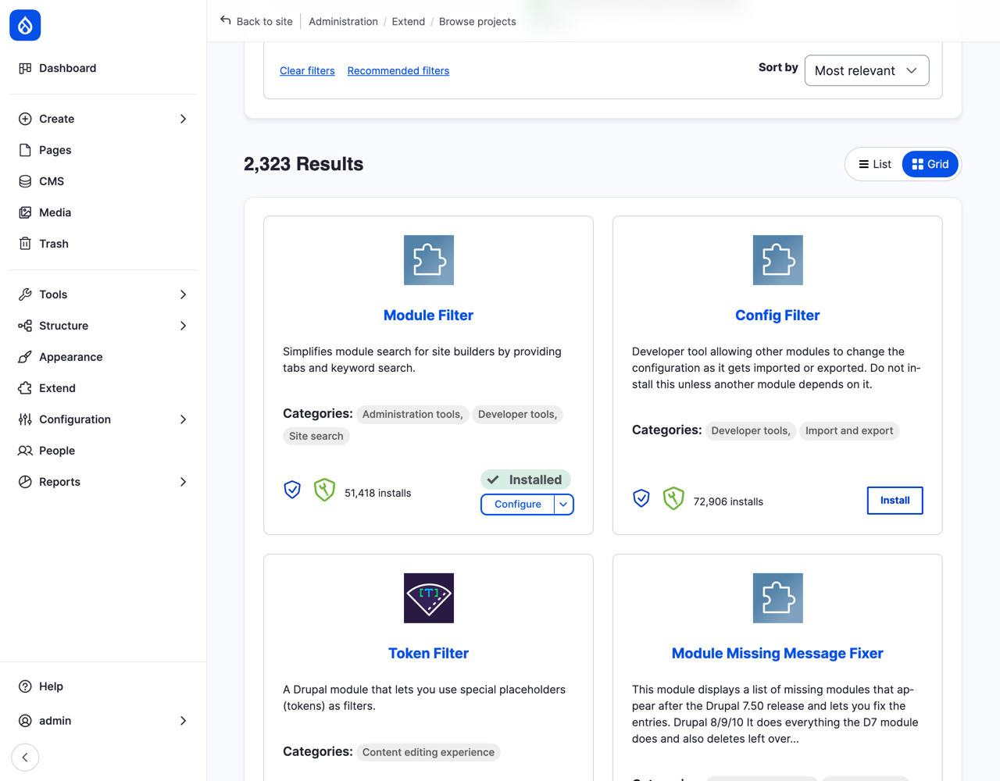
*Figure 11.13: Installed from Project Browser on Drupal CMS*

> **Coming from WordPress?** Drupal's modules are WordPress's plugins: code from the community that adds features, found in a directory on the project's website. The biggest difference is how you add them. In WordPress, you search **Plugins** > **Add New Plugin** in the dashboard, and select **Install Now**. On Drupal CMS, Project Browser is the same idea. On Drupal core sites, and on most professional Drupal sites, modules are added with Composer, because it also takes care of the libraries they need, and makes sure every copy of the site, from your laptop to the live server, runs exactly the same code. That's why Drupal developers keep `composer.json` and `composer.lock` in Git, and the downloaded code out of it. WordPress has nothing quite like recipes: the closest are plugins that import settings, or a starter theme with demo content.

## Summary

You can now:

- tell core, contributed and custom modules apart, and downloading a module from installing it;
- judge a contributed module by its project page: compatibility, security coverage, maintenance, usage and the issue queue;
- add a module with `ddev composer require`, and explain `composer.json` and `composer.lock`;
- install a module on **Extend**, and compare revisions with Diff;
- find modules and recipes with Project Browser;
- read a recipe, apply it with `ddev drush recipe`, and finish the job it starts;
- keep development modules such as Devel on Composer's `require-dev` list, and off the live site.

## Exercises

1. Uninstall Module Filter: on **Extend**, select the **Uninstall** tab, check **Module Filter**, and select **Uninstall**. Then remove its code with `ddev composer remove drupal/module_filter`. Look at `composer.json` before and after. What would have happened if you'd run the Composer command first?
2. Chapter 17 will use a module called **Pathauto**. Look it up on drupal.org, and answer the five questions from "Choosing a module". Would you add it to the club's site today?
3. Apply core's *Tags* recipe: `ddev drush recipe core/recipes/tags_taxonomy`. What did it add? If you did the Tags Try it in Chapter 10, what happened to your own Tags vocabulary, and which line of the recipe decides that? (Read `web/core/recipes/tags_taxonomy/recipe.yml`.)
4. Members want to comment on hikes too. Re-use the **Comments** field on Hike. Then look at **People** > **Permissions** for the permissions the recipe changed. Would you keep **Skip comment approval** for all logged-in users on the club's site?
5. *(challenge)* In Chapter 10's Exercise 5, you thought about the hikes' meeting places. Find a contributed module that shows a place on a map. Answer the five questions for it, and check whether it works with Drupal 12. Don't install it on the club's site; write down what you'd need to know before you did.

## Want to know more?

- [Downloading and Installing a Module from Drupal.org](https://www.drupal.org/docs/user_guide/en/extend-module-install.html), in the Drupal User Guide.
- [Using Composer to Install Drupal and Manage Dependencies](https://www.drupal.org/docs/develop/using-composer/manage-dependencies), on drupal.org.
- [Drupal Recipes](https://www.drupal.org/docs/extending-drupal/drupal-recipes), drupal.org's documentation of recipes.
- [Project Browser](https://www.drupal.org/project/project_browser) and [Diff](https://www.drupal.org/project/diff), the two projects we added.
- [Devel](https://www.drupal.org/project/devel), with Devel Generate.
- [Composer's documentation](https://getcomposer.org/doc/), for everything Composer can do.
