# Views: Lists of Content

Now we bring out the big guns: **Views**.

The club's site has hikes, news and albums, but a visitor can only find them if they know the address. There's no list of upcoming hikes, and the front page still says nothing about what the club is doing next. In Chapter 8 we gave hikes a *Teaser* and a *Card*, and I promised they'd appear somewhere; they haven't yet, because nothing on the site *lists* content. That's what Views does.

In this chapter we build the lists the club needs: a page of upcoming hikes, with a filter for visitors; the next three hikes and the newest photos on the front page; and a page of all the albums. Along the way you'll meet the ideas every view is built from. We start where Chapter 11 left us: hikes, news and albums, with areas, photo themes and comments.

Views is one of the most powerful parts of Drupal, and one of the most complicated. The basics are not hard, though, and they're all in this chapter. Chapter 13 goes deeper, for when you need it.

## What a view is

A *view* is a list of things from your site's database, built in the browser. Every view answers three questions:

1. **What should be in the list?** Which kind of thing (content, media, users, terms), and which of them: only hikes, only published ones, only the ones that haven't happened yet. These are the view's *filters*.
2. **In what order?** Soonest first, newest first, by title. These are its *sorts*.
3. **How should it look?** A list of teasers, a grid of photos, a table. This is its *format*.

You've been using views since Chapter 5 without knowing it. The **Content** page is a view: it lists content, filtered by the type and status you choose, sorted by when it was last updated, in a table. So are **Media**, **People**, and the page of a term from Chapter 10. Go to **Structure** > **Views** to see them all.

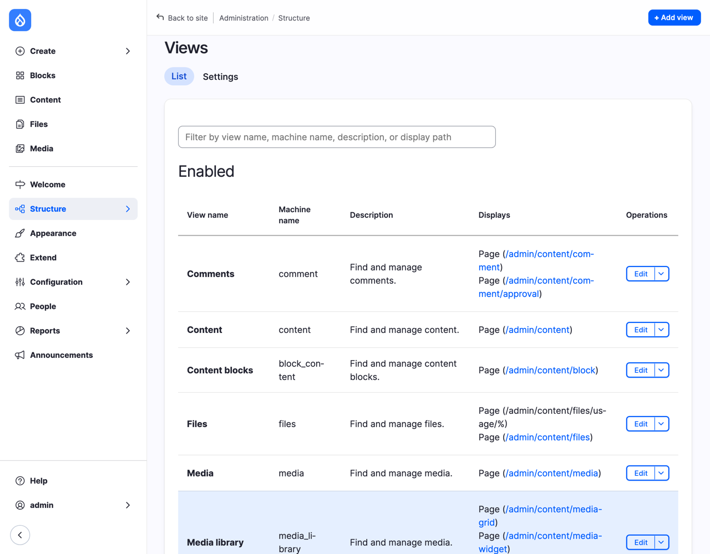
*Figure 12.1: The views that come with Drupal*

Each view can show its list in more than one place: as a page at its own address, as a block you can put on other pages, or as a feed. Those are the view's *displays*. The **Comments** view, for example, has two pages: one for published comments and one for comments waiting for approval. Scroll down, and you'll find a disabled view called **Promoted Content**: in older versions of Drupal, it was the front page, listing everything marked *Promoted* (Chapter 6). On a new Drupal 12 site it's switched off, and we build our own.

> **Drupalism: view, display, view mode.** Three words that sound alike, and mean different things. A **view** is a list (Hikes). A view's **displays** are the places the list appears (a page at `/hikes`, a block on the front page). A **view mode** is how *one item* looks (Teaser, Card), which you set up on **Manage display** in Chapter 8. A view uses view modes: our page of hikes shows each hike in its Teaser view mode. And to make it more confusing, Chapter 8's **Manage display** is also called a "display". Don't worry if it takes a while to keep them apart; it took me a while too ;-)

## Before we start: more hikes

A list of one hike isn't much of a list. Add a few more, as you did in Chapter 7 (**Content** > **Add content** > **Hike**). Use dates around your own today: one that has already happened, and three in the coming weeks. Here are mine; the Turnhouse Hill hike from Chapter 7 is on 21 November.

| Title | Date | Meeting place | Distance | Difficulty | Area |
|---|---|---|---|---|---|
| Arthur's Seat at sunrise | 24 October, 06:30 | Holyrood Palace car park | 5.5 | Moderate | Arthur's Seat |
| North Berwick Law and the harbour | 5 December, 09:30 | North Berwick railway station | 7 | Easy | North Berwick Law |
| Glencorse Reservoir loop | 19 December, 09:30 | Flotterstone car park | 9 | Easy | Glencorse Reservoir |
| Pentland Hills ridge | 2 January, 09:00 | Flotterstone car park | 16 | Hard | Pentland Hills |

Write a sentence or two in each **Description**, set **Change to** to **Published**, and save. A photo is optional.

## A page of upcoming hikes

### The wizard

Views starts with a short form, a *wizard*, that sets up the common things in one go.

1. Go to **Structure** > **Views**, and select **Add view**.
2. In **View name**, type `Hikes`.
3. Under **View settings**, **Show** **Content** **of type** **Hike**. Leave **sorted by** as it is; we'll change the order in a moment.
4. Turn on **Create a page**. **Page title**: `Upcoming hikes`. **Path**: `hikes`. Leave **Display format** as **Unformatted list** of **teasers**, and **Items to display** at `10`, with **Use a pager** on.
5. Turn on **Create a menu link**, choose **<Main navigation>** in **Menu**, and type `Hikes` in **Link text**.
6. Turn on **Create a block**. **Block title**: `Next hikes`. Set **output as** to **teasers**, and **Items per block** to `3`.
7. Select **Save and edit**.

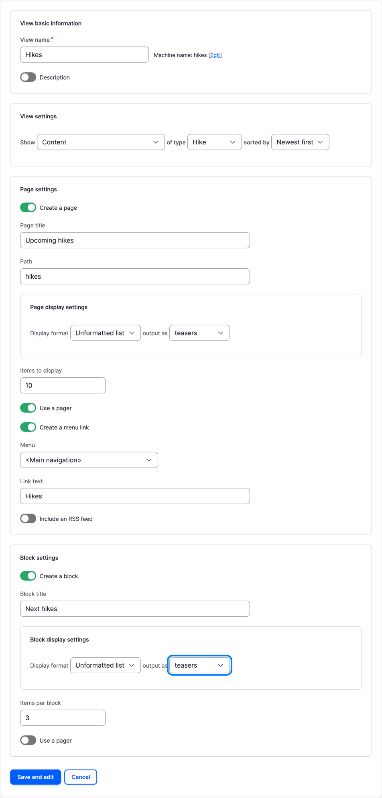
*Figure 12.2: The wizard, filled in*

The wizard made a view with two displays: a page and a block. Notice that you never chose *which fields* to show: **teasers** means "show each hike in its Teaser view mode", which you set up in Chapter 8. Change the Teaser on **Manage display**, and the list changes with it.

### Finding your way around the edit screen

The edit screen looks like a lot. Take a breath: it's the three questions again, plus where the list goes.

*Figure 12.3: The edit screen*

- At the top, the **displays**: **Page** and **Block**. A display is one place where the list appears: the page at `/hikes`, and the block we'll put on the front page. Both show the *same* list, from the same view, but each display has its own settings, such as the page's address or how many hikes the block shows. Select a display, and everything below it is that display's settings. Most of them are shared by all the displays until you say otherwise; we'll see how in "One view, two displays", below, and Chapter 13 tells the whole story.
- The **left column** is *what* and *how*: the **Title**, the **Format** (an **Unformatted list**, showing each item in the **Teaser** view mode), **Fields** (used only when you show fields instead of a view mode; Chapter 13), and the **Filter criteria** and **Sort criteria**.
- The **middle column** is about this display: the **Page settings** (its path, menu link and who may see it), a **Header** and **Footer** above and below the list, what to show when the list is empty (**No results behavior**), and the **Pager**.
- The **right column** is the advanced side: **Relationships** and **Contextual filters**, which Chapter 13 is about, the **Exposed form**, which we'll use later in this chapter, and **Other** settings, such as caching.

Under all of it, the **Preview** shows the list as it is now. Scroll down: there are all five hikes, Arthur's Seat too, even though it has already happened.

### Only hikes that haven't happened yet

The wizard added two filters: **Content: Published (= Yes)** and **Content: Content type (= Hike)**. Let's add a third, for the date.

1. Next to **Filter criteria**, select **Add**.
2. In the search box, type `date`, check **Date (field_date)** (the one that says "Appears in: hike"), and select **Apply (all displays)**. A second window opens, with the filter's settings.
3. Set **Operator** to **Is greater than or equal to**.
4. Under **Value type**, choose **An offset from the current time such as "+1 day" or "-2 hours -30 minutes"**, and type `now` in **Value**.
5. Select **Apply (all displays)**.

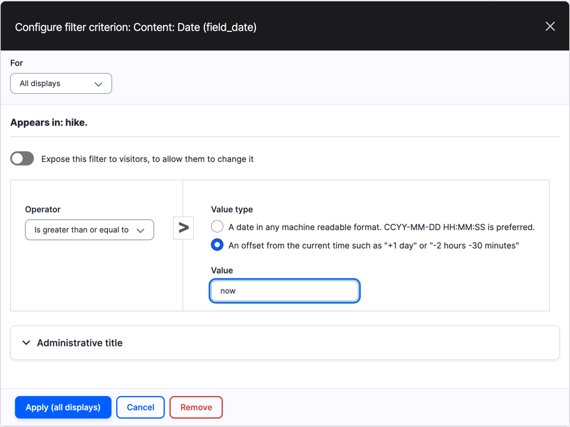
*Figure 12.4: Only hikes from now on*

"An offset from the current time" means the date is worked out every time someone looks at the list, so the hikes drop off the page on their own the moment they've started. You'll never have to remember to take an old hike down. You could write `-1 day` instead, to keep a hike on the list until the day after.

Notice the **For** setting at the top, set to **All displays**. Keep it in mind; we'll come back to it.

### Soonest first

The wizard sorted the hikes by **Authored on**, newest first: the hike *written* last comes first. That's right for news, but not for hikes. Visitors want the hike that *happens* next at the top.

1. Under **Sort criteria**, select **Content: Authored on (desc)**, and select **Remove**.
2. Next to **Sort criteria**, select **Add**, search for `date`, check **Date (field_date)**, and select **Apply (all displays)**.
3. Leave **Order** at **Sort ascending**, and select **Apply (all displays)**.

### When there's nothing to show

In the summer, when the club has a break, there may be no upcoming hikes at all. An empty page looks broken, so let's say so in words.

1. Next to **No results behavior**, select **Add**.
2. Search for `text`, check **Text area** (in the **Global** category), and select **Apply (all displays)**.
3. In **Content**, type something friendly, such as: `No hikes are planned right now. New hikes are usually announced a month ahead, so check back soon.` Select **Apply (all displays)**.

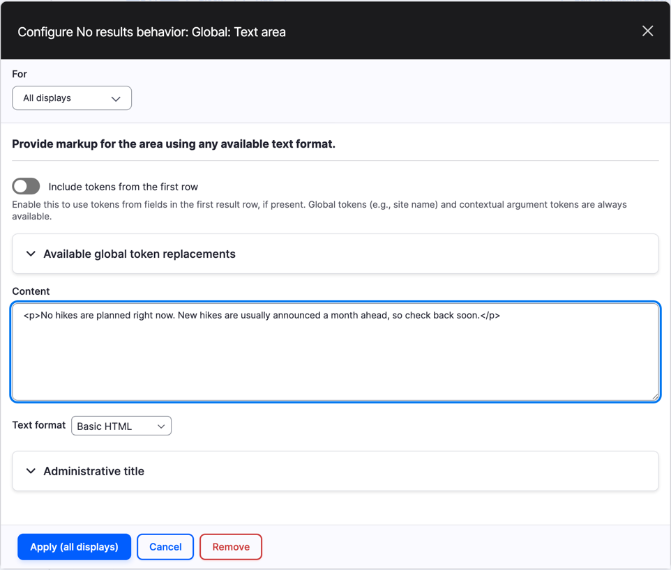
*Figure 12.5: A message for when the list is empty*

Your edit screen should now look like this. Arthur's Seat has gone from the preview, and the Turnhouse hike is at the top.

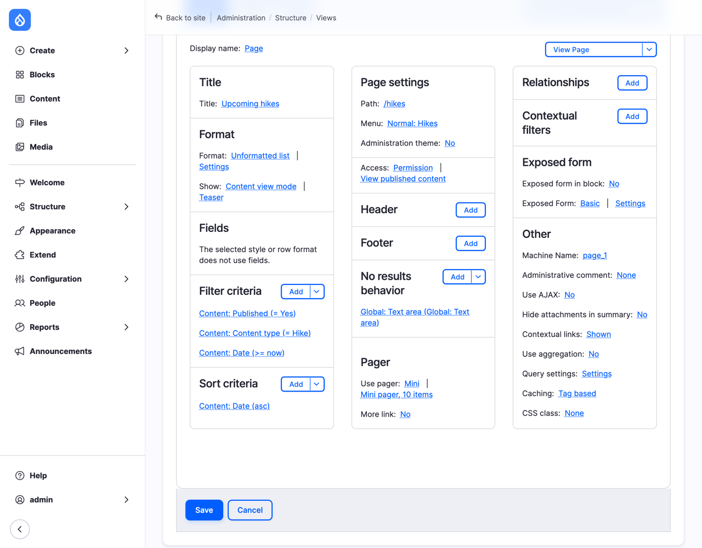
*Figure 12.6: Filters, sort and a no-results message*

Nothing is saved yet: Views keeps your changes aside, and says "You have unsaved changes" at the top, until you select **Save**. That's useful when you're trying things out: **Cancel** throws away everything since the last save. Select **Save** now.

Log out, or open a private window, and go to `/hikes`.

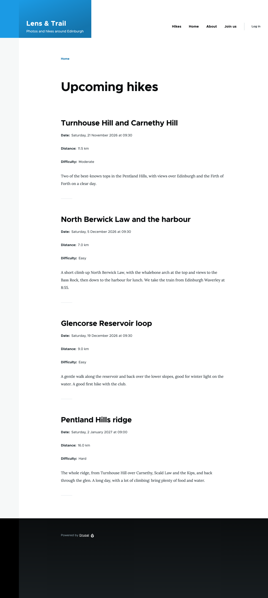
*Figure 12.7: The page of upcoming hikes*

There are the hikes, soonest first, each in its Teaser, and a **Hikes** link in the main menu. (The menu's order is a little odd for now: we'll sort the menus in Chapter 14.)

## The next hikes on the front page

### One view, two displays

Now the block. Select **Block** at the top of the edit screen. It shares almost everything with the page: the same filters and sort, and the same no-results message, because we chose **All displays** each time. That's the point of displays: one list, in several places, set up once.

But the front page needs the hikes smaller: the *Card* view mode from Chapter 8, with only the date and the difficulty. That's a difference between the two displays, and it's where the **For** setting comes in.

1. With the **Block** display selected, under **Format**, select **Content view mode** (next to **Show**).
2. Change **For** to **This block (override)**, and select **Apply (this display)**.

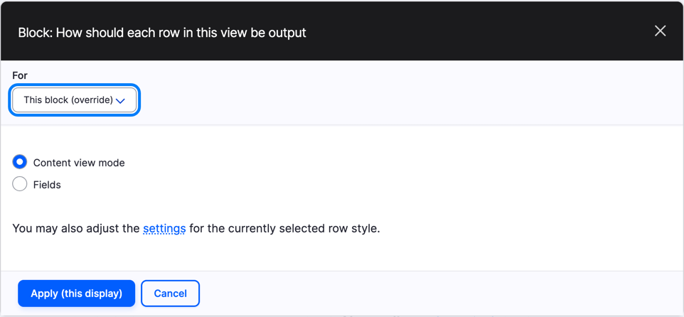
*Figure 12.8: This block gets its own format*

3. Now select **Teaser** (next to **Content view mode**), choose **Card** in **View mode**, and select **Apply**.

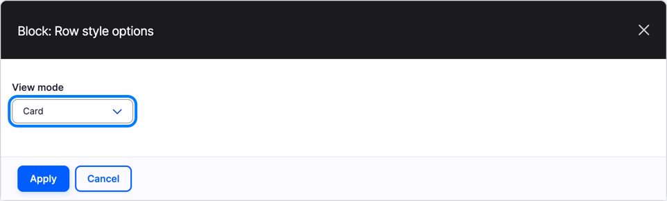
*Figure 12.9: The Card view mode, for the block only*

*Overriding* a setting means "this display does it differently". The block now has its own format; the page still shows teasers. In the edit screen, overridden settings are in *italics*, so you can see at a glance what's different about a display.

Be careful with **For**: it's easy to change a setting for all displays when you meant only one, and the other way round. Before you select **Apply**, look at the button: **Apply (all displays)** or **Apply (this display)** tells you which it's going to be. If you get it wrong, **Cancel** at the bottom of the edit screen throws away the unsaved changes.

> **Try it:** Select **Page**, and check in the preview that the page still shows teasers. Then go back to **Block**.

### A link to the rest

Three hikes on the front page is enough, as long as visitors can find the rest.

1. In the middle column, under **Pager**, select **No** next to **More link**.
2. Change **For** to **This block (override)**, turn on **Create more link** and **Always display the more link**, and type `All upcoming hikes` in **More link text**. Select **Apply (this display)**.
3. Under **Pager**, next to **Link display**, select **None**, choose **Page**, and select **Apply**. That tells the link to point to the view's page, `/hikes`.

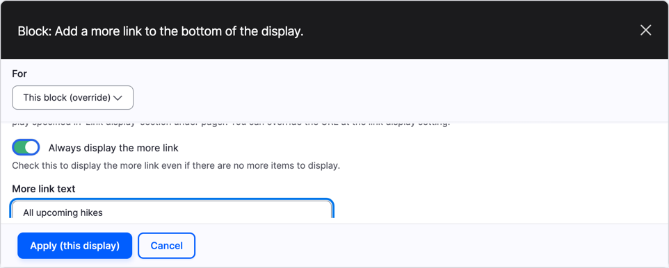
*Figure 12.10: A link to the page of all upcoming hikes*

4. Under **Block settings**, select **None** next to **Block name**, type `Next hikes`, and select **Apply**. This is the name you'll look for when you place the block; without it, the block is called after the view, `Hikes`.
5. Select **Save**.

We'll put the block on the front page once we have the photos too.

## Letting visitors choose: an exposed filter

The club's newer members have asked for easy hikes only. You could make a second page for each difficulty, but there's a better way: let the visitor choose. A filter that visitors can change is called an *exposed* filter.

We want the choice on the page, not in the small block on the front page, so this is another override, this time of the page's filters.

1. Select **Page** at the top of the edit screen.
2. Next to **Filter criteria**, select **Add**. Change **For** to **This page (override)**.
3. Search for `difficulty`, check **Difficulty (field_difficulty)**, and select **Apply (this display)**.
4. Turn on **Expose this filter to visitors, to allow them to change it**.
5. Change **Label** to `Difficulty`, and select **Apply (this display)**.
6. Select **Save**.

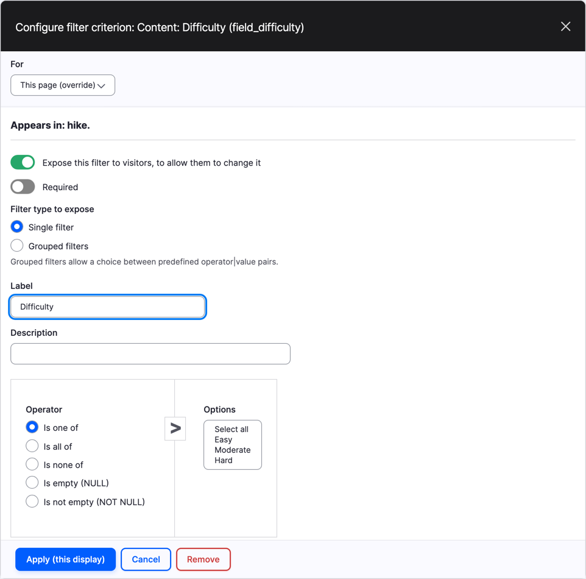
*Figure 12.11: The Difficulty filter, exposed on the page only*

Go to `/hikes` as a visitor, choose **Easy**, and select **Apply**.

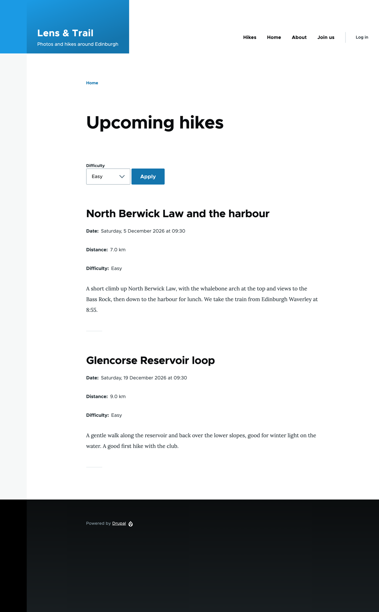
*Figure 12.12: Only the easy hikes*

The address is now `/hikes?field_difficulty_value=easy`, which means a member can share or bookmark the list of easy hikes.

One thing to know about overriding filters: the page now has its *own* list of filters, a copy of the shared one. If you later add a filter for **All displays** on the block, it won't reach the page any more, because the page no longer uses the shared list. That's why I override as little as I can, and only when a display really needs to be different.

## The newest photos

The front page also needs the club's newest photos. Photos are media items (Chapter 9), and a view can list those just as well as content.

### A small view mode for photos

The photos' existing view modes, *Banner* and *Album*, show them large. For a grid we need them small, so first a new view mode, as you did with *Card* in Chapter 8:

1. Go to **Structure** > **Display modes** > **View modes**, select **Add view mode**, and choose **Media**. Name it `Small`, check **Image** under **Enable this view mode for the following Media types**, and select **Save**.
2. Go to **Structure** > **Media types**, select **Manage display** for **Image**, and select the **Small** tab. Keep **Image** and **Photographer**, and disable the others. Give **Image** the image style **Banner small** (the 16:9 crop from Chapter 9) with its label hidden, set **Photographer**'s label to **Inline**, and select **Save**.

The photographer stays, even on a small photo: on a photography club's site, credit matters everywhere.

### A grid of photos

1. Go to **Structure** > **Views**, and select **Add view**. **View name**: `Photos`.
2. **Show** **Media** **of type** **Image** **sorted by** **Newest first**.
3. Leave **Create a page** off, and turn on **Create a block**. **Block title**: `Newest photos`. **Display format**: **Responsive Grid** of **Media view mode**. **Items per block**: `6`.
4. Select **Save and edit**.
5. Under **Format**, select **Default** (next to **Media view mode**), choose **Small**, and select **Apply**.
6. Select **Settings** next to **Responsive Grid**. Set **Maximum number of columns** to `3`, and select **Apply**.
7. Under **Block settings**, set **Block name** to `Newest photos`, and select **Save**.

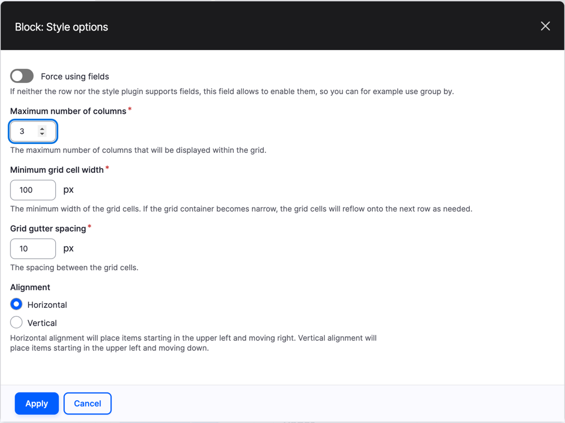
*Figure 12.13: A responsive grid of at most three columns*

A *responsive* grid adapts to the screen: up to three photos side by side on a wide screen, fewer on a phone, where each cell would otherwise get narrower than its **Minimum grid cell width**.

## Putting the blocks on the front page

A view's block can go anywhere a block can go. Chapter 14 is about blocks and regions, and places them around the whole site; for now, we put ours on one page, the front page, with Layout Builder. In Chapter 8, we allowed every Basic page its own layout, and *Welcome to Lens & Trail* is a Basic page.

1. Open the front page, and select the **Layout** tab.
2. Select **Add block** at the bottom of the section, below the page's text.
3. In the panel on the right, type `hikes` in the filter box, and under **Lists (Views)**, select **Next hikes**. Select **Add block**.

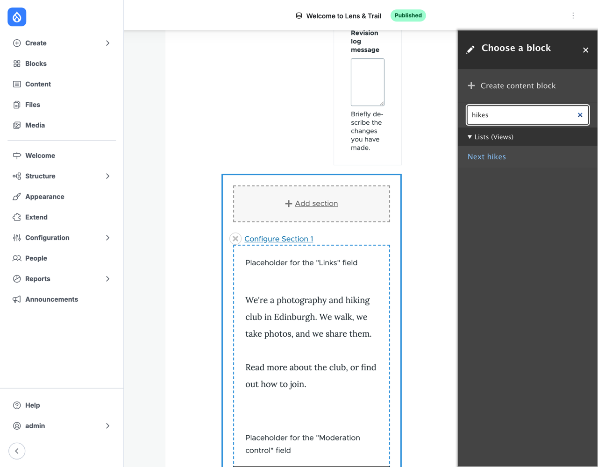
*Figure 12.14: The view's block, in Layout Builder*

4. Do the same for **Newest photos**.
5. In **Revision log message**, type `The next hikes and the newest photos.`, and select **Save layout**.

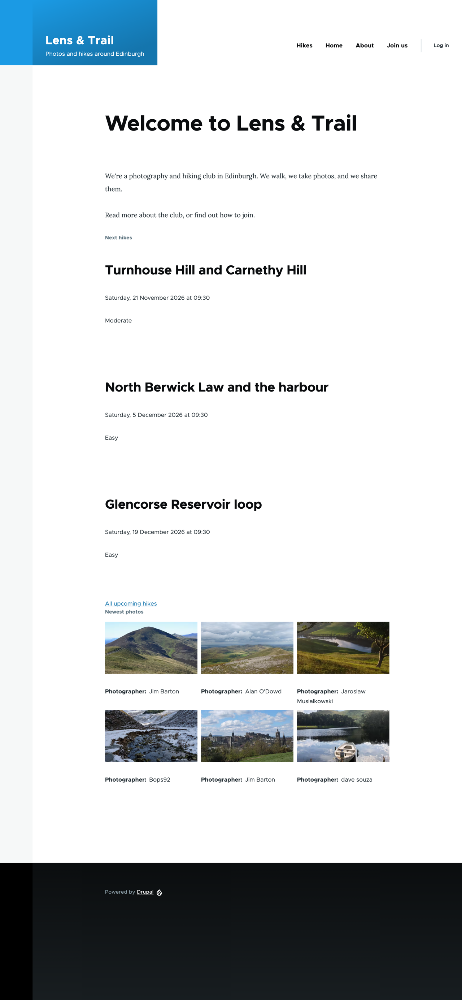
*Figure 12.15: The front page, with the next hikes and the newest photos*

The front page now changes on its own. When a hike leader adds a hike, it appears; when a hike has happened, it disappears; and every new photo goes to the top of the grid. Nobody has to edit the front page for any of it.

## A page of albums

> **Try it:** Chapter 9 promised a page of all the albums, at `/galleries`. Add a second album first, so the list has more than one (I added *Edinburgh, 24 October*, with the Old Town photo, for the Arthur's Seat hike). Then add a view called `Albums`: **Show** **Content** **of type** **Gallery**, **Newest first**, with a page titled `Albums` at the path `galleries`, as a **Responsive Grid** of **teasers**, `12` items, with a pager and a menu link `Albums` in **<Main navigation>**. After **Save and edit**, set the grid's **Maximum number of columns** to `2`, and save.

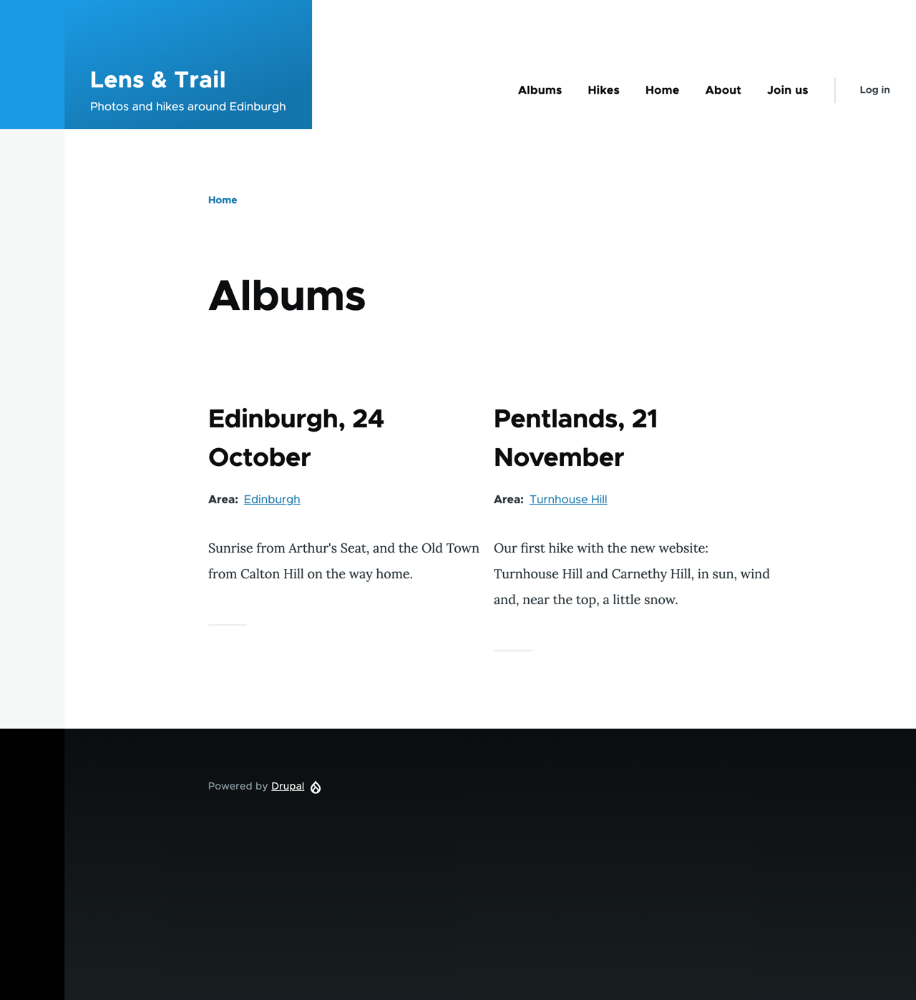
*Figure 12.16: The club's albums*

The albums show their area and description, but no photo. The Teaser could show the **Photos** field, but it would show *all* of an album's photos. Showing only the first one is a job for Views' fields, in Chapter 13.

> **On Drupal CMS:** Views works exactly the same, under **Structure** > **Views**. The Starter template comes with few views of its own: lists for the administration pages, and the *Recent content* and *My drafts* blocks on the dashboard. Other site templates and add-ons bring the lists they need, such as a list of events. And there's one more place a view's block can go: Canvas. Every block display you create becomes a component in Canvas, which you can drop onto a page next to a heading or a hero image, as you did in Chapter 8.

> **Coming from WordPress?** In WordPress, many lists come with the theme: the blog page, and an archive page for each category, tag, author and month. To build your own list, you add a **Query Loop** block to a page or template, choose a post type, a few filters (categories, tags, author, keyword) and the number of posts, and arrange the post's title, image and excerpt inside it. A Drupal view is the same idea, with more questions you can ask. The Query Loop orders posts by their date or title; ordering by a field of your own, such as the date of a hike, takes a plugin or code in WordPress, and a sort in Views. And a Drupal view isn't tied to one place: the same list can be a page, a block and a feed.

## Summary

You can now:

- explain what a view is: what to list (filters), in what order (sorts), and how it looks (format);
- tell a view, a display and a view mode apart;
- build a view with the wizard, with a page and a block;
- filter on a date relative to now, sort by a field, and add a message for when there's nothing to show;
- override a setting for one display, and recognize overridden settings by their italics;
- expose a filter to visitors;
- list media in a responsive grid, using a view mode of their own;
- place a view's block on a page with Layout Builder.

## Exercises

1. In Chapter 8, News got a Teaser. Build a page of news: `/news`, titled `News`, newest first, ten teasers per page, with a pager and a menu link. What should it say when there is no news yet?
2. On the Welcome page's layout, configure the **Next hikes** block (hover over it, and select the pencil). You can change how many hikes it shows, but not which ones. Why? (Hint: look at **Allow settings** under the block display's **Block settings**.)
3. Edit the hike *Glencorse Reservoir loop*, and set **Change to** to **Draft**. Look at `/hikes` as a visitor, and as an administrator. Which filter decides what you see? Publish the hike again afterwards.
4. *(challenge)* The club also wants a page of hikes that *have* happened, newest first, at `/hikes/past`. Add a second page display to the Hikes view (**Add** > **Page** at the top). Which settings must you override for it, and which can it share with the other displays? What happens to the upcoming hikes page if you get **For** wrong?
5. *(challenge)* Try to sort the albums on `/galleries` by the date of the *hike* they belong to, instead of when they were added. Why can't you find the hike's Date among the sort criteria? Chapter 13 has the answer.

## Want to know more?

- [Creating Listings with Views](https://www.drupal.org/docs/user_guide/en/views-chapter.html), the Views chapter of the Drupal User Guide, starting with [Concept: Uses of Views](https://www.drupal.org/docs/user_guide/en/views-concept.html) and [Concept: Parts of a View](https://www.drupal.org/docs/user_guide/en/views-parts.html).
- [Creating a Content List View](https://www.drupal.org/docs/user_guide/en/views-create.html) and [Adding a Block Display to a View](https://www.drupal.org/docs/user_guide/en/views-block.html), in the same guide.
- [Views module overview](https://www.drupal.org/docs/8/core/modules/views/overview), on drupal.org.
- [Query Loop block](https://wordpress.org/documentation/article/query-loop-block/), in WordPress's documentation, for comparison.
