# Going Deeper with Views

In Chapter 12, every view we built showed whole items in one of their view modes: a hike as a Teaser, a photo as Small. That takes us a long way, and it keeps the look of each item in one place, on **Manage display**. But sooner or later the club asks for a list that no view mode can give: a table of photo credits, an album with only its first photo, an album sorted by the date of the hike it belongs to, the hikes one member leads.

This chapter is about those lists. We build rows out of single fields, follow references from one item to another (*relationships*), count things (*aggregation*), let the address decide what a list shows (*contextual filters*), and add attachments and feeds. We finish with what Views does to keep all of it fast.

You can skip this chapter on a first read: nothing later in the book depends on it. But if you build Drupal sites for a living, you'll use most of it every week. We start where Chapter 12 left us: a page and a block of upcoming hikes, the newest photos on the front page, and a page of albums at `/galleries`.

## Displays, in depth

By the end of this chapter, the Hikes view has six displays. Before we add them, let's look more closely at what a display is.

A view answers the three questions from Chapter 12: what to list, in what order, and how it looks. A *display* answers a fourth one: *where* the list appears. One view can have many displays, and each of them shows the same list, in a different place. That's the reason displays exist: you build the list once, and when the club decides that a hike needs one more filter, you change it once.

There are six kinds of display. You add one with **Add**, at the top of the edit screen, next to the displays you already have.

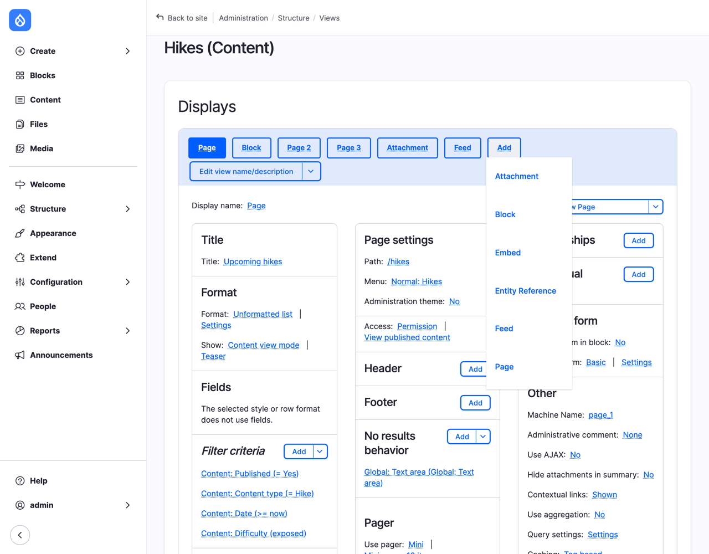
*Figure 13.1: The six kinds of display, under Add*

- A **Page** has its own address, such as `/hikes`, and can have a menu link or a tab.
- A **Block** has no address. You place it on other pages, with Layout Builder (Chapter 8), Canvas, or the block layout (Chapter 14).
- A **Feed** is the list for programs instead of people, in the RSS format. We add one later in this chapter.
- An **Attachment** isn't shown on its own. It's shown before or after another display of the same view, on the same page. We add one of those too.
- An **Entity Reference** display decides which items a reference field offers. Chapter 7's **Hike leader** field offers every user; with a view, it could offer only the members with the Hike leader role.
- An **Embed** display is for themes and code, which can show it anywhere. Site builders rarely need it.

### Shared settings and overrides

Behind the displays you see, every view has one more, hidden display: the **Default** display. It holds the settings that all the displays share. When a dialog says **For** **All displays**, you're changing the Default display, and every display that hasn't overridden that setting follows. When you choose **This page (override)**, the page gets its own copy of the setting, shown in *italics*, and stops following the Default display for that setting only.

So a display is mostly a list of exceptions. Our **Next hikes** block, from Chapter 12, shares the title, the filters, the sort and the no-results text with the Default display, and has its own format (Card), number of items and more link. If you want to see the Default display, turn on **Always show the default display** under **Structure** > **Views** > **Settings**. We prefer to leave it hidden, and to think about **For** in each dialog instead: it's harder to change every display by accident.

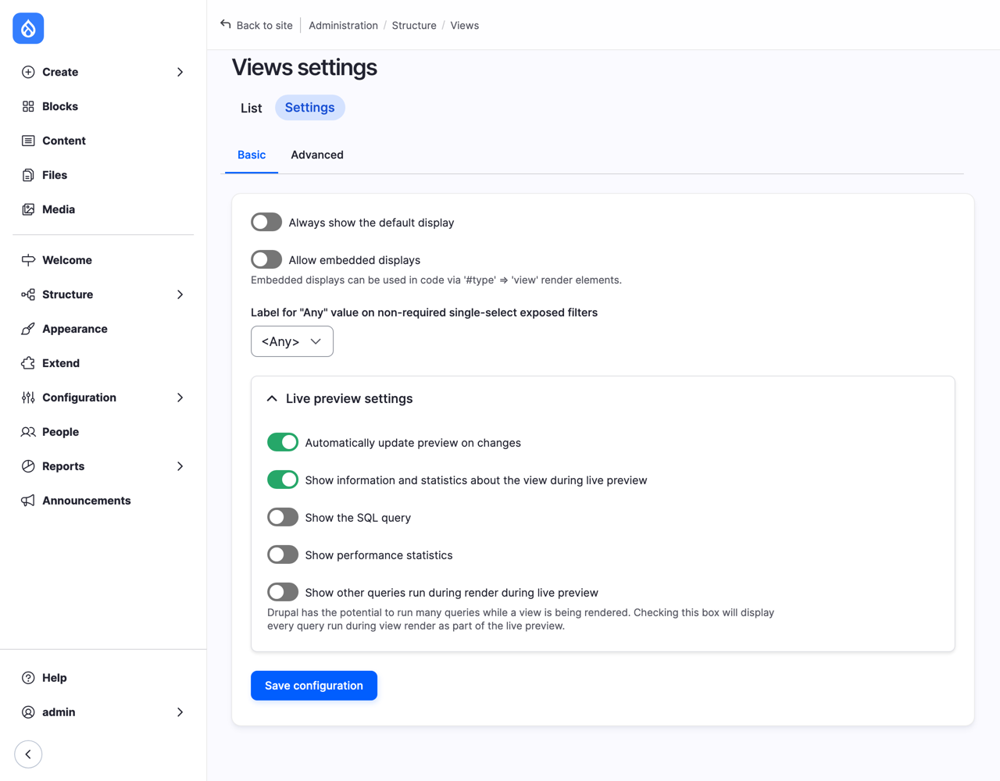
*Figure 13.2: Views settings, where the Default display can be shown*

One thing can't be different between the displays of a view: *what kind* of thing it lists. The Hikes view lists content; a display of it can't list media or users. That's chosen once, in the wizard's **Show**. A list of something else is a new view.

### Keeping track of displays

When a view has more than two displays, a few habits help:

- **Give displays names.** The wizard names them **Page** and **Block**, and the next ones become **Page 2**, **Page 3**. Select **Display name**, below the displays, to call them something you'll recognize, such as *Member's hikes*. Only administrators see display names.
- **Duplicate, disable and delete** are in the button at the right of the display name: **Duplicate Page** copies a display with all its settings, overridden or not; **Duplicate as Block** and the like make a display of another kind from it; **Disable Page** turns it off without throwing it away. A copy shares what the original shared: if the page uses the shared pager, so does its copy, and changing the copy's number of items changes it for every display that shares it. When in doubt, add a new display instead, or override the setting on the copy first.

*Figure 13.3: What you can do with a display*
- **The machine name**, under **Other**, such as `page_2`, is how Drupal knows the display, for example in a placed block's settings. You can change it, but do it before you use the display anywhere, or leave it as it is.

## Fields: building the row yourself

In the wizard, **Display format** has a second half: what each row shows. So far we chose **teasers** or a view mode. The other choice is **fields**: you pick the fields one by one, and Views shows only those, in the order you choose, with the labels and formatting you choose.

Fields are the right choice when the list has a shape of its own, such as a table, where every row must have the same columns. View modes are the right choice when the list should look like the content looks elsewhere, as our cards do. If you can do it with a view mode, do: one change on **Manage display** then changes every list that uses it.

### A table of photo credits

The club publishes photos taken by many people, under different licenses, and Chapter 9 gave every photo its photographer, license and source. A table of all of them helps the editors check that every photo is credited properly.

1. Go to **Structure** > **Views**, and select **Add view**. **View name**: `Photo credits`.
2. **Show** **Media** **of type** **Image** **sorted by** **Media name**.
3. Turn on **Create a page**. **Page title**: `Photo credits`. **Path**: `admin/content/photo-credits`. **Display format**: **Table**. (A table always shows fields, so there's nothing to choose next to it.) **Items to display**: `50`.
4. Select **Save and edit**.

The table has one column so far: **Media: Name**. Now we add the others.

5. Next to **Fields**, select **Add**. Type `thumbnail` in the search box, check **Thumbnail** (in the **Media** category), and select **Add and configure fields**.
6. Turn on **Create a label**, and type `Photo` in **Label**. Set **Image style** to **Thumbnail (100×100)**, and select **Apply**.

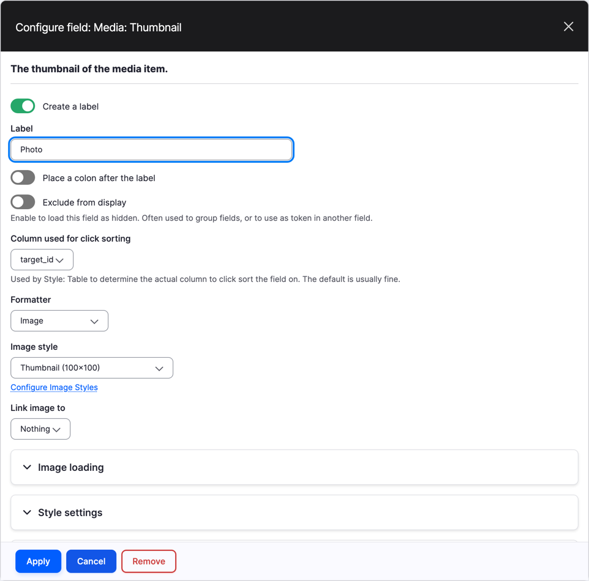
*Figure 13.4: Adding the thumbnail as a field*

7. Add **Photographer**, **License** and **Source** the same way. Their labels are fine as they are: select **Apply** for each.

Every field has the same kind of dialog: a label, a **Formatter** with its settings (the same formatters as on **Manage display**), and three closed sections we'll come back to: **Style settings**, **Rewrite results** and **No results behavior**.

Now the table itself. Select **Settings** next to **Table**, under **Format**.

8. Check **Sortable** for **Name**, **Photographer** and **License**, and set **Default sort** to **Name**.
9. Select **Apply**.

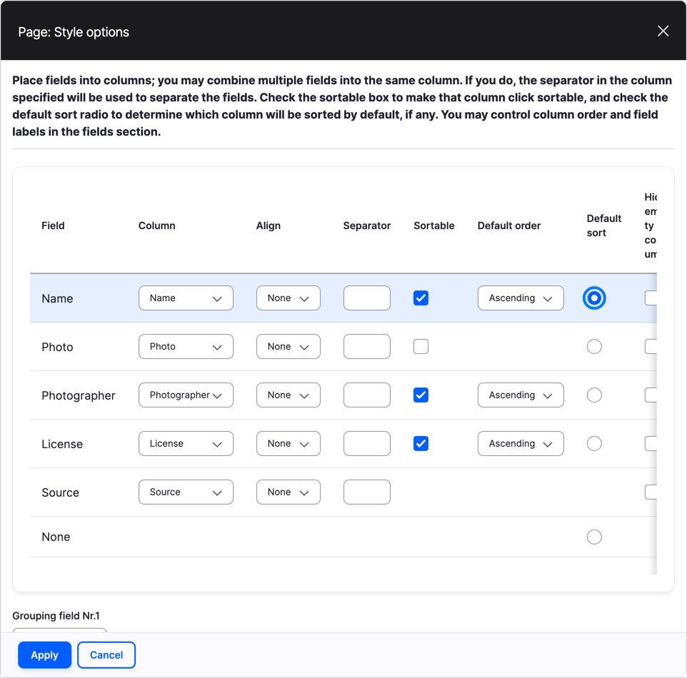
*Figure 13.5: Which columns visitors can sort by*

A *sortable* column has a clickable heading: select **Photographer**, and the table sorts by photographer; select it again to reverse the order. The **Column** select lets you put two fields in one column, with a **Separator** between them.

### Who may see the page?

One more thing before we save. The path starts with `admin/`, so the page uses the administration theme, like the rest of the administration pages. But an address under `/admin` doesn't make a page private: who may see it is decided under **Page settings** > **Access**. The wizard chose **Permission** | **View media**, which every visitor has.

10. Select **View media** next to **Access**, choose **Access media overview**, and select **Apply**.
11. Select **Save**.

Now only the people who can see **Content** > **Media** can see the credits. Remember this for every page you make for the club's editors: the address is for convenience, the access setting is the lock.

## Relationships: following references

The credits table is missing one useful column: which album each photo is in. That's not a field of the photo. The album has a **Photos** field that refers to the photo, and the photo knows nothing about it.

To show something from *another* item, a view needs a *relationship*: an instruction to follow a reference from each row to the item at the other end, so that the other item's fields become available too. In database terms, a relationship is a *join*; you don't need to know that, but it's where the name comes from.

### Which album is each photo in?

Our reference goes from the album to the photo, and we're listing photos, so we have to follow it backwards. Views calls that a *reverse* relationship.

1. Open the **Photo credits** view again. In the column on the right, next to **Relationships**, select **Add**.
2. Type `field_photos`, and check **Content using field_photos** (in the **Media** category). Select **Apply (all displays)**.

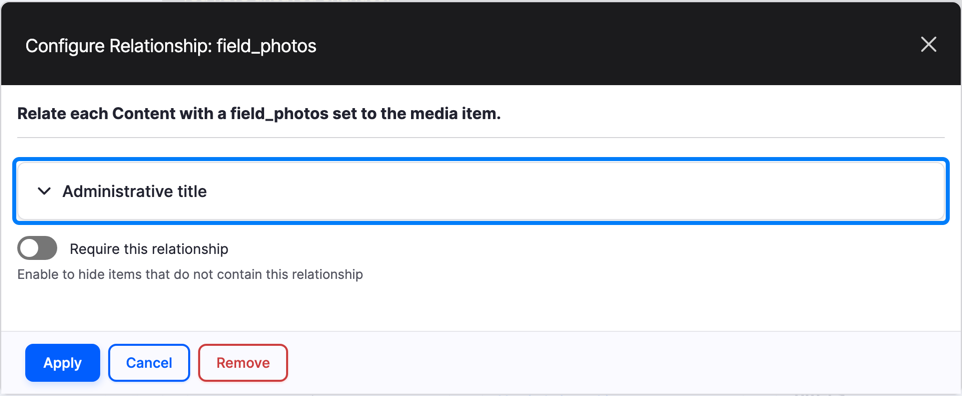
*Figure 13.6: A relationship from each photo to the album that uses it*

3. Leave **Require this relationship** off, and select **Apply**. (More about it in a moment.)
4. Add a field: type `title`, check **Title** in the **Content** category, and select **Add and configure fields**.
5. A new select has appeared at the top of the dialog: **Relationship**. It's set to **field_photos**, the only one there is: we want the album's title, not the photo's. Turn on **Create a label**, type `Album`, select **Apply**, and **Save** the view.

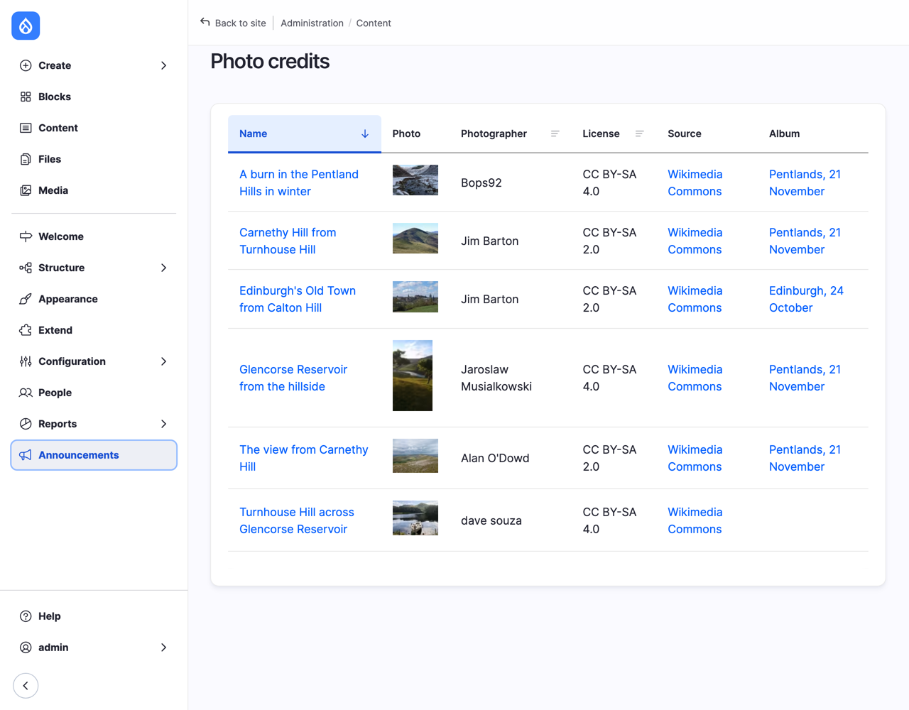
*Figure 13.7: The photo credits, with the album of each photo*

The last photo, *Turnhouse Hill across Glencorse Reservoir*, isn't in an album; it's on the hike's page, from Chapter 7. It's still in the list, with an empty **Album** column. That's what **Require this relationship** decides: off, rows without anything at the other end stay in the list; on, they're left out. Here we want every photo, so it stays off.

### Hikes at a glance: rewriting fields

The club's hike leaders want a table too: every hike, past and future, with its date, distance, difficulty and leader. This one teaches two more things: how to put two fields in one cell, and how to show something from a *user*.

> **Try it:** Add a view called `Hike admin`: **Show** **Content** **of type** **Hike**, **Unsorted**, with a page titled `Hikes` at `admin/content/hikes`, as a **Table**, `50` items. After **Save and edit**, add the fields **Date** (with **Date format** **Default medium date**), **Difficulty** and **Distance**. In the **Difficulty** dialog, turn on **Exclude from display**: we need its value, but not its column.

Distance and difficulty belong together ("9 km, easy"), so we put them in one column. Open the **Distance** field:

1. Turn on **Create a label**, and type `Distance and difficulty`. Set **Scale** to `1`, for one decimal.
2. Open **Rewrite results**, and turn on **Override the output of this field with custom text**.
3. In **Text**, type `{{ field_distance }}, {{ field_difficulty }}`, and select **Apply**.

*Figure 13.8: Rewriting a field with the values of others*

The words in double curly brackets are *replacement patterns*: placeholders for the value of another field in the same row. Open **Replacement patterns**, below the text, to see the ones you can use. You can only use fields that come *before* this one in the list of fields, which is why we added **Difficulty** first, and why **Exclude from display** exists: a field you only need for a pattern.

> **Drupalism: Twig.** The double curly brackets are *Twig*, the template language Drupal's themes are written in. You don't need to know any more Twig than this for Views, but if you meet it in a theme later, you'll recognize it.

Now the leader. **Hike leader** is a reference to a user (Chapter 7), so we need a relationship to the user.

4. Next to **Relationships**, select **Add**. Type `hike leader`, check **User referenced from field_hike_leader**, select **Apply (all displays)**, and **Apply** again.
5. Add the field **Name** from the **User** category. **Relationship** is set to **field_hike_leader: User**. Turn on **Create a label**, type `Leader`, and select **Apply**.

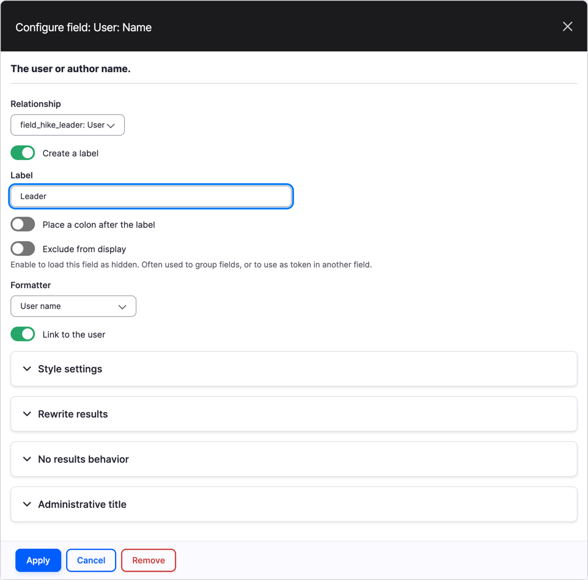
*Figure 13.9: The leader's name, through the relationship*

6. In the table's **Settings**, make **Date** sortable, set **Default sort** to **Date**, and its **Default order** to **Descending**: the newest hikes at the top.
7. Set **Access** to **Access the Content overview page**, as we did for the credits, and **Save**.

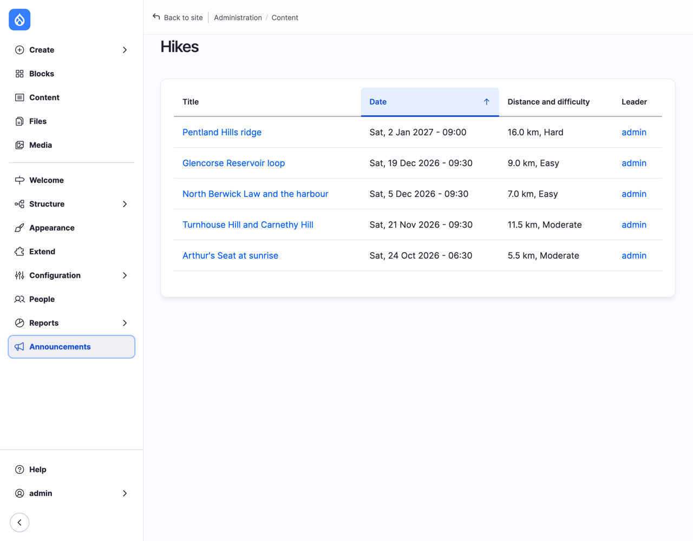
*Figure 13.10: The hike leaders' table*

### Albums with their first photo, sorted by their hike

Chapter 12 left two loose ends on the albums page: the albums showed no photo, and Exercise 5 asked how to sort them by the date of their hike. Both need fields, and the second needs a relationship.

1. Edit the **Albums** view. Under **Format**, select **Content** next to **Show**, choose **Fields**, and select **Apply** twice.
2. Add the field **Photos** (in **Content**). Leave **Create a label** off. Set **Formatter** to **Rendered entity**, and **View mode** to **Small**, the view mode we made for photos in Chapter 12.
3. Open **Multiple field settings**, and in **Display 1 value(s) starting from 0**, type `1` in the first box. Select **Apply**.

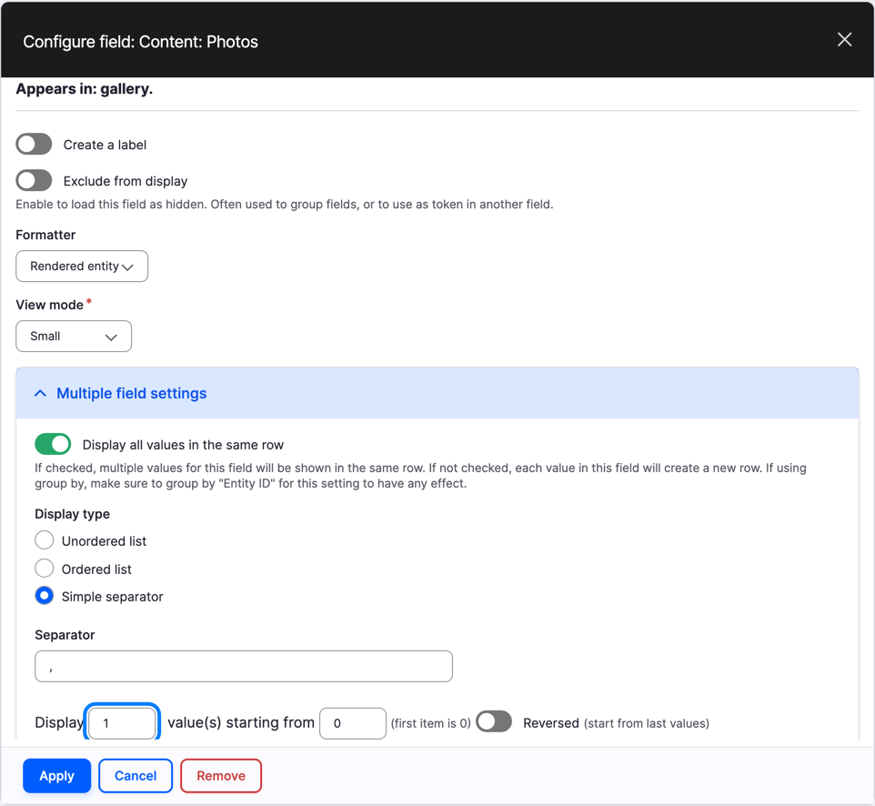
*Figure 13.11: Only the first photo of each album*

**Multiple field settings** appear on every field that can hold more than one value. *Starting from 0* means from the first one: computers start counting at zero.

Now the album's hike. The album refers to the hike, so this is a relationship forward, the way the reference points.

4. Add the relationship **Content referenced from field_hike**. Turn on **Require this relationship**, and select **Apply**.

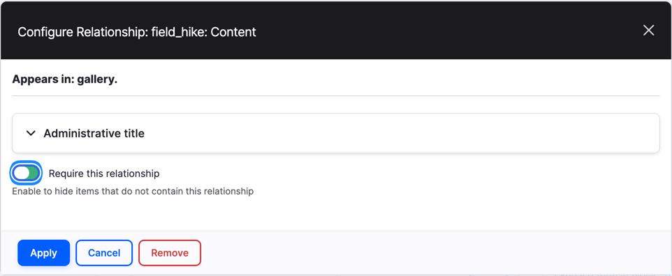
*Figure 13.12: Every album must belong to a hike to be listed*

This time we require it: an album that doesn't belong to a hike can't be sorted by the hike's date. (Is that what the club wants? An album from a photo walk in town, without a hike, would disappear from the page. Sometimes there's no clean answer; for now, every album belongs to a hike.)

5. Add the field **Title** (in **Content**), and set **Relationship** to **field_hike: Content**: the hike's title, not the album's. Turn on **Create a label**, type `Hike`, turn on **Place a colon after the label**, right below it, and select **Apply**.
6. Add the field **Date**, also through **field_hike: Content**, without a label.
7. Under **Sort criteria**, select **Content: Authored on (desc)**, and select **Remove**.
8. Add the sort criterion **Date** (in **Content**), with **Relationship** **field_hike: Content**, **Sort descending**, and select **Apply**. **Save** the view.

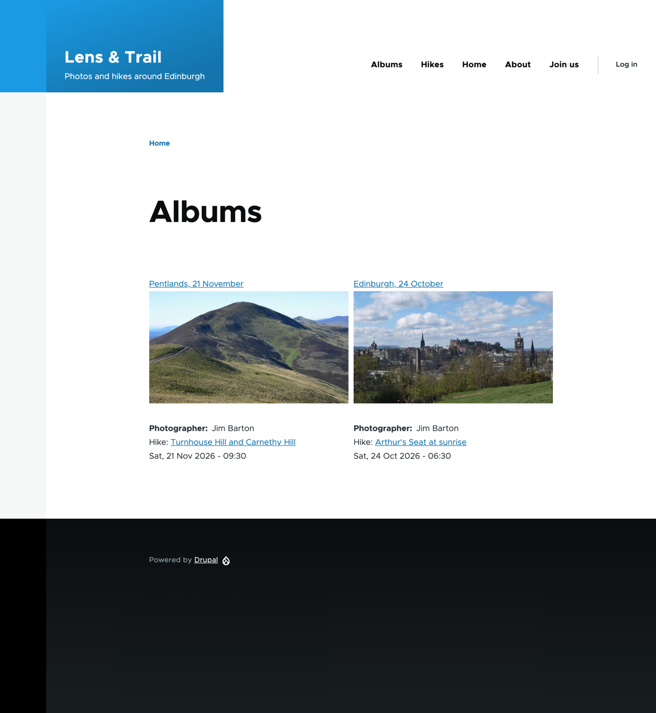
*Figure 13.13: Albums with their first photo, newest hike first*

That's the answer to Chapter 12's exercise: the hike's date isn't among the sort criteria until there's a relationship to the hike. Every field, filter and sort of the item at the other end becomes available, in each dialog's **Relationship** select.

### Too many rows

Relationships have one trap, and everybody falls into it once. Try this, without saving:

1. Add the relationship **Media referenced from field_photos**: from each album to its photos.
2. Add the field **Photographer**, through that relationship.

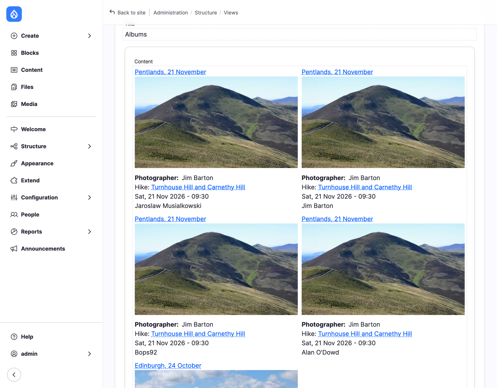
*Figure 13.14: One row per album and photo*

*Pentlands, 21 November* is in the list four times. A view has one row per *combination*: the album has four photos, so following the reference gives four rows, one for each photo. That's exactly right when you want to list photos with their album, as we did in the credits; it's the duplicates people complain about when you don't. Whenever rows repeat, look for a relationship to a field with more than one value. Select **Cancel** at the bottom of the view to throw these changes away.

## Counting: aggregation

How many photos has each photographer contributed? That's not a list of photos, but a list of *photographers*, each with a number. Views can group rows and count them: that's called *aggregation*.

1. Add a view called `Photographers`: **Show** **Media** **of type** **Image**, **Unsorted**, with a page titled `Photographers` at `admin/content/photo-credits/photographers`, as a **Table**, `50` items. Select **Save and edit**.
2. Under **Other**, in the column on the right, next to **Use aggregation**, select **No**, turn on **Aggregate**, and select **Apply**.

*Figure 13.15: Turning on aggregation*

3. Remove the field **Media: Name**: every photo has its own name, so grouping by it would give one row per photo.
4. Add the field **Photographer**, and select **Apply** twice.
5. Add the field **ID** (in **Media**). Because aggregation is on, a dialog asks first how to aggregate it: set **Aggregation type** to **Count**, and select **Apply and continue**. Then, in the field's own dialog, turn on **Create a label**, type `Photos`, and select **Apply**.

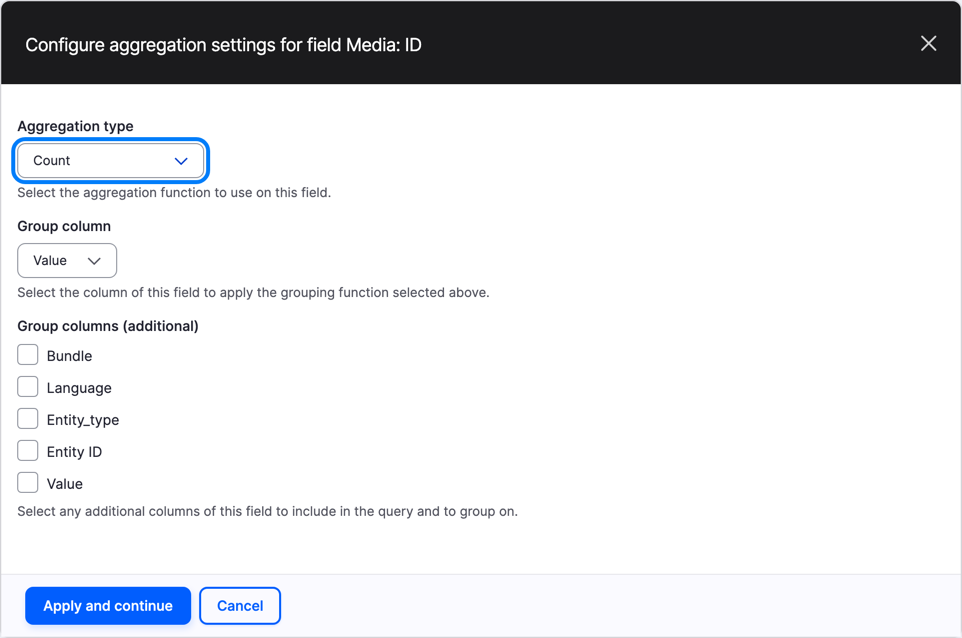
*Figure 13.16: Count the photos, instead of listing them*

6. Make **Photographer** sortable and the default sort, set **Access** as for the credits, and **Save**.

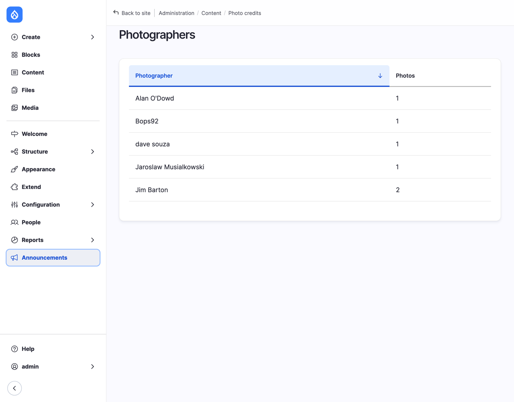
*Figure 13.17: Photographers, and how many photos each has given the club*

With aggregation on, every field is either *grouped* (**Group results together**, the default) or *aggregated* (**Count**, **Sum**, **Average**, **Minimum**, **Maximum**). Views makes one row for each different combination of the grouped fields, and runs the function on the others. That's why we removed the name: a grouped field that's different in every row means no grouping at all.

Aggregation is powerful and a little fiddly. If a number looks wrong, look at every field, sort and filter for one that's grouped when it shouldn't be: each of them has its own **Aggregation settings** link once aggregation is on.

## Contextual filters: lists that depend on where they are

Every filter so far was fixed: hikes, published, from now on. Sometimes a list depends on *where* it's shown: the hikes in *this* area, the albums of *this* hike, the hikes *this* member leads. One view can do that for every area, hike or member, with a *contextual filter*: a filter whose value comes from the context, usually the page's address.

You've seen one already. When you open an area, such as *Pentland Hills*, the page lists everything tagged with it. That page is the core view **Taxonomy term**, and its path is `/taxonomy/term/%`: the `%` stands for whatever is in the address at that place, the term's ID.

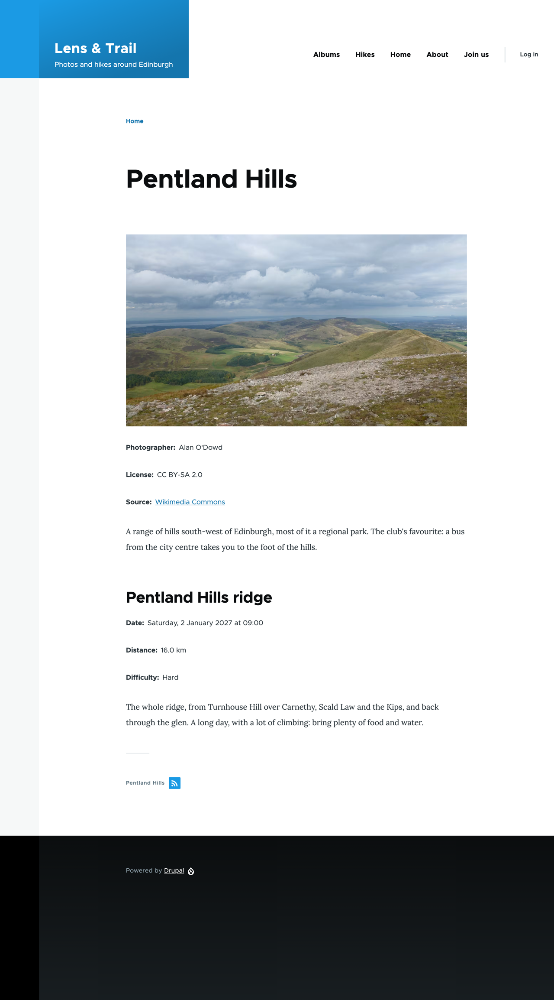
*Figure 13.18: The Pentland Hills area lists only what's tagged with Pentland Hills itself*

In Chapter 10 we made areas a hierarchy: Turnhouse Hill and Glencorse Reservoir are *in* the Pentland Hills. But the Pentland Hills page lists only the one hike tagged *Pentland Hills* itself, not the hikes on Turnhouse Hill. Let's fix that.

### Term pages with depth

1. Go to **Structure** > **Views**, and edit **Taxonomy term**.

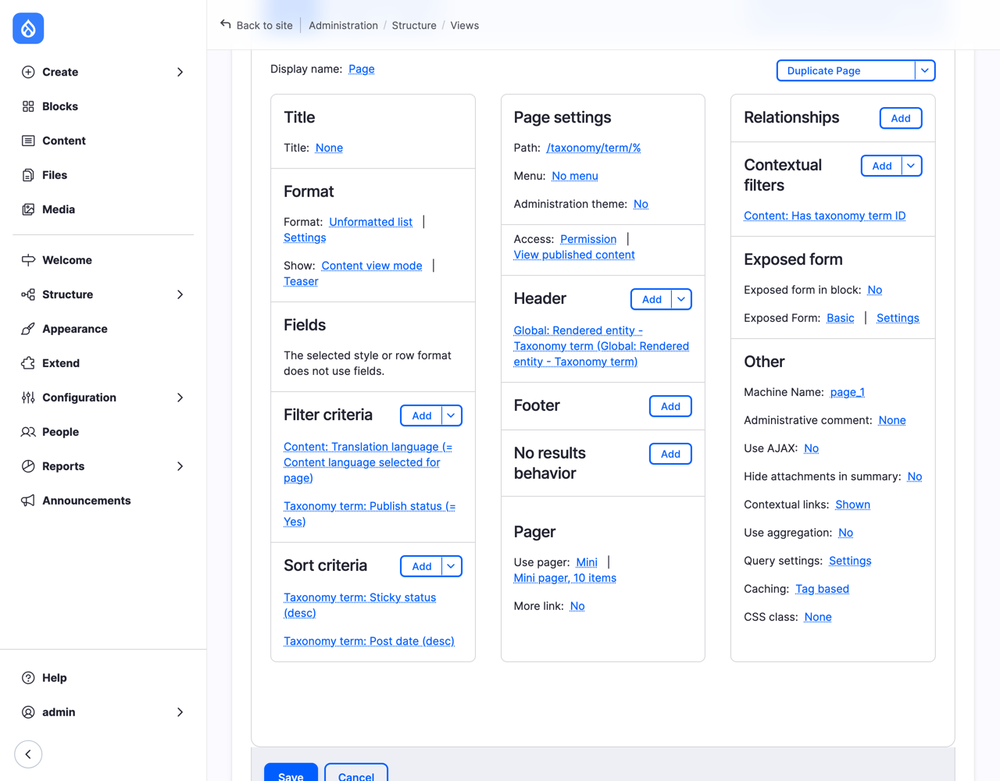
*Figure 13.19: The view behind every term page*

2. Under **Contextual filters**, select **Content: Has taxonomy term ID**, and **Remove** it.
3. Next to **Contextual filters**, select **Add**. Type `depth`, check **Has taxonomy term ID (with depth)**, and select **Apply (all displays)**.
4. Set **Depth** to `2`: the term itself, its children, and their children.
5. Under **When the filter value is NOT in the URL**, choose **Show "Page not found"**: the page makes no sense without a term.

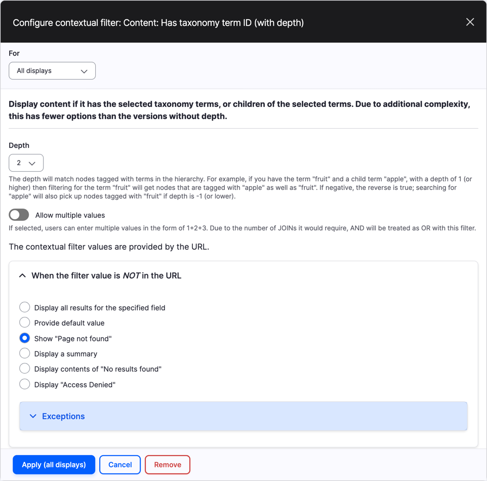
*Figure 13.20: Include the terms below this one*

6. Open **When the filter value IS in the URL**, turn on **Override title**, and type `{{ arguments.term_node_tid_depth }}`: the page's title becomes the term's name, instead of the term's ID.
7. Turn on **Specify validation criteria**, and set **Validator** to **Taxonomy term**. Now `/taxonomy/term/banana` is a *Page not found* instead of an empty page.
8. Select **Apply**.

**When the filter value is NOT in the URL** is the most important part of every contextual filter: it decides what happens when there's no value. We'll use four of its answers in this chapter.

One more change. The term's own photo and description at the top of the page come from a **Header** that shows the term, and it finds the term through the old contextual filter. Under **Header**, select **Global: Rendered entity - Taxonomy term**, and in **Taxonomy term ID**, change `tid` to `term_node_tid_depth`: `{{ raw_arguments.term_node_tid_depth }}`. Select **Apply**, and **Save**.

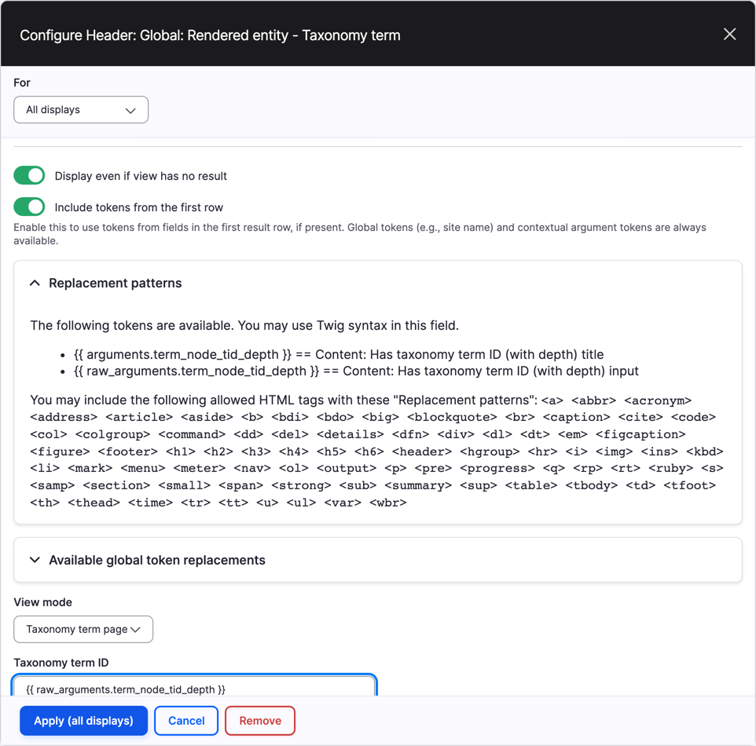
*Figure 13.21: The header follows the new contextual filter*

`arguments` is the filter's value as a title (*Pentland Hills*); `raw_arguments` is the value as it is in the address (the term's ID). *Argument* is the old name for a contextual filter, and it's still everywhere under the hood.

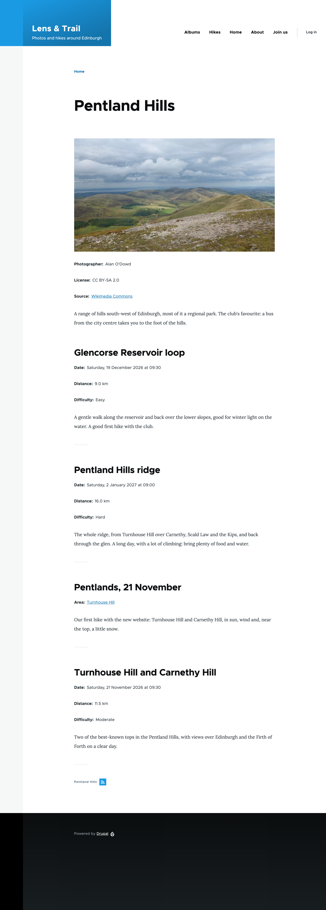
*Figure 13.22: Pentland Hills, with everything in the hills*

We changed a view that came with Drupal. That's fine, and it's what the core views are there for, but write down what you changed: Drupal has no button to put a core view back the way it was.

### Albums from this hike

On a hike's page, visitors should see the albums from that hike. A block can't take a value from its address the way a page can: a block has no address of its own. But a contextual filter can *provide a default value*, and one of the defaults is "the content this page shows".

1. Edit the **Albums** view, and at the top, select **Add** > **Block**.
2. Select the title, **Albums**, and set **For** to **This block (override)**. Type `Albums from this hike`, and select **Apply (this display)**.
3. Next to **Contextual filters**, select **Add**. Set **For** to **This block (override)**, type `hike`, check **Hike (field_hike)**, and select **Apply (this display)**.
4. Under **When the filter value is NOT available**, choose **Provide default value**, and set **Type** to **Content ID from URL**. Select **Apply (this display)**.

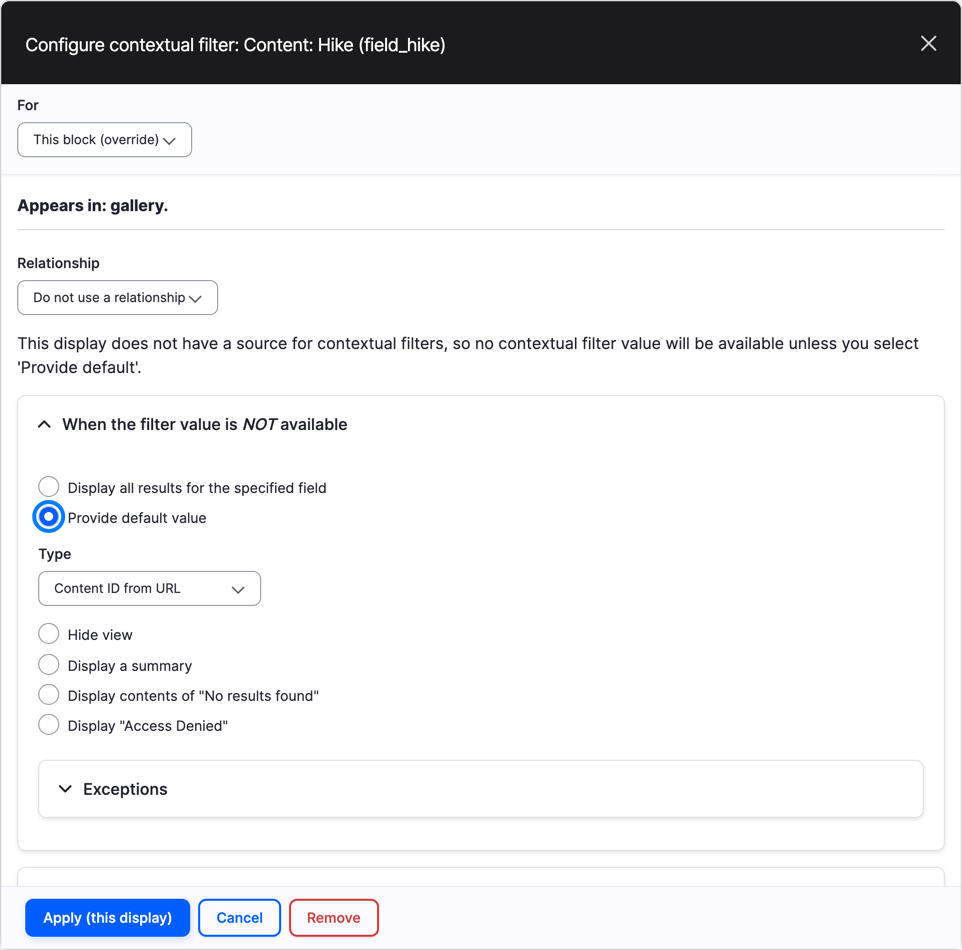
*Figure 13.23: The block takes the hike from the page it's on*

The note in the dialog says the same thing as we did: a block has no address, so without a default there's no value. **Content ID from URL** reads the page's address, and if it's a piece of content, uses its ID: on the page of the hike *Turnhouse Hill and Carnethy Hill*, the block lists the albums whose **Hike** is that hike.

5. Under **Block settings**, set **Block name** to `Albums from this hike`. Select **No** next to **Hide block if the view output is empty**, turn on **Hide block if no result/empty text**, select **Apply**, and **Save**. Most hikes have no album yet, and an empty heading helps nobody.

The block has to go on every hike's page. Chapter 14 is about blocks and their regions; for now, a short version:

6. Go to **Structure** > **Block layout**. Next to the **Content** region, select **Place block**, find **Albums from this hike**, and select **Place block**.
7. Under **Visibility** > **Content type**, check **Hike**, and select **Save block**.

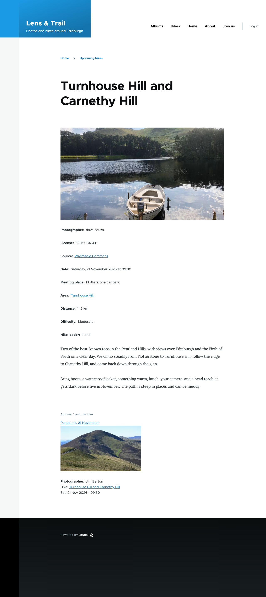
*Figure 13.24: The hike's albums, on the hike's page*

### The hikes a member leads

A member's profile can have a tab listing the hikes they lead. This one takes its value from the address again: the profile's address is `/user/` and the user's ID.

1. Edit the **Hikes** view, and select **Add** > **Page**.
2. Under **Page settings**, set **Path** to `user/%user/hikes`. `%user` stands for the user's ID, in the same place as on the profile, `/user/1`.
3. Next to **Menu**, choose **Menu tab**, type `Hikes` in **Menu link title**, and select **Apply**.

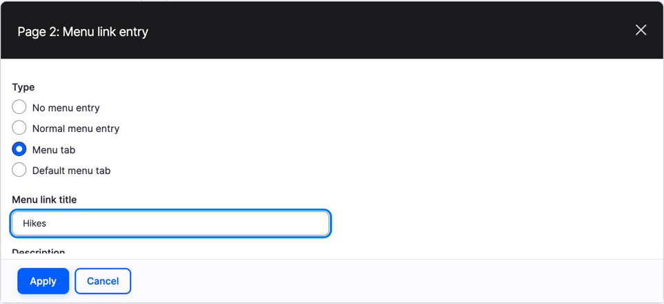
*Figure 13.25: A tab, next to View and Edit*

4. Add a contextual filter for **This page (override)**: **Hike leader (field_hike_leader)**. Open **When the filter value IS in the URL**, turn on **Override title**, and type `Hikes led by {{ arguments.field_hike_leader_target_id }}`. Select **Apply (this display)**, and **Save**.

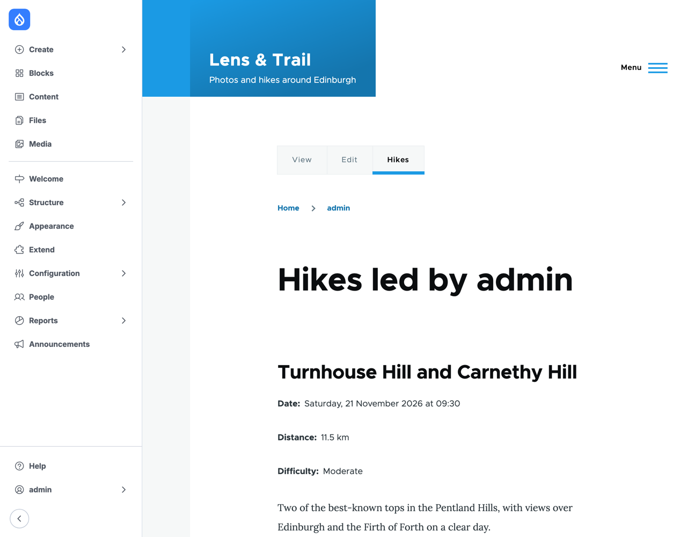
*Figure 13.26: The hikes admin leads, on their profile*

The filter's value is the user ID from the address, and Views compares it with each hike's **Hike leader**. We didn't choose anything under **When the filter value is NOT in the URL**: on this path, there's always a value.

The new page shares everything else with the upcoming hikes page: the same filters, the same sort, the same teasers. So it lists the *upcoming* hikes a member leads. That's a choice; Exercise 4 asks you to make the other one.

### An archive by month

The last kind of contextual filter answers a question with a list of possible answers: when there's no month in the address, show the months.

1. In the **Hikes** view, add another **Page**, with the **Path** `hikes/archive` and the title `Hike archive` (for **This page (override)**).
2. An archive is about the past too, so the date filter has to go, for this page only. Select **Content: Date (>= now)**, set **For** to **This page (override)**, and select **Remove**.
3. Add a contextual filter for **This page (override)**: type `date`, and check **node.field_date (year_month)**, in **Content**. (Yes, that's its name on screen; it's the **Date** field's year and month.)
4. Under **When the filter value is NOT in the URL**, choose **Display a summary**. Set **Sort order** to **Descending**, and **Format** to **List**.
5. Under **When the filter value IS in the URL**, override the title with `Hikes in {{ arguments.field_date_value_year_month }}`. Select **Apply (this display)**, and **Save**.

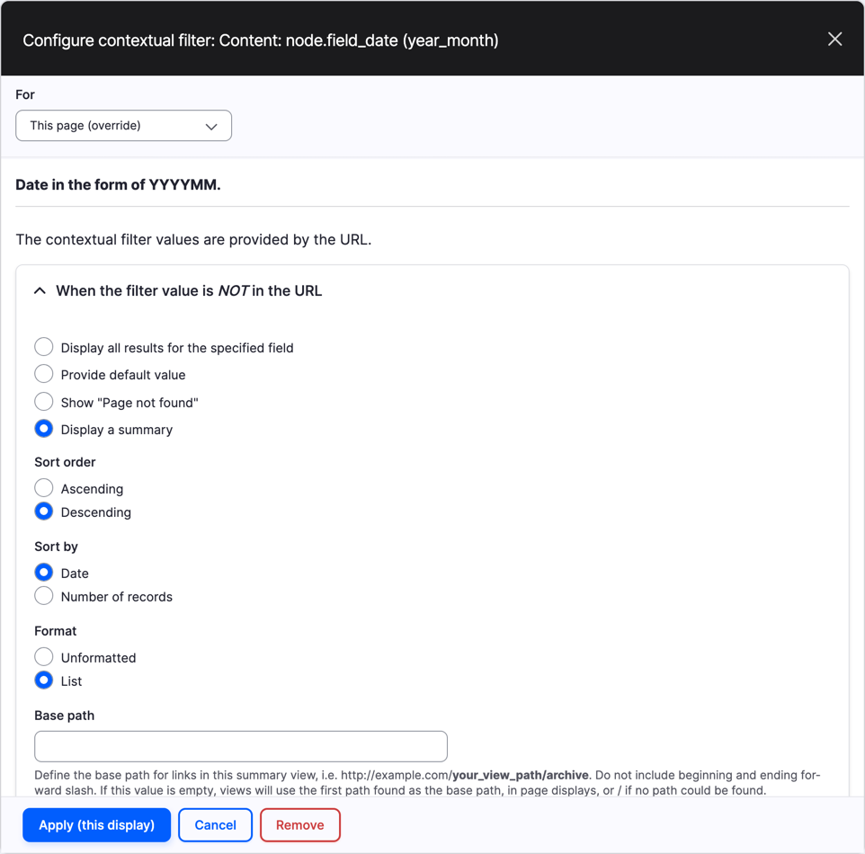
*Figure 13.27: When there's no month, list the months*

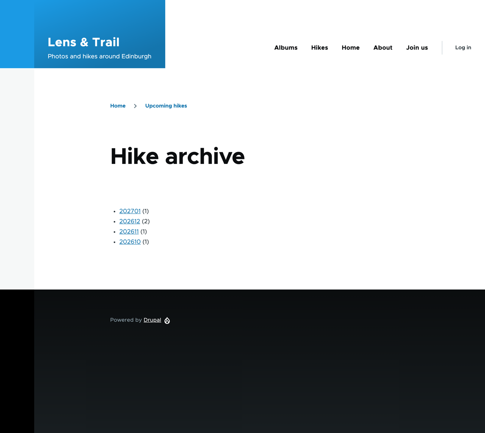
*Figure 13.28: The archive: one link for each month with hikes, and how many*

A *summary* is a list of every value the filter could have, with the number of rows for each. Select **202612**, and you're at `/hikes/archive/202612`: the two hikes in December 2026.

The months are shown as Views receives them: year and month, `202612`. For a **Date** field, Drupal doesn't turn them into *December 2026*; it does for the created date of content (**Authored on**). It's one of the rough edges you sometimes find, and a theme or a small module can make it friendlier.

## Attachments and feeds

A view has two more kinds of display. Neither is a page or a block of its own: they hang off another display.

### An attachment: the months above every month

On `/hikes/archive/202612`, the list of months is gone: there's a month in the address, so there's no summary. An *attachment* is a display that's shown before or after another display of the same view, on the same page. We'll use one to keep the months on every page of the archive.

1. In the **Hikes** view, select **Add** > **Attachment**.
2. Under **Attachment settings**, set **Attach to** to **Page 3** (the archive), and leave **Attachment position** at **Before**.
3. Set **Inherit contextual filters** to **No**. Otherwise the attachment gets the month from the page, and lists that month's hikes, twice.
4. Remove **Content: Date (>= now)** for **This attachment (override)**, as you did on the archive page.
5. Add the same contextual filter as on the archive, **node.field_date (year_month)**, for this attachment, with **Display a summary**, **Descending**, as a **List**.

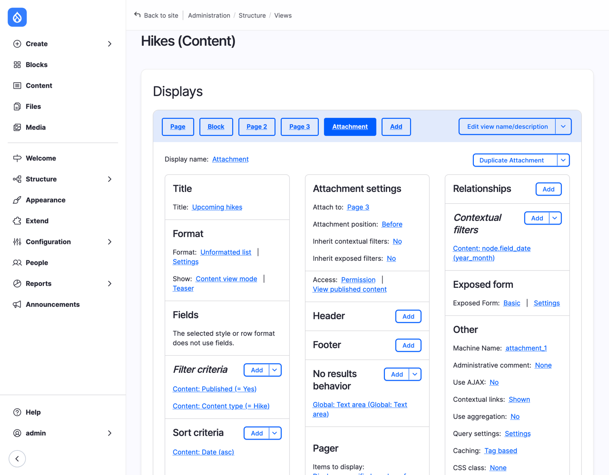
*Figure 13.29: An attachment, before the archive page*

Now the attachment always shows the months, so the archive page doesn't have to. Otherwise `/hikes/archive` shows them twice:

6. Go back to **Page 3**, open its contextual filter, choose **Display all results for the specified field** under **When the filter value is NOT in the URL**, and **Save**.

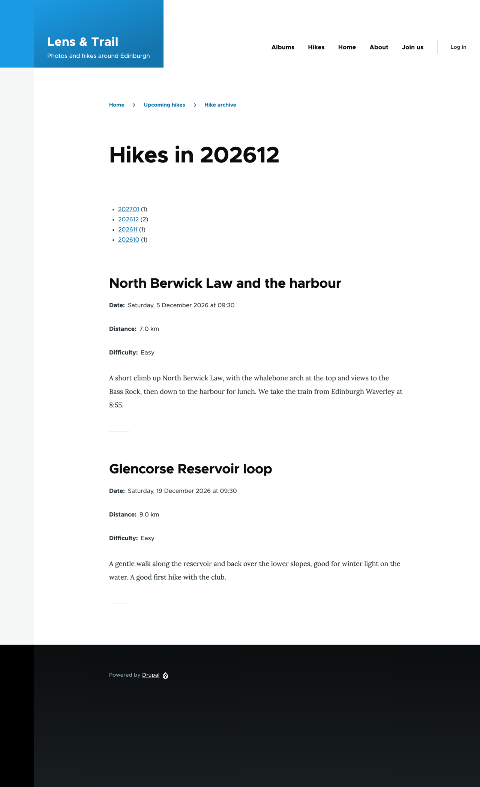
*Figure 13.30: The months stay at the top, whichever month you're in*

`/hikes/archive` now lists every hike, with the months above; each month's page lists that month's hikes, with the months above.

### A feed

A *feed* is a list for programs instead of people: a feed reader, another website, or a newsletter tool can follow it and show the club's new hikes. Views makes feeds in the RSS format.

1. In the **Hikes** view, select **Add** > **Feed**.
2. Under **Feed settings**, set **Path** to `hikes/feed`, and **Attach to** to **Page**, the upcoming hikes. **Save**.

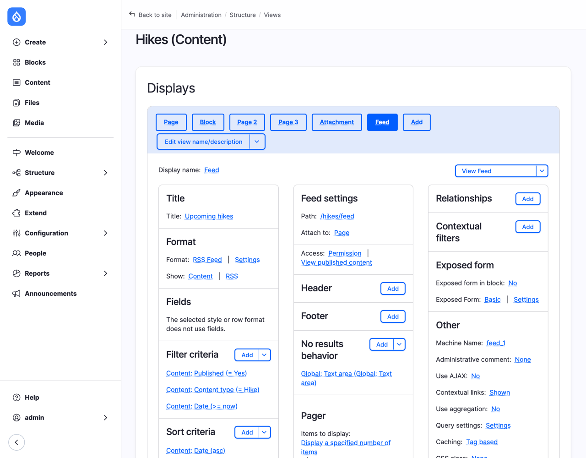
*Figure 13.31: A feed of the upcoming hikes*

**Attach to** here means: show the feed's icon at the bottom of that page, so people can find it.

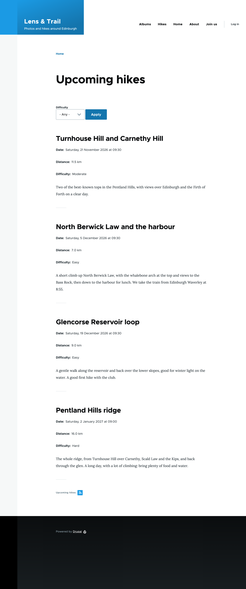
*Figure 13.32: The feed icon, on the page it belongs to*

Open `/hikes/feed`, and your browser shows the feed as text: the same hikes, in a format programs read. The term pages have had a feed all along, and now you know where its icon comes from.

> **Try it:** The Hikes view now has six displays: **Page**, **Block**, **Page 2**, **Page 3**, **Attachment** and **Feed**. Give them names you'll still understand next year, such as *Upcoming hikes*, *Next hikes*, *Member's hikes*, *Archive*, *Archive months* and *Upcoming hikes feed*.

## Caching and performance

Every time someone opens `/hikes`, Views asks the database for the hikes. On a small club's site that takes no time at all; on a site with a hundred thousand articles and a view with five relationships, it does. So Drupal keeps the results, and the HTML they become, in its *cache*, and reuses them.

Under **Other**, every view has a **Caching** setting.

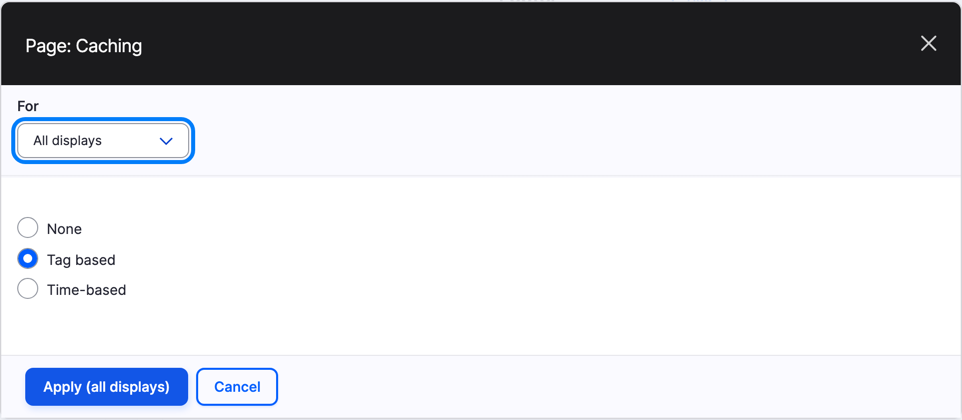
*Figure 13.33: How long Views keeps its results*

- **Tag based** (the default) keeps the results until something they depend on changes. When a hike is saved, Drupal throws away everything that lists content, and the next visitor gets a fresh list. You never see an old list, and the database is asked only when it has to be.
- **Time-based** keeps the results for a fixed time, such as an hour, whatever happens. Use it for a heavy view where a slightly old list is fine.
- **None** asks the database every time. Use it only while you're looking for a problem.

Leave **Tag based** on unless you have a reason. But our own site has a catch: the upcoming hikes depend on the *time*, not only on the content. When a hike's date passes, nothing is saved, so nothing tells the cache to throw the list away, and visitors can go on seeing yesterday's hike until someone saves any content. It's a known problem in Drupal core, with an [open issue on drupal.org](https://www.drupal.org/project/drupal/issues/2968485) that lists contributed modules as workarounds. On a club site where hikes and photos are added every week, the list is refreshed often enough; on a busier site, it's worth reading the issue. Either way, if you ever wonder why a list didn't change, caching is the first place to look.

Some habits keep views fast, cached or not:

- Show as few items per page as makes sense, with a pager.
- Add a relationship only when you need it, and make it required when you can: a required relationship is a cheaper join.
- Prefer a view mode to many fields when the list looks like the content does elsewhere.
- Be careful with aggregation and exposed filters on big lists: each combination is a new question to the database.

> **Under the hood: SQL.** Everything a view does, it does by asking the database a question in *SQL*, the language databases speak. You can see that question. Go to **Structure** > **Views** > **Settings**, turn on **Show the SQL query** under **Live preview settings**, and save. Now the preview of every view shows its query. Here's the one for the Albums page:
>
> 
> *Figure 13.34: The question Views asks the database*
>
> Read it from the top: *select* the hike's date and the album's ID *from* the content table, *join* the table where the album's Hike field is stored, then the content table *again*, for the hike itself, then the table where the hike's Date is stored; *where* the album is published and is a gallery; *ordered by* the hike's date, newest first; at most 13 of them. Each relationship is a *JOIN*, and the required one is an *INNER JOIN*: rows without a hike are left out. (Thirteen, not twelve: the mini pager asks for one more than it shows, to find out whether there's a next page.) You never need to write SQL in Drupal, but if you know a little, this is a good way to understand what a view does, and why it's slow when it is. Turn the setting off again when you're done.

> **On Drupal CMS:** Everything in this chapter works the same. Drupal CMS uses contextual filters itself: the **My drafts** block on the dashboard is a view of content with a contextual filter on the author, whose default value is **User ID from logged in user**. Open the **Publishing content** view under **Structure** > **Views** to see how it's made.

> **Coming from WordPress?** Many things this chapter builds come with WordPress: every category, tag and author has an archive page, and so does every month, at addresses like `/2026/12/`. The Query Loop block's **Default** query type does what a contextual filter does: it lists what the template's address asks for. What WordPress doesn't have without plugins is relationships: showing the hike an album belongs to, or sorting by it, takes a plugin such as a custom fields plugin, and some code. Tables with sortable columns and counts (aggregation) also need a plugin. In Drupal, they're all part of Views, in core.

## Summary

You can now:

- build a view's rows from fields, and show them as a table with sortable columns;
- restrict who can see a view's page, whatever its address;
- combine fields in one with rewriting and replacement patterns, and hide fields you only need for that;
- follow a reference with a relationship, forward and in reverse, and decide whether it's required;
- recognize duplicate rows, and the relationship that causes them;
- count and group with aggregation;
- make a list depend on its address or its page with a contextual filter, with a default value, a title, validation and a summary;
- add an attachment and a feed to a view;
- explain how Views caches its results, and read the SQL behind a view.

## Exercises

1. Add the **Meeting place** and the **Area** to the hike leaders' table, and make **Title** sortable. Which field can you click through to its term page?
2. On the albums block on a hike's page, the album shows its hike's title and date, which repeat the page it's on. Remove them from the block only. (Hint: **For**, on the field.)
3. Change the depth of the term pages to `0`, and look at *Pentland Hills* again. Then try `-1` on *Turnhouse Hill*: what does a negative depth do?
4. Make the member's **Hikes** tab list *all* the hikes they lead, past and future, newest first. Which settings must you override for that page only?
5. *(challenge)* Add a column to the **Photographers** table with the date of each photographer's most recent photo. Which field do you add, and which aggregation type does it need?
6. *(advanced)* Show the very next hike on its own, before the list on `/hikes`, with an attachment, and skip it in the list below with the pager's **Offset**. Now choose *Easy* in the exposed filter. What goes wrong, and why? Is there a way out, or would you choose a different design? (The answer is in Appendix C.)

## Want to know more?

- [Add a relationship to a view](https://www.drupal.org/docs/8/core/modules/views/add-a-relationship-to-a-view) and [Add a contextual filter to a view](https://www.drupal.org/docs/8/core/modules/views/add-a-contextual-filter-to-a-view), in the Views documentation on drupal.org.
- [Add a field to a view](https://www.drupal.org/docs/8/core/modules/views/add-a-field-to-a-view) and [Rewrite the output of a view field](https://www.drupal.org/docs/8/core/modules/views/rewrite-the-output-of-a-view-field), in the same documentation.
- [Add a display to a view](https://www.drupal.org/docs/8/core/modules/views/add-a-display-to-a-view), for attachments and feeds.
- [Cache tags](https://www.drupal.org/docs/drupal-apis/cache-api/cache-tags), in the Drupal API documentation, if you want to know how Drupal knows what to throw away.
- [Query Loop block](https://wordpress.org/documentation/article/query-loop-block/), in WordPress's documentation, for comparison.
