# Blocks, Regions, and Menus

So far, everything we built lives in the middle of the page: a page's text, a hike's details, a list of hikes. But a site is more than its content. There's a header with the club's name, a menu to find your way around, a sidebar with the next hikes, a footer with the meeting times and an email address. Those are the same on page after page, and nobody wants to type them into every page.

This chapter is about everything around the content. *Blocks* are the pieces, *regions* are the places on the page where they go, and *menus* are the links that take visitors from one page to the next. We put the next hikes in a sidebar on every hike's page, the club's details in the footer, an invitation to join for visitors only, and we sort and extend the menus.

We start where Chapter 13 left us (or Chapter 12, if you skipped it): a page of upcoming hikes at `/hikes` with its **Next hikes** block, the **Newest photos** block, both on the front page, and a page of albums at `/galleries`. If you did Chapter 13, the hike archive at `/hikes/archive` and the **Albums from this hike** block are there too.

## What a block is

A **block** is a piece of the page that you place in a region: a box with a title (or without one) and something in it. That something can come from many places:

- Drupal itself: the site's name and logo, the page title, the messages after you save something, the "Powered by Drupal" line.
- A module: the login form, a search box, a menu.
- A view: every block display you add to a view becomes a block, such as **Next hikes** and **Newest photos** from Chapter 12.
- You: a *content block*, with text, links, or any fields you like, such as the club's meeting times.

Whatever it shows, every block works the same way. You place it in a region, give it a title, and decide where and for whom it appears.

> **Drupalism: block.** The word *block* means different things in different places, even inside Drupal. In this chapter, a block is a piece of the page that you place in a region, on **Structure** > **Block layout**. In Layout Builder (Chapter 8), you add the same blocks to sections of a single page or content type. In WordPress, and in the "block editor" people talk about, a block is a piece of content inside a post, like a paragraph or an image: that's closer to a component in Drupal Canvas. When someone says "block" to you, it's worth asking which one they mean.

## Regions

A **region** is a place on the page where blocks can go: the header, the sidebar, the footer. Each theme decides which regions it has, and where they are. Go to **Structure** > **Block layout** (`/admin/structure/block`).


*Figure 14.1: The Block layout page, one row per region*

At the top, there's a tab for each theme: **Olivero**, the theme visitors see, and **Default Admin**, the theme of the administration pages. Each theme has its own regions and its own blocks, so placing a block in Olivero doesn't put it on the administration pages.

Below, every region of Olivero is listed, from **Header** at the top of the page to **Footer Bottom** at the end, with the blocks in it. Some regions are empty ("No blocks in this region"); a region without blocks takes no room on the page.

The names don't tell you where a region is. Select **Demonstrate block regions (Olivero)** above the table, and Drupal shows the front page with every region marked in yellow.


*Figure 14.2: Olivero's regions*

Sidebar is on the right of the content, Footer Top and Footer Bottom are in the dark footer, and Social Bar is the narrow strip on the left edge. (Header, behind the yellow box at the top left, holds the site's name.) Select **Exit block region demonstration** to go back.

> **Under the hood: regions.** A theme lists its regions in its *info file*, a short YAML file named after the theme. Olivero's has a `regions` key, one line per region: the machine name on the left, the name you see on Block layout on the right.
>
> `web/themes/contrib/olivero/olivero.info.yml` ([source](../examples/themes/olivero/olivero.info.yml))
>
> ```yaml
> name: Olivero
> type: theme
> base theme: false
> description: A clean, accessible, and flexible Drupal front-end theme.
> alt text: Screenshot of Olivero, Drupal front-end theme.
> core_version_requirement: ^11.4 || ^12
> # ...
> regions:
>   header: Header
>   primary_menu: Primary menu
>   secondary_menu: Secondary menu
>   hero: Hero (full width)
>   highlighted: Highlighted
>   breadcrumb: Breadcrumb
>   social: Social Bar
>   content_above: Content Above
>   content: Content
>   sidebar: Sidebar
>   content_below: Content Below
>   footer_top: Footer Top
>   footer_bottom: Footer Bottom
> ```
>
> The theme's template for the page, `page.html.twig`, then prints each region in its place. Here's the middle of Olivero's: the sidebar gets a column of its own only if there's something in it.
>
> `web/themes/contrib/olivero/templates/layout/page.html.twig` ([source](../examples/themes/olivero/page.html.twig))
>
> ```twig
> 
>   <div class="sidebar-grid grid-full">
>     <main class="site-main">
>       {{ page.content_above }}
>       {{ page.content }}
>     </main>
>
>     {{ page.sidebar }}
>   </div>
> 
>   <main>
>     {{ page.content_above }}
>     {{ page.content }}
>   </main>
> 
> {{ page.content_below }}
> ```
>
> That's why regions belong to a theme: they exist only because a theme's template prints them. When you install another theme, Drupal copies the blocks of the default theme to it; a block whose region the new theme doesn't have lands in the new theme's default region, waiting for you to move it. Chapter 16 is about themes, and how to give one regions of your own.

### The blocks Drupal places for you

Olivero didn't start empty. Before we add anything, let's see what's already there, because a few of them do quiet but important work, and you only notice when one is gone:

| Block | Region | What it shows |
|---|---|---|
| **Site branding** | Header | The site's name, slogan and logo, from **Configuration** > **Basic site settings** (Chapter 5). |
| **Main navigation** | Primary menu | The main menu. Every menu has a block; we come back to them later in this chapter. |
| **User account menu** | Secondary menu | **Log in**, or **My account** and **Log out**. |
| **Status messages** | Highlighted | The messages after you do something, such as "Basic page *About the club* has been updated." Without this block, nobody sees them. |
| **Primary tabs** and **Secondary tabs** | Highlighted | The tabs above a page, such as **View**, **Edit**, **Layout** and **Revisions**, for the people allowed to use them. |
| **Primary admin actions** | Highlighted | Action buttons on some pages, such as **Add link** on a menu. |
| **Breadcrumbs** | Breadcrumb | The trail of links above the page title, which we look at at the end of this chapter. |
| **Page title** | Content Above | The title of the page. |
| **Help** | Content Above | The help text some pages have at the top, mostly administration pages. |
| **Main page content** | Content | The page itself: a node, a view's page, a form. This is the one block every theme must have somewhere. |
| **Powered by Drupal** | Footer Bottom | A small link to drupal.org. |

You can move all of them, hide them on some pages, or remove them. Removing **Main page content** or **Status messages** is a bad idea, but nothing stops you: Drupal assumes you know what you're doing. If you do remove one, place it again with **Place block**, and it's back.

## Placing a block

On every hike's page, the club wants the next few hikes in the sidebar, so a visitor who's reading about one hike sees what else is coming. We have that list already: the **Next hikes** block from Chapter 12.

1. On **Block layout**, select **Place block** next to **Sidebar**.
2. A window lists every block you can place. Type `hikes` in the filter box at the top.

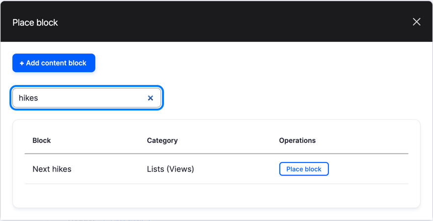
*Figure 14.3: Finding a block to place*

The **Category** column says where a block comes from: **Lists (Views)** for views, **Menus** for menus, **Forms** for forms such as the login form, **System** and **core** for Drupal's own.

3. Next to **Next hikes**, select **Place block**. The **Configure block** form opens.

At the top is the block's title, **Next hikes**, which comes from the view. **Display title** decides whether visitors see it. **Items per block** lets you show more or fewer hikes here than the view does; leave it at the view's setting, 3. **Override title** lets you give this placement a title of its own instead of the view's; leave it off. Every kind of block has its own settings in this part of the form: a menu block has others, as we'll see.

4. Under **Visibility**, select **Content type**, and check **Hike**.


*Figure 14.4: Next hikes, on hike pages only*

5. Check that **Region** is **Sidebar**, and select **Save block**.

You're back on Block layout, with **Next hikes** in the Sidebar region. Blocks are saved as soon as you select **Save block**; the **Save blocks** button at the bottom of Block layout is for moving and reordering, which we do later.

Below the visibility settings, **Machine-readable name** is the name Drupal stores the block placement under, such as `olivero_next_hikes`: the theme's name, then the block's. Drupal makes it up from the title, and you can change it until you save. It matters later, when the block ends up in the site's configuration, which you move from your computer to the live site in Chapter 21, and you'll be glad it isn't `olivero_views_block_hikes_block_1_2`.

Now open a hike, such as `/hikes/turnhouse-hill`, in a private window.

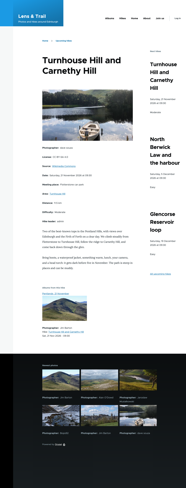
*Figure 14.5: The next hikes, in the sidebar of a hike's page*

The page made room for the sidebar, and the next three hikes are on the right, in their Card view mode from Chapter 8. (The titles are large for such a narrow column; we make them smaller with the theme in Chapter 16.) Open *About the club*: no sidebar, because the block is for hikes only, and the page has the whole width again.

## Visibility

**Visibility** decides on which pages, and for whom, a block appears. The block exists either way; Drupal checks these conditions on every page and leaves the block out when they don't match. There are five, in vertical tabs:

- **Response status**: show the block only on normal pages, or only on the "Access denied" or "Page not found" pages. A search box on the "Page not found" page, say.
- **Pages**: a list of paths, one per line, where the block shows, or where it doesn't.
- **Roles**: only for visitors with one of these roles, such as only for anonymous visitors (people who aren't logged in).
- **Content type**: only on the pages of these content types, as we did for Next hikes.
- **Vocabulary**: only on the term pages of these vocabularies, such as the pages of the Places terms from Chapter 10.

When you set more than one, a block must match *all* of them. "Hike pages" and "anonymous visitors" means only anonymous visitors on hike pages.

The last two tabs come from the Node and Taxonomy modules. Other modules can add tabs of their own, such as **Language** on a multilingual site (Chapter 18).

### The same block twice

The **Newest photos** block is on the front page already: we put it there with Layout Builder in Chapter 12. A block isn't used up when you place it. You can place the same block as often as you like, each time with its own title, region, settings and visibility. Let's put the newest photos in the footer of every page, except the front page, which has them already.

1. On **Block layout**, select **Place block** next to **Footer Top**, and place **Newest photos**.
2. Under **Visibility**, select **Pages**, type `<front>` in **Pages**, and select **Hide for the listed pages**.

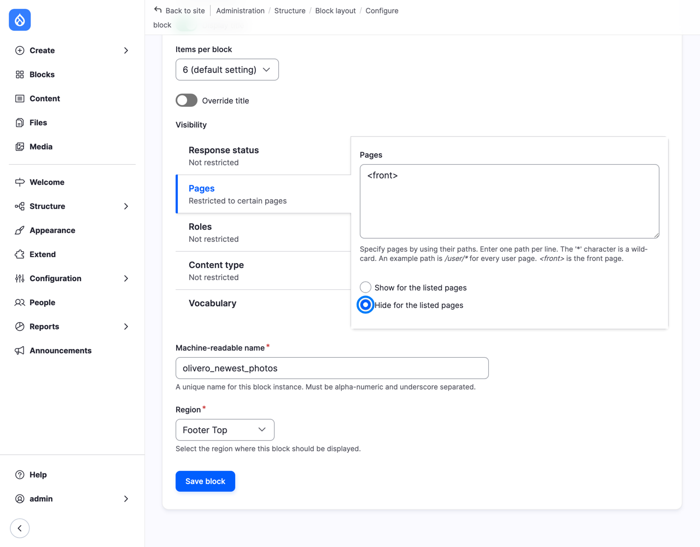
*Figure 14.6: Everywhere except the front page*

3. Select **Save block**.

`<front>` stands for the front page, whatever its address is. Other paths are written with a slash, such as `/about`, and a `*` stands for "anything": `/hikes/*` matches every page whose address starts with `/hikes/`, but not `/hikes` itself.

> **Try it:** Open *About the club* in a private window and scroll to the footer: the six newest photos are there. Now open the front page: they're in the middle of the page, from Layout Builder, and not in the footer. Two placements, one block.

Use path visibility with some care. It works with addresses, and addresses change: if someone renames `/join` to `/membership`, a block that hides itself on `/join` shows up again. When there's a condition that says what you mean, such as **Content type**, prefer it.

## Content blocks

The blocks so far came from Drupal and from Views. Now the club's own: a footer with the meeting times, an email address and a link to the club's photos. That's a **content block**: a block you write yourself, like a node, but meant to be placed in a region instead of having a page of its own.

Content blocks have *types*, the way nodes have content types, and each type has its own fields. Before we can create a content block, we need a type for it. Go to **Structure** > **Block types** (`/admin/structure/block-content`).

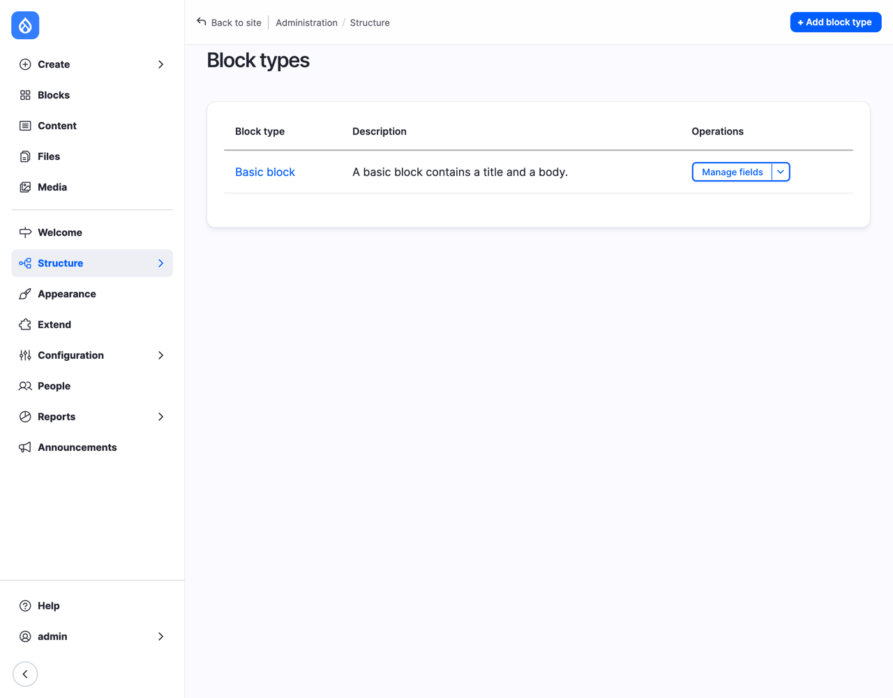
*Figure 14.7: The Block types page*

The Standard installation comes with one block type, **Basic block**: a description and a body, enough for a short text. For the club's details we want more structure: the meeting times, an email address, and links. If the email address is a field of its own, Drupal can show it as a link, check that it's a real address, and we can change it in one place.

Look at the tabs when you edit a block type: **Manage fields**, **Manage form display**, **Manage display**. They're the same as on a content type, because a block type *is* the same idea: a bundle of a different entity (Chapter 7). Everything you learned about fields works here.

1. Select **Add block type**. **Label**: `Club info`. **Description**: `The club's contact details and meeting times, for the footer.`
2. Select **Save and manage fields**.
3. Add three fields, as you did on Hike in Chapter 7:
   - **Meeting times**: **Formatted text**, **Long text**.
   - **Email**: **Email**.
   - **Follow us**: **Link**, with **Allowed number of values** set to **Unlimited**, **Allowed link type** **External links only**, and **Allow link text** **Required**: a club can be in more places than one, and "Flickr" reads better than a long address.

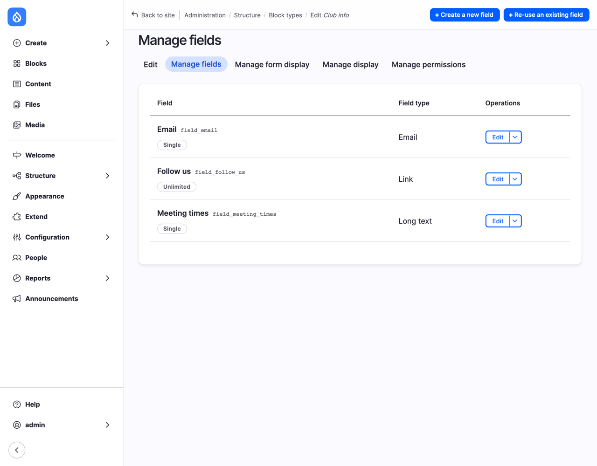
*Figure 14.8: The Club info block type, with three fields*

### Writing the block

Now the block itself. Go to **Content** > **Blocks** (`/admin/content/block`), or select **Blocks** in the sidebar, and select **Add content block**. With more than one block type, Drupal asks which kind first: choose **Club info**.

1. **Block description**: `Club info`. This is the block's name in lists, such as the Place block window; visitors don't see it.
2. **Meeting times**: the club's meeting times, from Chapter 6. We made the labels bold:

   **Hikes:** every other Saturday at 9:30.
   **Photo evenings:** the first Thursday of the month at 19:00, in a café in Leith.

3. **Email**: `hello@lens-and-trail.ddev.site`.
4. **Follow us**: **URL** `https://www.flickr.com/groups/lens-and-trail/`, **Link text** `Flickr`.

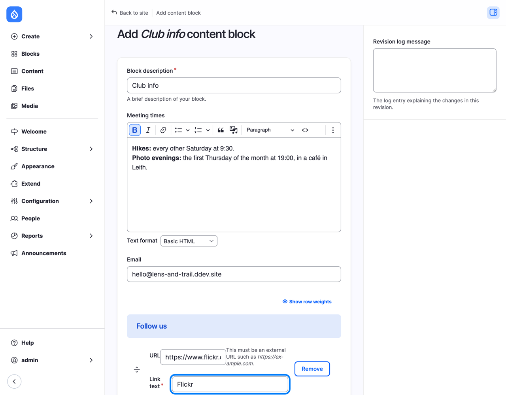
*Figure 14.9: Writing the club's details*

5. Select **Save and configure**.

**Save and configure** saves the block and takes you straight to its **Configure block** form, for the default theme. **Save** only saves it: then you place it later from Block layout, where it's listed under the category **Content block**.

6. Set **Region** to **Footer Top**, and turn off **Display title**: the footer doesn't need a heading that says "Club info". Select **Save block**.

### The order of blocks in a region

Footer Top now has two blocks, and the new one is at the end. We want the club's details first. On **Block layout**, drag **Club info** by its handle (the arrows on the left) above **Newest photos**, and select **Save blocks** at the bottom of the page.

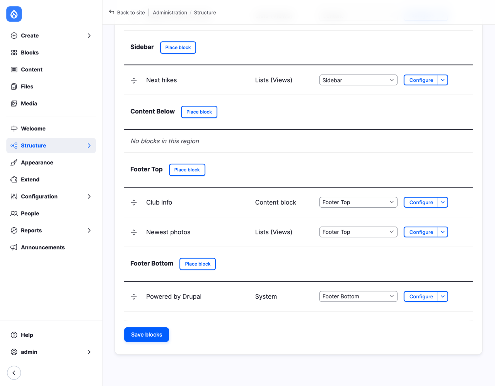
*Figure 14.10: Club info first in Footer Top*

Until you select **Save blocks**, nothing changes, and Drupal reminds you with a message at the top of the table. If dragging doesn't suit you, **Show row weights** at the top right replaces the handles with a **Weight** list for each block: lower numbers go first. You can also move a block to another region by changing its **Region** list here, without opening it.

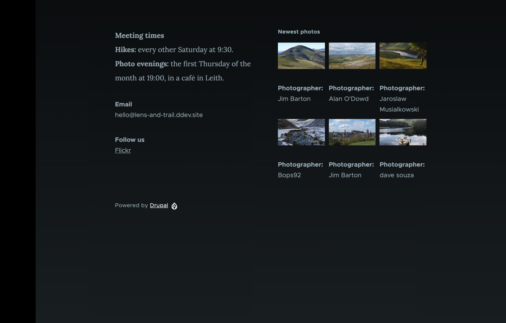
*Figure 14.11: The club's footer*

Olivero puts the blocks of Footer Top next to each other on a wide screen, and one under the other on a phone.

You can place a content block anywhere a block can go: in the sidebar, in Content Below, or in the header, as true rebels do! ;-)

### Reusable blocks and inline blocks

In Chapter 8, we created a block too: *When and where*, with **Create content block** in Layout Builder, on *How to join*. That one isn't on **Content** > **Blocks**. Layout Builder's blocks are *inline* blocks: they belong to one layout, and they're gone when you remove them from it. The blocks on **Content** > **Blocks** are *reusable*: one block, which you can place as often as you like, and when you change it, every placement changes.

Use an inline block for something that belongs to one page. Use a reusable block for anything that appears in more than one place, or that someone should be able to find and edit without knowing which page it's on.

### For visitors only

The last block in this section is an invitation to join, in the sidebar, for people who aren't members yet. A **Basic block** is enough: one text.

1. On **Content** > **Blocks**, select **Add content block**, and choose **Basic block**.
2. **Block description**: `Join the club`. **Body**: `New members are always welcome, whether you bring a camera, boots, or both. Membership is £20 a year, £10 for students.`, and a second paragraph with a link `How to join` to `/join`.
3. Select **Save**.

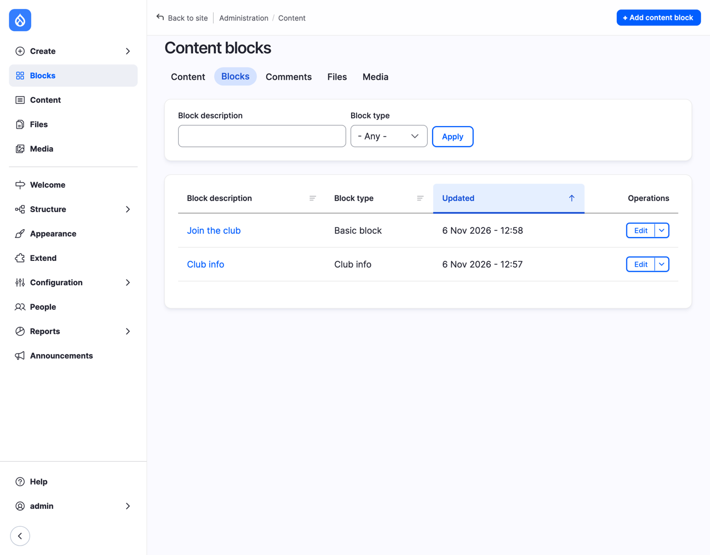
*Figure 14.12: The club's content blocks*

The list shows every reusable content block, with its type. This is where an editor goes to change the meeting times, without going near Block layout.

Now place it:

1. On **Block layout**, select **Place block** next to **Sidebar**, and place **Join the club**.
2. Under **Visibility**, select **Roles**, and check **Anonymous user**.
3. Select **Pages**, type `/join`, and select **Hide for the listed pages**: on *How to join* itself, the invitation would be going round in circles.


*Figure 14.13: For anonymous visitors, except on How to join*

4. Select **Save block**. On Block layout, drag **Join the club** above **Next hikes**, and select **Save blocks**.

**Anonymous user** means everyone who isn't logged in. Members who are logged in have the role **Authenticated user**, and they don't see it: they've joined already. Chapter 15 is about users and roles.

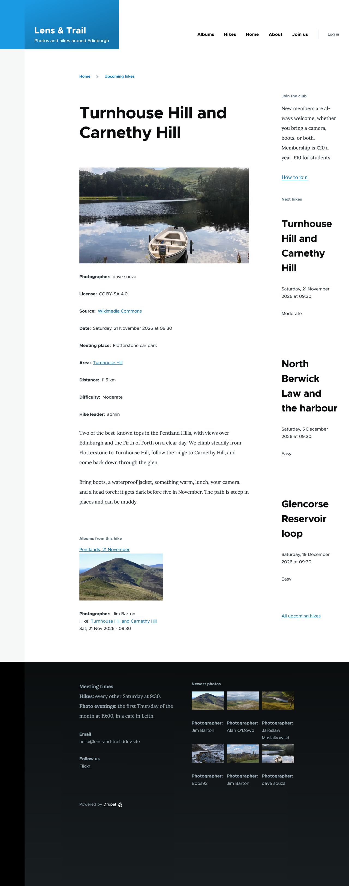
*Figure 14.14: The hike's page, for a visitor*

This block has no content type condition, so it shows on every page with a sidebar region: on *About the club*, the sidebar appears with only the invitation in it.

> **Try it:** Log in as `admin` in your normal window, and open the same hike. Is the invitation there? Now open *How to join* in the private window.

## Menus

A **menu** is a list of links. A site has several, and each has its own block: the main menu in the header, the account links in the corner, a footer menu, and the administration menu on the left of the administration pages. Go to **Structure** > **Menus** (`/admin/structure/menu`).

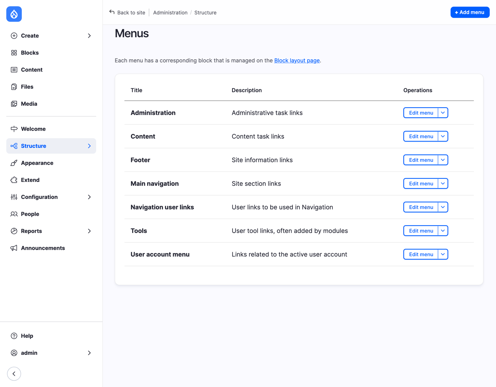
*Figure 14.15: The site's menus*

**Main navigation** is the one visitors see at the top. **Footer** is empty so far. **User account menu** holds **My account**, **Log in** and **Log out**, and the others are for the administration pages. You can add menus of your own with **Add menu**.

### Sorting the main menu

The main menu has collected links over several chapters: *About* and *Join us* in Chapter 6, *Hikes* and *Albums* from Views in Chapter 12. Their order is a little odd: *Albums*, *Hikes*, *Home*, *About*, *Join us*. Let's tidy it up.

1. Next to **Main navigation**, select **Edit menu**.
2. Drag the links by their handles into this order: **Home**, **Hikes**, **Albums**, **About**, **Join us**.
3. Select **Save**.

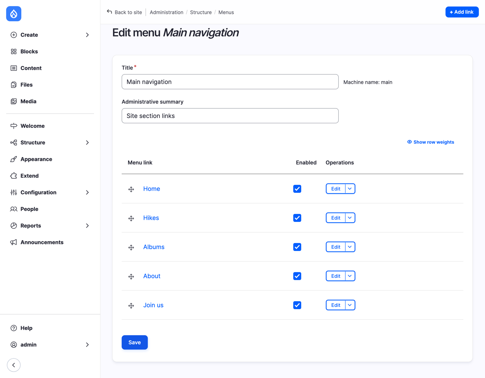
*Figure 14.16: The main menu, in order*

The links come from different places, and the menu doesn't mind. *Home* comes with the Standard installation, *About* and *Join us* were added with their pages, and *Hikes* and *Albums* belong to their views. When you drag a Views link, Drupal saves its new position in the view. The **Enabled** checkbox hides a link without deleting it.

### Nested links

Hikes have an archive now, at `/hikes/archive` (Chapter 13). It doesn't need a place of its own in the main menu, but it belongs under *Hikes*.

1. On the **Main navigation** menu, select **Add link**.
2. **Menu link title**: `Hike archive`. **Link**: `/hikes/archive`.
3. Under **Parent link** on the right, choose **-- Hikes**.

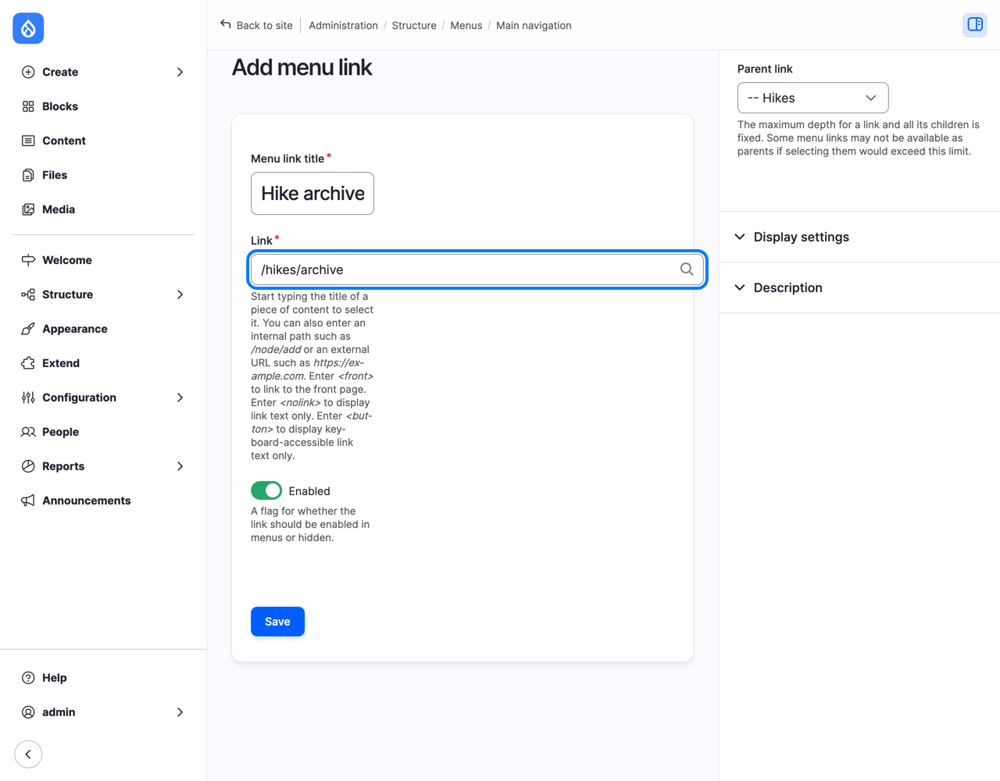
*Figure 14.17: A link under Hikes*

4. Select **Save**.

The **Link** field takes the title of a piece of content, an internal path such as `/hikes/archive`, or a full address on another site. It also knows two special values: `<front>` for the front page, and `<nolink>` for a menu item that's only a heading, with links under it.

On the menu page, *Hike archive* is now indented under *Hikes*. You can nest links by dragging too: drag a link slightly to the right, under another link, and it becomes its child.

But visitors don't see it yet. Olivero shows a link's children only if the parent link is set to **Show as expanded**:

1. Next to **Hikes**, select **Edit**.
2. Open **Display settings** on the right, and turn on **Show as expanded**.

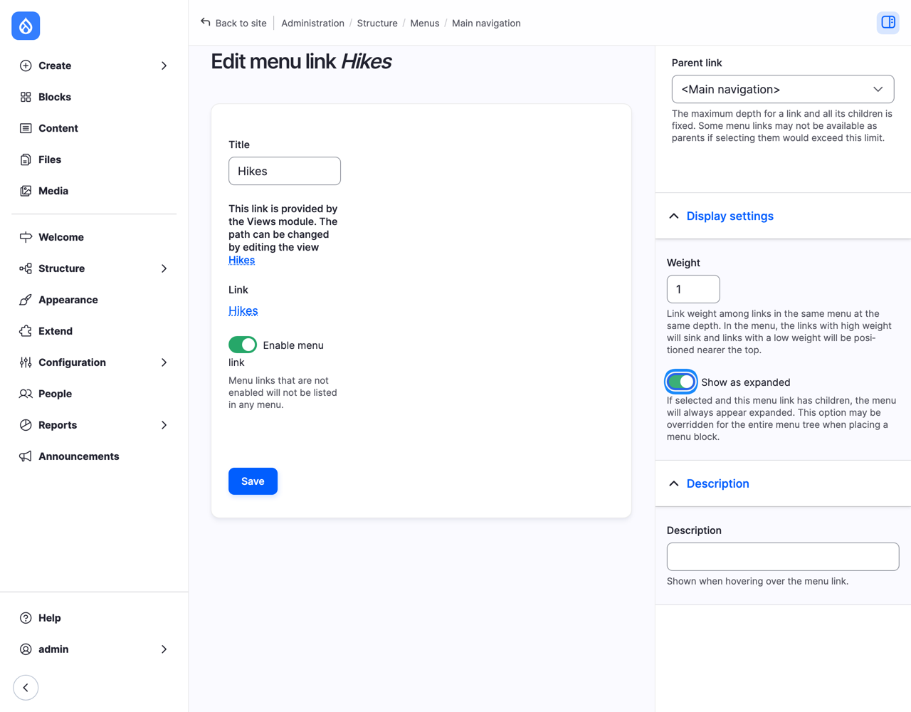
*Figure 14.18: Show as expanded*

3. Select **Save**.

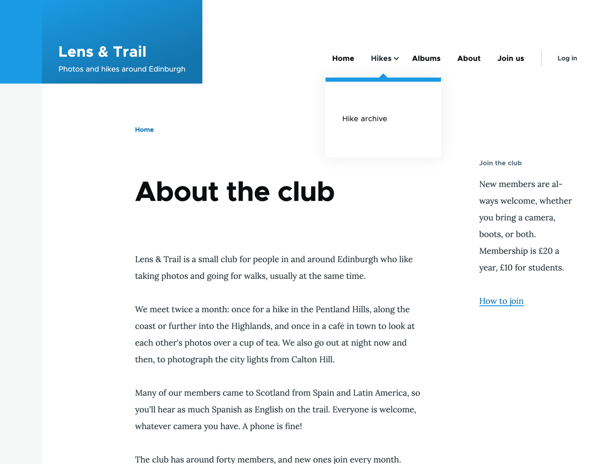
*Figure 14.19: The hike archive, in a dropdown under Hikes*

*Hikes* has a small arrow now, and the archive drops down below it when you point at it. On a phone, Olivero folds the whole menu behind a button, and the children appear when you open it.

What "expanded" means depends on the theme. For Olivero, it means "show the children as a dropdown". A theme without dropdowns might show them only when you're on the parent's page. The menu stores the structure; the theme decides how it looks.

> **Menu links from the content form:** in Chapter 6, we gave *About the club* its menu link from the page's own edit form, under **Menu settings**. That's often the quickest way for editors: they write a page and put it in the menu in one go. Each content type decides which menus its pages may go in, under **Menu settings** when you edit the content type. Basic page allows Main navigation; Hike and News allow none, because nobody wants every hike in the main menu: that's what the Hikes view is for.

### A footer menu

Most sites have a few links in the footer that don't belong at the top: a privacy page, a contact page, a feed. Drupal comes with an empty **Footer** menu for that.

> **Try it:** The club needs a privacy page. Add a Basic page called `Privacy`, with the URL alias `/privacy`, and a short text, such as: "Lens & Trail keeps only what it needs to run the club: your name and email address if you join, and the photos you choose to share. We never sell or pass on your details." Publish it.

1. On **Structure** > **Menus**, select **Edit menu** next to **Footer**.
2. Select **Add link**: **Menu link title** `Privacy`, **Link** `/privacy`, and **Save**.
3. Add a second link: **Menu link title** `Upcoming hikes (RSS)`, **Link** `/hikes/feed` (the feed from Chapter 13). If you skipped Chapter 13, leave this one out.

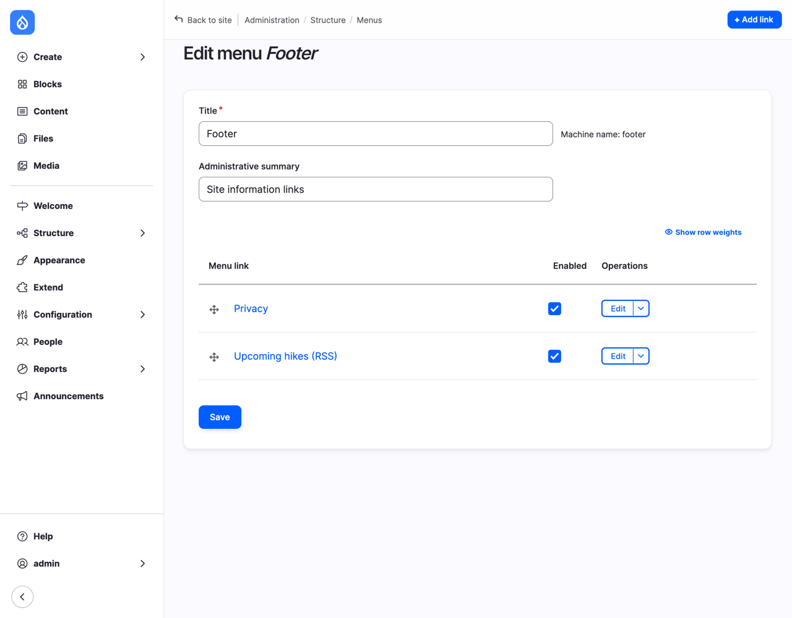
*Figure 14.20: The footer menu*

A menu with links doesn't show anywhere by itself: it needs its block, in a region.

1. On **Block layout**, select **Place block** next to **Footer Bottom**, and place **Footer** (in the category **Menus**).
2. Turn off **Display title**, and select **Save block**.

A menu block has settings of its own, under **Menu levels**:

- **Initial visibility level**: at **1**, the menu shows from the top. At **2**, it shows only the children of the current page's link, and only on those pages: a menu of the subpages of *Hikes*, say, in the sidebar of the Hikes section.
- **Number of levels to display**: how deep the block goes. The Main navigation block shows two levels, which is why the archive appears.
- **Expand all menu links**: show every child, whatever **Show as expanded** says on each link.
- **Add a CSS class to ancestors of the current page**: lets the theme highlight *Hikes* when you're on the archive. It costs some speed, so leave it off unless your theme uses it.

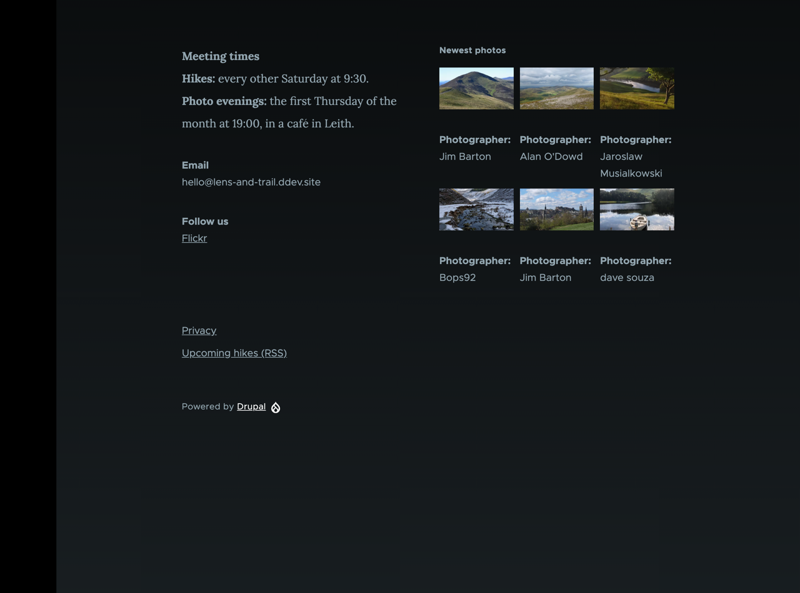
*Figure 14.21: The footer menu, above Powered by Drupal*

## Breadcrumbs

The **breadcrumb** is the trail of links above the page title, such as **Home > Upcoming hikes > Hike archive**. It tells visitors where they are, and takes them one step back up with one click. The **Breadcrumbs** block shows it, in Olivero's Breadcrumb region.

Drupal builds the breadcrumb from the page's *address*, not from the menu. On `/hikes/archive/202612`, it looks at `/hikes/archive` and `/hikes`, and for each address that is a page, it adds a link with that page's title:

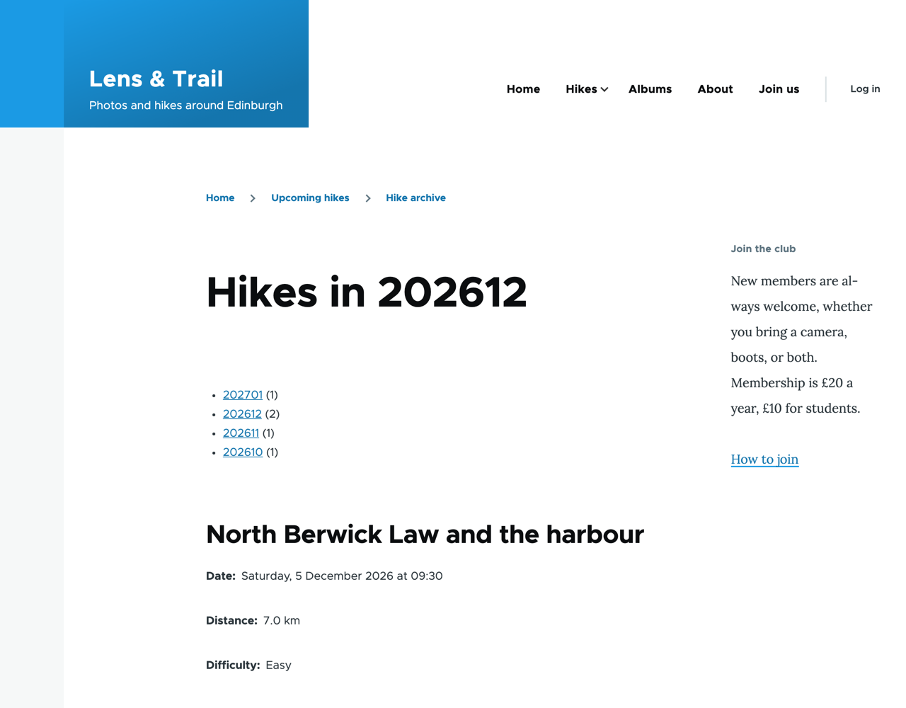
*Figure 14.22: A breadcrumb, built from the address*

That's why our URL aliases matter: a hike at `/hikes/turnhouse-hill` gets the breadcrumb **Home > Upcoming hikes** for free (look at Figure 14.5 again), and *About the club*, at `/about`, only **Home**. Good addresses give good breadcrumbs. (The breadcrumb leaves out the current page: it's the title right below it.)

Some sites want the breadcrumb to follow the menu instead: *Hike archive* is under *Hikes* in the main menu, so its breadcrumb should say so, whatever its address. Drupal core can't do that, but contributed modules can, such as [Menu Breadcrumb](https://www.drupal.org/project/menu_breadcrumb). Another popular one, [Easy Breadcrumb](https://www.drupal.org/project/easy_breadcrumb), keeps building from the address, but gives you settings for it: the current page as the last link, better titles, paths to leave out (Drupal CMS installs it; see the box below). As we write this, the newest releases of both support Drupal 11 but not yet Drupal 12. Chapter 11 showed how to find a module, and how to check which versions of Drupal it supports.

> **On Drupal CMS:** Drupal CMS uses the same blocks, regions and menus underneath, but you'll rarely visit Block layout. Its theme, Mercury, has only three regions (Header, Content and Footer), and Block layout has no blocks placed in any of them. Instead, Canvas draws the header and footer of every page with a **page template**: open Canvas (`/canvas`), select **Templates** in the bar on the left, then **Mercury theme** under **Page templates**, and **Layers**.
>
> 
> *Figure 14.23: Drupal CMS's header and footer, as a Canvas page template*
>
> The header is a **Navbar** component, with the **Site branding** and **Main navigation** blocks in its slots, and the footer has the **Footer** menu block under **Utility links**. They're the same blocks as on Drupal core, placed in components instead of regions; you can add other blocks, such as a view's, from the **Library**. The menus themselves are under **Structure** > **Menus**, exactly as in this chapter.
>
> One difference: the Starter template doesn't install the **Block Content** module, so there's no **Block types** page and no content blocks. For a box of text in the footer, you'd add a Canvas component to the page template, or install Block Content from **Extend**.
>
> Breadcrumbs, too, come from a contributed module on Drupal CMS: **Easy Breadcrumb**, under **Configuration** > **User interface** > **Easy Breadcrumb** (`/admin/config/user-interface/easy-breadcrumb`). It still builds the trail from the address, as core does, but adds the current page at the end, can show addresses that aren't pages as plain text, and lets you leave out paths or rename them. It also adds the breadcrumb to the page as *structured data*, a description search engines read (more in Chapter 17).
>
> 
> *Figure 14.24: Easy Breadcrumb's settings on Drupal CMS*

> **Coming from WordPress?** The closest thing to Drupal's blocks and regions in a classic WordPress theme are *widgets* in *widget areas*: the theme defines the areas (a sidebar, a footer), and you add widgets under **Appearance** > **Widgets** or in the Customizer. When you switch themes, widgets whose area the new theme doesn't have go to **Inactive Widgets**; Drupal puts them in the new theme's default region instead. Two things are different in Drupal: every block has visibility settings of its own (in WordPress, that takes a plugin), and you can place the same block several times. In a block theme, headers and footers are *template parts* that you edit in the Site Editor, which is much closer to Drupal CMS's page template in Canvas. Menus are close too: a classic theme has **Appearance** > **Menus** and *menu locations*, where Drupal has menus and menu blocks; a block theme has the **Navigation** block. Nesting works the same way in both, by dragging a link to the right.

## Summary

You can now:

- explain what a block is, where blocks come from (Drupal, modules, views, and you), and which "block" someone means;
- find a theme's regions on Block layout, and see them with **Demonstrate block regions**;
- recognize the blocks Drupal places for you, and know which ones not to remove;
- place a block in a region, give it a title or hide it, and order the blocks in a region;
- show a block only on some pages, for some roles, or on some content types, and place the same block twice;
- create a block type with fields, and a content block of that type, and tell reusable blocks from Layout Builder's inline blocks;
- sort a menu, nest a link under another, show its children as a dropdown, and add links to the footer menu and place its block;
- explain how Drupal builds the breadcrumb from the address;
- find the header and footer of Drupal CMS in Canvas's page template.

## Exercises

1. Place the **User login** block in the sidebar, for anonymous visitors only, and hidden on `/user/login`, which has a login form already. Which visibility settings did you need, and why the last one?
2. Place **Next hikes** a second time, in **Content Below**, only on *About the club*, with the title `Our next hike` (**Override title**) and **Items per block** set to `1`. Did the sidebar's Next hikes change?
3. The club has started an Instagram account. Add it to the *Club info* block's **Follow us**, without going near Block layout. Where else would you have had to change it if the links were typed into every page?
4. Move **Powered by Drupal** to **Content Above**, only on the front page. Then put it back where it was. Which do you find quicker: the **Region** list on Block layout, or the block's **Configure** form?
5. *(challenge)* Add a menu of your own, `For members`, with the links `Hike archive` and `Albums`, and `My account` (`/user`). Place its block in the sidebar, for logged-in members only. Why does the menu need its own block, and why does it make sense for it to have its own visibility?
6. *(challenge)* On the **Main navigation** block, set **Number of levels to display** to `1`. What happens to the dropdown under *Hikes*? Then set it back, and try **Initial visibility level** `2` on a second Main navigation block in the sidebar: on which pages does it show anything?

## Want to know more?

- [Concept: Blocks](https://www.drupal.org/docs/user_guide/en/block-concept.html), [Concept: Regions in a Theme](https://www.drupal.org/docs/user_guide/en/block-regions.html) and [Creating a Custom Block](https://www.drupal.org/docs/user_guide/en/block-create-custom.html), in the Drupal User Guide.
- [Concept: Menu](https://www.drupal.org/docs/user_guide/en/menu-concept.html) and [Changing the Order of Navigation](https://www.drupal.org/docs/user_guide/en/menu-reorder.html), in the same guide.
- [Menu Breadcrumb](https://www.drupal.org/project/menu_breadcrumb), a contributed module for breadcrumbs that follow the menu.
- For comparison, WordPress's [Manage WordPress widgets](https://wordpress.org/documentation/article/manage-wordpress-widgets/), [Template Part block](https://wordpress.org/documentation/article/template-part-block/), [Appearance Menus Screen](https://wordpress.org/documentation/article/appearance-menus-screen/) and [Navigation block](https://wordpress.org/documentation/article/navigation-block/).
