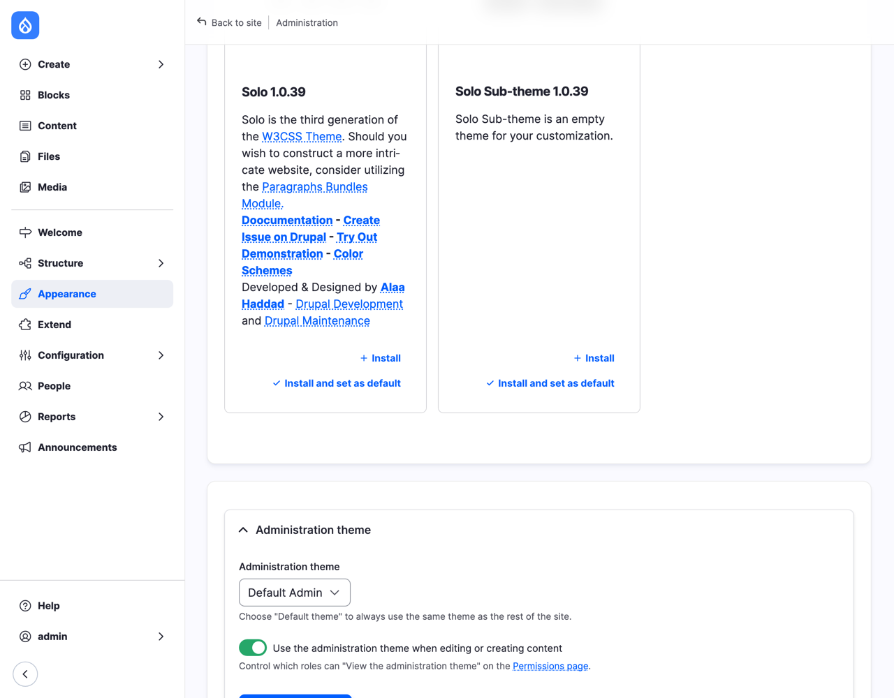
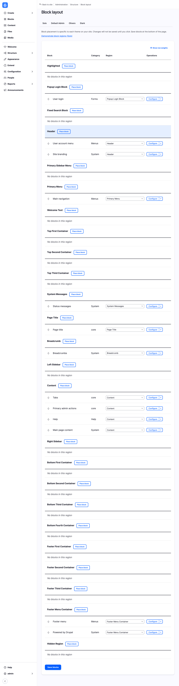
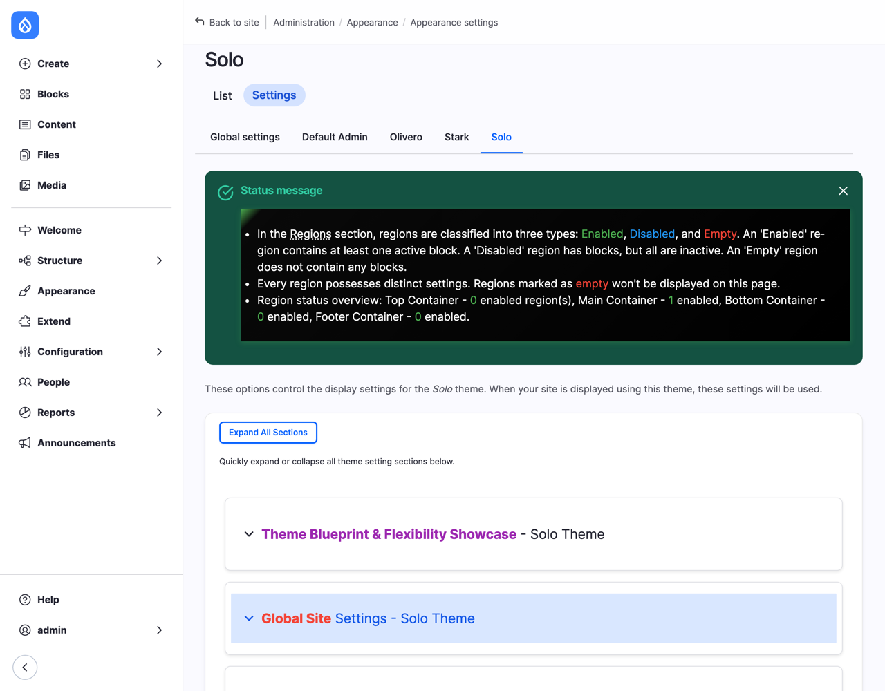
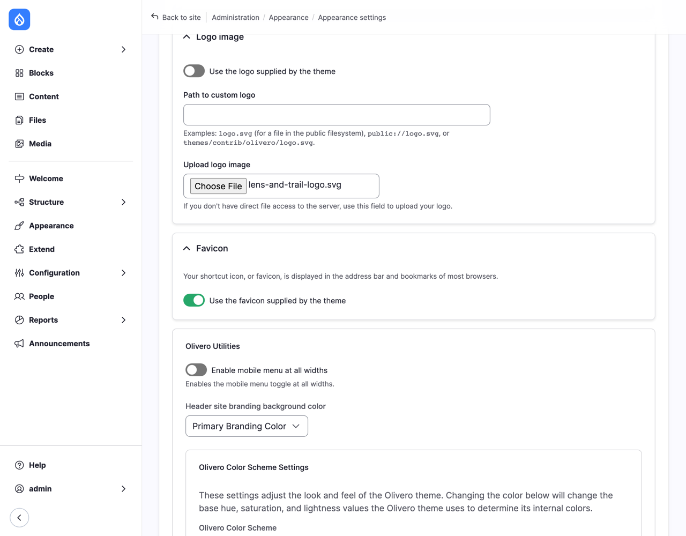
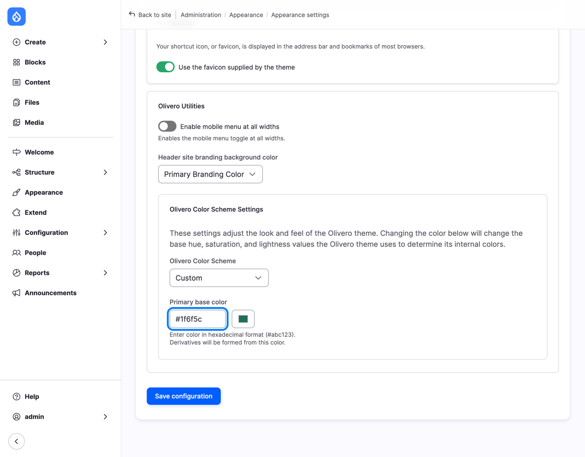
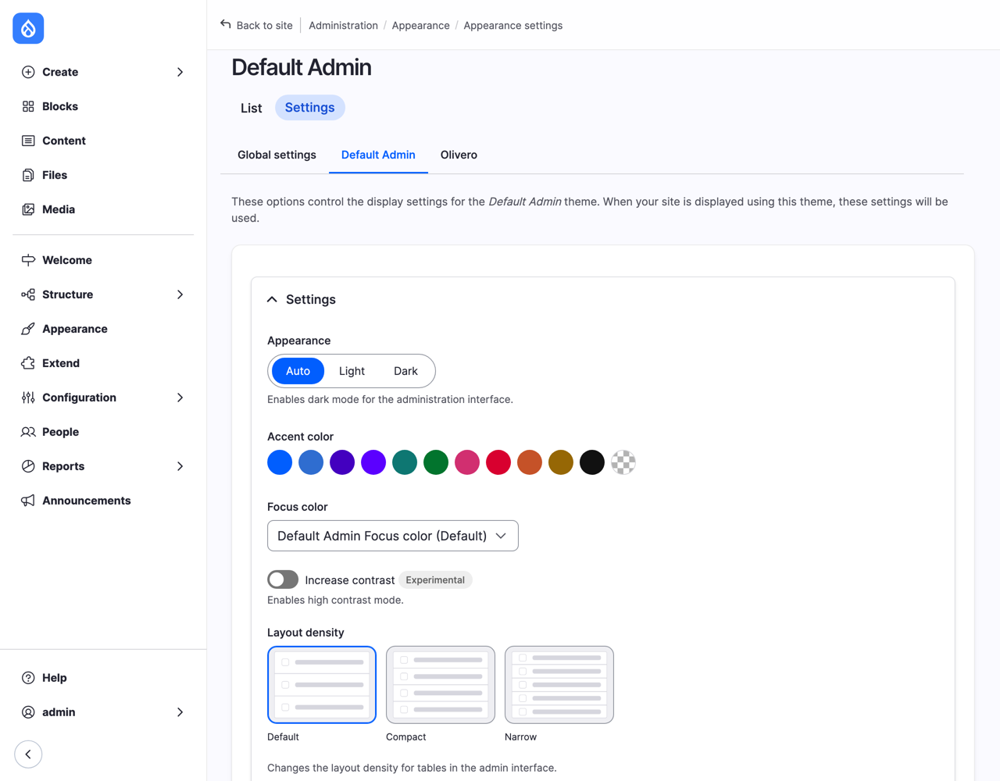
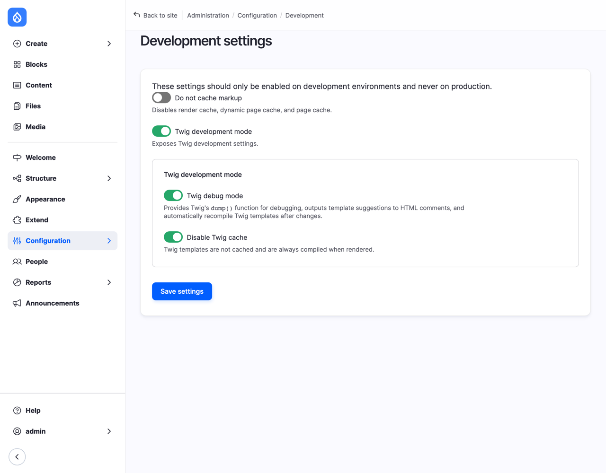
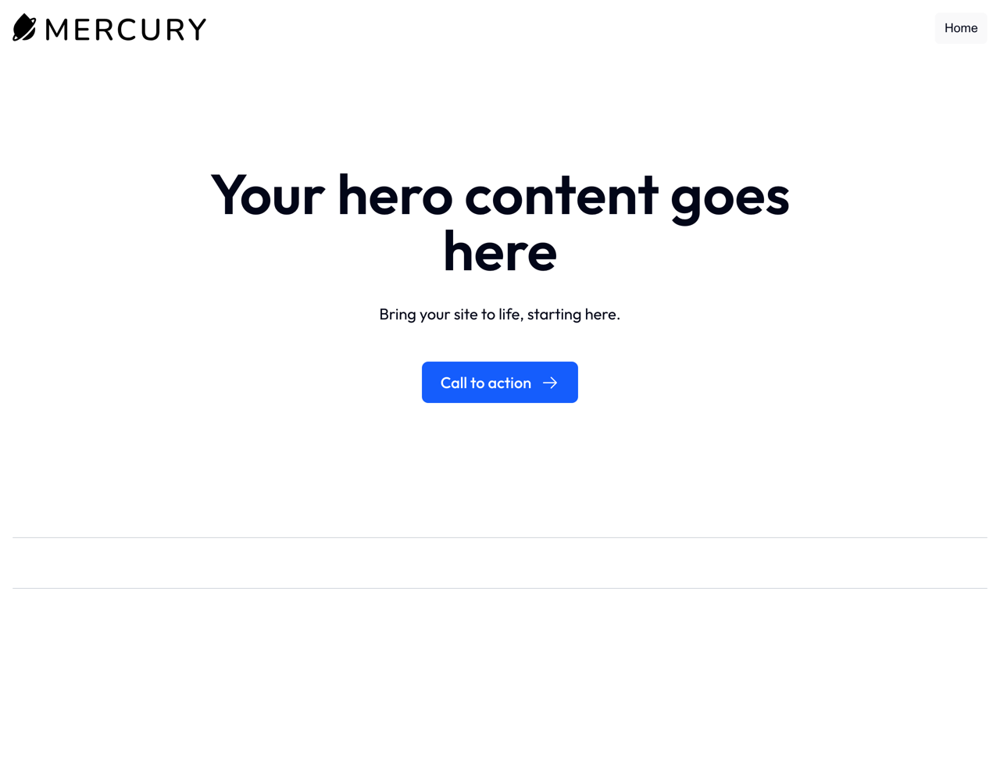
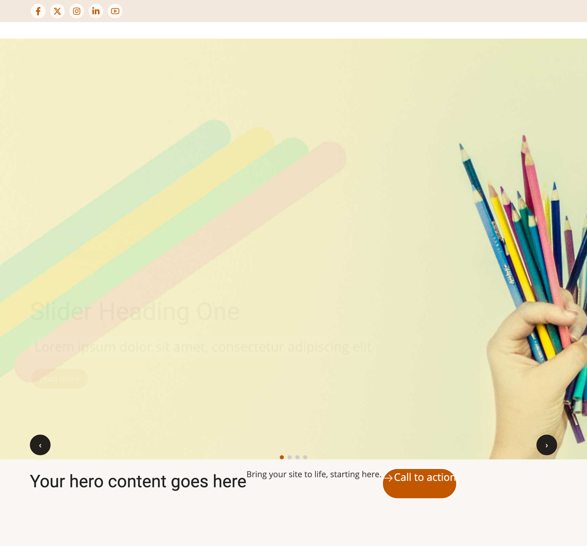
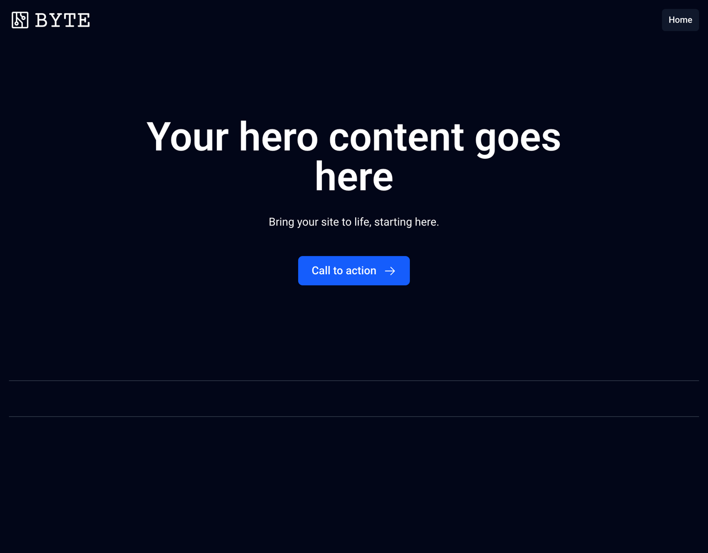

# Appearance: Themes

Everything we've built so far (the content types, the views, the blocks, the roles) would work the same on a site that looks completely different. What it looks like is the job of the **theme**: the colors, the fonts, the layout of the page, where the menu goes, what a button looks like.

This chapter is about choosing and setting up themes, all from the browser. We look at the site without any styling at all, try a theme from drupal.org and see what changes (and what doesn't), go back to Olivero, and give it the club's own color and logo. Then we do the same on Drupal CMS, where the theme and Canvas work closely together, and try four very different themes on one site.

We don't write any code in this chapter. Making a theme of your own (writing templates and CSS, and building components) is a craft of its own, for front-end developers, and it's the subject of our companion book, *Theming Drupal*. Here, we stay with what a site builder decides.

We start where Chapter 15 left the club's site: Olivero, with Chapter 14's blocks and menus, and the club's members, roles and permissions in place.

## What a theme is

A theme is a folder of files that turns Drupal's content into pages: templates for the HTML, stylesheets (CSS) for how it looks, a little JavaScript for things like the mobile menu, and a file that names the theme and lists its regions (we looked at Olivero's in Chapter 14). Every page you see has been through the theme.

> **Drupalism: theme.** A few words go with themes:
>
> - The **default theme** (or *front-end theme*) is the one visitors see. Ours is Olivero.
> - The **administration theme** is the one for the administration pages: Default Admin on our site. A site has both, and they're independent of each other.
> - A **base theme** is a theme that others are built on. A **sub-theme** builds on a base theme: it starts with everything the base theme has, and changes only what it needs to. (WordPress calls these *parent* and *child* themes.)
> - **Theme settings** are the options a theme offers in the browser: a logo, colors, sometimes many more.
> - A **template** is the file that decides the HTML for one kind of thing: a page, a block, a node, a field. Drupal's templates are written in **Twig** (Chapter 3).
>
> One more: *installing* a theme makes it available, and *setting it as default* makes visitors see it. You can have many themes installed, but only one default.

## The Appearance page

Go to **Appearance** (`/admin/appearance`).


*Figure 16.1: The Appearance page*

The page lists the themes Drupal can find, in two groups:

- **Installed themes**: Olivero, marked **default theme**, and Default Admin, marked **administration theme**. Each has a **Settings** link, and the ones that aren't the default have **Set as default**.
- **Uninstalled themes**: themes whose files are on the site, but that Drupal isn't using. Each has **Install**, and **Install and set as default**.

On Drupal 12, core comes with only two themes you'd use: Default Admin, and **Stark**. (A third, *Starterkit*, is a starting point for developers who make their own theme, and doesn't appear here.) Olivero, as you remember from Chapter 4, is a contributed theme now. (Your list won't have Solo yet; we add it in a moment.)

## A site without a look: Stark

Stark is a theme that does almost nothing on purpose: it shows Drupal's HTML as it comes, with no styling of its own. It's there for testing, and it's the best way to see what a theme does, by seeing a site without one.

Next to **Stark**, select **Install and set as default**. Then open the front page in a private window:


*Figure 16.2: The same front page, without a theme's look*

Everything is still there: the menu, the welcome text, the next hikes, the newest photos, the club's info and the footer menu. Nothing is lost when you change themes: content, views, menus and blocks belong to the site, not to the theme. But without a theme to arrange them, they come one under the other, in the browser's own type, with the page title somewhere near the bottom, because that's where Stark happens to print its regions.

That's what a theme adds: the order of the regions on the page, the columns, the colors and fonts, and the spacing. Go back to **Appearance**, and select **Set as default** next to **Olivero**.

## Themes from drupal.org

There are thousands of contributed themes on drupal.org. Go to **Themes** on drupal.org ([drupal.org/project/project_theme](https://www.drupal.org/project/project_theme)): you can filter them by the Drupal version they support, search, and sort by how many sites use them.

> **Choosing a theme.** The five questions from "Choosing a module" in Chapter 11 apply to themes too: does it support your version of Drupal, is it covered by the security advisory policy, is it maintained, do other sites use it, and what does the issue queue say? Themes add a few of their own:
>
> - **Is it accessible?** Can you use the site with a keyboard alone, is the text large enough, and is there enough contrast between text and background? Olivero was built with accessibility as a goal from the start; not every theme was. Try the demo with the Tab key before you choose.
> - **What does it expect?** Some themes are made for a particular kind of site, or a particular set of modules, and look their best only with those, such as a slider on the front page or a certain block in a certain region. Read the project page to the end.
> - **How hard is it to leave?** A module does one job, and you can replace it. A theme touches every page, and the longer you use one, the more of the site depends on its regions, its settings and its look. Choose a theme as if you'll keep it for years, because you probably will.
> - **Is it meant to be built on?** If you'll want changes later, check whether the theme expects sub-themes. Olivero, for example, says in its own files that it isn't meant to be a base theme, and Drupal CMS's Mercury says "Don't subtheme Mercury!". Both offer other ways to make changes, which we come back to at the end of the chapter.

Let's try one: **Solo**, a theme with many settings in the browser. It supports Drupal 12, it's covered by the security advisory policy, and a few thousand sites use it.

1. Download it with Composer, as in Chapter 11:

   ```
   ddev composer require drupal/solo
   ```

2. Go back to **Appearance**. Solo is under **Uninstalled themes**, with **Solo Sub-theme** next to it: an empty sub-theme that comes with Solo, for developers who want to build on it.


*Figure 16.3: Solo, downloaded, not yet installed*

3. Next to **Solo**, select **Install and set as default**.

Open the front page in a private window:


*Figure 16.4: The same site in Solo*

A completely different site, from one click. Look closely at what came along and what didn't:

- **The content and the views came along**: the welcome text, the next hikes and the newest photos, which we placed on the Welcome page with Layout Builder in Chapter 12. They belong to the page, not to the theme.
- **The menus came along**: the main navigation, with the Hikes dropdown, and the footer menu.
- **Solo's own extras came too**: its logo, a row of social media icons and a "Company Name" copyright line. A theme's demonstration settings are a starting point; you'd change them all on Solo's **Settings** page.
- **Some of the club's blocks didn't come**: the club info and newest photos in the footer, *Join the club* and *Next hikes* in the sidebar.

Why not? Go to **Structure** > **Block layout**, and select the **Solo** tab:


*Figure 16.5: Solo's own blocks, in Solo's own regions*

Remember from Chapter 14: blocks are placed *per theme*, because regions belong to a theme. Solo has 25 regions, with names such as **Top First Container** and **Footer Menu Container**, and none of them is called *Sidebar* or *Footer Top*. When Drupal installs a theme that has no block placements of its own, it copies the default theme's blocks, and puts the ones whose region doesn't exist into the new theme's first region, to be moved by hand. Solo, like many contributed themes, comes with its own block placements, so it gets those instead, and the club's blocks aren't placed in Solo at all. They still exist, in Olivero's block layout and in the block library, waiting for you to place them in Solo's regions.

That's the "How hard is it to leave?" question in practice. A theme change on a real site is a small project: place the blocks again, check every page, adjust the settings, and look at the site on a phone.

Solo's **Settings** page shows how far theme settings can go: colors for every part of the page, fonts, the width of the layout, which regions show, and more. It's a good example of a theme that lets a site builder do a lot without code.


*Figure 16.6: Solo's settings*

### Back to Olivero, and removing a theme

The club stays with Olivero: its look fits the club, and every screenshot in this book uses it. On **Appearance**, select **Set as default** next to **Olivero**.

Solo is still installed. To remove it, do what you did for a module in Chapter 11, in two steps: uninstall it in Drupal, then remove its files with Composer.

1. On **Appearance**, select **Uninstall** next to **Solo**. (You can't uninstall the default theme: that's why we switched back first.) Drupal asks for confirmation, and lists what it will delete:


*Figure 16.7: Uninstalling a theme deletes its block placements and settings*

2. Select **Uninstall**.
3. Remove the files:

   ```
   ddev composer remove drupal/solo
   ```

Uninstall **Stark** the same way: it's part of core, so it stays in the list, uninstalled, for the next time you need it.

## The club's look, with Olivero's settings

Olivero has fewer settings than Solo, but enough to make it the club's own. On **Appearance**, select **Settings** next to **Olivero**.


*Figure 16.8: Olivero's settings, part one*

The tabs at the top are worth a look. **Global settings** apply to every theme; each theme's own tab overrides them for that theme. We set everything on Olivero's tab, so it doesn't affect any other theme.

- **Page element display**: whether to show user pictures next to content and comments, the "(not verified)" mark next to comments from visitors without an account, and the shortcut icon. Leave them.
- **Logo image**: Olivero comes with **Use the logo supplied by the theme** turned off, which is why the club has had no logo so far. Under **Upload logo image**, choose the club's logo, `lens-and-trail-logo.svg` from the book's `examples/club/` folder (or a logo of your own).


*Figure 16.9: The club's logo*

- **Favicon**: the small icon in the browser tab. Olivero's is the Drupal drop. Leave it for now (Exercise 2).

Further down, under **Olivero Utilities**, are Olivero's own settings:

- **Enable mobile menu at all widths**: shows the menu button, the one phones get, on every screen. Useful for a site with a long main menu.
- **Header site branding background color**: the background of the box with the logo and site name: the primary color, gray or white.
- **Olivero Color Scheme Settings**: **Olivero Color Scheme** offers five ready-made schemes: *Blue Lagoon* (the default, the blue you've seen so far), *Firehouse*, *Ice*, *Plum* and *Slate*. Or type a color of your own in **Primary base color**, and Olivero works out the rest: the darker and lighter shades for links, buttons and backgrounds.

The club wants a green, for the Pentland Hills. Type `#1f6f5c` in **Primary base color** (or choose one with the color picker next to it). **Olivero Color Scheme** changes to **Custom**.


*Figure 16.10: The club's color*

Select **Save configuration**, and open the front page in a private window:


*Figure 16.11: Olivero, in the club's colors*

The branding box, the line under the current menu item, and the links are now green, and the logo sits next to the club's name. The site name and slogan come from **Basic site settings** (Chapter 5), and whether the logo, name and slogan show is a setting of the **Site branding** block (Chapter 14).

How green is too green? Olivero checks nothing for you: if you choose a pale color, white text on it becomes hard to read. Check the contrast of your color with a contrast checker (the "Want to know more?" section has one) before you settle on it.

## The administration theme

The bottom of **Appearance** has the settings for the administration theme:


*Figure 16.12: The administration theme*

- **Administration theme** is Default Admin. Choose **Default theme** to use Olivero for the administration pages too; that's rarely a good idea, because front-end themes aren't made for long forms and wide tables.
- **Use the administration theme when editing or creating content**: with it on, the content forms use Default Admin; with it off, editors write in the front-end theme, closer to how the page will look. Who gets the administration theme at all is a permission, **View the administration theme**, which we gave the hike leaders and the secretary in Chapter 15.

Default Admin has settings of its own: select **Settings** next to it on **Appearance**.


*Figure 16.13: The administration theme's own settings*

Light or dark, an accent color, higher contrast, and how close together the rows of a table are. These change the administration pages for everyone; they don't touch what visitors see.

> **Under the hood: templates.** How does a theme turn a hike into HTML? With templates: one file for the page, one for each region, block, node and field. You can see which template drew each part of a page, without writing a line of code. Go to **Configuration** > **Development** > **Development settings** (`/admin/config/development/settings`), turn on **Twig development mode**, and check **Twig debug mode** and **Disable Twig cache**.
>
> 
> *Figure 16.14: Twig development mode, for your test site only*
>
> Save, open a hike, and look at the page's source (in most browsers, right-click, then **View Page Source**). Before each part of the page, Drupal has written a comment:
>
> `view-source:https://lens-and-trail.ddev.site:8443/hikes/turnhouse-hill` ([source](../examples/twig-debug/hike-page.html))
>
> ```html
> <!-- THEME DEBUG -->
> <!-- THEME HOOK: 'node' -->
> <!-- FILE NAME SUGGESTIONS:
>    ▪️ node--7--full.html.twig
>    ▪️ node--7.html.twig
>    ▪️ node--hike--full.html.twig
>    ▪️ node--hike.html.twig
>    ▪️ node--full.html.twig
>    ✅ node.html.twig
> -->
> <!-- 💡 BEGIN CUSTOM TEMPLATE OUTPUT from 'themes/contrib/olivero/templates/content/node.html.twig' -->
>
> <article class="node node--type-hike node--view-mode-full">
>   ...
> </article>
>
> <!-- END CUSTOM TEMPLATE OUTPUT from 'themes/contrib/olivero/templates/content/node.html.twig' -->
> ```
>
> The **FILE NAME SUGGESTIONS** are the templates Drupal would use for this node, from the most specific to the most general: one for node 7 alone, one for hikes in the Full content view mode, one for all hikes, and so on, down to `node.html.twig`, for every node. The tick shows the one it found: Olivero's `node.html.twig`. A theme that wants hikes to look different from news adds a file called `node--hike.html.twig`, and Drupal uses it for hikes only. That's how themes change one thing without touching the rest: the sidebar's smaller titles, a grid of photos in an album, or the number of photos next to each album all start with a file like that. Writing those files is where *Theming Drupal* begins.
>
> Turn **Twig development mode** off again when you're done. It makes every page slower, and it shows how your site is built to anyone who reads the source: never turn it on on a live site.

## Where theming begins

Some changes the club would like aren't in any theme's settings: smaller titles for the hike cards in the sidebar (Chapter 14), the photos of an album in a grid rather than one under the other (Chapter 9), a region of the club's own. Those need a theme of your own: a sub-theme, or a copy of a theme renamed as your own, with your own CSS and templates.

The themes themselves say how they'd like to be changed. Olivero says in its own files that it isn't meant to be a base theme: if you build a sub-theme on it, a later version of Olivero may break your changes, so its maintainers suggest copying it and making it yours. Mercury, on Drupal CMS, has its own recipe for changing fonts and colors, which we look at below. And Drupal core's **Starterkit** generates a new theme of your own, with a copy of everything it needs.

That's a developer's work, with files, a code editor and the command line, and it's the subject of *Theming Drupal*. For this book, the site builder's question is the one before it: do we need a theme of our own at all, or do a good theme and its settings do the job? For many sites, the second is enough.

## On Drupal CMS

Drupal CMS takes a different approach to its look, so this section is longer than usual. Go to **Appearance** on the Drupal CMS site.


*Figure 16.15: Appearance on Drupal CMS*

Three differences from our core site:

- The front-end theme is **Mercury**, Drupal CMS's own. It's built from *components*, small reusable pieces of design such as a hero, a card or a button, each in a folder of its own with its template, styles and settings. (Drupal calls them *single-directory components*.) Those components are what you place on a page in Canvas (Chapter 8).
- The administration theme is **Gin**, the contributed theme Default Admin grew out of (Chapter 1). Drupal CMS 2 still runs on Drupal 11, so it uses Gin itself; Claro, Drupal 11's earlier administration theme, is installed too.
- **Components**, the tab at the top, lists every component the site's themes and modules provide.

Mercury's **Settings** are short:


*Figure 16.16: Mercury's settings*

A logo, a favicon, a light or dark color scheme further down, and whether Canvas draws the page template (Chapter 14). There's no color picker: Mercury's fonts and colors live in two small files, which you copy next to Drupal's `index.php` and change there (the note at the top points to the instructions). That's a file, not a form, so it's for whoever looks after the site's code.

Here's the front page in Mercury:


*Figure 16.17: The front page in Mercury, the Starter template's placeholder*

(It's the Starter template's placeholder home page: we built *How to join* with Canvas in Chapter 8, but never changed the front page.)

### Four themes, one site

Let's try the same page in other themes. Olivero is part of Drupal 11's core, so it's already on the Drupal CMS site, uninstalled. Download two more:

```
ddev composer require drupal/tara drupal/byte_theme
```

**Tara** is a popular general-purpose theme, with a front-page slider and many settings. **Byte (theme)** is the theme of *Byte*, a Drupal CMS *site template*: a ready-made starting point for a particular kind of site (Byte's is a marketing site for a software product), with its own content types, pages and theme.

On **Appearance**, select **Install and set as default** next to each in turn, and open the front page in a private window each time. First Olivero:


*Figure 16.18: The Canvas page in Olivero*

Then Tara:


*Figure 16.19: The Canvas page in Tara, under Tara's demonstration slider*

And Byte:


*Figure 16.20: The Canvas page in Byte*

Olivero and Tara both look broken, in different ways, and Byte looks right. Why?

The home page is a Canvas page, built from Mercury's components: a hero with a heading, a text and a button. A component's look comes from its theme. In Olivero and Tara, the page still has Mercury's hero, but neither theme knows how it should look: the button turns gray, the layout falls apart. Olivero's header is empty too, because Mercury places no blocks in Block layout (Chapter 14), so there was nothing to copy into Olivero's regions. Tara adds its own demonstration slider on top.

Byte was made *from* Mercury: it has the same components, with its own colors and fonts. So the same page, with the same hero, looks right, only dark.

That's the lesson of Drupal CMS's approach. On Drupal CMS, the theme and the pages you build with Canvas go together: the components you place come from the theme. Changing the theme of a site built with Canvas only works with a theme made for it, such as one made from Mercury. Changing to a theme like Olivero or Tara means building the pages again. Pages built from fields and view modes, like our hikes on the core site, move between themes with much less work, as Solo showed.

When you're done, select **Set as default** next to **Mercury**, uninstall the other three, and remove Tara and Byte with Composer, as we did with Solo.

> **Coming from WordPress?** Much of this works the same in WordPress: you choose a theme from a directory of free themes, you can install it from the dashboard, and only one theme is active at a time. A *child theme* in WordPress is a *sub-theme* in Drupal: it inherits everything from its parent, and changes only what it needs to. Two differences are worth knowing. First, WordPress has no administration theme to choose: the dashboard looks the same whatever the theme, and each user can only pick a color scheme for it in their profile. In Drupal, the administration pages have a theme of their own, which you can change. Second, newer WordPress *block themes* let you edit the header, footer and templates in the browser, with the **Site Editor**. On Drupal, Canvas's page templates are the closest thing, and only with a theme made for Canvas, such as Mercury; on a classic theme like Olivero, the layout of the page comes from the theme's files and Block layout, as in Chapter 14.

## Summary

You can now:

- explain what a theme does, and tell the default theme, the administration theme, base themes and sub-themes apart;
- install a theme, set it as default, and see what changes and what stays when you switch;
- find a theme on drupal.org, and judge it with the questions from "Choosing a theme";
- download, uninstall and remove a contributed theme, and explain why the club's blocks didn't follow it;
- give Olivero the club's color and logo with its settings;
- set up the administration theme, and Default Admin's own settings;
- see which template drew each part of a page, with Twig development mode on a test site;
- explain why, on Drupal CMS, the theme and Canvas pages go together.

## Exercises

1. Try each of Olivero's five color schemes on the club's site. Which one would you choose if the club were a sailing club? Go back to the club's green when you're done.
2. Make a favicon for the club: a small square image, 32 by 32 pixels or larger, perhaps from the logo. Upload it on Olivero's settings, and find it in the browser tab.
3. Turn on **Enable mobile menu at all widths** in Olivero, and look at the site on a wide screen. When would you choose it? Turn it off again.
4. Go to [drupal.org/project/project_theme](https://www.drupal.org/project/project_theme), and find a theme you'd consider for a photography portfolio. Answer the questions from "Choosing a theme" for it. Would you install it on the club's site? Why, or why not?
5. Change Default Admin's accent color and switch it to dark. Do the hike leaders see the change too, when they log in? Change it back.
6. *(challenge)* Install Solo again, and place the club's blocks in Solo's regions: *Next hikes* and *Join the club* in a sidebar, and *Club info* and *Newest photos* in the footer. Which of Solo's regions would you choose, and how long did it take? Then switch back to Olivero, and think about what it would take on a site with fifty blocks.

## Want to know more?

- The [theming guide](https://www.drupal.org/docs/develop/theming-drupal) on drupal.org, for developers (and for what our companion book, *Theming Drupal*, will cover).
- [Download & Extend: Themes](https://www.drupal.org/project/project_theme), the contributed themes on drupal.org.
- [Olivero](https://www.drupal.org/project/olivero), [Solo](https://www.drupal.org/project/solo), [Tara](https://www.drupal.org/project/tara), [Mercury](https://www.drupal.org/project/mercury) and [Byte](https://www.drupal.org/project/byte), the themes and the site template in this chapter.
- [Using single-directory components](https://www.drupal.org/docs/develop/theming-drupal/using-single-directory-components), on drupal.org, for what Mercury's components are made of.
- [WebAIM's contrast checker](https://webaim.org/resources/contrastchecker/), to check that the text on your colors is readable.
- For comparison, WordPress's [child themes](https://developer.wordpress.org/themes/advanced-topics/child-themes/) and [Site Editor](https://wordpress.org/documentation/article/site-editor/).
