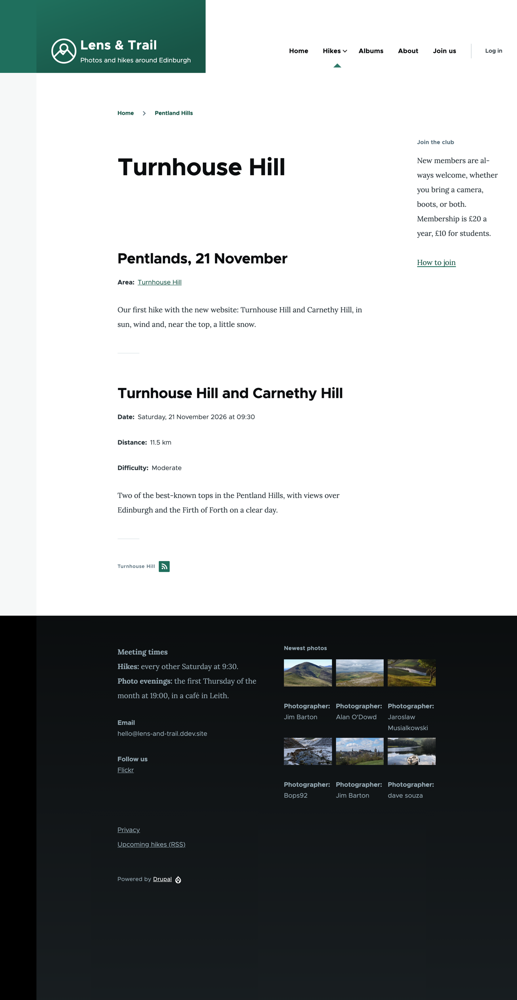
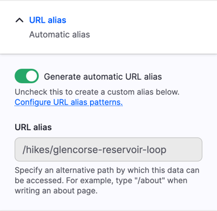
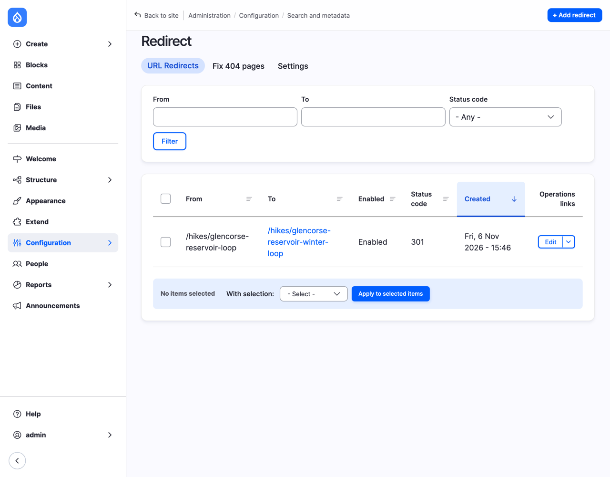
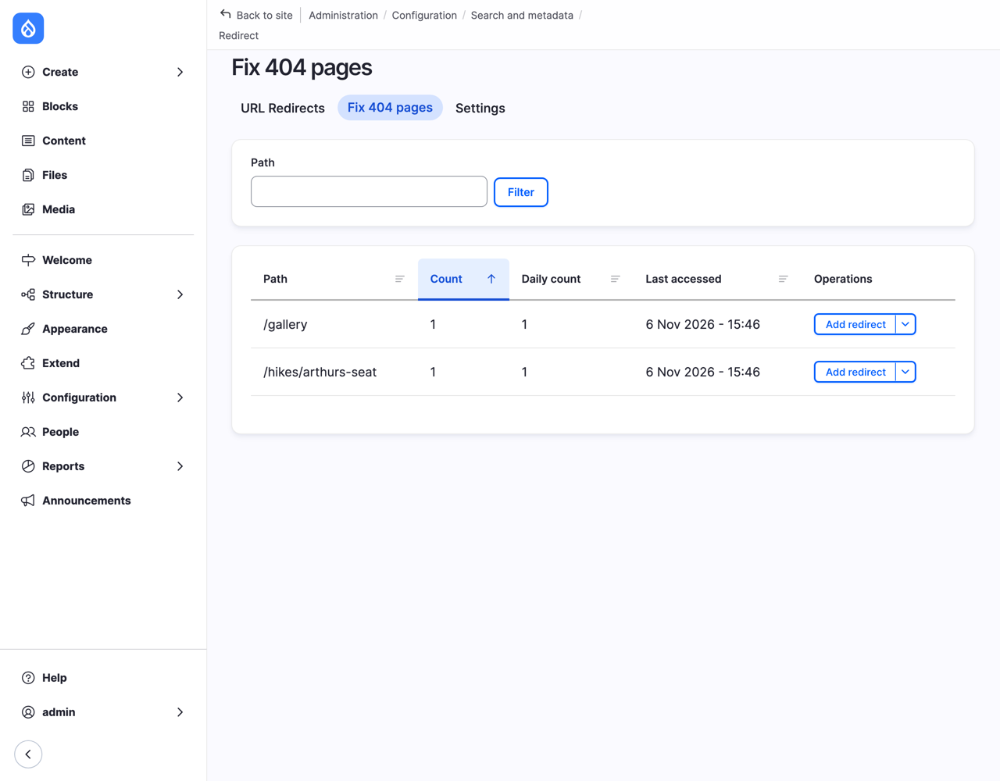
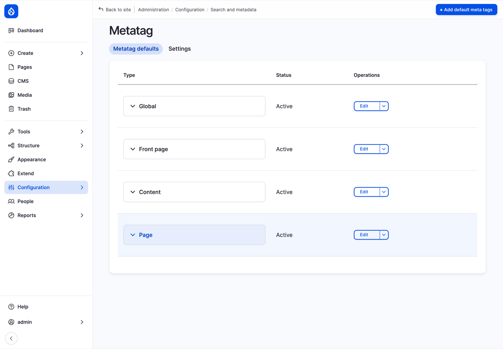
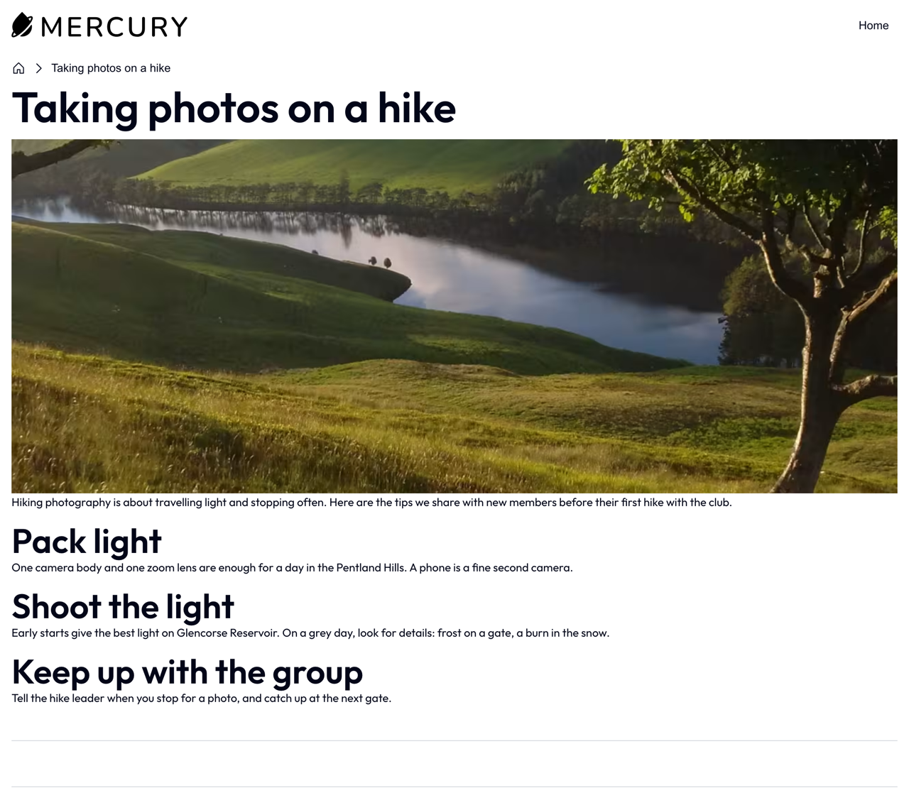

# Nice URLs and SEO

Look at the address of an album on the club's site: `/node/11`. It works, but it tells nobody anything. A person can't guess what's behind it, can't remember it, and can't tell from a list of search results whether it's the album they were looking for. Our Basic pages have better addresses, because we typed them by hand in Chapter 6: `/about`, `/join`. Nobody wants to type one for every hike, every album and every place in the Areas vocabulary, and nobody remembers to.

This chapter is about addresses, and about being found. We let Drupal make the addresses for us, from patterns, with a module called Pathauto. We keep old addresses working when a title changes, with Redirect, and see which addresses people try that don't exist. We give search engines a list of every page on the site, with Simple XML Sitemap. Then we look at what helps people find a page beyond the technical side: titles, descriptions, headings, and writing for people. On Drupal CMS, most of this is already set up, and we add the descriptions that search engines and social media show, with Metatag, and a second opinion on each page, with Real-time SEO.

*SEO*, by the way, stands for *search engine optimization*: helping search engines understand a site, so they show it to people who are looking for what it offers. There's a lot of nonsense written about it. Most of what works is in this chapter, and none of it is a trick.

We start where Chapter 16 left the club's site: Olivero, in the club's colors, with all the content, views, blocks and roles of the earlier chapters.

## Addresses in Drupal core

Every page in Drupal has a *system path*, the address Drupal uses internally: `/node/11` for the album, `/taxonomy/term/55` for the Pentland Hills, `/user/2` for a member. On top of that, a page can have a **URL alias**, a second, friendlier address: `/about` for `/node/1`. You gave a few in Chapter 6 and Chapter 7, in the **URL alias** field on the content form. Drupal core lists them all under **Configuration** > **Search and metadata** > **URL aliases** (`/admin/config/search/path`), where you can add, change and delete them too.

> **Under the hood: aliases.** An alias is an entity of its own, a *path alias* (Chapter 7), with three values: the system path (`/node/1`), the alias (`/about`), and a language. When a request for `/about` comes in, Drupal looks the alias up and handles it as `/node/1`; when Drupal writes a link to `/node/1` anywhere on the site (in a menu, a view, a teaser), it writes `/about` instead. That's why a menu link you made to `/node/1` shows the alias, and why changing an alias changes every link to the page at once. The system path keeps working too: `/node/1` and `/about` show the same page.
>
> Because aliases are entities, they're content, like nodes, not configuration. And because a page can have only one alias in use at a time, the old one stops working the moment you change it, unless something remembers it. We get to that in "When an address changes".

Core gives you the alias field; what it doesn't do is fill it in. That takes a contributed module.

## Pathauto: addresses from patterns

**Pathauto** makes aliases from *patterns*: "a hike's address is `/hikes/` followed by its title", for example. Every new hike gets an alias when you save it, and every hike changes its alias when its title changes. Pathauto needs **Token**, a module that comes along with it (see "Drupalism: token" below), and **Chaos Tools**, which helps with some of its forms.

While we're installing, we add the two other modules of this chapter, **Redirect** and **Simple XML Sitemap**. Download all three with Composer, as in Chapter 11:

```
ddev composer require drupal/pathauto drupal/redirect drupal/simple_sitemap
```

> **A note on Drupal 12.** As we write this, Pathauto, Redirect and Simple XML Sitemap have no release for Drupal 12 yet, only *development versions*: the code the maintainers are working on, which hasn't been released. If Composer answers that it can't find a version that matches your Drupal, ask for the development versions by name:
>
> ```
> ddev composer require drupal/pathauto:1.x-dev@dev drupal/ctools:4.1.x-dev@dev drupal/redirect:1.x-dev@dev drupal/simple_sitemap:5.x-dev@dev
> ```
>
> They work on the club's test site, and that's all we ask of them: development versions aren't covered by the security advisory policy (Chapter 11), and they can change from one day to the next. Don't put them on a live site. Most contributed modules get their Drupal 12 release soon after Drupal 12.0.0 comes out, so by the time you read this, the first command will probably do.

Go to **Extend**, check **Pathauto**, **Redirect**, **Redirect 404** and **Simple XML Sitemap**, and select **Install**. Drupal asks to install Token and Chaos Tools as well; select **Continue**.


*Figure 17.1: Pathauto, Redirect and Redirect 404 on Extend*

### A pattern for hikes

Go to **Configuration** > **Search and metadata** > **URL aliases**. Pathauto has added tabs: **List** (the aliases, as before), **Patterns**, **Settings**, **Bulk generate** and **Delete aliases**. Select **Patterns**, then **Add Pathauto pattern**.

1. **Pattern type**: **Content**. (The form grows when you choose; the type is what the pattern is for: content, taxonomy terms, users.)
2. **Path pattern**: `/hikes/[node:title]`.
3. Under **Content type**, check **Hike**.
4. **Label**: `Hikes`.
5. Select **Save**.

![The Add Pathauto pattern form: Pattern type Content, Path pattern /hikes/[node:title], a Browse available tokens. link, Content type with Hike checked among Gallery, Hike, News and Basic page, Label Hikes with the machine name hikes, and Enabled on](images/17-pattern-hike.png)
*Figure 17.2: The pattern for hikes*

The part in square brackets is a *token*, a placeholder that Drupal fills in for each hike: `[node:title]` becomes the hike's title. Pathauto then *cleans* the result for an address: lowercase, hyphens instead of spaces, no punctuation, and no short words such as "a", "and", "at" or "the". *Arthur's Seat by night* becomes `/hikes/arthurs-seat-night`.

Where do you find the tokens? Select **Browse available tokens.** It opens a list of every token you can use here, grouped: the current date, the current user, the site, and, because this pattern is for content, **Nodes**. Open a group with the small triangle to see its tokens, and select one to put it in the field you last clicked.


*Figure 17.3: The token browser*

> **Drupalism: token.** A token is a placeholder in square brackets, which Drupal replaces with a value: `[site:name]` with "Lens & Trail", `[node:title]` with a node's title, `[current-date:short]` with today's date. You've met them before, without the name: the emails in Chapter 15's account settings are full of them (`[user:display-name]`, `[site:login-url]`).
>
> Tokens can go through references, one step at a time, separated by colons. A hike's area is a reference to a term, so `[node:field_area:entity:name]` is the *name* of the *entity* in the hike's *Area* field: "Turnhouse Hill". The token browser shows these chains as groups inside groups.
>
> Drupal core has tokens, and uses them in a few places. The **Token** module adds many more (one for every field, for example), and the token browser to find them. Many modules use tokens for anything that should be filled in per page: aliases here, meta tags on Drupal CMS later in this chapter, email subjects in a contact form.

### Patterns for everything else

Add the other patterns the same way. Each needs a label; I used the names from the club's menu.

| Label | Pattern type | Path pattern | For |
|---|---|---|---|
| Albums | Content | `/galleries/[node:title]` | Gallery |
| News | Content | `/news/[node:title]` | News |
| Areas | Taxonomy term | `/areas/[term:parents:join-path]/[term:name]` | Vocabulary Areas |
| Photo themes | Taxonomy term | `/photo-themes/[term:name]` | Vocabulary Photo themes |

The albums go under `/galleries/`, next to the list of albums the Albums view shows at `/galleries` (Chapter 12). The Areas pattern needs a closer look:

![The Add Pathauto pattern form for terms: Pattern type Taxonomy term, Path pattern /areas/[term:parents:join-path]/[term:name], Vocabulary with Areas checked and Photo themes not, and the label Areas](images/17-pattern-areas.png)
*Figure 17.4: The pattern for areas, with the parent terms in the address*

`[term:parents:join-path]` is the term's parents, from the top down, cleaned and joined with slashes. Turnhouse Hill's parent is the Pentland Hills, so its address becomes `/areas/pentland-hills/turnhouse-hill`, and the Pentland Hills, which have no parent, get `/areas/pentland-hills`. That's the address Chapter 10 promised the Pentland Hills page.

![The Patterns tab: Albums /galleries/[node:title] (Content, Content type is gallery), Areas /areas/[term:parents:join-path]/[term:name] (Taxonomy term, Vocabulary is areas), Hikes /hikes/[node:title] (Content type is hike), News /news/[node:title] (Content type is news), and Photo themes /photo-themes/[term:name] (Vocabulary is photo_themes), each with a Duplicate button and a drag handle](images/17-patterns.png)
*Figure 17.5: The club's five patterns*

There's no pattern for Basic pages. The club has four, each with an address someone chose: `/about`, `/join`, `/welcome`, `/privacy`. A pattern would only get in the way. When there's no pattern for a page, Pathauto leaves its alias alone, and you type one by hand, as before.

If two patterns fit the same page (say, one for all content and one for hikes), Pathauto uses the first in the list; drag them into the order you need.

### The settings

Select the **Settings** tab. Most of it can stay as it is, and the descriptions say what each setting does: which *entity types* can have patterns at all, the separator (a hyphen), lowercase, the maximum length. Two are worth knowing about:

![Pathauto's Settings, further down: Maximum component length 100; Update action with Do nothing. Leave the old alias intact., Create a new alias. Leave the existing alias functioning., and Create a new alias. Delete the old alias. (selected), with a link to the Redirect module settings; Transliterate prior to creating alias (on); Reduce strings to letters and numbers (off); Strings to Remove: a, an, as, at, before, but, by, for, from, is, in, into, like, of, off, on, onto, per, since, than, the, this, that, to, up, via, with; and Safe tokens](images/17-pathauto-settings.png)
*Figure 17.6: What happens when a title changes, and the words Pathauto leaves out*

- **Update action**: what Pathauto does when you change a title. The default, **Create a new alias. Delete the old alias.**, keeps one address per page, and leaves it to Redirect to send visitors from the old address to the new one, as we see in a moment.
- **Strings to Remove**: the short words Pathauto leaves out of addresses. If the club ever has a hike that needs one of them in the address, this is the place.

**Transliterate prior to creating alias** turns letters such as "é" or "ñ" into plain "e" and "n". It matters for the club's Spanish pages (Chapter 18).

### Aliases for what's already there

Patterns apply when you save something. The hikes, albums and terms the club already has don't have aliases from patterns yet, until we ask for them. Select the **Bulk generate** tab:

1. Check **Content** and **Taxonomy term**.
2. Leave **Generate a URL alias for un-aliased paths only** selected.
3. Select **Update**.


*Figure 17.7: Aliases for all the content and terms that have none*

Drupal works through them in batches, and reports how many aliases it made. Look at the **List** tab now:


*Figure 17.8: Every page has an address now*

Every hike, album, news item and term has an address now. Open one, say the Turnhouse Hill term, at `/areas/pentland-hills/turnhouse-hill`:


*Figure 17.9: An area's page, with its address and a breadcrumb to match*

Look at the breadcrumb: **Home** > **Pentland Hills**. In Chapter 14, we saw that Drupal builds breadcrumbs from the address, one step for each part of it. With `/taxonomy/term/56`, there was nothing to build on; with `/areas/pentland-hills/turnhouse-hill`, the breadcrumb leads up to the Pentland Hills page. (There's no step for `/areas` itself, because there's no page at that address. A view at `/areas` would make one.)

### The aliases you made by hand

Bulk generate left your own aliases alone, as it promised: the Basic pages, which have no pattern, and the Turnhouse hike, which already had `/hikes/turnhouse-hill` from Chapter 7. But open that hike's edit form, and look at **URL alias** in the sidebar:


*Figure 17.10: Generate automatic URL alias, on by default wherever a pattern applies*

Pathauto has added **Generate automatic URL alias**, and turned it on, as it does for every page a pattern applies to, unless someone has turned it off before. When it's on, the alias field is greyed out, and the next time someone saves the hike, Pathauto replaces `/hikes/turnhouse-hill` with an alias from the pattern: `/hikes/turnhouse-hill-carnethy-hill`.

That's not wrong (and Redirect, as we see next, would keep the old address working), but the short address was chosen on purpose. To keep it, turn **Generate automatic URL alias** off, check that the alias field says `/hikes/turnhouse-hill`, and save. Pathauto remembers the choice for this hike from then on.

> **Try it:** add a hike, and don't touch its URL alias. Save it, and look at its address. Then give it a shorter address of your own: turn **Generate automatic URL alias** off, type the alias, and save.

## When an address changes: Redirect

Addresses get around. Someone posts the link to a hike on social media, a member bookmarks the album, a search engine lists the Pentland Hills page. If the address changes, all those links lead to "Page not found", and search engines drop the page until they find it again.

The club's *Glencorse Reservoir loop* has a new name: it's the club's winter walk now. Open it, change the title to `Glencorse Reservoir winter loop`, and save. Pathauto makes a new alias, `/hikes/glencorse-reservoir-winter-loop`, and deletes the old one, as the update action says. Now go to **Configuration** > **Search and metadata** > **URL redirects** (`/admin/config/search/redirect`):


*Figure 17.11: Redirect remembered the old address*

Redirect saw the alias change, and made a *redirect* from the old address to the page: anyone who opens `/hikes/glencorse-reservoir-loop` is sent on to the new one. The **301** is the code it answers with, which means "moved for good". It tells search engines to replace the old address with the new one in their lists. (The other common code, **302**, means "moved for now", and search engines keep the old one.) Redirect does this for every alias that changes; you can turn it off, and change the default code, under **Settings**.

You can also add a redirect by hand, with **Add redirect**: for an address on the old club website, for example, or a short address for a poster (`/winter` for the winter walk).

### Addresses that don't exist

**Redirect 404**, which came with Redirect, keeps a list of the addresses people asked for that don't exist. (*404* is the code for "Page not found".) Open a few in a private window to see it work: `/hikes/arthurs-seat`, perhaps, or `/gallery`, without the s. Then select the **Fix 404 pages** tab:


*Figure 17.12: The addresses people tried*

Each address shows how often it was asked for. **Add redirect** makes a redirect from it to the page you choose: `/gallery` to `/galleries` is a typo worth catching. Look at this list now and then: it shows the links to your site that are broken somewhere else, and what people guess your addresses are.

Not everything on it is a person. Bots try addresses on every site on the internet, such as `/wp-login.php` (WordPress's login page), looking for a weakness. Those you can ignore; **Pages to ignore**, under Redirect's **Settings**, hides the addresses you don't want to see.

## A map for search engines: the sitemap

Search engines find pages by following links. Most of the club's pages are linked from somewhere, but some only from a list on page three of the archive, and a search engine may give up before it gets there. A *sitemap* is a file that lists every page you want found, with the date each one last changed, so search engines don't have to guess.

**Simple XML Sitemap** makes one, at `/sitemap.xml`. You decide which kinds of pages go in it. Go to **Configuration** > **Search and metadata** > **Simple XML Sitemap**, select the **Inclusion** tab, and **Configure** next to **Content** (or go straight to `/admin/config/search/simplesitemap/entities/node`):


*Figure 17.13: Hikes in the sitemap*

1. Select **Hike** on the left, and **Index entities of type Hike in sitemap Default**.
2. Do the same for **Gallery**, **News** and **Basic page**.
3. Check **Regenerate all sitemaps after hitting Save** (otherwise it waits for *cron*, the housekeeping Drupal does at regular intervals), and select **Save configuration**.

**Priority** and **Change frequency** were meant to tell search engines which pages matter most and how often to look again. Google says it ignores both today, so leave them as they are. Do the same for the Areas, if you like (**Configure** next to **Taxonomy term** on the **Inclusion** tab): their pages are useful lists, and worth finding.

Open `/sitemap.xml`:


*Figure 17.14: The club's sitemap*

It's written for machines, but you can read it: each `<url>` is a page, with its address (`<loc>`) and the date it last changed (`<lastmod>`). Unpublished pages aren't in it, and neither is anything a visitor can't see. Each page can be left out on its own, too: the hike form has a **Simple XML Sitemap** section in the sidebar.

Search engines look for `/sitemap.xml` on their own, but it's quicker to tell them. Once the site is live, give the address to Google's Search Console and Bing's Webmaster Tools: both are free, and they also tell you which of your pages they've found, which searches showed them, and what went wrong.

### robots.txt

Next to Drupal's `index.php` there's a file called `robots.txt`. It's for the same machines, and says the opposite: where *not* to go. Drupal's asks search engines to stay out of the administration pages, the login and registration forms, and the search results, which are of no use in a search engine. You don't need to change it. Keep in mind that it's a request, not a lock: well-behaved search engines follow it, and anyone else can ignore it. A page that must stay private needs permissions (Chapter 15), not a line in `robots.txt`.

## What search engines read

Addresses and sitemaps help search engines *find* pages. Whether they show them to anyone depends on what's on them. There's no secret to it, and no setting: search engines try to show people the page that answers their question best, so the best SEO is a page that does. A few things help them tell:

- **The title.** It's the link in the search results, and the name of the browser tab. Make it say what the page is: "Turnhouse Hill and Carnethy Hill" tells more than "Saturday's hike". Drupal puts the site's name after it: `Turnhouse Hill and Carnethy Hill | Lens & Trail`.
- **The description.** Under the link, search engines show a short text: one the page provides (a *meta description*), or a piece of the page they choose themselves. Drupal core doesn't let you write one; Metatag does, as we see on Drupal CMS below. Without one, the first paragraph is what people see, so make the first paragraph count.
- **Headings.** A page with headings (**Heading 2** and **Heading 3** in the editor's **Paragraph** menu) shows what's on it, to search engines and to people who use a screen reader, which reads the headings out to jump between them. Use them in order, as an outline, not to make text bigger.
- **Alt text.** Search engines can't see photos. They read the alternative text you wrote for each one (Chapter 9), and so do screen readers. "Glencorse Reservoir between the hills, seen from a grassy slope with two trees" helps both; "IMG_4021" helps neither.
- **Link text.** "Read the hike's description" says where a link goes; "click here" doesn't.
- **Speed and phones.** Search engines prefer pages that load quickly and work on a phone. Olivero works on phones, and Chapter 9's image styles and responsive images keep the photos small. You've done this part already.

Notice that every one of these helps people first. Accessibility and search engines want the same things from a page, and a page written for people is written for search engines. Write for the members, and for the people who might become members: what's the walk like, how long is it, where do we meet. That's what they type into a search engine.

> **Structured data.** A search engine reading a hike's page sees text: a title, a date, a place. It has to guess that this is an event, that the date is when it starts, and that the place is where to meet. *Structured data* takes the guessing away: a description of the page in a shared vocabulary, *Schema.org*, which the big search engines agreed on. In Schema.org's words, a hike is an `Event`, with a `name`, a `startDate`, a `location` and an `organizer`. It goes in the page's HTML, usually as a small block of *JSON-LD*, a format for data that people can read too. Here is the Turnhouse hike, written by hand as an example:
>
> `hike-event.html` ([source](../examples/structured-data/hike-event.html))
>
> ```html
> <script type="application/ld+json">
> {
>   "@context": "https://schema.org",
>   "@type": "Event",
>   "name": "Turnhouse Hill and Carnethy Hill",
>   "startDate": "2026-11-21T09:30:00+00:00",
>   "description": "Two of the best-known tops in the Pentland Hills, with views over Edinburgh and the Firth of Forth on a clear day.",
>   "location": {
>     "@type": "Place",
>     "name": "Flotterstone car park"
>   },
>   "organizer": {
>     "@type": "Organization",
>     "name": "Lens & Trail",
>     "url": "https://lens-and-trail.ddev.site:8443/"
>   }
> }
> </script>
> ```
>
> With it, a search engine can show the hike as an event, with its date, in the results. Nobody types this by hand for every hike. The **Schema.org Metatag** module fills it in from the page's fields with tokens, as Pathauto does for addresses: `[node:field_date]` for the start date, `[node:field_meeting_place]` for the place. It builds on Metatag, and, like Metatag, it doesn't install on Drupal 12 yet.
>
> You've met one kind of structured data already: Easy Breadcrumb on Drupal CMS (Chapter 14) can add the breadcrumb as a Schema.org `BreadcrumbList`, so search engines can show where a page sits on the site. It does that on pages where the **Breadcrumbs** block is placed. Mercury draws its breadcrumb itself, without the block, so on the Drupal CMS site there's none to find: one more reason to look at a page's source, rather than trust a setting.

## On Drupal CMS

Drupal CMS was made with SEO in mind, so most of this chapter is done before you start. The installer puts its SEO tools in place, already set up: Pathauto, Redirect, Redirect 404 and Simple XML Sitemap, and three more we haven't met: **Metatag**, **Real-time SEO** and **SEO Checklist**.

Go to **Configuration** > **Search and metadata** > **URL aliases** > **Patterns** on the Drupal CMS site:

![Pathauto's patterns on Drupal CMS: Page content /[node:title] (Content, Content type is page) and Menu Path /[node:menu-link:parents:join-path]/[node:title] (Content, no conditions)](images/17-cms-patterns.png)
*Figure 17.15: Drupal CMS's two patterns*

Two patterns: Utility pages (the content type with the machine name `page`, Drupal CMS's Basic page) get their title as their address, and anything else gets the path of its menu link and its title, so a page under *About* in the menu gets `/about/...`. When you add a content type of your own, add a pattern for it here, as we did on core.

### Meta tags

A *meta tag* is a line in a page's HTML `<head>`, the part that doesn't show on the page, which describes the page to machines. The meta description from "What search engines read" is one. Others decide what a link to your page looks like when someone shares it on social media: the title, the text, and the photo. Without them, a social media site guesses, and often picks the logo, or nothing.

**Metatag** lets you set them, with tokens, for the whole site and for each kind of page. Go to **Configuration** > **Search and metadata** > **Metatag** (`/admin/config/search/metatag`):


*Figure 17.16: Meta tags for the whole site, the front page, content, and Canvas pages*

The defaults go from general to specific. **Global** applies everywhere; **Front page** and **Content** add to it for the front page and for nodes; **Page** is for Canvas pages. You could add one for a single content type, with **Add default meta tags**. Select **Edit** next to **Content**, and open **Open Graph**:

![Metatag's Content defaults, the Open Graph section: "The Open Graph meta tags are used to control how Facebook, Pinterest, LinkedIn and other social networking sites interpret the site's content", with Site name [site:name], Content type article, Page URL [current-page:url:absolute], and Title [node:field_seo_title|node:title]](images/17-cms-metatag-node.png)
*Figure 17.17: Open Graph tags, filled in with tokens*

*Open Graph* is the set of meta tags that most social media sites read when a link is shared. Each field is one tag, filled in with tokens, and the descriptions under each say what it's for. One is new: `[node:field_seo_title|node:title]`, with a bar between two tokens, means "the SEO title, or if there isn't one, the node's title". Drupal CMS adds that with a small module, *Token OR*, so each page can have its own SEO title and description, and falls back on its ordinary title and description when it doesn't.

Those SEO fields are on the content form. Let's write a page with them: the club's tips for taking photos on a hike, a Utility page, with a photo in **Featured image**. Under the content, open **Search Engine Optimization (SEO) Information**:


*Figure 17.18: A page's own SEO title, description and image*

- **SEO title**: a title for search engines, if you want one that's different from the page's. Most pages don't need one.
- **SEO description**: the meta description. Write one or two sentences that make someone want to open the page, around 150 characters, because search engines cut longer ones short.
- **SEO image**: a photo for social media, if you want a different one from the featured image.

Write a description, and leave the title and image empty: the page's title and featured image will do.

### A second opinion: Real-time SEO

Below the SEO fields is **SEO analysis**, from the **Real-time SEO** module. Type a **Focus keyword**, the words you hope people search for to find this page (`hiking photography`), and select **Seo preview**:


*Figure 17.19: Real-time SEO's analysis of the page*

The **Snippet preview** shows the page roughly as a search engine would list it. Under it, a checklist: green for what's good, orange for what could be better, red for what's missing. (Real-time SEO is built on the same analysis as Yoast SEO, a WordPress plugin, but isn't made by Yoast.)

Take its advice as a second opinion, not as orders. Some of it is good: a description that mentions what the page is about, the words in the first paragraph. Some of it isn't for every page: "The images on this page do not have alt attributes containing the focus keyword" would have us describe a photo of a reservoir as "hiking photography", which helps no one who can't see it. Write the alt text for the photo, and the page for the reader; a green light is a means, never the goal.

Save the page, and open it:


*Figure 17.20: The page, as visitors see it*

The meta tags don't show on the page. To see them, look at the page's source (right-click, then **View Page Source**), near the top:

`view-source:https://lens-and-trail-cms.ddev.site:8443/taking-photos-hike` ([source](../examples/metatag/taking-photos-on-a-hike-head.html))

```html
<!-- The <head> of "Taking photos on a hike" on Drupal CMS: the tags Metatag adds (excerpt). -->
<meta name="description" content="Tips from the Lens &amp; Trail photo club for hiking photography in the hills around Edinburgh: what to pack, when the light is best, and how to keep up with the group.">
<link rel="canonical" href="https://lens-and-trail-cms.ddev.site:8443/taking-photos-hike">
<meta property="og:site_name" content="Lens &amp; Trail">
<meta property="og:type" content="article">
<meta property="og:url" content="https://lens-and-trail-cms.ddev.site:8443/taking-photos-hike">
<meta property="og:title" content="Taking photos on a hike">
<meta property="og:description" content="Tips from the Lens &amp; Trail photo club for hiking photography in the hills around Edinburgh: what to pack, when the light is best, and how to keep up with the group.">
<meta property="og:image" content="https://lens-and-trail-cms.ddev.site:8443/sites/default/files/styles/social_media_facebook/public/glencorse-reservoir-portrait.jpg.avif?itok=Xk-cbYGW">
<meta property="og:image:type" content="image/avif">
<meta property="og:image:width" content="1200">
<meta property="og:image:height" content="630">
<meta property="og:image:alt" content="Glencorse Reservoir between the hills, seen from a grassy slope with two trees">
<meta property="og:updated_time" content="2026-11-06T15:38:19+00:00">
<meta name="twitter:card" content="summary_large_image">
<meta name="twitter:description" content="Tips from the Lens &amp; Trail photo club for hiking photography in the hills around Edinburgh: what to pack, when the light is best, and how to keep up with the group.">
<meta name="twitter:title" content="Taking photos on a hike">
<meta name="twitter:image" content="https://lens-and-trail-cms.ddev.site:8443/sites/default/files/styles/social_media_x/public/glencorse-reservoir-portrait.jpg.avif?itok=gcT4vE8U">
<meta name="twitter:image:alt" content="Glencorse Reservoir between the hills, seen from a grassy slope with two trees">
```

The description you wrote is there three times: for search engines, for Open Graph, and for X (`twitter:`). The photo is there in a size made for sharing, 1200 by 630 pixels, by an image style (Chapter 9), with its alt text. The address is `/taking-photos-hike`: Pathauto left out "on" and "a".

### The SEO Checklist

Last, go to **Configuration** > **Search and metadata** > **SEO checklist**:

![The SEO checklist: "SEO checklist found 6 unchecked items that were already completed and checked them for you", a progress bar at 0 of 45, and vertical tabs Clean URLs, Meta tags and Schema.org Vocabularies, Search engines, Optimizing content, On-page optimization, Security and performance, and Mobile; under Clean URLs, Install and Enable Redirect module (checked), Configure the Redirect module, Configure the Redirect 404 module, Install and Enable Pathauto module (checked), Configure the Pathauto module, each with Download, Install, Configure and Configure permissions links](images/17-cms-seo-checklist.png)
*Figure 17.21: A to-do list for a site's SEO*

It's a to-do list of 45 things, from modules to install to accounts to set up with search engines, each with a short explanation and a link to the right page. It checks what it can see for itself (here, six items) and leaves the rest for you to tick off and save. Not every item fits every site, and some suggest modules that a small club doesn't need. Read it as a list of questions: you'll recognize most of them from this chapter.

## Coming from WordPress?

> **Coming from WordPress?** WordPress chooses one address structure for all posts at once, under **Settings** > **Permalinks** (**Post name**, **Day and name**, or a custom structure with tags such as `%postname%`), and pages get their own slug. Drupal core has no such setting: each page has an alias or not, and Pathauto adds patterns, one per content type or vocabulary if you like, which is what Permalinks' structure tags do, with tokens. Two things WordPress does by itself need a module in Drupal. When a post's slug changes, WordPress sends visitors from the old address to the new one; in Drupal, that's Redirect. And WordPress has made a sitemap, at `/wp-sitemap.xml`, since version 5.5; in Drupal, that's Simple XML Sitemap. For meta descriptions and social media tags, many WordPress sites use a plugin such as Yoast SEO or Rank Math; in Drupal, that's Metatag, with Real-time SEO for a Yoast-like analysis on the content form.

## Summary

You can now:

- explain the difference between a system path and a URL alias, and where Drupal keeps aliases;
- install Pathauto, and write patterns for content and taxonomy terms with tokens, using the token browser;
- give existing content aliases with Bulk generate, and keep a hand-made alias from being replaced;
- keep old addresses working with Redirect, and find broken links with Redirect 404;
- make a sitemap for search engines with Simple XML Sitemap, and explain what `robots.txt` does and doesn't do;
- write titles, descriptions, headings, alt text and links that help people and search engines alike;
- explain what structured data is, and why a hike might be a Schema.org Event;
- on Drupal CMS, set meta tags with Metatag, write a page's SEO description, and weigh Real-time SEO's advice.

## Exercises

1. Members find their way to `/gallery` and `/hike` (without the s). Use **Fix 404 pages** to send them to `/galleries` and `/hikes`. Which status code did you choose, and why?
2. Change the News pattern to `/news/[node:created:custom:Y]/[node:title]`, so the news items get the year in their address. Use **Bulk generate** to update the existing aliases. What happened to the old address of *The club has a website*? Look at **URL redirects**. Then decide which pattern you'd keep.
3. Pathauto's **Settings** let you turn on patterns for **User** too. Would you give members' profile pages addresses such as `/members/[user:account-name]`? Think about Chapter 15: who can see profiles, and what a member's user name tells a stranger.
4. On Drupal CMS, give *How to join* (the Canvas page from Chapter 8) a description in its page data, and check the page's source for the meta description. Which of Metatag's defaults applies to Canvas pages?
5. *(challenge)* Write a hike as a Schema.org `Event` by hand, as in the "Structured data" box, for *Arthur's Seat by night*. Look up the `Event` type at [schema.org/Event](https://schema.org/Event): which of the hike's other fields (Distance, Difficulty, Hike leader) could go in it, and as which properties? Which have no place?
6. *(challenge)* In Chapter 11, Exercise 2, you judged Pathauto with the five questions from "Choosing a module". Answer them again for Redirect and Simple XML Sitemap. Has anything changed for Pathauto since?

## Want to know more?

- [Pathauto](https://www.drupal.org/project/pathauto), [Token](https://www.drupal.org/project/token), [Redirect](https://www.drupal.org/project/redirect) and [Simple XML Sitemap](https://www.drupal.org/project/simple_sitemap) on drupal.org, and [Pathauto's documentation](https://www.drupal.org/docs/contributed-modules/pathauto).
- [Metatag](https://www.drupal.org/project/metatag) and [its documentation](https://www.drupal.org/docs/contributed-modules/metatag), [Schema.org Metatag](https://www.drupal.org/project/schema_metatag), [Real-time SEO for Drupal](https://www.drupal.org/project/yoast_seo) and [SEO Checklist](https://www.drupal.org/project/seo_checklist).
- Core's [Path module](https://www.drupal.org/docs/8/core/modules/path/overview), for URL aliases without Pathauto.
- Google's [SEO starter guide](https://developers.google.com/search/docs/fundamentals/seo-starter-guide) and [introduction to structured data](https://developers.google.com/search/docs/appearance/structured-data/intro-structured-data): written by a search engine, and refreshingly free of tricks.
- [sitemaps.org](https://www.sitemaps.org/), [Schema.org](https://schema.org/Event) and [the Open Graph protocol](https://ogp.me/), for the formats in this chapter.
- For comparison, WordPress's [Permalinks screen](https://wordpress.org/documentation/article/settings-permalinks-screen/) and [its sitemaps](https://make.wordpress.org/core/2020/07/22/new-xml-sitemaps-functionality-in-wordpress-5-5/).
