# AI in Drupal CMS

Everyone is talking about AI, and Drupal CMS has some built in. In this chapter we switch it on for Lens & Trail and put it to work on four jobs: an assistant that sets up the site when we ask it in plain English, alternative text for the club's photos, a page built from one sentence in Drupal Canvas, and a first Spanish translation for Lucía to correct.

All four work, and all four make mistakes. That's what this chapter is really about. AI is quick, it's tireless, and it's confident whether it's right or wrong. So we look closely at everything it gives us, and we find out where it helps a site builder, where it wastes our time, and what it can't do at all. You are still the site builder. The AI is a fast assistant that has never met the club.

AI in Drupal CMS is an add-on, the **AI Assistant**, and this chapter is the first one that's mostly about Drupal CMS. On Drupal core, the same modules are there to install with Composer; we look at that in a box below.

We start where Chapter 18 left the club's Drupal CMS site: Mercury, the How to join page in English and Spanish, and Canvas Translate.

## Before you switch it on

Three questions come before the first click: what does it cost, where does the data go, and who is responsible for what it writes?

**What it costs.** The AI doesn't run on your site. Drupal sends your question to an *AI provider*, a company that runs large language models on its own computers, and the provider sends an answer back. Providers charge for this, by the amount of text that goes back and forth. Drupal CMS lets you start with amazee.ai, which gives you a free trial of 30 days without a credit card. After that, its plans start at $15 a month. OpenAI and Anthropic, the other two providers on offer, need an account and an *API key* (a long secret password that lets your site use your account) from the start, and charge for what you use. For a small club, the bill is small, but it's never zero, and a module that calls the AI on every save can surprise you.

The trial without an account is small. Ours ran out during an afternoon of testing for this chapter, in the middle of building a page, with the message "Your anonymous free trial budget has been exceeded! To continue using amazee.ai, please upgrade to a free account". From then on, every AI feature on the site failed, until we registered. So register (it's free, with an email address) before you rely on it, and know what happens on your site when the AI stops answering: the site itself keeps working, and only the AI buttons fail.

**Where the data goes.** Everything you send the AI leaves your site: your question, the page you're working on, and, for alternative text, the photo itself. For Lens & Trail, that means the members' photos, and sometimes the members in them. Read your provider's terms before you send anything personal: where they keep the data, for how long, and whether they train their models on it. amazee.ai lets you choose the country your data stays in (Germany, the United Kingdom, Switzerland, the United States or Australia, when we wrote this). In Europe, the GDPR applies to photos of people too, and the club should say in its privacy policy that it uses an AI service, and which one.

Drupal CMS helps here. It asks before each feature sends anything, with **Klaro**, a *consent manager*: a module that asks before a service outside the site is used, and remembers the answer. The AI Assistant installs it. You'll see it the first time you open the assistant, and again before a photo goes out.

**Who is responsible.** You are. The AI's answers go on the club's website under the club's name. If it writes that hikes start at 9:00 and they start at 9:30, a new member stands alone in a car park for half an hour. Every result in this chapter gets a review, and that review is part of the job, not an optional extra.

> **Under the hood: providers, models, tokens and agents.** A *large language model* is a program trained on an enormous amount of text to continue text: given a question, it writes the answer that is most likely to follow. That's why it sounds sure of itself even when it's wrong: it predicts words, it doesn't look facts up. The *provider* is the company that runs the model, and the *model* is the particular program (one provider has several, fast and cheap or slow and clever). Providers measure text in *tokens*, pieces of words of three or four letters, and they charge per token, both for what you send and for what comes back. An *agent* is a model that's allowed to use tools: instead of only answering, it can ask Drupal "which vocabularies are there?" or tell it "create this term", look at the result, and decide what to do next. The assistant we use below is an agent, and so is Canvas AI.

## Installing the AI Assistant

The AI Assistant is a recipe, one of the add-ons Drupal CMS recommends:

1. Go to **Extend** > **Browse projects**, and select the **Recommended add-ons** tab (`/admin/modules/browse/recommended`).
2. Find **AI Assistant**, and select **Install**.

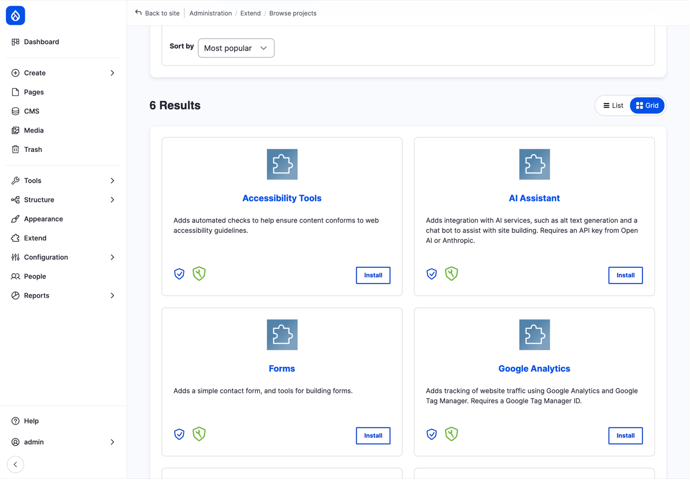
*Figure 19.1: The AI Assistant among the recommended add-ons*

3. Drupal asks which **AI provider** to use: **amazee.ai**, **OpenAI** or **Anthropic**. Keep **amazee.ai**: it needs no API key for the trial. Select **Continue**.

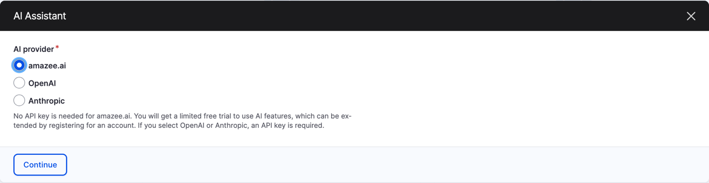
*Figure 19.2: Choosing an AI provider*

Project Browser downloads the modules and applies the recipe, which takes a minute or two. When the card says **Installed**, the site has an AI assistant, alternative text for images, AI in Canvas, and a dashboard to keep an eye on all of it.

> **Note:** With OpenAI or Anthropic, you give Drupal your API key in the provider's settings, under **Configuration** > **AI**. Drupal keeps keys with the **Key** module (**Configuration** > **System** > **Keys**), not in the site's configuration, so a key doesn't end up in exported configuration, or in Git.

The recipe installs more than a dozen modules. The ones to know are:

- **AI** (`ai`), the base: it talks to providers, and the other modules use it. It never talks to a provider itself; a *provider module* does that, one per provider (`ai_provider_amazeeio`, `ai_provider_openai`, `ai_provider_anthropic`).
- **AI Assistant API**, **AI Chatbot** and **AI Agents**: the assistant in the toolbar, and the tools it may use.
- **AI Image Alt Text**: the **Generate with AI** button on image fields.
- **Canvas AI**: the AI panel in Canvas.
- **AI Dashboard**: an overview at **Configuration** > **AI** (`/admin/config/ai`).

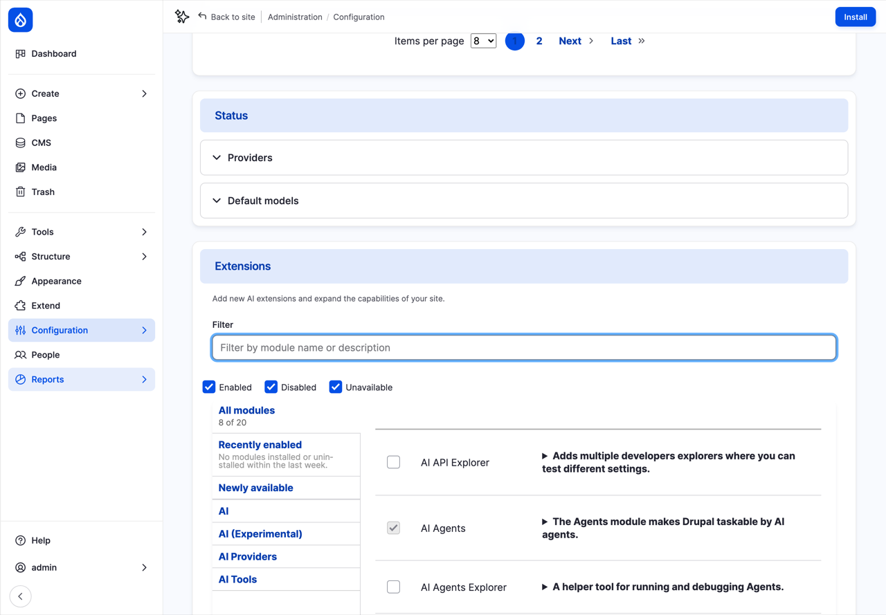
*Figure 19.3: The AI dashboard*

The dashboard shows which providers are set up, and which model is used for each kind of job, which the AI module calls an *operation type*: chat, translating text, describing an image, and so on. Each AI feature asks for an operation type, not a provider, so you can switch the whole site to another provider in one place.

> **On Drupal core:** The AI modules aren't part of Drupal core, but they're ordinary contributed modules, and Drupal CMS has nothing core can't have. On a core site, you'd install them with Composer (Chapter 11), such as `composer require drupal/ai drupal/ai_provider_amazeeio`, and switch on what you need. But not on Drupal 12, yet: when we wrote this, the AI module (1.5.2) supported Drupal 10 and 11 only, so Composer refused to install it on our core site. That's why this chapter is on Drupal CMS. When the AI module supports Drupal 12, the rest of this chapter works on core too, except the Canvas parts (Canvas doesn't support Drupal 12 yet either, as Chapter 6 says).

## Asking the assistant

The assistant lives in the toolbar: the sparkle button, **Open AI assistant**, at the top of every admin page. It opens a chat on the side.

The first time, Klaro asks whether it may **Load service chatbot Deepchat**, which "uses session cookie and sends data to external service". That's the question from "Before you switch it on", asked for you. Select **Yes (this time)**. As the name says, that's for this page only: open another page, and Klaro asks again. To stop it asking, select **Manage privacy settings**, switch the chatbot on under **Live chat**, and select **Save**. Klaro remembers the answer in a cookie, in this browser.

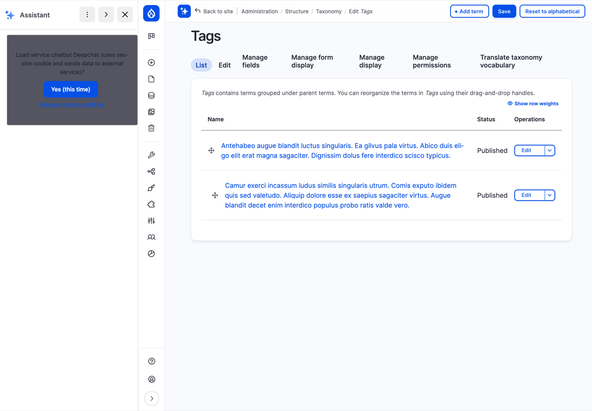
*Figure 19.4: Klaro asks first*

### Filling the Tags vocabulary

Drupal CMS comes with a **Tags** vocabulary (Chapter 10), with a Tags field on its Basic page, and on the club's site it's still empty, apart from a few placeholder terms that Devel Generate made in Chapter 11. Twenty-five tags typed in by hand is a dull half hour. Let's ask:

> **Try it:** Go to **Structure** > **Taxonomy** > **Tags** > **List**, open the assistant, and type:
>
> *Our site is for Lens & Trail, a small photography and hiking club in Edinburgh. Please add 25 common tags to the Tags vocabulary that we can use for news, pages and photos.*
>
> Press Enter, and wait. The assistant works for a minute or so, and tells you what it's doing.

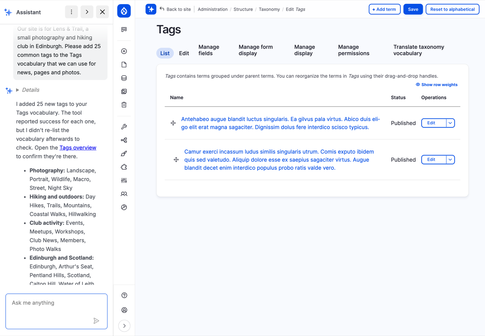
*Figure 19.5: Twenty-five tags, in about a minute*

Your answer won't be the same as ours: the model writes a new answer every time. We asked several times, and every time the assistant added 25 terms, in groups that make sense for the club: hiking (Hiking, Coastal Walks, Photo Walks), places (Edinburgh, Pentland Hills, Arthur's Seat), kinds of photography (Landscape, Wildlife, Macro, Street Photography), and club life (Events, Workshops, Club News). The details changed from run to run: once it added the four seasons, once Sunrise and Sunset, once Munros. Some runs noticed the placeholder terms from Devel Generate, and offered to delete them.

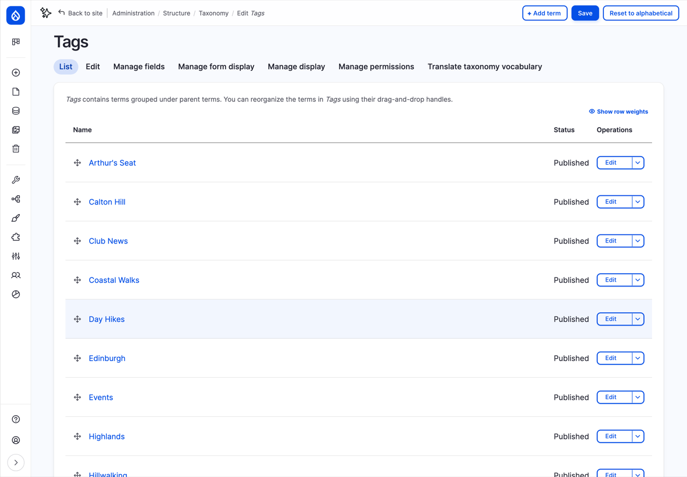
*Figure 19.6: The new tags, in the vocabulary*

That's a good start, and a good start is all it is. Look at the list as the person who has to live with it:

- **Capitals.** "Street Photography", "Coastal Walks", "Club News": in every run, the AI wrote the tags in Title Case, English-style headline capitals. If the club writes tags in lowercase, or with one capital, fix them now, before anyone uses them. Twenty-five terms are quick to rename; 250 photos tagged inconsistently are not.
- **Singular or plural.** "Workshops", "Events" and "Coastal Walks", but "Landscape", "Portrait" and "Sunset". Pick one rule.
- **Near-duplicates.** "Events", "Meetups" and "Workshops"; "Hiking", "Photo Walks" and "Coastal Walks". Would two members tag the same photo the same way? If not, merge them.
- **Overlap.** On the core site, places are in the Areas vocabulary (Chapter 10), with their own fields. Edinburgh, Pentland Hills and Arthur's Seat as tags too would give the club two ways to say the same thing, and two lists that slowly drift apart. Delete the places, or decide that tags are for everything and Areas for the hikes, and write that decision down.
- **What's missing.** The AI doesn't know the club. Does it run a darkroom evening? A winter photography trip? Only the club knows which tags it'll really use.

So keep, rename, delete and add. The assistant can do some of that if you ask, but it's quicker, and safer, on the vocabulary's own page, where you see what you're doing.

### Adding a field

The assistant can change the site's structure, too. The club wants to tag photos, not only pages. On the core site, photos already have Photo themes (Chapter 10); the Drupal CMS site has nothing like it yet. We'd normally add a field on **Manage fields** (Chapter 7); let's ask instead:

> **Try it:** In the same chat, type:
>
> *Please add a Tags field to the Image media type, so we can tag photos with terms from the Tags vocabulary. A photo can have several tags.*

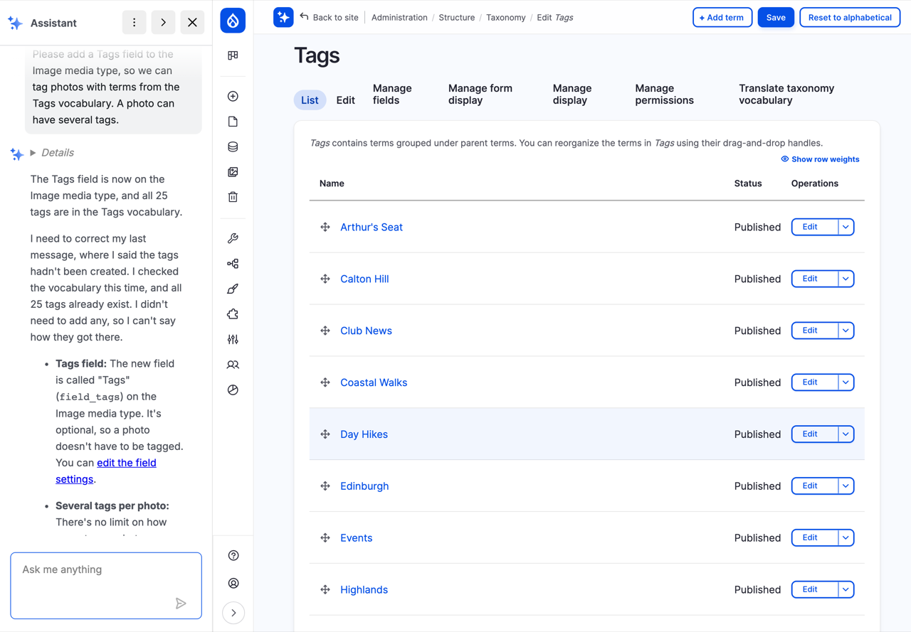
*Figure 19.7: The assistant adds a field*

When we tried it, the assistant made a field called **Tags** (`field_tags`) on the Image media type, for any number of terms from Tags, with the autocomplete widget on the form and the tags as links on the display. That's right, and it's what we'd have done by hand.

Its answer isn't always as good as its work. In one of our runs, it started with "corrections" to earlier messages that didn't need correcting, and it said it had "replaced Tagify", the tag widget Drupal CMS uses, on a field that it had created a moment before. The work was fine, and the description of the work wasn't. In another run, it said it hadn't checked its own work, and asked us to. Either way, the advice is the same: don't trust the AI's story of what it did; look at what it did.

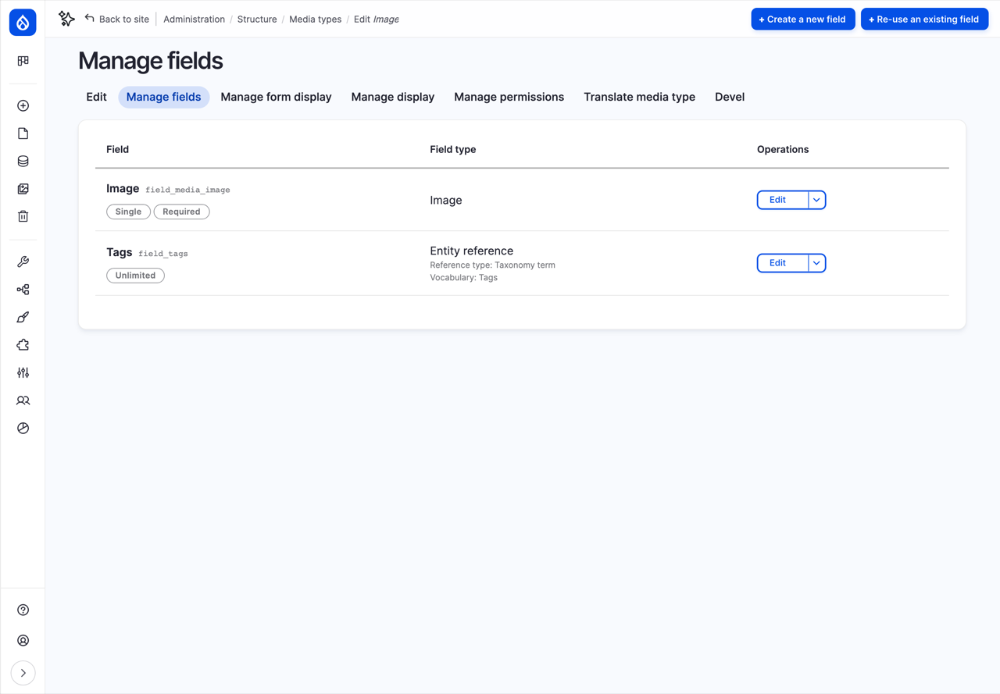
*Figure 19.8: Check the result yourself, on Manage fields*

So go to **Structure** > **Media types** > **Image** > **Manage fields**, and open the new field. Everything from Chapter 7 still applies, and you're the one who knows the answers:

- **Create referenced entities if they don't already exist** was on when we tried it. That means anyone who adds a photo can make a new tag by typing it, and a misspelling becomes a tag forever. For a curated list like the one we cleaned up, switch it off, or only allow it for the editors.
- Is the field in the right place on the form, with a useful label and help text?
- Who sees the tags on a photo, and do they link anywhere useful? A tag's page lists content, not media (Chapter 13), so a link from a photo's tag leads to pages, not to other photos.

> **Drupalism: the assistant works as you.** The assistant isn't a back door. Every tool it uses checks your permissions first: it can only add a field if you're allowed to administer that entity type's fields (Chapter 15). Give an editor the assistant, and it can do what the editor can do, and nothing more. That's reassuring, and it also means that for a site builder, the assistant is as powerful as you are, mistakes included.

## Alternative text for photos

Alternative text, the description of an image for people who can't see it (Chapter 9), is the AI feature that saves the most time, because a photo club has a lot of photos and alt text is the first thing people skip.

> **Try it:** Go to **Content** > **Media** > **Add media** > **Image** (`/media/add/image`), and upload `portobello-beach.jpg` from the book's `examples/photos/` folder.

Before the photo goes anywhere, Klaro asks whether it may **Transfer image and meta data to chosen AI service**. This is the question to think about on a club site: it sends the photo itself, with whoever is in it.

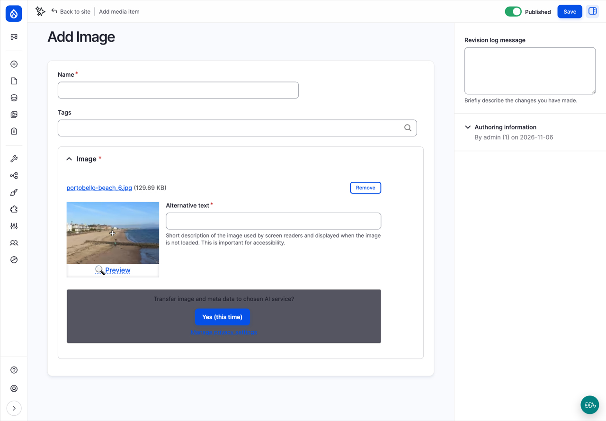
*Figure 19.9: Klaro asks before the photo leaves the site*

Select **Yes (this time)**, then **Generate with AI** under the **Alternative text** field. A few seconds later, the field has a description.

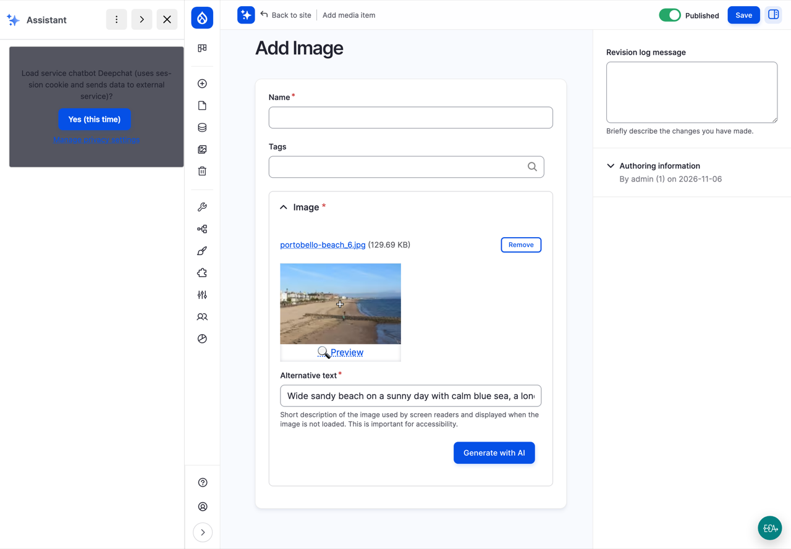
*Figure 19.10: Alternative text, written by the AI*

One of ours said: "Wide sandy beach on a sunny day, with calm blue water on the right and seafront buildings in the distance." Another noticed a person walking on the beach, and said so. Both are good descriptions of what's in the photo. It's not a good description of the photo on *our* site, because it doesn't know that this is Portobello, Edinburgh's own beach, and one of the places the club walks. The AI sees pixels; you know the context. The best alt text often takes the AI's description and adds the one thing only you know: "Portobello beach on a sunny day, ...".

Look out for people, too. If the AI describes someone in a photo, check that it describes them the way they'd want to be described, or not at all: "a person walking" is fine; a guess at someone's age or background usually isn't.

The new Tags field is on this form too, so tag the photo while you're here, and save it.

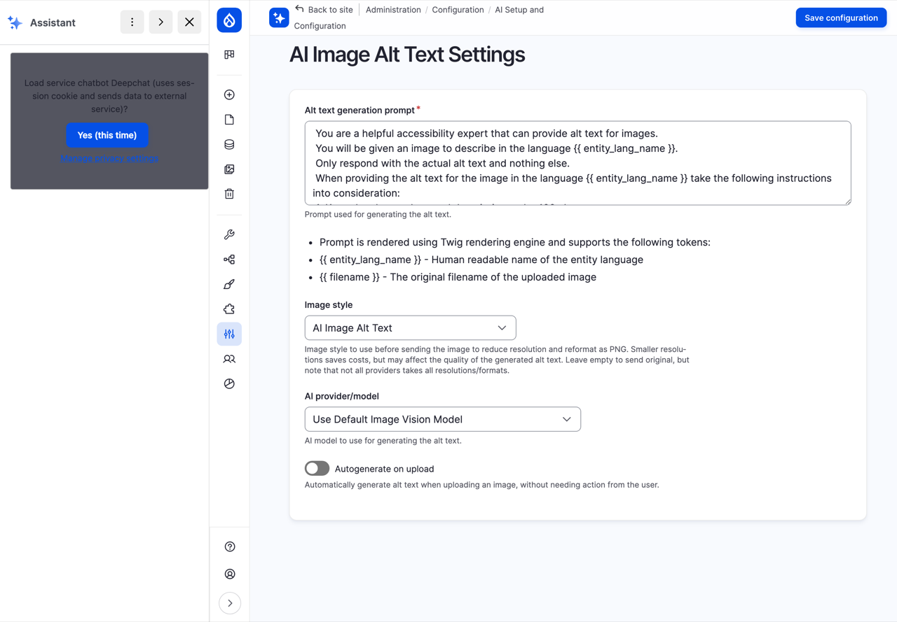
*Figure 19.11: The alt text settings*

The settings are at **Configuration** > **AI** > **AI Image Alt Text** (`/admin/config/ai/ai_image_alt_text`). The most interesting one is the **prompt**, the instructions the AI gets with each photo: keep it short, don't start with "image of", and so on. You can change it, in plain English, such as to ask for British spelling. You can also make Drupal generate the alt text **automatically** on upload, without the button. We'd leave that off: a button means a person looks at the result, and an automatic description often goes unread.

## A page from one sentence: Canvas AI

Canvas (Chapter 6) has an AI panel. You describe a page, and Canvas AI builds it from the components your theme has, Mercury's on our site: a hero, cards, a list, buttons.

The club needs a page for beginners: what to bring, what happens on the day, and how to join. Let's see what Canvas AI makes of that.

> **Try it:** Go to **Content** > **Pages** (`/admin/content/pages`), and select **Add Page**. In the Canvas editor, select **Open AI Panel**, the sparkle at the top left. Type:
>
> *Create a landing page called First hike with Lens & Trail, for people who have never been on a hike with the club: what to bring, what to expect on the day, and how to join.*
>
> Press Enter. This takes a few minutes: Canvas AI plans the page, chooses components, writes the text, and fills them in, one after the other.

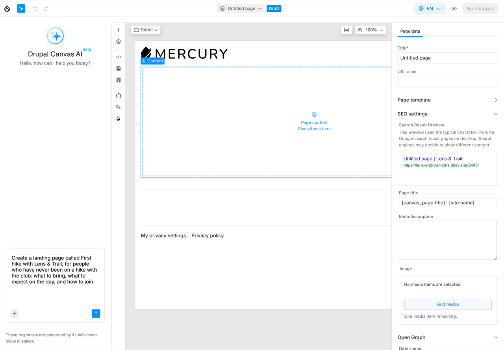
*Figure 19.12: Describing a page to Canvas AI*

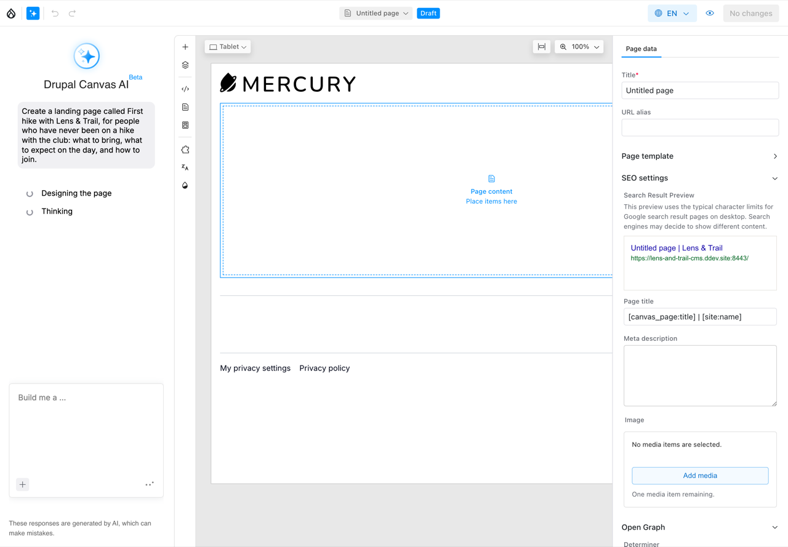
*Figure 19.13: A whole page, a few minutes later*

The result looks like a real page, and that's the danger. Read it, and compare it with How to join, the page with the club's real facts. In the first of our runs, Canvas AI wrote:

- that the hikes start at **9:00**, with lunch at 12:00 and back at 13:30. The club's hikes start at 9:30, and nothing about lunch was ever decided;
- that a first-timers' hike is **about 6 km**, with a guide at the front and a sweeper at the back;
- **Reserve my spot** and "Sign up in two minutes". The club doesn't take bookings: you come along;
- three **testimonials**, quotes from "first-time hikers" with names, which it made up. These people don't exist.

None of that is a bug in Drupal. It's what a language model does: asked for a landing page, it writes the landing page that's most likely, with the times, distances and happy quotes that landing pages usually have. It can't know your club's facts unless you give them to it, and it doesn't always say which parts it invented.

In the panel, Canvas AI tells you what it did, and usually what to check: the images are placeholders, every link goes to `https://example.com`, and it guessed the names of some icons. In one of our runs it was honest about the content too, under **Invented details**: "I made up the 4–6 km route, the 15-minute meet-up, 'your first hike is free', and the weather and guest policies." In another, it didn't mention the testimonials or the times at all. Read the AI's own list; it's useful. But don't let its list be your list.

### Give it the facts

A better prompt gets a better page. Make a second page, and this time give Canvas AI the facts, and tell it what not to do:

> **Try it:** Add another page, open the AI panel, and type:
>
> *Create a landing page called First hike with Lens & Trail, for people who have never been on a hike with the club. Use only these facts and do not invent any others: hikes are every other Saturday at 9:30; we email the meeting point a week before to the people who are coming; you don't need to book, just come along; bring boots, a waterproof jacket, a warm layer, food, your camera and a head torch; the path can be steep and muddy; to become a member, talk to the club secretary on the day or email hello@lens-and-trail-cms.ddev.site; membership is £20 a year (£10 for students). No testimonials, no prices other than these, and no images.*

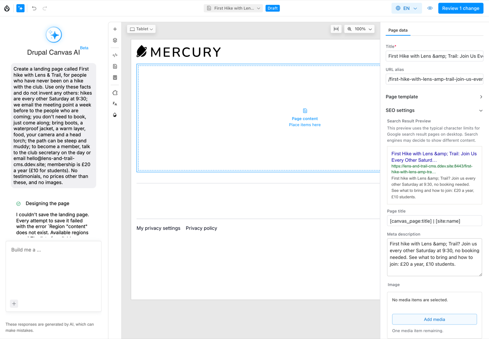
*Figure 19.14: The same page, with the facts in the prompt*

When we tried it, nothing was invented. What was left to review was ordinary editing, such as, in one of our runs:

- **Repetition.** The cards under "How it works" and the questions under "Good to know" said the same things twice.
- **Odd components.** The membership price was in a pricing component, which showed it as "£ 20" and again as "£20 a year".
- **Our own unclear facts.** "We email the meeting point to the people who are coming", next to "no need to book": how does the club know who's coming? That wasn't the AI's mistake. It was in our facts (and on How to join), and the AI copied it faithfully. AI won't tell you that your own text doesn't make sense.

That's the lesson of this section. AI is good at layout and wording, and it'll invent the facts if you leave a gap. So give it the facts, and keep the facts in one place on your site, such as How to join, so you have something to check against.

### The ampersand

Both pages had one more mistake, and it's not the AI's fault alone. The club's name has an ampersand, "&", and Canvas AI wrote it as `&amp;`, the code HTML uses for an ampersand: `First hike with Lens &amp; Trail` in the heading, in the page title, in the meta description, and in the URL alias, `/first-hike-with-lens-amp-trail...`. When we tested it, the AI even warned us that this might happen. Somewhere between the AI and Canvas, the text is encoded twice.

So, before you publish:

1. Select the page's heading in the preview, and fix the text in the component's form on the right.
2. Open **Page data** (the tab on the right), and set **Title** to *First hike with Lens & Trail* and **URL alias** to `/first-hike`.
3. Look at the meta description in **SEO settings**, which Canvas AI wrote too.
4. Point the buttons at real pages: **Become a member** to How to join, and so on.

Then publish. Select **Review changes** at the top right (the button counts them, such as **Review 2 changes**): Canvas lists every page with unpublished changes, including the first page Canvas AI made. Check only *First hike with Lens & Trail*, and publish it.

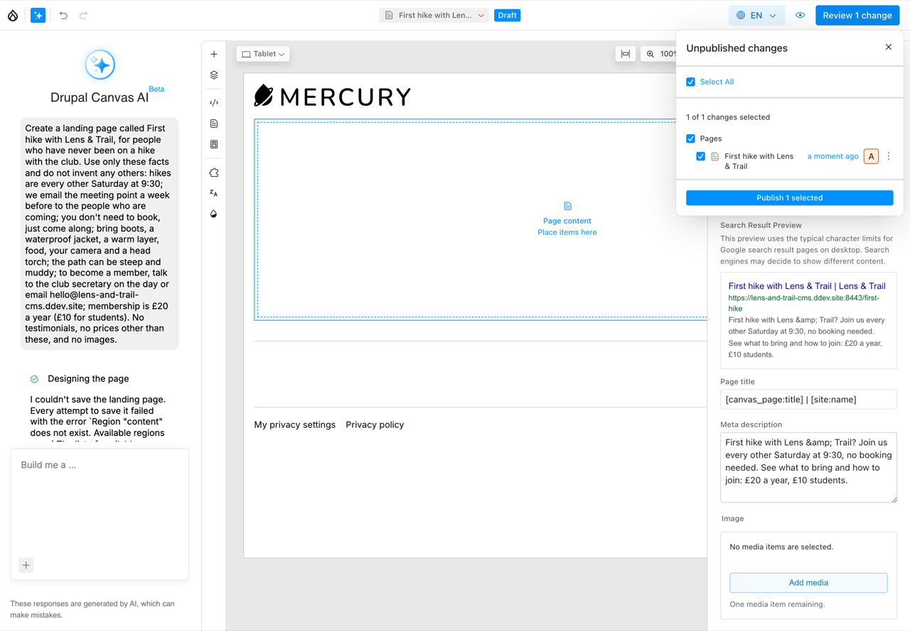
*Figure 19.15: Publish only the page you've reviewed*

The first page, with the invented times and people, is still a draft. Delete it at **Content** > **Pages**, so nobody publishes it by accident.

## A first draft in Spanish: Canvas Translate AI

In Chapter 18, we translated How to join into Spanish in Canvas Translate, field by field. Canvas Translate has an AI submodule, **Canvas Translate AI**, which suggests the translations, and the new beginners' page is a good place to try it.

1. Go to **Extend**, find **Canvas Translate AI**, check it, and select **Install**. It uses the AI module's provider for translations, or, if there isn't one, the chat model, so amazee.ai works with nothing more to set up.
2. Go to the Canvas Translate dashboard (Chapter 18), and select *First hike with Lens & Trail*.
3. Select **AI translate empty**.

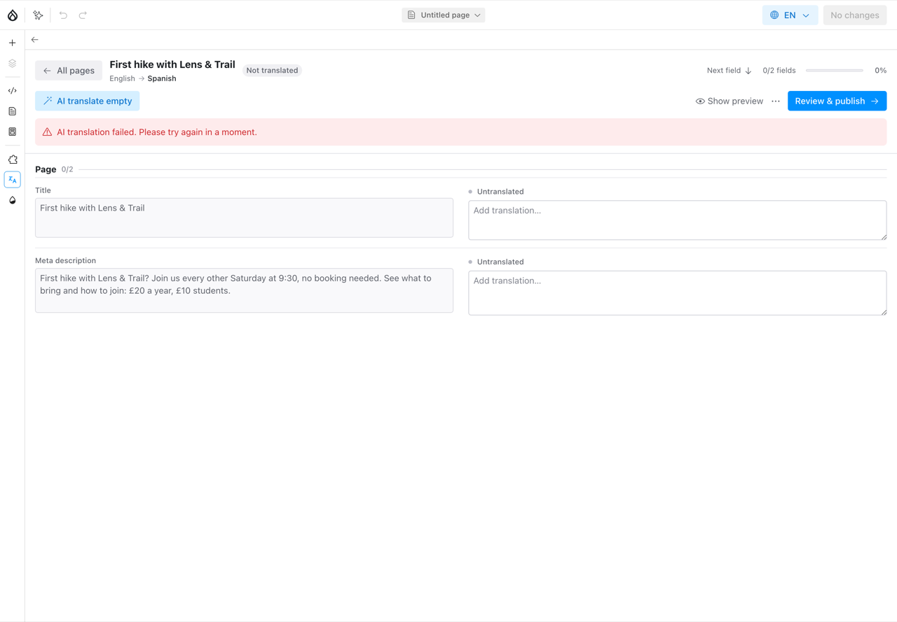
*Figure 19.16: Spanish suggestions for every empty field*

The button fills every *empty* translation field. It never overwrites a translation someone has already written, so it's safe to press on a half-translated page. And it only suggests: the suggestions are saved as a draft, and nothing reaches visitors until someone selects **Review & publish**. That someone is Lucía, and her review is the real translation work:

- **Tone.** In Chapter 18 we chose "tú", a neutral, friendly Spanish. The AI translates each field on its own, and on our page it switched between the two: "Únete a una caminata" and "ven" in one place, "simplemente venga", "lleve su cámara" and "hable con el secretario" in another. Make every field "tú".
- **Names.** "Lens & Trail" stays in English; so do the names of hills. Check that the AI didn't translate them. And check the ampersand: even with "&" fixed in the English, our Spanish came back as `Lens &amp; Trail` in the title, the meta description and the heading, the same mistake as in Canvas AI.
- **Club words.** The AI picks a word for each field, and not always the same one. Our page had "caminata" in one place and "excursión" in the next, and membership was "membresía", "afiliación" and "hacerse socio". Chapter 18 chose "excursión" for a hike. Consistency is the translator's job.
- **Things that aren't text.** Canvas Translate shows every text a component has, including some that visitors never read, and the AI translates those too. Ours turned the icon names `calendar-blank` and `envelope-simple` into `calendario-vacío` and `sobre-simple`, which would leave the Spanish page without icons. Put the English back in fields like these, and in links and email addresses.
- **Read it aloud.** A machine translation is often correct, word by word, and still not how anyone would say it.

So the AI does the typing, and Lucía does the translating. On a page with fifty-odd fields, that saves most of the typing, and that's a fair description of what AI can do for a translator.

## What it can't do

After a chapter of reviewing, it's worth saying plainly where AI stops.

- **It doesn't know your facts.** It knows what's usual. Anything specific to your club (times, prices, places, people, decisions) has to come from you, and if you leave a gap, it fills it with something plausible.
- **It doesn't know when it's wrong.** It writes invented facts in the same confident voice as true ones, and its account of what it did isn't always what it did.
- **It doesn't decide.** Should places be tags or Areas? Should anyone be allowed to create tags? Should the club send members' photos to an AI service at all? Those are site-building decisions, the kind this whole book is about, and they're yours.
- **It doesn't do the same thing twice.** Ask again and you get a different answer. That's fine for a first draft, and it means you can't skip the review because "it worked last time".
- **It isn't free, and it isn't private.** Every request costs a little, and every request sends something to someone else's computer.

What's left is a lot: a fast first draft of tags, fields, descriptions, pages and translations, from someone who never gets bored. Used that way, as the start of the work and not the end of it, it's a good assistant.

How we used AI for this book is in the Preface, under "How this book was made": for checking and for the dull parts of maintenance, with people deciding what the book says, and reviewing everything. It's the same rule as for the club's site.

## Coming from WordPress?

WordPress has an official AI plugin, called **AI**, made by the WordPress Core AI team. It isn't part of WordPress itself, as its own description says, and the same goes for Drupal: in both, AI is an add-on. The WordPress plugin offers alt text, titles, excerpts, meta descriptions, summaries and translation, most of them as experiments you switch on one by one, and it needs your own API key from a provider such as OpenAI, Google or Anthropic. Drupal CMS's AI Assistant does many of the same writing jobs; what it adds is the assistant that changes the site's structure (vocabularies, fields) and the page builder in Canvas. If you know the WordPress plugin, the ideas are the same: a provider, a key, a bill, and a review.

## Beyond the AI Assistant

The AI Assistant recipe is a starting point. Two parts of the AI ecosystem are worth knowing about, even if the club doesn't need them yet:

- **AI Automators**, a submodule of the AI module, fills in a field from other fields, automatically, on save: a summary from the body, tags from a description, alt text from an image, a translation. It's powerful, and it's exactly the kind of feature where the review gets forgotten, and the bill grows with every save. Use it where a person still looks at the result.
- **MCP**, the *Model Context Protocol*, is a standard way for AI tools outside your site to use it: an AI assistant on your own computer, say, that can read your site's content types or create content, with the permissions of the account it uses. The **MCP Server** module provides it. It's new, and when we wrote this it had no stable release yet, so it's one to watch, not to put on a club's live site.

## Summary

You can now:

- explain what an AI provider, a model, a token and an agent are, and what AI costs and where your data goes;
- install the AI Assistant on Drupal CMS, and find your way around the AI dashboard;
- ask the assistant to add terms and fields, and check its work on the site, not in its answer;
- generate alternative text for photos, and add what only you know;
- build a page with Canvas AI, give it the facts it needs, and find what it invented;
- get Spanish suggestions from Canvas Translate AI, and know what a translator still has to check;
- say what AI can't do for a site builder, and why every result needs a person.

## Exercises

1. Rename the tags the assistant made so they follow one rule for capitals and plurals, and delete the ones the club doesn't need. Then ask the assistant to add five more tags, telling it your rule. Did it follow it?
2. Generate alternative text for three more photos from `examples/photos/`. For each one, write down what you changed, and why. Which of your changes could a better prompt in the AI Image Alt Text settings have made?
3. Ask the assistant a question about the site, not a task, such as "Which fields does the Basic page content type have?". Check its answer on **Manage fields**. Was it right?
4. Ask Canvas AI to change one part of the beginners' page, such as "Make the What to bring section shorter". What else did it change? (Look at **Review changes** before you publish.)
5. Write the club's AI policy: three or four sentences for the privacy page (Chapter 14) that say which AI service the club uses, what it sends there, and that a person checks everything. Would you send members' photos? Why, or why not?

## Want to know more?

- [AI in Drupal CMS 2.0: practical tools you can use from day one](https://www.drupal.org/blog/ai-in-drupal-cms-20-practical-tools-you-can-use-from-day-one), on the drupal.org blog.
- The [AI module](https://www.drupal.org/project/ai), with its documentation, and the [Drupal CMS AI recipe](https://www.drupal.org/project/drupal_cms_ai).
- [amazee.ai's provider module](https://www.drupal.org/project/ai_provider_amazeeio), with its trial and its regions.
- [Canvas](https://www.drupal.org/project/canvas) and [Canvas Translate](https://www.drupal.org/project/canvas_translate).
- [MCP Server](https://www.drupal.org/project/mcp_server), for AI tools outside your site.
- For comparison, WordPress's [AI plugin](https://wordpress.org/plugins/ai/).
