# Configuration and Going Live

For twenty chapters we've built Lens & Trail on our own computer, where only we can see it. Sooner or later the club wants it on the internet. And once it's there, the work doesn't stop: next month the hike leaders want a new field, and you'll build it on your own computer first, try it, and only then put it on the live site.

That raises a question we touched on in Chapter 1. When you move your work to the live site, what exactly do you move? Not the test hikes you made up while building. Not the members who signed up on the live site in the meantime. Only the new field, and the settings that go with it. Drupal has a name for those: **configuration**. This chapter is about what configuration is, how Drupal exports it from one copy of a site and imports it into another, and what to watch out for when you do.

We do it all on our own computer, with two copies of the club's site: the one we've built, and a second one that plays the live site. The chapter ends with a checklist for the day the club's site really goes live. Setting up the server itself is a job for your hosting company, or for a developer, and every host does it a little differently, so we leave the details to them and point to where to read more.

We start where Chapter 20 left the club's core site.

## Content or configuration?

Chapter 1 drew the line: content is what the site is about, configuration is how the site works. In practice the line isn't always where you'd guess, so here's how it falls on our site.

**Configuration** is everything a site builder sets up:

- The site's name and slogan, and the settings on every **Configuration** page.
- Content types and their fields, form displays and displays (Chapters 6 to 8).
- Vocabularies (Chapter 10), but not their terms.
- Image styles (Chapter 9), views (Chapters 12 and 13), menus, and which blocks sit in which region (Chapter 14).
- Roles and their permissions, but not the users (Chapter 15).
- The themes and modules that are installed, and their settings.
- The translations of all of these (Chapter 18).

**Content** is everything people make while they use the site:

- Hikes, news, pages, galleries and media.
- Taxonomy terms: the areas and photo themes.
- Users.
- The text of content blocks, such as *Join the club*.
- Links you add to a menu in the browser, such as the club's Main navigation.
- Uploaded files.

The last four surprise everyone the first time. The *Areas* vocabulary is configuration, but *Pentland Hills* is content. The block placement of *Join the club* is configuration, but its text is content. That's not as odd as it sounds: these are things the club's members, the secretary and Morag change all the time, on the live site, and they shouldn't be overwritten by whatever happens to be on your computer.

> **Drupalism:** "Configuration" in Drupal means something narrower than in everyday speech. On the **Configuration** menu you'll find settings pages, and they are configuration, but so is everything under **Structure**, and nothing under **Content**. When a Drupal developer says "it's in config", they mean it's something you can export to a file, as below.

## Where configuration lives

While the site runs, its configuration is in the database, like everything else. Drupal calls that the **active configuration**. To move it, Drupal writes it out as files: one small text file for each item, in a format called **YAML**, which is made to be readable by people as well as computers.

Let's look at one. Go to **Configuration** > **Development** > **Configuration synchronization** (`/admin/config/development/configuration`), select the **Export** tab, and then **Single item**. Choose **Content type** as the **Configuration type**, and **hike (Hike)** as the **Configuration name**.

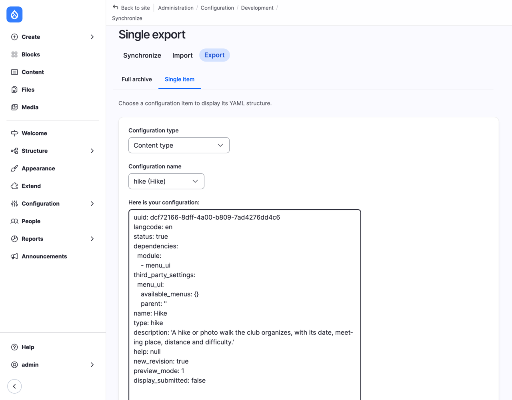
*Figure 21.1: The Hike content type, as configuration*

That's our Hike content type, as Drupal stores it: its name, its machine name (`type: hike`), the description from Chapter 7, and settings such as `display_submitted: false`, which is the **Display author and date information** checkbox we unchecked. Every setting on every form you've filled in ends up in a file like this. The `uuid` at the top is a unique ID, which Drupal uses to know that this is the same Hike on every copy of the site.

### The sync folder

When Drupal imports or exports a whole site's configuration, it uses a folder of these files, the **sync folder** (Drupal's screens call it the *sync directory*). Where the folder is is set in `settings.php`. DDEV sets it for you, to `sites/default/files/sync`, inside the folder of uploaded files. That works, but it puts the site's configuration inside `web/`, where a web server could hand it out to anyone who asks for it. Configuration isn't secret, but it's a map of your site, and there's no reason to publish it. So let's move it next to `web/`, where no visitor can reach it.

> **Try it:**
>
> 1. Open `web/sites/default/settings.php` in your editor, and find this line (it's around line 260):
>
>    ```php
>    # $settings['config_sync_directory'] = '/directory/outside/webroot';
>    ```
>
> 2. Remove the `#` at the start, which turns the line on, and change the folder:
>
>    ```php
>    $settings['config_sync_directory'] = '../config/sync';
>    ```
>
>    The path is counted from `web/`, so `../config/sync` is a folder `config/sync` next to `web/`, in your project folder.
>
> 3. Open the **Status report** (`/admin/reports/status`).

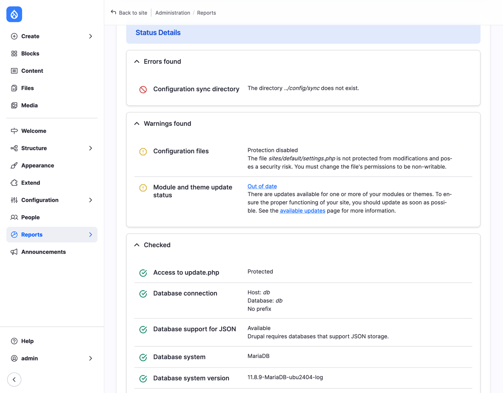
*Figure 21.2: Drupal doesn't make the folder for you*

Drupal doesn't create the folder: make it yourself, in your project folder (not in `web/`):

```bash
mkdir -p config/sync
```

Reload the Status report, and the error is gone.

> **Note:** `settings.php` is DDEV's business only at the very end, where it adds its own settings file, `settings.ddev.php`. DDEV only sets the sync folder if `settings.php` hasn't set one, so our line wins.

## A second copy of the site

To practice moving configuration, we need somewhere to move it to. On a real project that's the live site. We make a second copy of the club's site on our own computer, and pretend it's the live one. It's how many teams work anyway: a copy for building, often one for testing, and the live site.

There's one rule: **configuration can only move between copies of the same site**. Every Drupal site gets its own ID when it's installed, the *site UUID*, and Drupal refuses to import configuration from a site with a different one: "The staged configuration cannot be imported, because it originates from a different site than this site." Two sites that you installed separately are two different sites, even if you set them up in exactly the same way. So the second copy has to be a copy, not a new install.

> **Try it:** Make the copy. In the folder that holds your project (for us, `~/websites/open-university`):
>
> ```bash
> cp -R lens-and-trail lens-and-trail-live
> cd lens-and-trail-live
> ddev config --project-name=lens-and-trail-live
> ddev start
> ```
>
> `cp -R` copies the whole project: the code, `settings.php`, and the uploaded files. `ddev config` gives the copy a name of its own, so it gets its own address, `https://lens-and-trail-live.ddev.site`. The copy has an empty database, so copy the database across:
>
> ```bash
> cd ../lens-and-trail
> ddev export-db --file=../lens-and-trail.sql.gz
> cd ../lens-and-trail-live
> ddev import-db --file=../lens-and-trail.sql.gz
> ```
>
> Open `https://lens-and-trail-live.ddev.site` and log in: it's the club's site, with the same hikes and the same users. If you copied the project with `config/sync` in it, empty the copy's `config/sync` folder, so the live copy starts clean.

From now on we call them **the club's site** (the one we build on) and **the live copy**. To tell them apart in the browser, look at the address.

> **Note:** This is also how you get a copy of a real live site onto your computer: the database, the code from Git, and, if you need them, the uploaded files. Our workshop's advice still holds: the database and the code are all you need to get going, and the uploaded files are the biggest part. The **Stage File Proxy** module fetches each image from the live site the first time a page needs it, so you don't have to copy them all.

## Moving a change

Now the real thing. The hike leaders want to show how much climbing each hike has.

> **Try it:** On **the club's site**, add a field to Hike, as in Chapter 7: **Number**, **Integer**, label `Elevation gain`, with **Minimum** `0` and **Suffix** ` m` (with a space before the `m`). Leave it at that for now; Chapter 7 showed where to place it on the form and the display.

### Export

1. Still on the club's site, go to **Configuration** > **Development** > **Configuration synchronization**, select **Export**, and stay on **Full archive**.

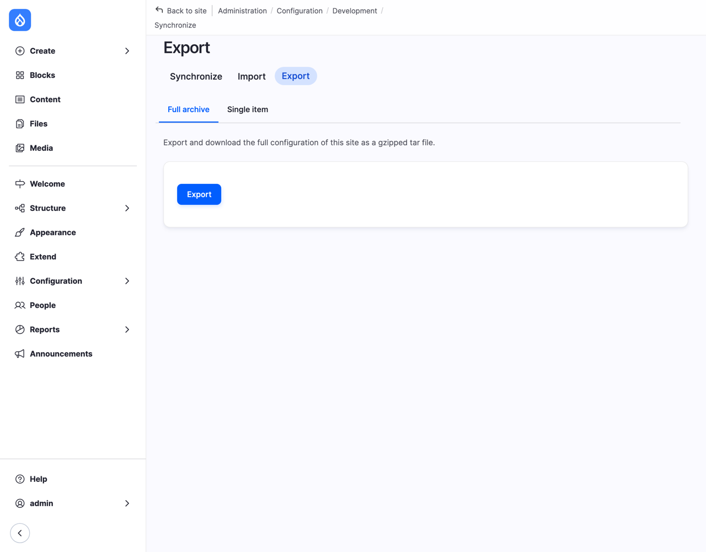
*Figure 21.3: Exporting the whole configuration*

2. Select **Export**. Your browser downloads a file with a name like `config-lens-and-trail-ddev-site_8443-2026-11-07-16-48.tar.gz`: an archive of every configuration file of the site, about 400 of them on ours.

The archive is all of the configuration, not only what you changed. You don't have to keep track of what changed: Drupal works that out on the other side.

### Import

1. On **the live copy**, go to the same page, select **Import**, and stay on **Full archive**.
2. Choose the archive you downloaded, and select **Upload**.

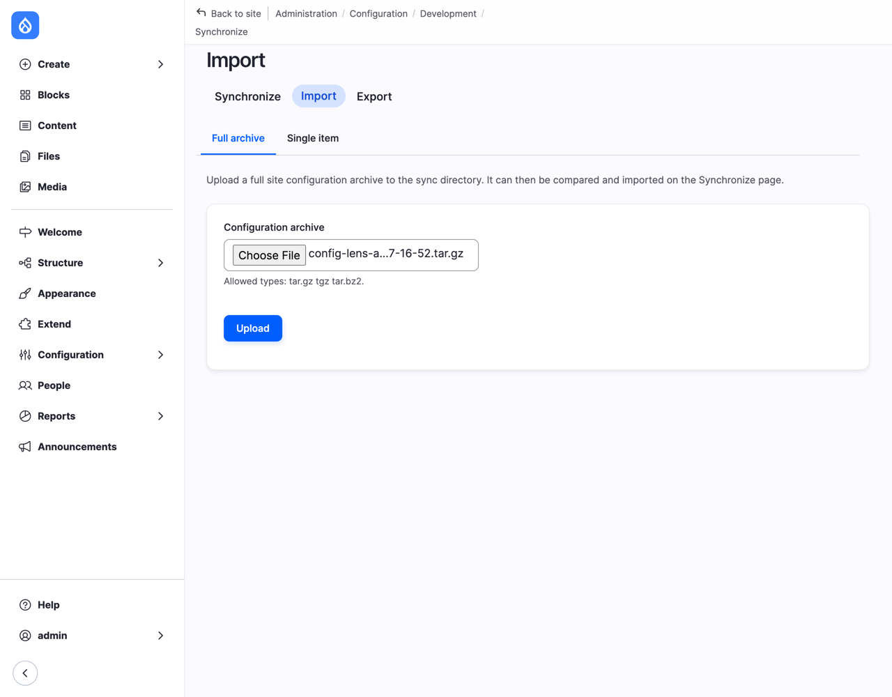
*Figure 21.4: Uploading the archive on the live copy*

Nothing has changed yet. Drupal has unpacked the archive into the live copy's sync folder, and now shows you how it differs from what the live copy has:

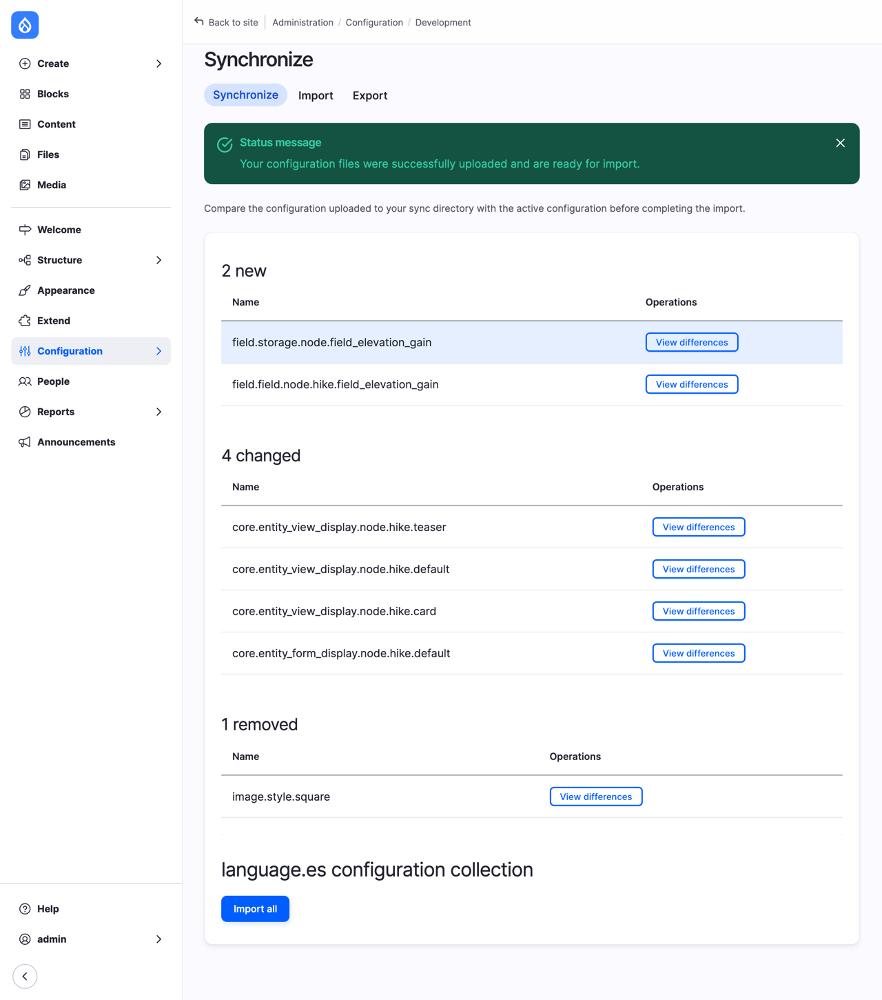
*Figure 21.5: What the import would change*

Read this page every time. It's sorted into what's **new**, what's **changed**, and what would be **removed**:

- **2 new**: the Elevation gain field. A field is two items in configuration: its **storage** (`field.storage.node.field_elevation_gain`: the kind of data, an integer), and the field on Hike (`field.field.node.hike.field_elevation_gain`: the label, the minimum, the suffix). The same storage can be re-used on another content type, which is why they're separate (Chapter 7).
- **4 changed**: Hike's form display and three of its displays, because Drupal added the new field to each of them.
- **1 removed**: an image style called *Square*. We didn't make that.

**View differences** shows exactly what would change, line by line, with the live copy's version (**Active**) on the left and the archive's (**Staged**) on the right:

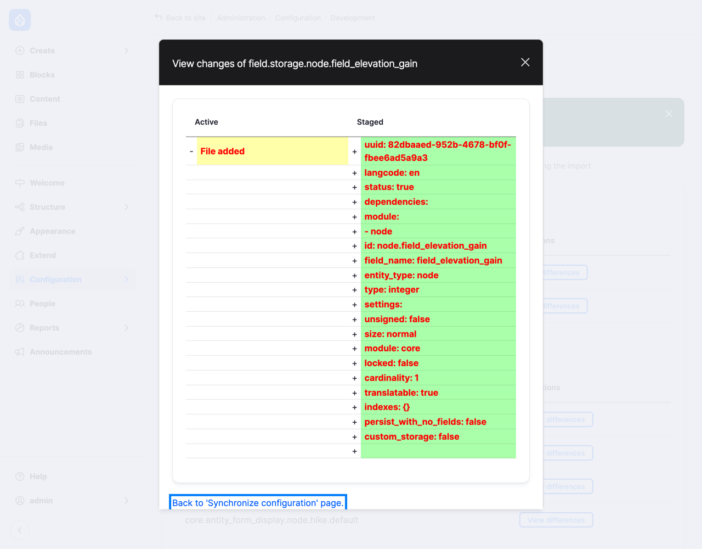
*Figure 21.6: The differences for one item*

### The import removes what isn't in the archive

So where does the image style come from? While we were adding the field, Morag made a *Square* image style directly on the live site, for the club's social media posts. It isn't on our computer, so it isn't in the archive. And an import makes the site's configuration **exactly** what's in the archive: what's new is added, what's changed is changed, and what isn't there is deleted.

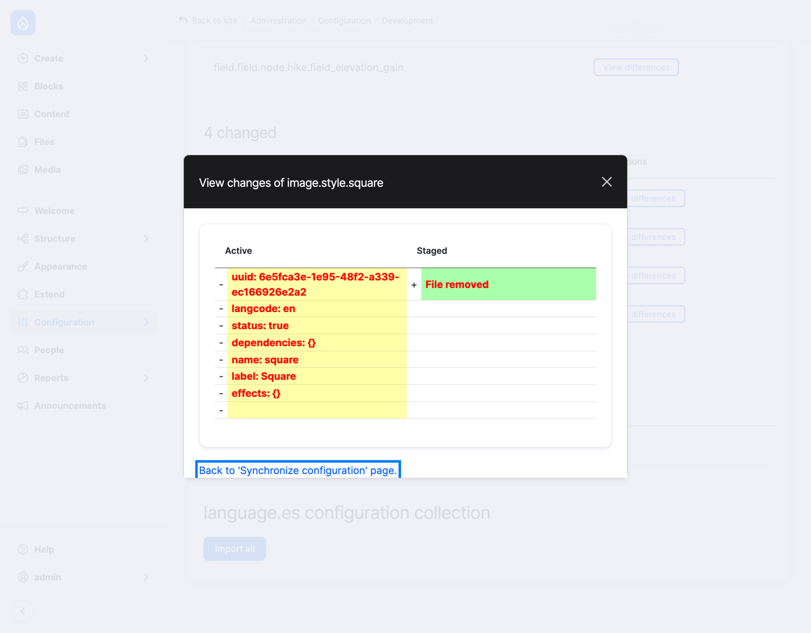
*Figure 21.7: Morag's image style would be deleted*

This is the one thing to remember from this chapter. **Configuration flows one way**: from your computer to the live site. If someone changes configuration directly on the live site, the next import undoes it. Content isn't touched (the hikes, the members and the news that people added on the live site stay), but every setting, view, field and image style that was made on the live site and not on your computer disappears.

Teams handle this with a simple rule: nobody changes configuration on the live site. On a small club site, where Morag has every right to make an image style, there's a second rule: before you import, look at **removed**, and if something is there that you didn't expect, stop. Get it into your own copy first (Exercise 6 shows how), export again, and then import.

For our practice, it's fine to lose the *Square* style.

3. Select **Import all**. Drupal imports the configuration, and reports "The configuration was imported successfully." The page now says "The staged configuration is identical to the active configuration": the two copies agree.

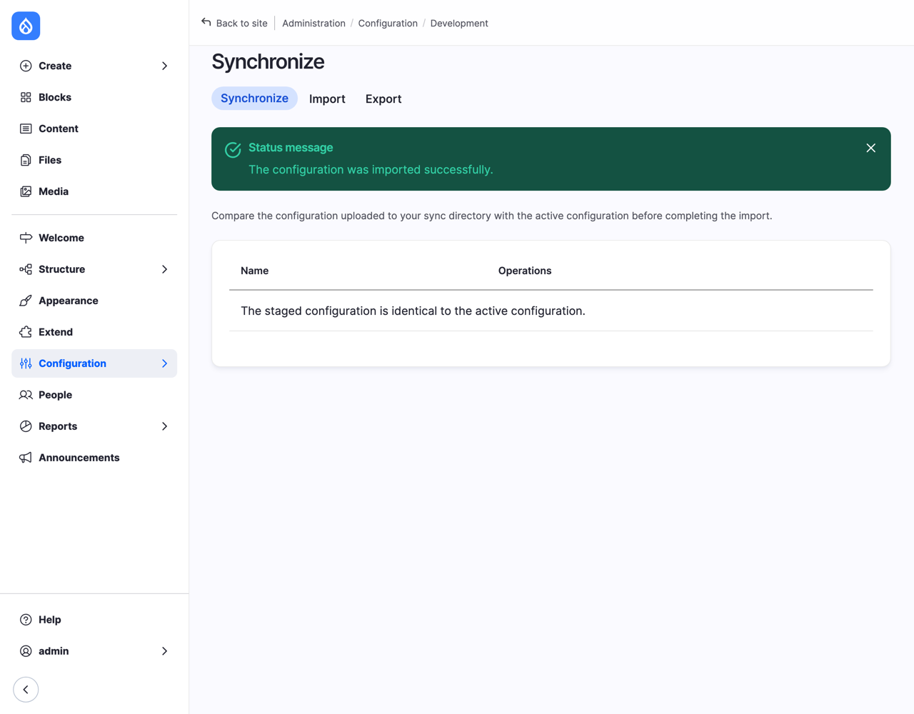
*Figure 21.8: The two copies agree*

On the live copy, go to **Structure** > **Content types** > **Hike** > **Manage fields**: Elevation gain is there.

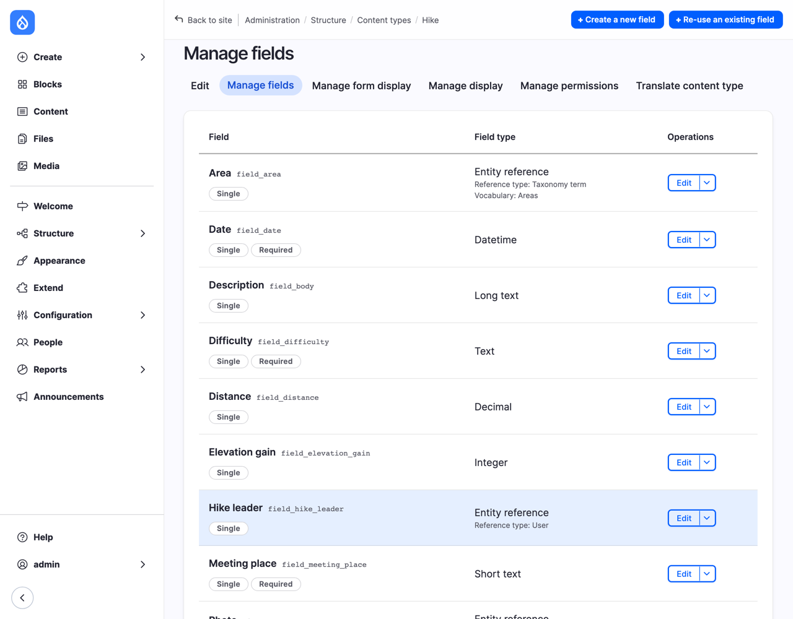
*Figure 21.9: The new field, on the live copy*

The live copy's hikes are all still there, and none of them has an elevation gain yet: the field arrived, the content didn't. A hike leader fills in the numbers on the live site, as content.

> **Note:** Under **Import** and **Export** there's also **Single item**, which moves one item: paste the YAML from **Single export** on one site into **Single import** on the other. It's handy for small things, but it doesn't bring along what the item depends on: a view of hikes that shows the Elevation gain field can only be imported where the field already exists. For anything bigger than one item, use the full archive.

### The language collection

At the bottom of the Synchronize page you may have noticed **language.es configuration collection**. That's the Spanish translations of the configuration, from Chapter 18: the Spanish name of the site, the labels of fields, the titles of views. They're exported and imported with everything else, kept in a folder of their own, `language/es`. If a Spanish label had changed, it would be listed there.

## What shouldn't move

Moving all configuration is what you want almost always. Two things are the exception.

### Secrets

API keys, passwords for mail services, and the like are often settings, so they end up in configuration, and in every export. On a team, the exported configuration goes into Git, where everyone who can read the code can read it too. Chapter 19's AI provider key was encrypted for that reason, with the private key in a file that never leaves the server.

The usual answer is to keep the real value out of configuration, and give it to the site on each server separately: in `settings.php`, which can override any configuration value (it's not exported), or in an **environment variable**, a setting of the server itself, which `settings.php` or the Key module reads. Your hosting company will tell you which it prefers. What's exported is then harmless, and each copy of the site has its own secret.

### Modules for your computer only

Which modules are installed is configuration too (it's in an item called `core.extension`). That's mostly what you want: install Pathauto on your computer, export, import, and it's installed on the live site. But Chapter 20 asked you to keep development modules, such as Devel and Upgrade Status, off the live site. If they're installed on your computer when you export, the import tries to install them on the live site too, and if their code isn't there (Chapter 11's `require-dev`), it stops with "Unable to install the devel module since it does not exist."

The simple answer is to uninstall development modules before you export. The usual answer on bigger projects is the **Config Split** module, which keeps some configuration (such as "Devel is installed") on your computer only. As we write this, it doesn't have a release for Drupal 12 yet.

> **Under the hood: with Drush and Git**
>
> On a team, nobody downloads and uploads archives. Drush exports the configuration straight into the sync folder, and Git carries it to the live site with the code:
>
> ```bash
> ddev drush config:export        # or: ddev drush cex
> git add config
> git commit -m "Elevation gain on hikes"
> ```
>
> `config:export` writes the active configuration to `config/sync`, one file per item, and deletes the files of items that no longer exist. Git then shows exactly which files changed, and the people on the team can review them like any other change.
>
> On the live server, after the code has arrived:
>
> ```bash
> composer install --no-dev
> drush deploy
> ```
>
> `composer install --no-dev` installs exactly the versions in `composer.lock`, without the `require-dev` list (Chapter 11). `drush deploy` then runs the database updates, imports the configuration, and clears the caches, in the right order. `drush config:import` (or `cim`) on its own imports the configuration, after showing the same list of changes as the Synchronize page, and asks before it goes ahead. How the code gets to the server, and who runs these commands, depends on the host: many run them for you every time you push to Git.

> **On Drupal CMS:** Configuration works the same way: the same pages, the same commands. Recipes (Chapter 11) don't change that. A recipe is a way to *install* configuration; once it's applied, what it made is ordinary configuration, and it's exported like everything else. Two things to know before a Drupal CMS site goes live. Automatic Updates (Chapter 20) needs a server where the site can write to its own code, which doesn't fit with code that only comes from Git, so pick one way of updating. And if you followed Chapter 19, the folder `.easy_encryption/` has the private key for your AI provider's key: it isn't in the configuration, and it must not be in Git, so it has to be put on the live server separately.

## Going live: a checklist

The day the club's site goes on the internet is a good day, and it needs a little preparation. The details depend on the host, so this is a checklist, not a recipe. Go through it with your hosting company's documentation next to you.

### Choosing a host

Drupal runs on most hosting that runs PHP, but not all hosting runs Drupal well. Check:

- **PHP 8.5** or newer for Drupal 12 (Drupal 11 needs PHP 8.3 or newer), with at least 64 MB of memory for PHP, and more in practice (128 or 256 MB is common).
- **A database**: MariaDB 10.11 or newer, MySQL 8.0, PostgreSQL 18, or SQLite 3.45.
- **Composer and a command line** (SSH): Drupal is installed and updated with Composer (Chapters 11 and 20). Hosting where you can only upload files works badly for Drupal today.
- **Git**, ideally, so the code goes to the server the same way every time.
- **Backups** that the host makes, and a way to get one back (Chapter 20).
- **HTTPS** included, and a way to add your own domain.

There are roughly three kinds of host. **Shared hosting** is cheap and you share a server with others; check the list above carefully, since many shared hosts are built for WordPress. A **virtual private server (VPS)** is a server of your own, where you or a developer install and look after everything. **Drupal hosting** is offered by companies that specialize in Drupal: more expensive, but they do much of this chapter for you (Composer, Drush, Git, backups, separate copies for testing). Many of them are members of the Drupal Association, and some support the community with time and money. For a small club with no developer, a Drupal host or a shared host that supports Drupal is the sensible choice.

### Before launch

On the live site, before you tell anyone:

- **Passwords.** Not `12345`. A long password for user 1 and every administrator (Chapter 20).
- **User 1.** If you like, switch user 1's special powers off, as Chapter 15 described: copy `web/sites/default/default.services.yml` to `services.yml` in the same folder, set `security.enable_super_user` in it to `false`, and clear the caches, and make sure an administrator account with the Administrator role exists first.
- **Status report.** No errors, and every warning read (Chapter 20). On a live server, make `settings.php` read-only, and set the **trusted host** setting (`trusted_host_patterns` in `settings.php`) to your domain: the Status report tells you about both.
- **Error messages** to **None** (Chapter 20).
- **Development modules** off: Devel and Upgrade Status, and on many sites Field UI and Views UI too (Chapter 20). Remember that the next import turns on whatever is on in your export.
- **Private files**: if the site has files that not everyone may download (membership forms, say), set up a private files folder outside `web/` (`file_private_path` in `settings.php`).
- **Caching** on: on **Configuration** > **Development** > **Performance** (`/admin/config/development/performance`), the **Browser and proxy cache maximum age** is *no caching* while you build. On the live site, pick a time, such as 15 minutes: visitors' browsers and the host's caches keep pages that long. Leave **Aggregate CSS files** and **Aggregate JavaScript files** on.

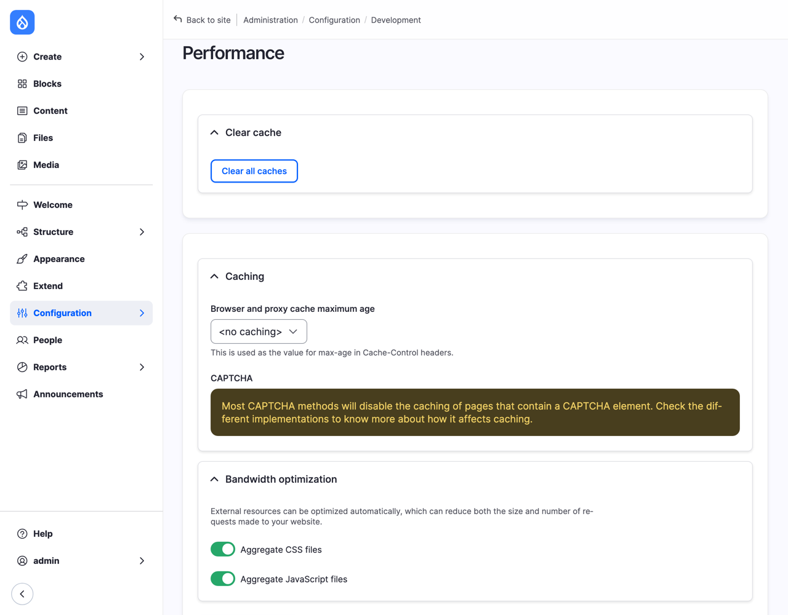
*Figure 21.10: Caching for the live site*

### Domain, HTTPS, email, and cron

Four things that only exist on a real server. Ask the host about each:

- **The domain.** You register a domain (such as `lensandtrail.org`) with a registrar, and point it at the host. Your host tells you what to enter.
- **HTTPS.** Every site needs it, so that passwords and forms travel encrypted, and browsers warn visitors about sites without it. Most hosts give you a free certificate, often from Let's Encrypt, and renew it themselves. Check that `http://` addresses send visitors to `https://`.
- **Email.** Drupal sends email for new accounts, password resets, and the update notifications from Chapter 20. On your computer, DDEV caught it all. On a live server, test it: reset a password and see whether the email arrives, and whether it lands in spam. If it doesn't arrive, the usual answer is to send it through a mail service (SMTP). Your host tells you which, and the setting goes in `settings.php` or a contributed module.
- **Cron.** Drupal has jobs that run every now and then: checking for updates, cleaning up, indexing. Out of the box, **Automated Cron** runs them every three hours, when someone visits the site. On a live site it's better to have the server start them on a schedule. **Configuration** > **System** > **Cron** (`/admin/config/system/cron`) shows the address that starts cron from outside the site: give it to the host's scheduled tasks, or ask them to run `drush cron`, every hour or so. Keep that address to yourself: anyone who has it can start cron.

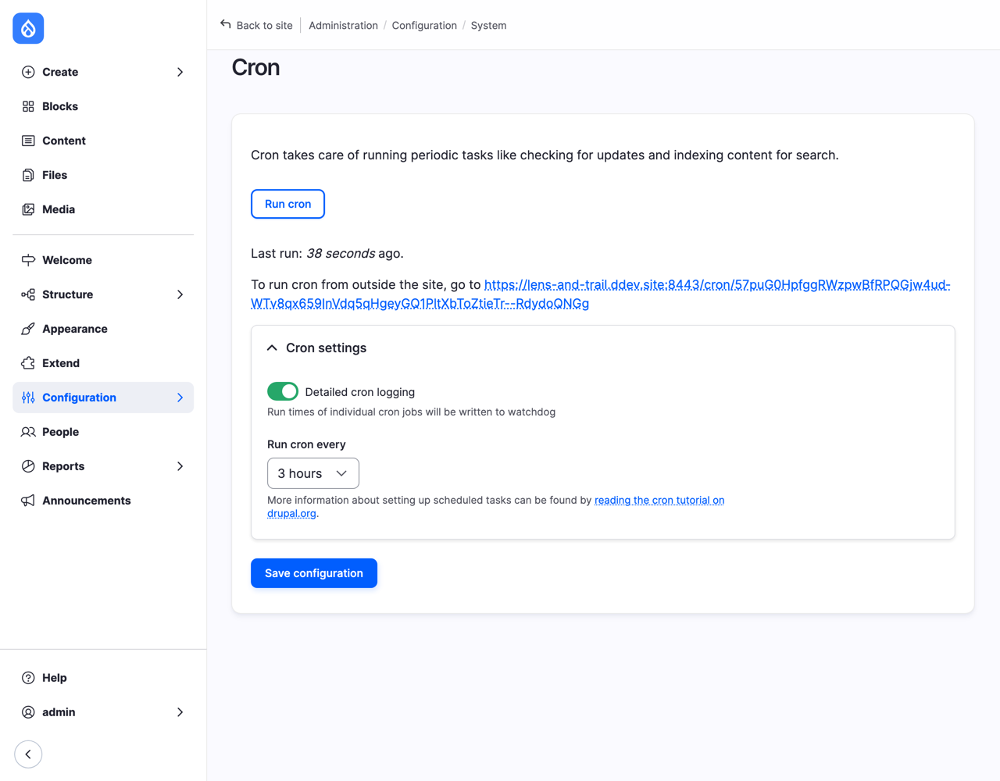
*Figure 21.11: Cron, and the address to run it from outside*

### After launch

The first week:

- **Backups are running**, and you've restored one, somewhere safe, to see that it works (Chapter 20).
- **Update emails arrive** at the addresses you gave (Chapter 20).
- **Search engines know**: the sitemap from Chapter 17 is at `/sitemap.xml`; submit it in the search engines' tools for site owners, such as Google Search Console.
- **The live site is the master of content, your computer of configuration.** From now on, new configuration is made on your computer, and moves to the live site by export and import. When you need fresh content on your computer, copy the live database down.

## Coming from WordPress?

WordPress has no configuration export in core. Settings and content live together in the database, and moving changes from a test site to a live one usually means doing them again by hand, or copying the whole database, or using a plugin. Drupal's line between content and configuration is one of the things developers like most about it, once they've got used to it. It also means that the question "can I copy my test site over the live one?" has a better answer in Drupal: move the configuration, and leave the content alone.

## Summary

In this chapter you learned:

- What configuration is, and what isn't: terms, menu links, block text, users and files are content.
- What a configuration item looks like, as YAML, with Single export.
- How to set the sync folder outside the web folder.
- How to make a second copy of a site with DDEV, and why configuration only moves between copies of the same site.
- How to export the configuration on one copy and import it on another, and how to read the Synchronize page before you import.
- That an import removes configuration that isn't in the export, so configuration flows one way, from your computer to the live site.
- How secrets and development modules are kept out of the way.
- What to check before, during, and after a site goes live.

## Exercises

1. With **Single export**, look at the configuration of the *Hikes* view (Chapter 12). Find the number of items per page, and the filter that only shows upcoming hikes. Change the number of items in the view's settings, and look again.
2. On the club's site, change something small: the help text of the Elevation gain field, say. Export, upload the archive on the live copy, and read the Synchronize page before you import. How many items changed? Then import.
3. On the live copy, add a hike. On the club's site, add a news item. Move the configuration from the club's site to the live copy again. Is the hike still on the live copy? Did the news item arrive? Why, in both cases?
4. Content or configuration? Decide for each, then check with **Single export** (if it's there, it's configuration): a new photo theme term; a new vocabulary; the *Join us* link in the Main navigation; the Main navigation menu itself; the placement of the *Next hikes* block; the text of the *Join the club* block; the Hike leader role; Jordi's account; the site's slogan; the Spanish name of the site.
5. Fill in the going-live checklist for the club: pick a host you could use (look at what it offers on its website), and write down, for every point, whether it's covered and how.
6. *(challenge)* Morag made the *Square* image style on the live site again. Get it onto the club's site without losing it: export it with **Single export** on the live copy, and import it with **Single import** on the club's site. Then do a full export and import, and check that **removed** is empty this time.

## Want to know more?

- [Managing your site's configuration](https://www.drupal.org/docs/administering-a-drupal-site/configuration-management), in the drupal.org documentation.
- Drupal's [system requirements](https://www.drupal.org/docs/getting-started/system-requirements): PHP, databases, web servers.
- [Drush's deploy command](https://www.drush.org/latest/deploycommand/), for those who deploy from the command line.
- [Config Split](https://www.drupal.org/project/config_split) and [Stage File Proxy](https://www.drupal.org/project/stage_file_proxy).
- [Let's Encrypt](https://letsencrypt.org/), the free certificates most hosts use for HTTPS.
- [Drupal web hosting](https://www.drupal.org/association/supporters/hosting), drupal.org's list of hosts that support the Drupal community (a list, not a recommendation).
