# Search

A visitor lands on the club's site with one thing in mind: "that walk by the reservoir". She doesn't know it's called *Glencorse Reservoir winter loop*, and she doesn't know whether it's under Hikes, the hike archive, or an album. She looks for a search box. Lens & Trail doesn't have one.

This chapter gives it one, and a good one. We start with what a search actually does, and why it doesn't look through every page each time someone types a word. We try Drupal's old Search module, which used to come with Drupal core, and see where it falls short. Then we build the search the club deserves with **Search API**: an index of the club's content in a database, a search page as a view, in English and Spanish, a search box on every page, and suggestions while you type. On Drupal CMS, a recipe does most of this for you, and we add *facets*, the lists of choices next to the results that let a visitor narrow them down. And we look at the bigger search engines that large sites use. (A search that understands what you *mean* gets a chapter of its own, the next one.)

We start where Chapter 21 left the club's site: two languages, hikes, albums, news and pages, the views from Chapters 12 and 13, and the roles from Chapter 15.

## What a search does

Imagine finding every page about reservoirs in a printed book. You could read it from the first page to the last, which works for a leaflet and not for a book. Or you could turn to the index at the back, where someone has listed every important word, in alphabetical order, with the pages it appears on. Search engines do the second. Before anyone searches, they read every page once and write an *index*: a list of words, and for each word, the pages it's on. A search looks the words up in the index, which is fast however big the site is.

Writing a useful index takes more than listing words. A visitor who types "reservoirs" wants the page that says "reservoir". "Photo" should find "photos", "Glencorse" should find "glencorse", and "como" should find "Cómo unirse", the Spanish *How to join* page, accent or no accent. So when a search engine indexes a page, it first *processes* the text:

- It splits the text into words (*tokenizing*).
- It turns every word into lowercase, so the case doesn't matter.
- It turns letters such as "ó" or "ñ" into plain "o" and "n" (*transliteration*).
- It cuts words down to their stem: "reservoirs" and "reservoir" both become "reservoir", "walking" and "walked" become "walk" (*stemming*).

It does the same to whatever the visitor types, so both sides meet in the middle. Then it *ranks* the results: a page with the word in its title, or with the word five times, comes before a page that mentions it once in passing. The word for how well a page matches is *relevance*.

Keep those steps in mind. Every setting in this chapter is one of them.

> **Drupalism: index.** In Drupal, "index" mostly means this kind of search index, the list of words and where they are. To *index* content is to read it into such a list. You'll also see the word used for database indexes, which speed up looking things up in database tables; that's the same idea, at a lower level, and nothing you need to set up.

## Drupal's old Search module

Until Drupal 11, Drupal core came with a **Search** module. It indexes the site's content in the database during cron, and gives every site a page at `/search/node` and a search block. If you've seen a Drupal 7 or Drupal 8 site with a search box, it was probably this.

It was also old, and few people used it beyond small sites. Its index is simple, it searches all languages at once, and it can't be changed much. So the Drupal core team took it out: Drupal 11 marked it as *deprecated*, a warning that it would go, and Drupal 12 doesn't have it. It lives on as a contributed project, also called **Search**, for the sites that still use it.

We tried it on the club's site, so you don't have to. With the contributed Search project downloaded with Composer (`ddev composer require drupal/search`), the Search module and its submodule for content installed, the content indexed, and the permission **Use search** given to visitors (without it, the search page says "Access denied"), it worked. But:

- **English searches also found the Spanish pages.** The module searches every language at once, and has no setting to change that.
- **"Reservoirs" found nothing.** The module only looks up whole words as they are written. There's no stemming, unless you add a contributed module for it.
- **"Photo" missed "photos".** Same reason.
- **There's nothing to choose.** The results page is fixed: no filters for hikes only, or for the Pentland Hills, no way to say which fields matter more than others, and no say in what each result shows.

None of that is a bug. It's what a simple search was, fifteen years ago. Visitors today expect more, and Drupal has a better tool for it. We uninstalled the module, and removed it with `ddev composer remove drupal/search`.

## Search API: the parts

**Search API** is a contributed module, and it's what nearly every Drupal site with a serious search uses. It splits a search into parts, which you can change one at a time:

- A **server** is where the index lives, and the **backend** is the kind of server: the site's own database, or a separate search engine such as Solr (more on those later in this chapter). For the club, the database will do.
- An **index** says *what* goes into the index: which content, which fields of it, and how each field is treated. One server can hold several indexes.
- **Processors** are the processing steps from "What a search does": tokenizing, lowercase, transliteration, stemming, and a few more. You switch them on for each index.
- A **view** shows the results. Search API doesn't make a search page itself: you build one with Views, as you built every list in Chapters 12 and 13, with filters, fields, sorts and a pager. That's where most of the freedom comes from.

The parts are independent. You can move an index from the database to Solr without touching the view, or build three views on one index: a search page, a search box, and a list of the newest matches.

Search API was written by Thomas Seidl (drunken monkey on drupal.org), and has been the standard for search in Drupal since Drupal 7. It works with dozens of other modules, for facets, autocomplete, spelling suggestions and every major search engine, which is why we picked it over the alternatives: there's no other module with that reach.

## Installing Search API

Download Search API with Composer, as in Chapter 11:

```
ddev composer require drupal/search_api
```

> **A note on Drupal 12.** As we write this, Search API's newest release says it supports Drupal 12, but two parts of it don't quite: its pages for managing an index show empty tables, and its **Database Search** module, the backend we need, refuses to install, because its own description file still lists Drupal 10 and 11 only. Both are fixed in Search API's development code, but not yet in a release. Until they are, the club's site uses the fixes as *patches*: small files that change a module's code in a way Composer can repeat every time it installs the module. The two patches are in the book's repository, in `examples/search/patches/`, and **Appendix C, *Patching a Contributed Module***, shows how to add them to your site, step by step. Do that first, then come back here. By the time you read this, a new release of Search API may have made the appendix unnecessary for this chapter; the appendix tells you how to check.

Go to **Extend**, filter on `search`, and check **Search API** and **Database Search**. Leave **Database Search Defaults** alone: it makes a ready-made server, index and view for you, which is handy, but we want to see how the parts fit together, and build them ourselves. Select **Install**.

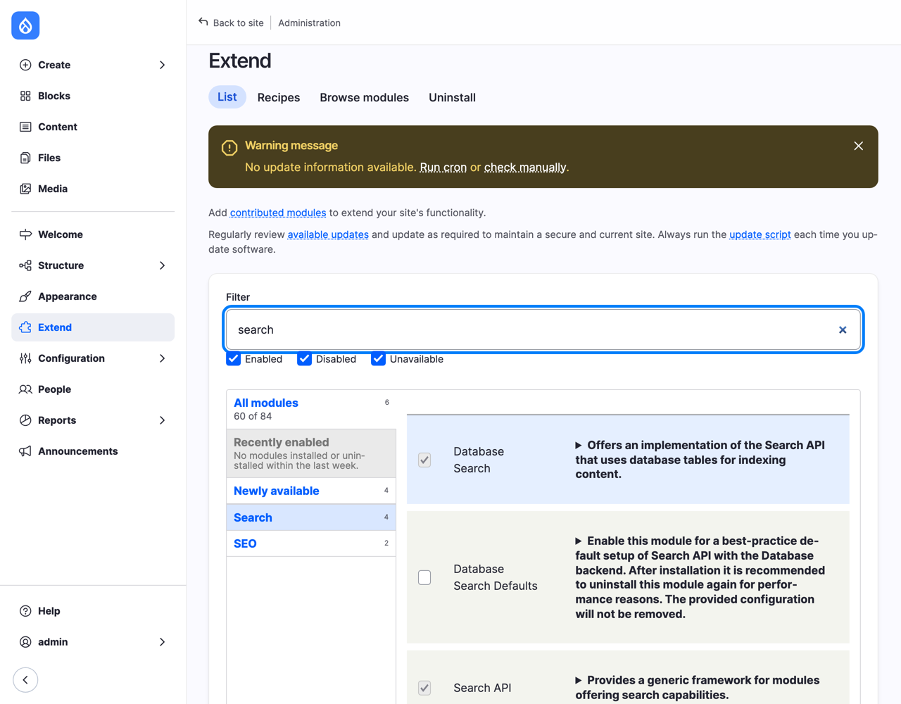
*Figure 22.1: Search API and Database Search on Extend*

Search API's pages are under **Configuration** > **Search and metadata** > **Search API** (`/admin/config/search/search-api`). The page is empty for now, apart from two buttons: **Add server** and **Add index**. The text at the top sums up the difference between them: a server is the engine that stores the index, and an index defines what goes in it.

## A server in the database

Select **Add server**:

1. **Server name**: `Club database`.
2. Under **Backend**, keep **Database**, the only choice for now. Its description is honest: it "supports several advanced features, but should not be used for large sites". The club has a few dozen pages. A large site, in this sense, has tens of thousands.
3. Under **Configure Database backend**, keep **Minimum word length** at **1**, so that even short words like "A9" (a road) are indexed.
4. **Partial matching**: choose **Match words starting with given keywords**.
5. Keep **Phrase indexing** at **Bigram**.
6. Select **Save**.

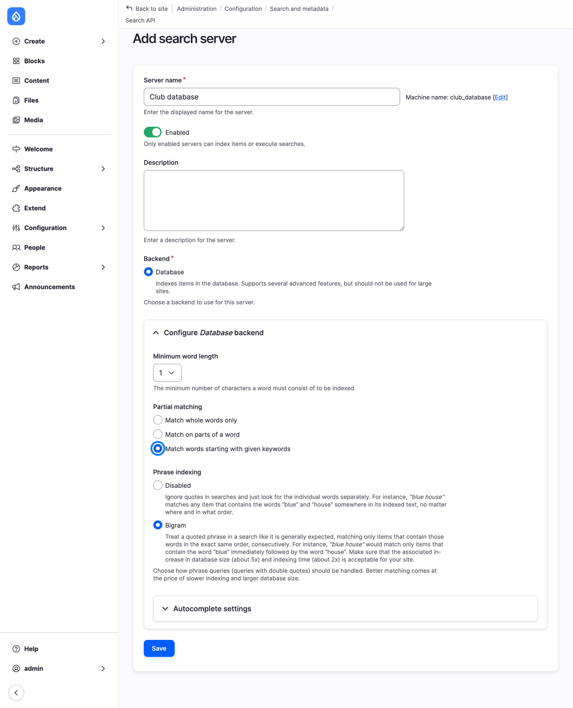
*Figure 22.2: The Club database server*

**Partial matching** decides how much of a word a visitor has to type. **Match whole words only** needs the whole word, "glencorse"; **Match on parts of a word** finds "corse" inside "Glencorse" too, which also finds "horse" in "horseshoe", and makes the index slower. **Match words starting with given keywords** is in between: "glenc" finds "Glencorse", and "photo" finds "photographer". It's the one that suits suggestions while typing, which we add later in the chapter.

**Phrase indexing** is for searches in quotation marks. With **Bigram**, the database stores which words follow which, so that `"winter loop"` finds only pages where the two words come one after the other. It makes the index about five times bigger. For the club's few dozen pages, that's nothing.

## An index of the club's content

Back on the Search API page, select **Add index**:

1. **Index name**: `Club content`.
2. Under **Datasources**, check **Content**. A *datasource* is a kind of thing to index: content (nodes), taxonomy terms, users, media, and so on. The club's visitors look for hikes, albums, news and pages, which are all content.
3. A new section appears, **Configure the Content datasource**. Under **Bundles**, keep **All except those selected**, with none selected: every content type goes in. Under **Languages**, the same: both English and Spanish.
4. Under **Server**, choose **Club database**.
5. Open **Index options**. **Index items immediately** is on: when someone saves a hike, it's indexed straight away, not at the next cron run. Keep it.
6. Select **Save and add fields**.

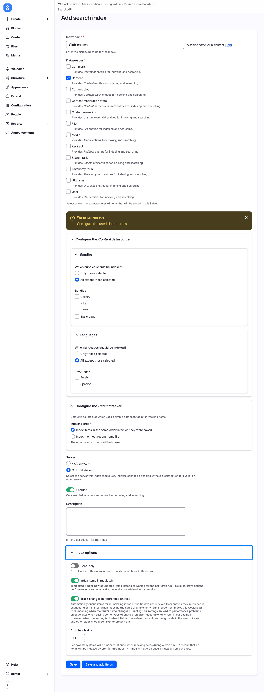
*Figure 22.3: The Club content index*

> **Bundles and languages.** "Bundle" is Drupal's general word for a content type, a vocabulary, a media type: the kinds within an entity type (Chapter 7). "All except those selected" means new content types go into the index automatically, which is usually what you want. If the club ever adds a content type that shouldn't be found (internal notes for the committee, say), come back here and select it.

### Fields: what goes into the index

Search API doesn't guess which fields to index. You choose, and for each field, you choose what it's for. The **Fields** tab is empty; select **Add fields**. The dialog lists everything you can index, in two groups: **General**, for things that apply to any content, and **Content**, the fields of the content types.

Add these, with **Add** next to each, and **Done** at the end:

| Field | Group | Why |
|---|---|---|
| **Rendered HTML output** | General | The page as visitors see it, with all its text, for searching. |
| **Title** | Content | The title on its own, so it can count more. |
| **Content type** | Content | To let visitors look for hikes only. |
| **Area** | Content | To narrow down to the Pentland Hills. |
| **Difficulty** | Content | To find easy hikes. |
| **Date** | Content | For the hikes' dates; more on this later. |

**Rendered HTML output** asks what to render: for each content type, a *view mode* (Chapter 8), and which role to render it as. Keep **Anonymous user** as the role, so the index contains only what a visitor may see. For the view modes, choose **Default** for every content type for now; we come back to it in a moment.

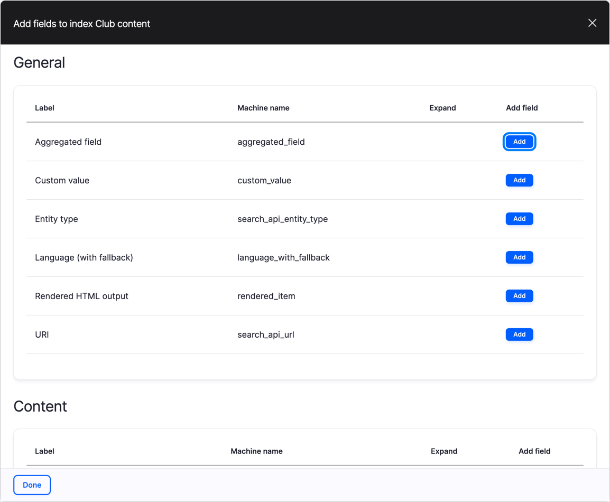
*Figure 22.4: The Add fields dialog*

Now set each field's **Type** in the table:

- **Rendered HTML output** and **Title**: **Fulltext**. Full text is text to search in: it's split into words, processed, and ranked.
- **Content type** and **Difficulty**: **String**. A string is a value to match exactly, "hike" or "easy", the way a filter does. It isn't split into words.
- **Area**: **Integer**, the term's ID. (A reference stores the ID of the term it points to, Chapter 10.)
- **Date**: **Date**.

Then set the **Boost** of **Title** to **5.00**. A *boost* multiplies a field's weight in the ranking: a word in the title now counts five times as much as the same word in the text. Someone who types "Turnhouse" most likely wants the hike with Turnhouse in its title, not the album that mentions it once. Select **Save changes**.

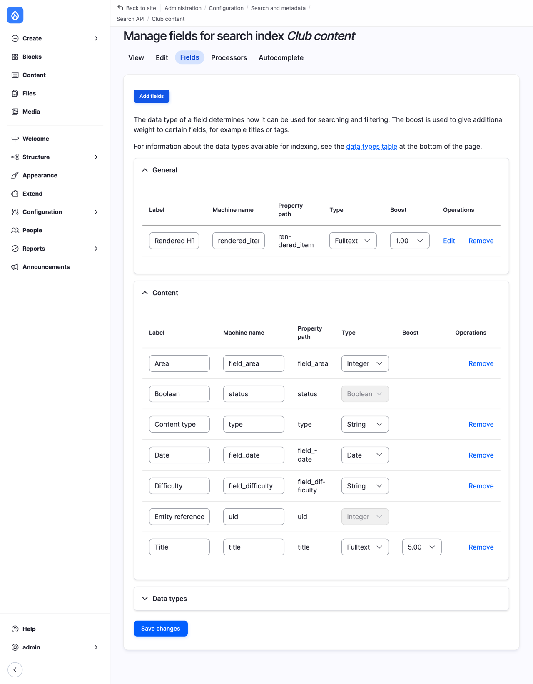
*Figure 22.5: The index's fields, with their types and boosts*

You'll see two more fields in the table that you didn't add, in grey and without a **Remove** button: `status` (labeled **Boolean**: published or not) and `uid` (labeled **Entity reference**: the author). Search API's processors added them, as we see in a moment: they need them to check who may see what.

### Processors

Select the **Processors** tab. Each processor is one step from "What a search does", or a check. Turn these on:

- **Content access**: a result only shows if the visitor may see it, with the same rules as the rest of the site (Chapter 15).
- **Entity status**: unpublished content stays out of the index.
- **Highlight**: shows an *excerpt* with each result, the part of the text where the words were found, with the words in bold.
- **HTML filter**: removes the HTML tags from the rendered page, so `<strong>` isn't a word to search for.
- **Ignore case**: lowercase.
- **Tokenizer**: splitting text into words.
- **Stemmer**: cutting words down to their stem. Its description says it: "Currently, this only acts on English language content."
- **Transliteration**: "ó" becomes "o".

Below the list, **Processor order** shows the order the processors run in, at three moments: when content is indexed (**Preprocess index**), when a visitor's words are processed (**Preprocess query**), and when results come back (**Postprocess query**). The defaults are in a sensible order: transliteration and lowercase before splitting into words, stemming after. Under **Processor settings**, each processor that has settings has a tab: for **Highlight**, check that **Create excerpt** is on. Select **Save**.

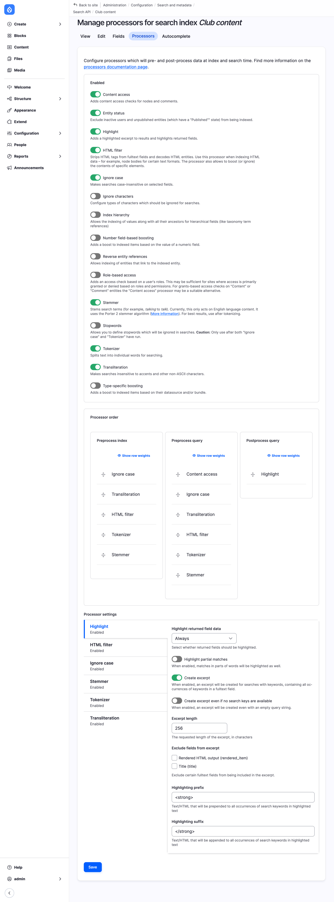
*Figure 22.6: The processors, their order, and Highlight's settings*

> **No stemming in Spanish.** The stemmer only knows English. It's built on the *Porter2* algorithm, a set of rules for English endings ("-ies" to "-y", "-ing" off), and Spanish needs rules of its own ("embalses" to "embalse", "caminatas" to "caminata"). Search API leaves the Spanish pages alone, which is the right thing to do: English rules would damage Spanish words. Thanks to **Match words starting with given keywords**, "embalse" still finds "embalses", because one starts with the other. The other way around, it doesn't. For real Spanish stemming, a search engine such as Solr (later in this chapter) has languages built in.

### Indexing

Back on the **View** tab, the index says **0%** and **0/26 indexed**: it knows about the club's 26 pieces of content, in both languages, but hasn't read them yet. New and changed content is indexed when it's saved, and the rest at cron, 50 items each run. To do it now, select **Index now**.

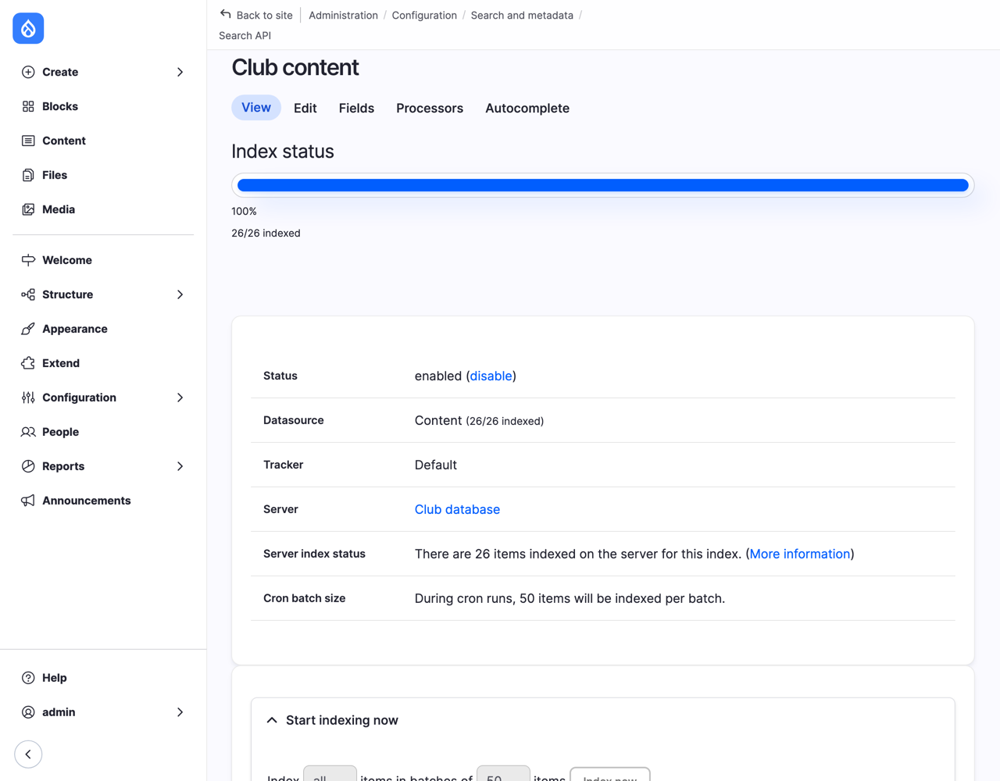
*Figure 22.7: The index after indexing*

> **On the command line.** Drush has Search API commands too, such as `ddev drush search-api:index`. As we write this, that one fails with Drush 14's development version ("The log level "success" does not exist"), so use **Index now**, or let cron do it.

## The search page

Search API has an index; now visitors need a page to search it. Go to **Structure** > **Views** > **Add view**, as in Chapter 12:

1. **View name**: `Search`.
2. **Show**: **Index Club content**. Search API's indexes are a choice of their own here, next to Content, Users and the rest.
3. Check **Create a page**. **Page title**: `Search`. **Path**: `search`.
4. **Display format**: **Unformatted list** of **fields**. **Items to display**: `10`. Check **Use a pager**.
5. Select **Save and edit**.

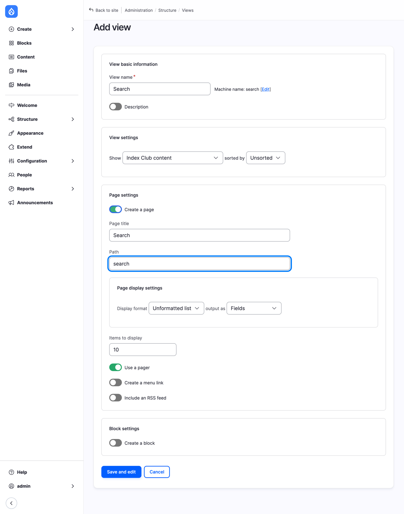
*Figure 22.8: A view of the index*

The view looks like Chapter 12's, with one difference: everything in it comes from the index, not from the database tables. Its fields, filters and sorts are in groups named after where they come from: **Index Club content** for the index's own fields, **Content datasource** for the fields of the content, and **Search** for the parts of the search itself.

### The search box

Under **Filter criteria**, select **Add** and choose **Search: Fulltext search**. This is the filter a visitor types words into:

1. Check **Expose this filter to visitors, to allow them to change it**.
2. **Label**: `Search for`.
3. **Filter identifier**: `keys`, the name of the search words in the address: `/search?keys=reservoir`.
4. **Parse mode**: **Multiple words**: the visitor's words are looked up one by one.
5. Under **Operator**, **Contains all of these words**: a page needs all of them to match.
6. Leave **Searched fields** empty, which means all the full-text fields.
7. Select **Apply**.

A view with no words to search for shows everything, which is a strange search page. Under **Exposed form** (in the right column, under **Advanced**), select **Basic** next to **Exposed form style**, and choose **Input required**. Now the page shows only the search box until the visitor searches. Its **Text on demand** is what shows before that; leave it empty.

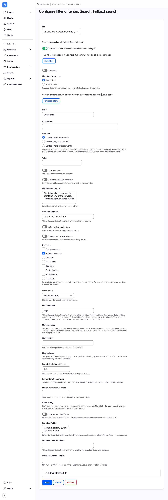
*Figure 22.9: The Fulltext search filter*

### Narrowing down

Add three more filters, exposed the same way: **Content datasource: Content type** (label `Type`), **Content datasource: Area** (label `Area`) and **Content datasource: Difficulty** (label `Difficulty`). A visitor who leaves them at **- Any -** searches everything. (**Allow multiple selections** would let a visitor pick *Easy* and *Moderate* at once; we kept one choice each, which is simpler on a phone.)

The last filter isn't exposed. Add **Index Club content: Item language**, and choose **Interface text language selected for page**. Without it, an English visitor gets the Spanish hikes too, as with the old Search module; with it, each visitor gets the pages in the language they're reading the site in.

### What each result shows

Under **Fields**, Views has added **Rendered HTML output**: the whole page, in each result. Remove it, and add:

1. **Content datasource: Title**, with **Link to the Content item** checked, and no label.
2. **Content datasource: Content type**, no label.
3. **Search: Excerpt**, no label: the text around the words that were found, from the **Highlight** processor.

### The order of the results

Under **Sort criteria**, add **Search: Relevance**, and choose **Sort descending**: the best match first. That's what a search should do by default.

### When nothing is found

Under **No results behavior**, add **Global: Text area**, and write `Nothing found. Try fewer or other words.` Under **Pager**, choose **Mini**: a search with eleven results doesn't need numbered pages.

Save the view, and try it at `/search`: search for `reservoir`.

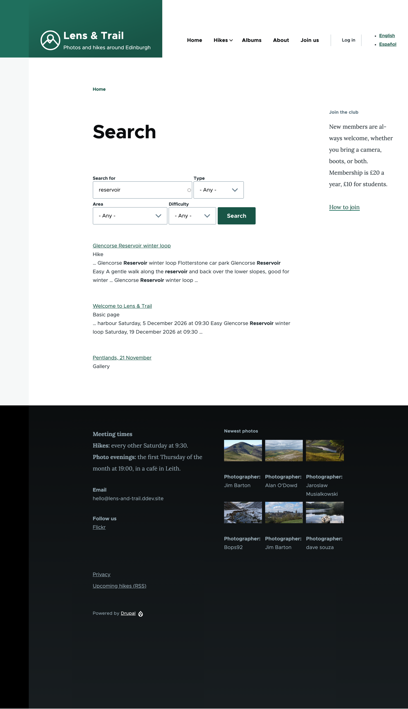
*Figure 22.10: Searching for reservoir*

The Glencorse hike comes first, with "Reservoir" in bold in the excerpt. Now try `reservoirs`: the same pages come back, thanks to the stemmer, which turned your "reservoirs" into "reservoir". But they come back without excerpts. The **Highlight** processor looks for the words you typed, and "reservoirs" isn't in the text; it doesn't know about stems. A search engine such as Solr, later in this chapter, highlights stems too. Try `photos`, which finds the albums, and `glencorse` in lowercase.

> **Try it:** search for `meeting`. Every hike comes back. Why?

### The view mode for the index

The answer is in what the index read. **Rendered HTML output** renders each hike with its **Default** view mode, and the Default view mode shows the field labels: every hike has "Meeting place" on it, so every hike matches "meeting". Labels are for people reading a page, not for an index.

The index should read a version of the hike made for searching: its text, without labels or photos. Drupal has a view mode for that, **Search index**. Go to **Structure** > **Content types** > **Hike** > **Manage display**, open **Custom display settings** at the bottom, check **Search index**, and save. A new tab, **Search index**, appears at the top. On it:

1. Keep **Description**, **Meeting place**, **Area** and **Difficulty**, and set the **Label** of each to **- Hidden -**.
2. Move **Photo**, **Hike leader**, **Date**, **Distance** and **Elevation gain** down to **Disabled**: the photo has no words, and the rest are better as filters than as text.
3. Select **Save**.

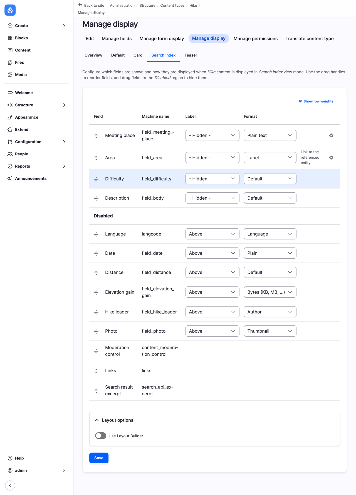
*Figure 22.11: Hike's Search index view mode*

Now tell the index to use it. On the index's **Fields** tab, select **Edit** next to **Rendered HTML output**, and choose **Search index** for **Hike**. Save, and select **Index now** on the **View** tab again: changing what the index reads means reading everything again, and Search API says so, with a message that the index needs to be rebuilt.

Search for `meeting` again. Now only pages that talk about meeting come back.

> **Under the hood: rendered output.** Why index the rendered page at all, rather than the Description field? Because the rendered page has everything a visitor reads, in the right language, whatever fields a content type has: an album's photo captions, a Basic page's text, a hike's meeting place. You don't have to add every text field of every content type, and when Chapter 13's club adds a field, the index picks it up. The price is the one you saw: what's on the page, labels and all, is what gets indexed. A view mode for searching gives you the best of both.

### In Spanish

Switch the site to Spanish, at `/es/search`, and search for `embalse`: *Vuelta invernal al embalse de Glencorse* comes up, and the English hike doesn't. Try `como`, without the accent: *Cómo unirse* is found, thanks to transliteration.

The page itself needs two translations. Its address: Spanish visitors deserve `/es/buscar`. Go to **Configuration** > **Search and metadata** > **URL aliases**, select **Add alias**, and give `/search` the alias `/buscar`, with the language **Spanish**. Redirect (Chapter 17) now sends anyone who opens `/es/search` on to `/es/buscar`. And its words: translate the view, as in Chapter 18, under **Configuration** > **Region and language** > **Configuration translation**: **Views**, **Search**, **Translate**, **Spanish**. The title becomes `Buscar`, the label `Buscar`, the button `Buscar`, and the text for no results `No se encontró nada. Prueba con menos palabras u otras.`

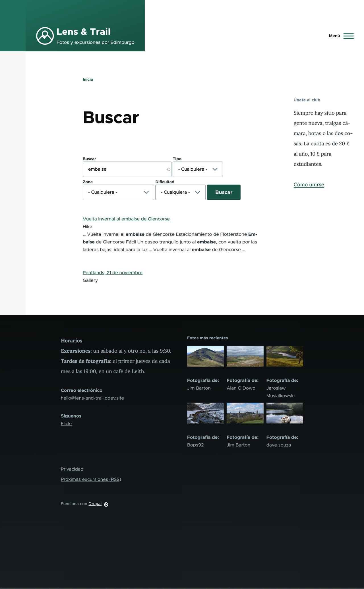
*Figure 22.12: The search page in Spanish*

## A search box on every page

A search page is good; a search box on every page is better. A view can have more than one display (Chapter 13), and a *block* display can show only the exposed form, the box, and send the visitor to the page for the results.

1. On the Search view, select **Add** > **Block**. Its **Block name**: `Search box`.
2. Under **Filter criteria**, select **For: This block (override)**, and remove the Type, Area and Difficulty filters from the block: the box only needs the words.
3. Under **Advanced** > **Other**, set **Link display** to **Page**: the block's form sends the visitor to `/search`.
4. Save the view.

The block shows no results of its own, only the box: the **Input required** exposed form style, which the block shares with the page, shows results only after a search, and a search from the box goes to the page.

Now place it, as in Chapter 14: **Structure** > **Block layout**, **Place block** in Olivero's **Highlighted** region, and choose **Search box** (from the Search view). Title it `Search the club`. Under **Pages**, enter `/search` and choose **Hide for the listed pages**: on the search page itself, a second box would be one too many. Save, and on **Block layout**, drag **Search the club** to the top of the region, above **Status messages**, and select **Save blocks**.

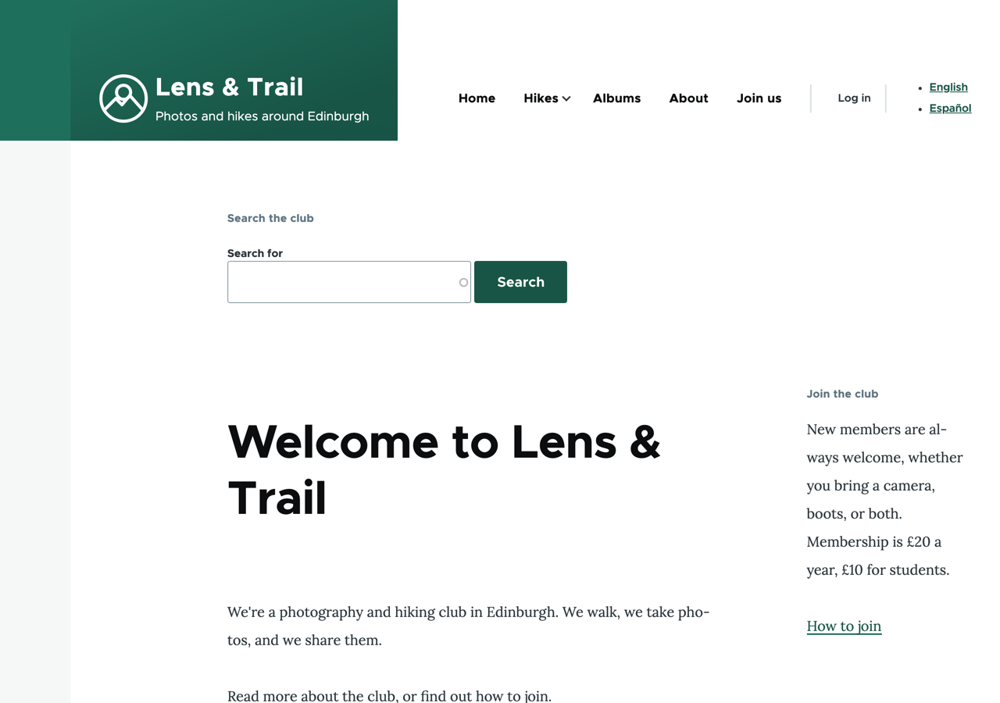
*Figure 22.13: The search box under the header*

Highlighted is the band under the header, where Chapter 14 put the status messages and the tabs. It's on every page, in the same place, and it's as wide as the content, so the box fits, on a phone too.

Why not the header, where most sites have their search box? Because of how Olivero's header works: when its main menu doesn't fit, Olivero folds it into a **Menu** button, and a search box in the header region makes it not fit much sooner. And why not the sidebar, the usual place for an extra block? We tried it, and the box stuck out past the right edge of the page. Olivero shows a search box at its natural width, about 30 characters, which is wider than its sidebar on a computer screen, and nothing in Views or Search API makes a search box narrower. A theme could, with a line of CSS, but Olivero doesn't let you add your own. Highlighted needs no CSS. (*Theming Drupal* puts the box in the header, with a theme made for it.)

> **Try it:** search for `pentland` from the box on the front page. You land on `/search?keys=pentland`, with the results, and the Type, Area and Difficulty filters to narrow them down.

## Suggestions while you type: Search API Autocomplete

Most visitors know search boxes that suggest words as they type, and show the first results before they've finished. **Search API Autocomplete** adds that to any Search API view. It's a separate contributed module, by the same team as Search API.

> **On Drupal 12.** As we write this, Search API Autocomplete has no release for Drupal 12. Its maintainers have the changes it needs in a *merge request*, a proposed change waiting to be accepted, and it works on the club's site with it. Appendix C shows how to install a module like this: Composer's *lenient* plugin lets Composer install it anyway, and the merge request goes in as a patch. If you followed the appendix for Search API, the autocomplete patch is already in the same list.

```
ddev composer require drupal/search_api_autocomplete
```

Install **Search API Autocomplete** on **Extend**. The index has a new tab, **Autocomplete**, which lists the views that search this index. Select **Edit** next to **Search**:

1. Check **Enabled**.
2. Under **Suggester plugins**, check **Display live results** and **Retrieve from server**. The first shows matching pages as you type; the second suggests words from the index, such as "reservoir" when you've typed "reser".
3. Keep **Minimum length of keywords for autocompletion** at **3**: after "res", not after "r".
4. Keep **Display result count estimates** on: each suggested word shows how many pages it would find.
5. Select **Save**.

Visitors need permission to use it: under **People** > **Permissions**, give **Anonymous user** and **Authenticated user** the permission **Use autocomplete for the Search search** (the second "Search" is the view's name).

Type `res` in the search box:

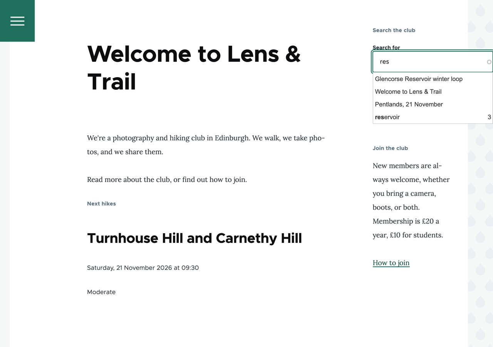
*Figure 22.14: Suggestions while typing*

## Old hikes, and why they stay

Search for `arthur`, and both Arthur's Seat hikes come back: *Arthur's Seat by night*, in January, and *Arthur's Seat at sunrise*, which was in October. Should a past hike be found?

For the club, yes. A past hike is a description of a walk the club does again, and its album has the photos. A new member who searches for "Arthur's Seat" wants to know what it's like, not only when the next one is. And the hike archive from Chapter 13 shows past hikes on purpose.

> **Leaving out past hikes.** If your site does want only what's coming up, there's a catch: you can't leave past hikes out of the *index*. An index is written when content is saved, and it doesn't know what day it is: a hike for next Saturday is in the future when you save it, and in the past a week later, without anyone saving it again. Search API has no way to say "index only what's in the future".
>
> Do it in the view instead, which runs at the moment someone searches. Add the filter **Content datasource: Date**, with the operator **Is greater than or equal to**, **An offset from the current time…**, and the value `now`. Every search then leaves out what's already happened. It also leaves out everything without a date, which is everything but hikes, so it suits a view of hikes only: a "Search upcoming hikes" box, for example.

## On Drupal CMS: search is a recipe

Drupal CMS doesn't come with search either, but it's one click away: **Search** is one of the recommended add-ons, like the AI Assistant in Chapter 19.

1. Go to **Extend** > **Browse projects**, and select the **Recommended add-ons** tab (`/admin/modules/browse/recommended`).
2. Find **Search** ("Adds a search to help visitors find content"), and select **Install**.

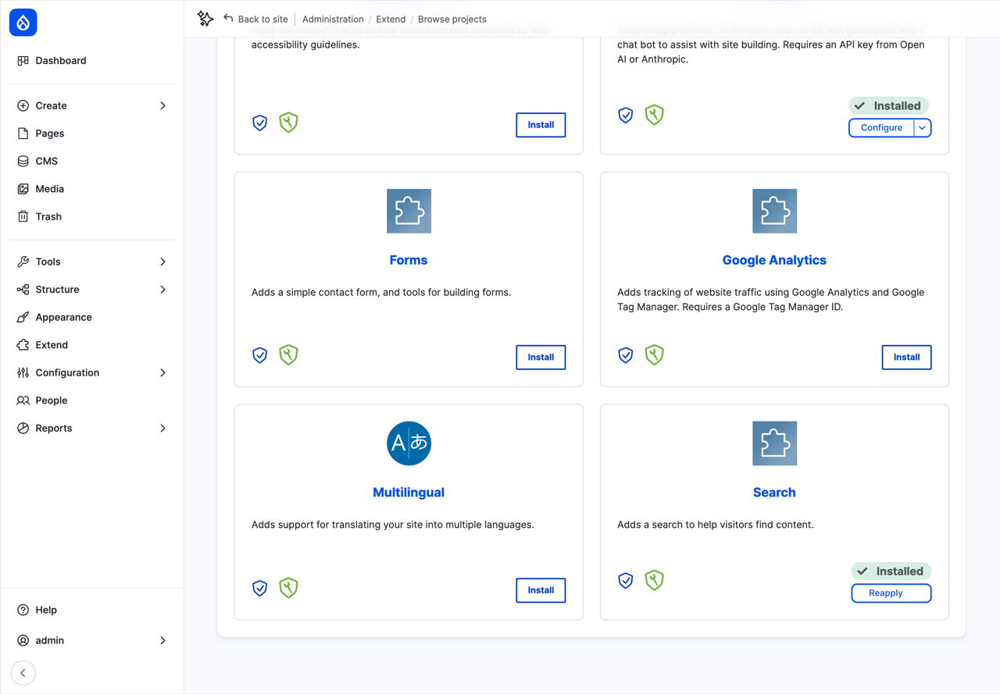
*Figure 22.15: Search in the Recommended add-ons*

The recipe sets up what we built by hand on core, and a little more. Under **Configuration** > **Search and metadata** > **Search API**, there's a server, **Database**, and an index, **Content** ("Can search within all content types"). The index has two datasources: content, and Canvas pages (**Page**), so the pages you build in Canvas are found too. The recipe also:

- made a **Search index** view mode for every content type, a copy of its **Default** view mode;
- installed **Search API Exclude**, which adds a checkbox to the content form to keep a single page out of the search;
- installed **Automated Cron**, so the index stays up to date even on a site without a cron job (Chapter 11);
- made a view, **Search**, with a block that shows a search box.

The search index view modes are copies of **Default**, labels and all, so they have the "meeting" problem from earlier in this chapter. Fix it as on core: for **Hike** (and **Album**), open **Manage display** > **Search index**, hide the labels, and disable the photo, the hike leader, the date and the distance.

### Facets

The core site's search has filters to narrow the results: Type, Area, Difficulty, each with all its choices. *Facets* are filters that know about the results. Search for `pentland`, and a facet for Area lists only the areas that have results, with the number of results next to each. A visitor sees at once where the results are, and never picks a choice that gives nothing. Shops use them for sizes and brands; the club uses them for areas, types and difficulties.

**Facets** is a contributed module, built on Search API, with a submodule, **Facets Exposed Filters**, that turns facets into exposed filters in a view. We use it here, on Drupal CMS, because it doesn't work on Drupal 12 yet: the core site would need it rebuilt, not patched. Drupal CMS runs Drupal 11, where it does.

Install **Facets** and **Better Exposed Filters** from **Extend** > **Browse projects** (Project Browser downloads them; Chapter 11), then check **Facets Exposed Filters** on **Extend** and install it too. **Better Exposed Filters** gives a view's exposed filters other shapes than a drop-down list: checkboxes, links, sliders.

Facets need fields in the index to count. On the **Content** index's **Fields** tab, add **Content type**, **Area** and **Difficulty** (Content group), as on core, and select **Index now** on the **View** tab.

The recipe's Search view has only a block, which a Canvas page shows. Facets don't show when the view is a block placed with Canvas: we tried, and the facets stayed empty. So give the view a page of its own. Edit the **Search** view, select **Add** > **Page**, with the path `search`. Then, for the page:

1. Under **Filter criteria**, select **Add**, and look at the **Facets** group: every field of the index is there as a facet, such as **Area (field_area)**. Add **Area (field_area)**, **Content type (type)** and **Difficulty (field_difficulty)**.
2. For each, give it a label: `Area`, `Type`, `Difficulty`. A facet is always exposed to visitors, so there's no **Expose** button.
3. Add **Index Content: Item language**, set to **Interface text language selected for page**, as on core.
4. Under **Exposed form**, change **Exposed form style** to **Better Exposed Filters**. In its settings, choose **Checkboxes/Radio Buttons** for the three facets.
5. Save the view.
6. Now each facet in **Filter criteria** has a **Settings** link next to it (it only appears once the view is saved). For each, select it, and check **Show the amount of results**. For Area and Content type, also check **Transform entity ID to label**, so the facet shows "Pentland Hills" rather than the term's ID; for Difficulty, check **List item label**, so it shows "Moderate" rather than `moderate`. Select **Apply**, and save the view again.

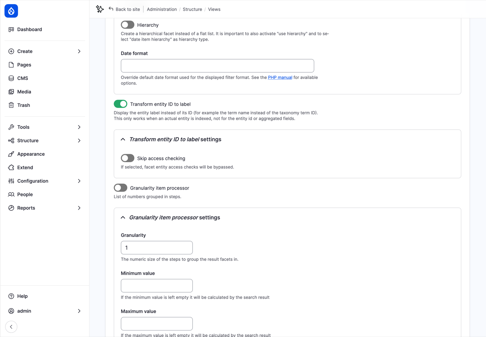
*Figure 22.16: A facet's settings*

Search for `pentland` at `/search`:

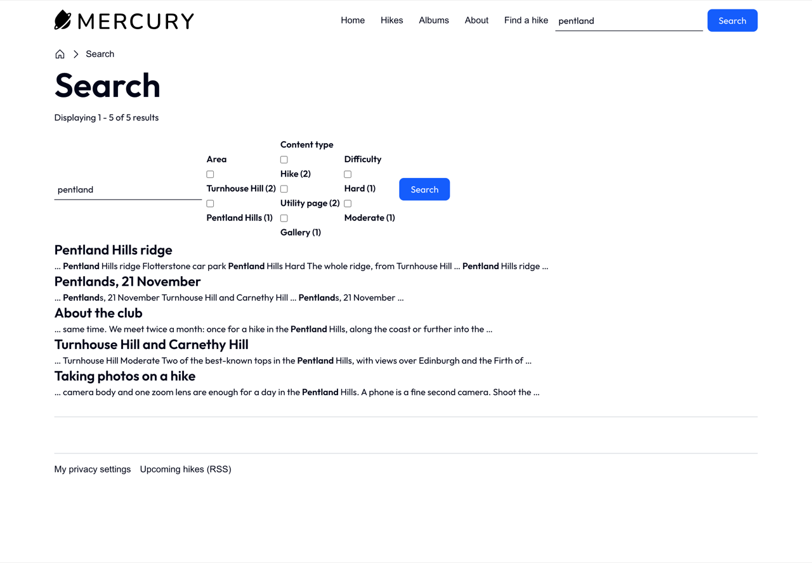
*Figure 22.17: Facets on Drupal CMS*

Check *Moderate* under Difficulty, and the results, and the counts in the other facets, change to match.

The search box goes in the header, which on Drupal CMS is a Canvas page template (Chapter 14). Open Canvas, **Templates**, **Mercury theme**, and in the **Library**, find the Search view's exposed form block; drag it into the **Navbar**'s **CTAs** slot, next to the main menu. It works in both languages: `/es/search` gives Spanish results.

## Bigger search engines

The Database backend is a fine search for a site the size of the club's, and for much bigger ones. It has limits, though, and big sites run into them: it gets slow with tens of thousands of pages, its ranking is basic, and it knows only English stemming. That's where separate search engines come in: programs made for nothing but searching, which run next to Drupal on a server of their own, or as a service you rent. Search API talks to all the common ones, each with a module that adds a backend:

- **Apache Solr**, the oldest and the most used with Drupal, with the **Search API Solr** module. It has stemming for dozens of languages, spelling suggestions ("Did you mean *Glencorse*?"), synonyms, and fast facets. Most Drupal hosting companies offer it.
- **Elasticsearch** and **OpenSearch**, its open-source fork, with the **Elasticsearch Connector** and **Search API OpenSearch** modules: similar to Solr, popular outside Drupal, often rented as a service.
- **Typesense** and **Meilisearch**, newer and smaller, built for search-as-you-type with typos forgiven ("glencrose" still finds Glencorse), with the **Search API Typesense** and **Search API Meilisearch** modules.

Changing the backend is mostly changing the server. The index, the fields, the processors (some of which the engine does itself) and the view stay. That's the point of Search API's parts: the club could move to Solr the day it has ten thousand albums, without rebuilding its search page.

Setting one up is beyond this book: it means running another program, which is a job for a server, not for a site builder's browser. If you'd like to try, DDEV can run Solr next to your site, with an add-on (`ddev add-on get ddev/ddev-solr`).

## Searching by meaning

Every search in this chapter looks for *words*. A visitor who types "an easy walk by the water" gets the pages that contain "easy", "walk" and "water", and not the Glencorse hike, which says "reservoir". Chapter 23 builds a search that looks for what she *means*, with the AI tools from Chapter 19, on the same Search API you've used here.

## Coming from WordPress?

> **Coming from WordPress?** WordPress has a search built in: every theme has a search form, and `?s=reservoir` searches posts and pages, title and text, with posts that have the words in their title first. It has no stemming, no facets, and no say in which fields count; many WordPress sites add a plugin for that, such as Relevanssi or SearchWP (which keep their own index in the database, like Search API's Database backend), or ElasticPress (Elasticsearch, like Search API with an Elasticsearch backend). Drupal's old Search module was the closest to WordPress's built-in search. Search API is closer to those plugins, with one difference: the results page is a view, which you build and change like any other list on the site.

## Summary

You can now:

- explain what a search index is, and the processing steps that make a search find "reservoir" when you type "Reservoirs";
- explain why Drupal 12 no longer has the Search module, and what it couldn't do;
- set up Search API with a Database server, an index with fields, types and boosts, and processors;
- give the index a view mode made for searching, and explain why labels don't belong in an index;
- build a search page as a view, in two languages, with exposed filters, excerpts and relevance;
- add a search box to every page with a block display, and suggestions while typing with Search API Autocomplete;
- explain why past content can't be left out of an index, and leave it out in the view instead;
- on Drupal CMS, add search with the recipe, and narrow results with facets;
- tell when a site needs a separate search engine, and name the common ones.

## Exercises

1. Members ask to find albums by photographer. Add the photographer to the core site's index: in **Add fields**, open **Photos** (the album's photos) with **Expand**, then the media, and find **Photographer**. Which type should it be, and why? Index again, and search for a photographer's name.
2. Make the text for no results more helpful: add a link to the hike archive (`/hikes/archive`) for visitors who were looking for a hike, and translate the text into Spanish.
3. On the core site, switch to Spanish, and search for `embalse`, then for `embalses`. Explain both results with what this chapter says about stemming and partial matching. What would a Spanish visitor have to type to find the hike if the server matched whole words only?
4. *(challenge)* Make a second block for the Search view, **Search hikes only**, for the hikes page: the box searches only hikes, and the results page shows only hikes. Which filter goes where? Does it need a page display of its own?
5. *(advanced)* Visitors who search for `arthur` get both Arthur's Seat hikes, past and future, in order of relevance. Make the upcoming ones come first, without hiding the past ones. Why doesn't **Number field-based boosting** on the hike's date do it? (The answer is in Appendix D.)

## Want to know more?

- [Search API](https://www.drupal.org/project/search_api), whose project page links to its documentation, with a page for each processor and backend.
- [Search API Autocomplete](https://www.drupal.org/project/search_api_autocomplete), [Facets](https://www.drupal.org/project/facets) and [Better Exposed Filters](https://www.drupal.org/project/better_exposed_filters).
- The contributed [Search](https://www.drupal.org/project/search) project, Drupal's old Search module.
- Search engines: [Search API Solr](https://www.drupal.org/project/search_api_solr), [Elasticsearch Connector](https://www.drupal.org/project/elasticsearch_connector), [Search API OpenSearch](https://www.drupal.org/project/search_api_opensearch), [Search API Typesense](https://www.drupal.org/project/search_api_typesense) and [Search API Meilisearch](https://www.drupal.org/project/search_api_meilisearch).
- For comparison, WordPress's [Search block](https://wordpress.org/documentation/article/search-block/), and the plugins [Relevanssi](https://wordpress.org/plugins/relevanssi/) and [ElasticPress](https://wordpress.org/plugins/elasticpress/).
