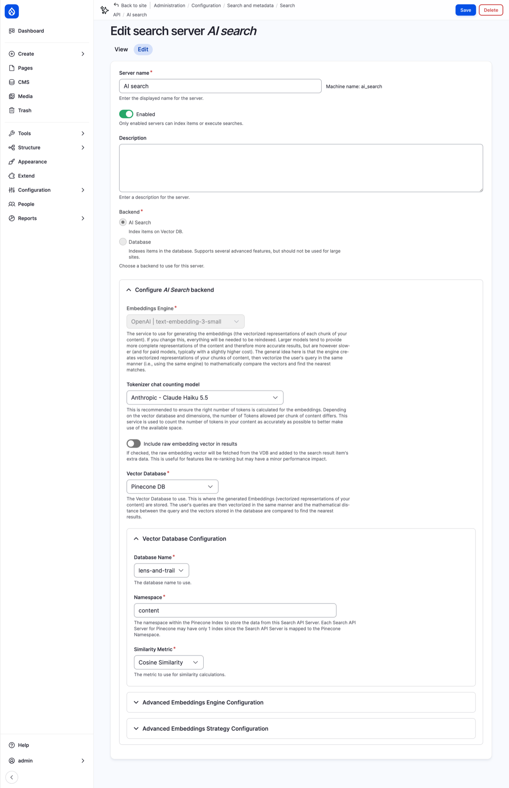
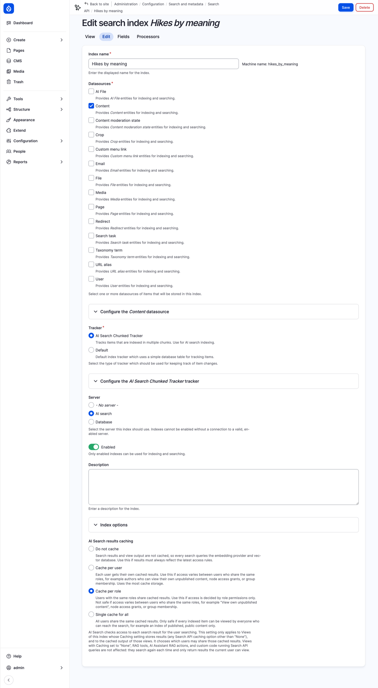
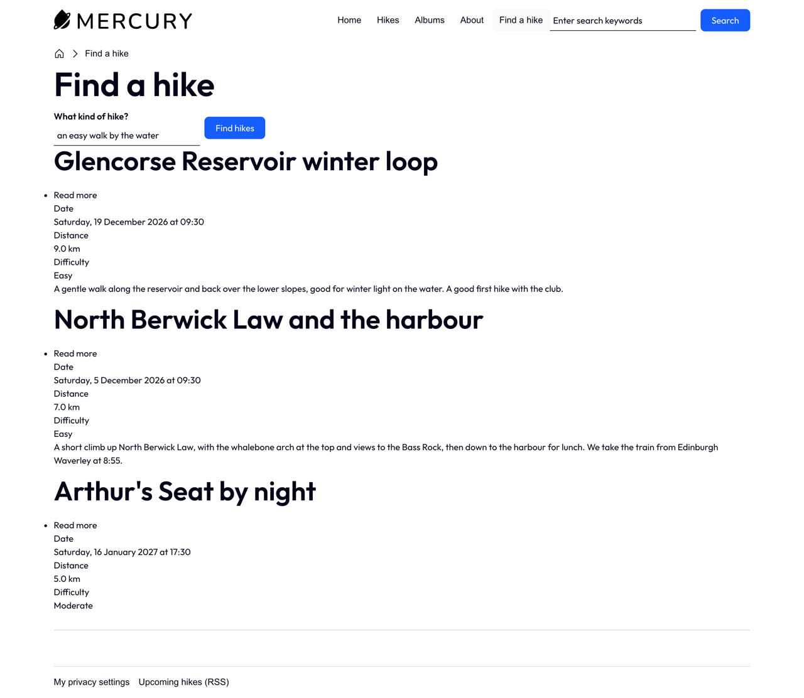
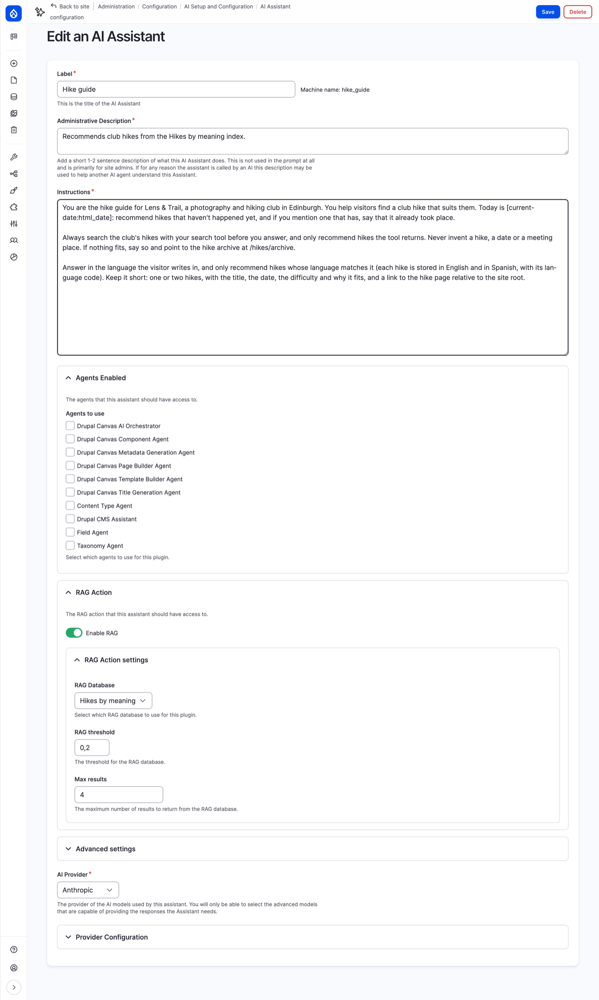
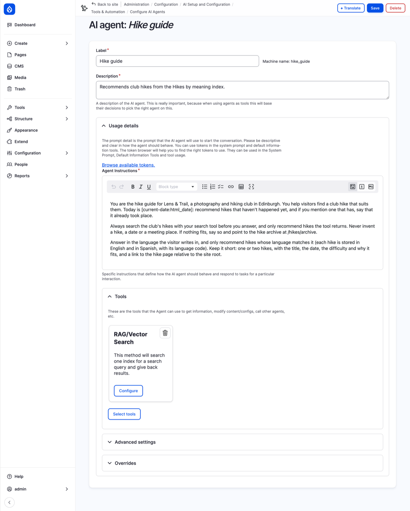
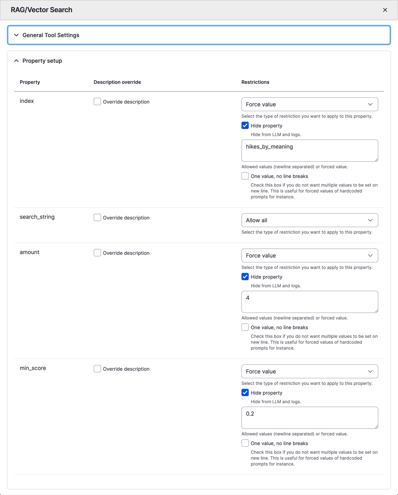

# Search by Meaning

The club's search box from Chapter 22 does what a search box should: type "reservoir", and you get the Glencorse hike. But visitors don't always know the words. A new member types what she's after, "an easy walk by the water", and the search looks for pages that contain "easy", "walk" and "water". The Glencorse hike doesn't say "water": it says "reservoir". So it isn't found, though it's exactly what she wants.

This chapter builds a search that looks for *meaning* instead of words, with the AI tools from Chapter 19. We explain how that works, with *embeddings* and a *vector database*. We set up the services it needs, and an index of the club's hikes, built with the same Search API you know from Chapter 22. We give visitors a **Find a hike** page, in English and Spanish. And then we go a step further: a *hike guide* you can ask questions, which looks up the club's hikes before it answers.

Like Chapter 19, this chapter is about Drupal CMS, which has the AI tools installed. We start where Chapter 22 left the Drupal CMS site: the club's content, the AI Assistant from Chapter 19 with Anthropic as its provider, and the Search recipe with its search index view modes.

> **On Drupal core:** none of this is special to Drupal CMS: the AI module and its AI Search work on Drupal 11 core too. On Drupal 12, when we wrote this, the AI module wasn't available yet (Chapter 19).

## How a search by meaning works

A search by words, as in Chapter 22, keeps a list of words and the pages they're on. A search by meaning keeps something else for each page: an *embedding*. A model, like the ones in Chapter 19, reads a piece of text and turns it into a long list of numbers, 1536 of them in our case, that places the text in a kind of map of meanings. Texts about similar things end up close to each other on the map, whatever words they use: "a walk by the water" lands near "a loop around the reservoir". A search turns the visitor's words into an embedding too, and looks for the pages nearest to it.

That also works across languages. "Un paseo fácil junto al agua" lands in the same place as its English translation, because the model learned that they mean the same.

> **Under the hood: embeddings and vector databases.** An embedding is a *vector*, a point in a space with as many directions as it has numbers. You can't picture 1536 directions, but the idea is the same as on a map with two: points close together mean similar things. "Close" is measured by the angle between two vectors (the *cosine similarity*), and a *vector database* is a database made to find the nearest vectors quickly, among millions. Long pages are cut into *chunks* first, a few hundred words each, so that a long page about many things can be found by any of them. Making an embedding costs a little money each time: the club pays for every page indexed, and every search, at the rates of the model's provider.

The AI module from Chapter 19 has a backend for Search API that does this, **AI Search**, which keeps the index in a vector database instead of Drupal's database. The rest is Search API as you know it from Chapter 22: a server, an index, a view.

## What you need

Three services, each with an account and an API key:

- **An embeddings model.** We use OpenAI's `text-embedding-3-small`, the provider the AI module calls OpenAI. Indexing the club's hikes, and a few hundred searches, cost less than one US cent when we tried it.
- **A vector database.** We use **Pinecone**, a vector database you rent as a service, because its free plan is enough for a small site, and the AI module has a provider for it. The AI module also has providers for Milvus, PostgreSQL and others you'd run yourself. If you chose amazee.ai in Chapter 19, it offers a vector database and embeddings too; we haven't tried them for this chapter.
- **A chat model,** to count the tokens in each chunk (Chapter 19). We use Anthropic's Claude Haiku, from Chapter 19.

Chapter 19 showed how to store API keys with the **Key** module, under **Configuration** > **System** > **Keys**: add an `OpenAI API key` and a `Pinecone API key` there the same way. Then set up OpenAI under **Configuration** > **AI** > **Providers**, as Chapter 19 did with Anthropic.

### A vector database on Pinecone

At [pinecone.io](https://www.pinecone.io), create a free account, then create an *index* (Pinecone's word for a database):

1. **Name**: `lens-and-trail`.
2. Set the **dimension** to `1536`, the length of `text-embedding-3-small`'s vectors (the two have to match), and the **metric** to **cosine**.
3. Choose a serverless index on AWS, in `us-east-1`, the region of the free plan.
4. Create it, and copy your API key from **API keys**.

### The modules

The Pinecone provider is a contributed module. As we write this, it only has *beta* releases, so ask for one by name:

```
ddev composer require 'drupal/ai_vdb_provider_pinecone:^1.1@beta'
```

On **Extend**, install **AI Search** (Extend marks it as deprecated; see the box below) and **Pinecone Serverless VDB Provider**. Then go to **Configuration** > **AI** > **Vector Database Configuration** (`/admin/config/ai/vdb_providers`), select **Pinecone Configuration**, choose your **Pinecone API key**, and save.

> **AI Search is moving.** The AI module's **AI Search** module is being moved into a project of its own, also called AI Search, so that it can grow at its own pace. That's why **Extend** shows it as deprecated. When we wrote this, the new project had only test releases, and the one inside the AI module was the one to use. By the time you read this, check the AI Search project page on drupal.org: if it has a stable release, use that one; the steps should look much the same.

## A server and an index

Under **Configuration** > **Search and metadata** > **Search API**, select **Add server**:

1. **Server name**: `AI search`.
2. **Backend**: **AI Search** ("Index items on Vector DB").
3. **Embeddings Engine**: **OpenAI | text-embedding-3-small**.
4. **Tokenizer chat counting model**: **Anthropic - Claude Haiku 5.5**.
5. **Vector Database**: **Pinecone DB**. Then **Database Name** **lens-and-trail**, **Namespace** `content` (a part of the Pinecone index, so other indexes could share it), and **Similarity Metric** **Cosine Similarity**.
6. Under the embedding strategy, keep **Enriched Embedding Strategy** and its defaults: chunks of 500 tokens, with the title repeated in each.
7. Select **Save**.


*Figure 23.1: The AI search server*

Then **Add index**:

1. **Index name**: `Hikes by meaning`.
2. **Datasources**: **Content**; under its settings, **Bundles**: **Only those selected**, with **Hike**. Visitors who describe a walk want hikes, not albums.
3. **Tracker**: choose **AI Search Chunked Tracker**, *not* **Default**. This one matters, and nothing chooses it for you. The tracker keeps track of what needs indexing; AI Search indexes long pages a few chunks at a time, and only its own tracker remembers to start again from the first chunk when a hike changes. With the **Default** tracker, a changed hike is never indexed again, and its old version stays in Pinecone for good, without any error message. (We found out the hard way.)
4. **Server**: **AI search**.
5. Select **Save and add fields**.


*Figure 23.2: The Hikes by meaning index, with the chunked tracker*

The **Fields** tab looks different for an AI index: each field has an **Indexing option** instead of a boost. The descriptions at the top of the page explain them. Add these fields, and set their options:

| Field | Indexing option | What it does |
|---|---|---|
| **Rendered HTML output** (Hike: **Search index**) | **Main content** | The text that's cut into chunks and turned into embeddings. |
| **Title** | **Contextual content** | Added to every chunk, so each chunk knows which hike it's from. |
| **Date** | **Contextual content** | The same: the date travels with each chunk. |
| **Area**, **Difficulty**, **Language** | **Filterable attributes** | Stored next to each vector, to filter on before searching. |

**Rendered HTML output** uses the hike's **Search index** view mode, the one without labels and photos from Chapter 22: what the model reads is what it can find. Save, and **Index now**. To check what went in, the **Fields** tab has **Preview content to be vectorized**, which shows a hike as the embeddings model sees it.

## Find a hike

Now a view, as for Chapter 22's search page: **Add view**, **Show** **Index Hikes by meaning**, a page at `find-a-hike` titled `Find a hike`, showing **Rendered entity** in the **Teaser** view mode, 3 items, no pager. Then:

1. Add **Search: Fulltext search**, exposed, with the label `What kind of hike?`, the identifier `describe`, and the placeholder `an easy walk by the water`. Set its **Parse mode** to **Multiple words**. (**Direct query** sounds like the right choice for a sentence, but with AI Search it returned nothing in our tests.)
2. Set **Exposed form style** to **Input required**.
3. Add **Search: Relevance**, descending.
4. Add **Index Hikes by meaning: Language**, *not* exposed, set to `en`.

### One page per language

Why a fixed `en`, and not **Item language** with the interface language, as on Chapter 22's search page? Because the AI Search backend ignores **Item language**: it passes filters to the vector database only when they're on the index's own fields, such as **Language**, which we added as a filterable attribute. So this display shows English hikes, and we make a second one for Spanish: **Add** > **Page**, with the path `buscar-excursion`, and for this page only (**This page (override)**), the **Language** filter set to `es`. Save.

Couldn't we index English only, and show the results in the visitor's language? We tried. Search API always shows a result in the language it was indexed in, whatever the view's rendering language says, so Spanish visitors got the right hikes, in English. One page per language is the way that works.

Last, the menu: add a link to `/find-a-hike` called `Find a hike` in the main menu, and translate its title to `Buscar excursión` (Chapter 18). A menu link's address can't be translated, so Spanish visitors would land on `/es/find-a-hike`, the English display. Send them on with a redirect (Chapter 17): under **URL redirects**, **Add redirect**, from `find-a-hike` to `/buscar-excursion`, with the language **Spanish**.

### Trying it

"An easy walk by the water":


*Figure 23.3: Find a hike, searching by meaning*

The Glencorse loop comes first, though it never says "water", then North Berwick, by the sea. "A hard climb with sea views" gives the Pentland Hills ridge, Turnhouse Hill and Arthur's Seat at sunrise. And on `/es/buscar-excursion`, "un paseo fácil junto al agua" finds the Spanish Glencorse hike first.

The results aren't perfect: every search gives three hikes, even when none of them fits, because a search by meaning always finds *something* nearest. Arthur's Seat by night is no walk by the water. That's the trade: a search by words gives nothing rather than something wrong; a search by meaning gives its best guess. For a club with six hikes, a best guess is helpful. For a site where a wrong answer matters, combine the two, or let people check.

## A hike guide to talk to

Chapter 19's AI Assistant answers questions about building the site. With the AI Search index, an assistant can answer questions about the *club*: "Is there an easy hike by the water before Christmas?" It searches the index for the hikes that fit, and writes an answer from what it finds, with links. This is called *retrieval-augmented generation*, or *RAG*: the model doesn't answer from what it learned in training, which knows nothing about Lens & Trail, but from what the search *retrieved* from your site.

It's made of the same parts as Chapter 19's assistant: an *agent*, which has tools and instructions, and an *assistant*, which puts an agent in a chatbot. You don't have to build them separately: the assistant's form makes its own agent, with the same name, and sets up the search tool for it.

### The assistant

Go to **Configuration** > **AI** > **AI Assistants** (`/admin/config/ai/ai-assistant`), and add one:

1. **Label**: `Hike guide`. **Administrative Description**: `Recommends club hikes from the Hikes by meaning index.`
2. **Instructions**: what the guide is for, and how it should behave. These are the club's:

`Instructions` ([source](../examples/search/hike-guide-instructions.txt))

```text
You are the hike guide for Lens & Trail, a photography and hiking club in Edinburgh. You help visitors find a club hike that suits them. Today is [current-date:html_date]: recommend hikes that haven't happened yet, and if you mention one that has, say that it already took place.

Always search the club's hikes with your search tool before you answer, and only recommend hikes the tool returns. Never invent a hike, a date or a meeting place. If nothing fits, say so and point to the hike archive at /hikes/archive.

Answer in the language the visitor writes in, and only recommend hikes whose language matches it (each hike is stored in English and in Spanish, with its language code). Keep it short: one or two hikes, with the title, the date, the difficulty and why it fits, and a link to the hike page relative to the site root.
```

3. Leave **Agents to use** empty. Those are *other* agents the guide could hand work to, such as Chapter 19's agents that build fields and content types. A guide for visitors shouldn't be able to change the site.
4. Under **RAG Action**, check **Enable RAG**. **RAG Database**: **Hikes by meaning**. **Max results**: `4`.
5. **RAG threshold**: `0.2`. The threshold is the lowest score a result may have to be used, and the default, 0.5, is too high: with OpenAI's small embeddings model, the best matches for "an easy walk by the water" scored about 0.4 in our tests, so 0.5 would leave the guide with nothing, and it would say there's no such hike. (We found out the hard way, again.)
6. **AI Provider**: **Anthropic**, and under **Provider Configuration**, the model **Claude Haiku 5.5**: fast and cheap, and good enough to write a short answer from four hikes.
7. Under **Advanced settings**, **Permission Roles**: check **Anonymous user** and **Authenticated user**.
8. Save.


*Figure 23.4: The Hike guide assistant*

The instructions do most of the work, so they're worth a closer look. "Only recommend hikes the tool returns. Never invent a hike, a date or a meeting place" keeps the model to what the club has: a model asked about hikes near Edinburgh knows plenty of real ones, and would happily recommend them. `[current-date:html_date]` is a token (Chapter 17), which the agent fills in with today's date, so it can tell a hike that's coming from one that's over: the index can't, as Chapter 22 explained. And "only recommend hikes whose language matches" is there because the index has both languages, and the tool, like the view, doesn't filter on the visitor's.

### The agent it made

Now look at what the form made. Go to **Configuration** > **AI** > **AI Agents** (`/admin/config/ai/tools-automation/agents`): there's a new agent, **Hike guide**, with the same instructions, and one tool, **RAG/Vector Search**, the AI Search tool.


*Figure 23.5: The agent behind the assistant*

Select **Configure** on the tool. Under **Property setup**, the tool's four values are listed: the **index** to search, the **search_string**, the **amount** of results and the **min_score**. Three of them are set to **Force value**, with **Hide property** checked: the index is always `hikes_by_meaning`, the amount always 4, the minimal score always 0.2, and the model doesn't even see that there's a choice. Only the search string is the model's to write. That's what keeps the guide to the club's hikes: it can't search any other index, because, as far as it knows, there isn't one.


*Figure 23.6: The search tool's forced values*

You can build an agent like this by hand, on this page, and give it to an assistant; for one agent with one search, the assistant's form is quicker. Be careful when you edit the two afterwards, though: saving the assistant's form writes its instructions and its RAG settings into the agent again, over any change you made on the agent's page.

### Where visitors can't reach it, yet

A chatbot for visitors would be a block in the site's header or footer. Here we hit a wall. On Drupal CMS, the header and footer are a Canvas page template (Chapter 14), and Canvas only offers blocks whose settings it can check fully, which the chatbot block's aren't, yet. So visitors can't get the chatbot.

We tried the guide in the admin chatbot instead. Go to **Structure** > **Block layout**, select the **Default Admin** theme, configure the **Drupal Agent Chatbot** block, and choose **Hike guide** as its **AI Assistant**. Remember to switch it back to the Drupal CMS Assistant afterwards, if you use that one for building the site.

### Asking it

Asked "Is there an easy hike by the water before Christmas?", it answered with the Glencorse Reservoir winter loop on Saturday 19 December at 9:30, rated easy, meeting at Flotterstone car park, with a link. In other runs it also offered North Berwick on 5 December "if you'd like the sea instead": a model doesn't give the same answer twice, but it gave a right one every time. Asked in Spanish about a hike with sea views, it answered in Spanish, with the Spanish North Berwick page. It never made up a hike.


*Figure 23.7: The hike guide answering in the admin chatbot*

Two more things to know before you put a chatbot in front of visitors. Drupal CMS's privacy settings (the *Klaro* consent manager) ask before the chatbot loads, because it sends what you type to an outside service: a visitor-facing chatbot needs that consent too, and a line in the privacy policy. And each question costs a few model calls, paid by the token: little for one question, real money for thousands. A chatbot on a busy public site needs a budget, and a limit.

## Summary

You can now:

- explain how a search by meaning differs from a search by words, and what embeddings and vector databases are;
- set up an embeddings provider and a vector database, and keep their keys in the Key module;
- build a Search API server and index on AI Search, with the right tracker and indexing options;
- build a search by meaning as a view, with one page per language, and explain why;
- explain what RAG is, and build an agent and an assistant that answer from the club's own content;
- name what a chatbot on a public site needs: consent, a privacy policy, and a budget.

## Exercises

1. Try *Find a hike* with searches of your own. Find one that the Chapter 22 search page answers better, and one that only *Find a hike* gets right. What do they tell you about when to use which?
2. Difficulty is a filterable attribute in the index. Add it to *Find a hike* as an exposed filter, so a visitor can ask for "a walk with views" among the easy hikes only. Remember both page displays.
3. Change the Hike guide's instructions so it always says where to meet and what to bring. Ask it the same question before and after. What else would you like it to say, or never say?
4. *(challenge)* The guide only knows the hikes. Make a second index, *Albums by meaning*, with the albums, and give the guide a second RAG/Vector Search tool for it, so it can answer "where can I see photos from the Pentlands?". What does that cost to index, compared with the hikes?
5. *(challenge)* Some questions shouldn't be answered from the club's pages at all: "Is it safe to go up Arthur's Seat in the dark?", "What will the weather be on Saturday?". Write instructions for the guide for questions like these, and test them.

## Want to know more?

- The [AI module](https://www.drupal.org/project/ai), the new [AI Search](https://www.drupal.org/project/ai_search) project, and the [Pinecone provider](https://www.drupal.org/project/ai_vdb_provider_pinecone).
- [Pinecone's own introduction to vector databases](https://www.pinecone.io/learn/vector-database/).
