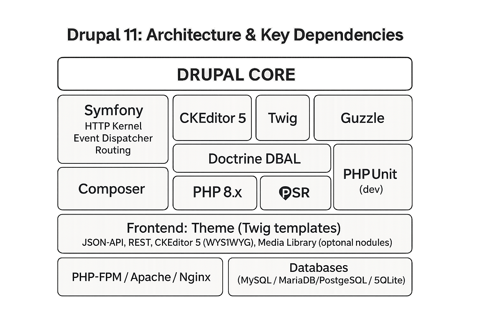

# Appendix B: How Drupal Is Built


Drupal sits at the center of a modern PHP ecosystem that gives it both stability and flexibility. At its heart is **Drupal core**, which defines the content model (entities such as nodes, users, and taxonomy terms), the field and storage systems, configuration management, caching, access control, plugins, and a services-based architecture. Core is what makes Drupal more than a framework: it provides powerful, reusable building blocks that let teams model complex, multilingual content and workflows without reinventing fundamentals.

Around that heart, Drupal relies heavily on **Symfony** components—most notably HttpKernel, Routing, and EventDispatcher—to handle the HTTP lifecycle. A request enters, is matched to a route, dispatched to a controller, and transformed into a response. Symfony’s event system lets modules subscribe to key moments in that lifecycle, adding or altering behavior in a clean, decoupled way. This Symfony foundation is a major reason Drupal feels modern and maintainable: it aligns Drupal with best practices across the broader PHP world.

For presentation, Drupal uses **Twig** as its templating engine. Twig enforces a clear separation between logic and markup and escapes output by default, which significantly reduces the risk of cross-site scripting. Theme developers can override templates predictably, and the render system feeds Twig with structured arrays so that concerns remain separate: backend code assembles data; the theme decides how it looks.

Authoring rich content depends on **CKEditor 5**, the bundled WYSIWYG editor. CKEditor integrates with Drupal’s text formats and filtering, so what editors see reflects the security and formatting rules you’ve configured. Its plugin ecosystem brings modern editing capabilities—media embeds, link management, collaborative features—and produces structured, predictable HTML that fits neatly into Drupal’s field system and theming layer.

Whenever Drupal talks to the outside world, it typically does so through **Guzzle**, a PSR-compatible HTTP client. Guzzle provides consistent request/response handling, middleware for things like retries or authentication, and solid error reporting. Because it follows community standards, modules that integrate with third-party services can share common, well-understood patterns instead of bespoke HTTP code.

Those community standards are the **PSRs (PHP Standards Recommendations)**—especially PSR-4 for autoloading, PSR-3 for logging, PSR-11 for containers, and PSR-7/17 for HTTP messages. By adhering to PSRs, Drupal plays nicely with the wider PHP ecosystem: libraries slot in more easily, and Drupal developers can rely on familiar abstractions instead of Drupal-only conventions.

Underneath all of this is **PHP 8.x**, which brings significant performance and language improvements—typed properties, attributes, enums, union types, and better JIT behavior. Drupal core and contributed modules increasingly use these features for safer, clearer code and faster execution. Managing the complex set of PHP libraries that make up a Drupal site falls to **Composer**, the dependency manager. Composer resolves versions, installs packages (core, modules, themes, and third-party libraries), and records the exact dependency graph in a lockfile. That reproducibility is essential for CI/CD pipelines and for keeping production, staging, and developer machines in sync.

Quality and stability are reinforced by **PHPUnit**, the testing framework used by Drupal core and the contrib ecosystem. Functional browser tests, kernel tests, and unit tests exercise everything from routing to field storage. This culture of automated testing is why Drupal can ship regular updates without constant regressions—and why site builders can upgrade with confidence when they maintain their own test coverage.

On the front end, Drupal’s theming layer turns render arrays into HTML via **Twig templates**, with library definitions controlling CSS/JS assets. This clear boundary enables performance tuning (lazy-loading, asset aggregation), accessibility-first markup, and the ability to swap or extend themes without disturbing business logic. When Drupal must act as a content platform for other clients, the **JSON:API** module exposes entities as a standards-compliant API with filtering, includes, pagination, and sparse fieldsets out of the box. If a project needs different formats or bespoke resources, core’s **REST** framework offers configurable endpoints, authentication options, and serialization control—handy when JSON:API’s conventions don’t quite fit.

Managing images, documents, and other assets at scale is the job of **Media** and the **Media Library**. Media entities provide a canonical, reusable representation of an asset (local or remote), complete with fields, permissions, and display settings. The Media Library gives editors a fast, searchable UI to insert existing assets or upload new ones, improving consistency and reducing duplication across large teams.

Data persistence is handled by **relational databases**—MySQL, MariaDB, PostgreSQL, or SQLite—selected according to operational needs. Drupal does **not** use Doctrine DBAL for its core database layer; instead, it implements its own PDO-based abstraction with pluggable drivers, a query builder, and a schema API. That approach preserves portability across engines and caters to Drupal’s entity/field storage patterns, while still allowing contrib or tooling to leverage Doctrine where it makes sense outside of core.

Finally, the application is served by **PHP-FPM** behind **Apache or Nginx**. These components decide how requests are routed to Drupal, manage process pools, set caching and compression headers, negotiate TLS, and implement rewrites for clean URLs. Tuning them—along with Drupal’s own page, dynamic, and render caching—often yields the largest real-world performance gains, especially under load.

Taken together, this stack gives Drupal its defining qualities: a robust content model, secure and flexible theming, modern HTTP and dependency practices, reliable integration points, and an editorial experience that scales. Each component does a focused job, and the boundaries between them are deliberate—tight where safety and performance matter, loose where extensibility and interoperability pay dividends.

## The Symfony framework
Symfony is a modular, industrial-strength framework for building PHP applications, but calling it a “framework” undersells what it really provides. At its core Symfony is a collection of decoupled components—small, well-tested libraries such as HttpKernel, Routing, EventDispatcher, DependencyInjection, Console, Finder, Filesystem, Serializer, Validator, and Cache—that you can adopt à la carte or as a cohesive whole. Many projects use the full “Symfony Framework” distribution; many others, including Drupal, cherry-pick individual components to underpin their own architectures. This dual identity—both a complete application framework and a toolbox—explains Symfony’s wide footprint across the PHP ecosystem.

The heart of Symfony’s web stack is the HTTP lifecycle defined by HttpFoundation and HttpKernel. HttpFoundation replaces PHP’s superglobals with object-oriented Request and Response objects. HttpKernel orchestrates what happens when a request arrives: a kernel receives it, resolves the route, invokes a controller, and returns a response. In between, events fire at well-defined points: before the controller runs, after it returns, when an exception is thrown, and when the view is being created. The EventDispatcher enables that choreography. Listeners and subscribers can inspect or alter the request, short-circuit processing, transform exceptions into responses, or post-process the output for caching and security. This evented model is the reason Symfony projects remain extensible as they grow; you add behavior by subscribing to moments in the pipeline rather than forking core code.

Routing ties URIs to controllers through expressive patterns, HTTP method constraints, host and scheme conditions, and parameter requirements. Routes can be declared in YAML, XML, PHP, or via PHP 8 attributes directly on controller methods. The controller itself is deliberately simple: a callable that receives the Request (and any autowired services) and returns a Response. Keeping controllers thin is a cultural norm in Symfony. Business logic typically lives in services—plain PHP classes managed by the DependencyInjection (DI) container—which makes behavior easy to test and reuse.

The DI container is a central pillar. It constructs and wires services according to definitions in configuration files or discovered via autowiring. Autowiring leverages PHP type hints so Symfony can infer which service to inject, while autoconfiguration applies sensible defaults based on class roles (e.g., “this is a console command” or “this is an event subscriber”). The result is a codebase where dependencies are explicit yet friction is low: you describe your system, then let the container build the object graph efficiently. Performance remains solid because Symfony compiles container configuration into optimized PHP classes during cache warmup, minimizing reflection and configuration lookups at runtime.

Configuration in Symfony is environment-aware. You can define defaults shared across the application and override them for dev, test, or prod. The Config component reads YAML, XML, PHP, or environment variables with strong validation. In development, the Web Profiler and Debug Toolbar provide a complete x-ray of each request—routing matches, queries, logs, templates rendered, cache hits, and more—turning performance tuning and bug hunting into a data-driven process. In production, HTTP caching is first-class: Response objects can carry cache headers, ETags, and surrogate keys, while the Cache component offers PSR-6/16-compatible adapters for Redis, Memcached, and filesystem storage. Paired with reverse proxies like Varnish or Symfony’s own HttpCache, these features deliver large speedups with minimal code changes.

Security in Symfony balances flexibility with clear concepts. The Security component handles authentication (via form login, HTTP basic, JWT via bundles, OAuth, etc.), authorization with role- and attribute-based checks (voters), CSRF protection, password hashing, and session management. Modern best practices—password migration, remember-me cookies, and stateless token patterns—are supported without forcing one approach. When applications need message-driven workflows or background processing, the Messenger component provides commands, events, and queries with transports for AMQP, Redis, Doctrine, and synchronous buses. Validation rules attach to DTOs or entities using attributes or YAML, and the Serializer converts objects to and from JSON, XML, or custom formats, making it straightforward to expose or consume APIs.

Templating is commonly done with Twig, which was co-created in the Symfony orbit. Twig emphasizes safety and clarity: escaping by default, sandboxing options, and a clean template syntax. Asset management, translation, and form handling round out the user-facing layers. The Translation component supports message catalogs, pluralization rules, and ICU formats; the Form component maps request data to typed objects with validation pipelines, making it easier to build complex UIs without leaking raw input throughout the codebase.

One of Symfony’s quiet strengths is its tooling and release discipline. Composer is the package manager of record, and Symfony Flex streamlines project setup by installing bundles and applying “recipes” that configure sane defaults automatically. Long-term support (LTS) releases give organizations predictable maintenance windows, while a time-boxed release schedule ensures features land regularly without destabilizing existing apps. The combination of semantic versioning, deprecation notices, and upgrade tools means that even large codebases can move forward incrementally.

Testing is woven into the framework from the start. PHPUnit is the standard, with base classes for fast unit tests, kernel-level integration tests, and full browser tests. Test containers make it easy to override or fake dependencies, and projects like Symfony Panther allow real-browser end-to-end tests when required. Because most logic lives in services, test suites remain fast and focused—controllers simply orchestrate the work.

Symfony also scales down gracefully. You can begin with a micro-kernel—just Routing, HttpFoundation, and a couple of services—and grow as needs evolve. Many CLI-only or batch systems adopt the Console component for robust command-line applications: argument parsing, interactive prompts, progress bars, and lazy service loading are all standard. This ability to compose just what you need is why Symfony components appear far beyond web frameworks: in deployment tooling, static analyzers, API clients, and yes, content management systems.

Drupal’s relationship to Symfony is a good example of this modularity in action. Drupal consumes the HTTP stack (HttpKernel, Routing, EventDispatcher) to model its request/response lifecycle; it uses the DI container to register services and plugins; it renders HTML through Twig; and it embraces PSR standards for logging, autoloading, and HTTP messages. Yet Drupal keeps its own identity where its needs differ—most notably in the database layer and the entity/field system. This selective adoption gives Drupal a modern core without sacrificing the features that make it a content platform.

From an operational perspective, Symfony fits into contemporary DevOps practices cleanly. Config can be driven by environment variables; caches compile or warm on deploy; commands automate maintenance tasks; and observability hooks expose logs and metrics to external systems. Because Symfony adheres closely to PSR interfaces, swapping implementations—say, a different logger, cache backend, or HTTP client—rarely touches application code. The result is a framework that is both opinionated enough to be productive and flexible enough to integrate with heterogeneous stacks.

If there is a single theme running through Symfony’s design, it is explicitness. Dependencies are declared, state is contained, lifecycles are observable, and extension points are explicit via events and interfaces. That explicitness pays off in large, long-lived systems: teams can reason about behavior, replace parts with confidence, and upgrade on a known path. For newcomers, the learning curve exists, but the guardrails—profiler, error pages, strict configuration validation—make mistakes visible early. For veterans, the ergonomics of autowiring, attributes, and compiled containers keep day-to-day work fast.

In short, Symfony provides a stable foundation for serious PHP software. Whether you adopt a single component to solve a focused problem or build a full application on the framework, you get predictable releases, battle-tested libraries, strong developer tooling, and an architecture that keeps codebases maintainable as they scale. That combination of modularity, standards compliance, and operational maturity is why Symfony sits underneath so many of today’s PHP platforms—and why it continues to shape how the ecosystem writes modern, testable, and high-performance applications.

## How Drupal's code has changed

Chapter 3 tells Drupal's history from a site builder's point of view. This is the programmer's side of the same story: how the code itself changed, and how developers keep their modules up to date today. You don't need any of it to build sites, but it explains a lot of what you'll see if you ever open a module's files.

### Hooks: changing Drupal from the outside (2001 onward)

From its early versions, Drupal had a *hook system*. A hook is a function with a special name that Drupal calls at a certain moment, if a module has one. If Drupal is about to show a piece of content, it calls every module's `hook_node_view()` (with the module's name in place of `hook`), and each module can add to it or change it. That way, modules can change how Drupal behaves without anyone changing Drupal core, which is the idea behind every module ever written for Drupal.

Hooks are still there today. Since Drupal 11.1, they can also be written as methods on a class, marked with a `#[Hook]` attribute, instead of as functions with special names.

### The Form API (Drupal 4.7, 2006)

Drupal 4.7 brought the *Form API* (FAPI), and it changed how module developers worked. Instead of writing the HTML for a form by hand, a developer describes the form as a structured PHP array: a text field here, a select list there, these are required. Drupal builds the HTML, validates what the user submits, and calls the module's submit function. Because every form goes through the same system, other modules can change any form (add a field to the login form, say), every form can be themed the same way, and protection against cross-site request forgery (CSRF) comes built in, with a hidden token on every form.

The Form API is still the way forms are built in Drupal, although today a form is a class instead of a set of functions.

### Theming: from PHP files to Twig

The first Drupal themes were PHP files that printed HTML directly, so theming meant editing PHP. Then came *theme engines*, which let themes use templates: by Drupal 4.7 and 5, PHPTemplate was the standard, with its `.tpl.php` files, HTML with small pieces of PHP in them. It was a big step towards separating logic from presentation, but a template could still run any PHP it liked, including database queries, and that made themes slow and insecure in the wrong hands.

Drupal 8 replaced PHPTemplate with **Twig**. A Twig template can't run arbitrary PHP: it prints variables, loops over lists, and calls a limited set of filters and functions. And Twig escapes everything it prints by default, which closes off a whole class of security problems (cross-site scripting). Chapter 16 shows Twig templates.

### Drupal 7: render arrays, entities and a new database layer (2011)

Behind Drupal 7's fields in core were three changes for developers:

- **The Field API and entities.** Fields could be attached to any kind of data, and the idea of the *entity*, a common name for nodes, users, taxonomy terms and comments, appeared. Drupal 7's entity support in core was basic; much of it came from the contributed Entity API module.
- **Render arrays.** Instead of building HTML strings, modules return structured arrays describing what to show, and the theme layer turns them into HTML at the last moment. That lets other modules change the output before it's rendered.
- **A new database layer**, built on PHP's PDO, with a query builder, so the same code works on MySQL, PostgreSQL and SQLite. It's the reason `'; DROP DATABASE` doesn't work in Drupal: what users type is never put directly into a database query.

Drupal 7 also brought automated tests into core, a habit that's the reason Drupal can release so often without breaking things.

### Drupal 8: object-oriented, and off the island (2015)

Up to Drupal 7, Drupal was written in *procedural* PHP: thousands of functions, with naming conventions holding them together. That made it hard to test, hard to maintain, and hard for PHP developers from elsewhere to learn. Drupal 8 rebuilt it as *object-oriented* PHP, on Symfony components, and adopted the PHP community's standards. Among the changes:

- **Classes, PSR-4 autoloading, and services.** Code lives in classes, loaded automatically by their names, and shared functionality is provided by *services*, which a *dependency injection container* (from Symfony) creates and hands to the code that needs them.
- **Routing and events from Symfony.** A URL is matched to a *route*, which points to a *controller* that returns the page. Modules can react to events in the request's life, as described at the start of this appendix.
- **Plugins.** Many things that used to be hooks became *plugins*: small classes, found automatically, for blocks, field types, field widgets and formatters, image effects, and much more.
- **The Configuration Management Initiative (CMI).** All configuration is stored in one system, and can be exported to YAML files and imported on another copy of the site. Before Drupal 8, configuration was spread over many database tables, and moving it between sites took contributed modules such as Features.
- **Composer.** Drupal 8 brought Composer, PHP's dependency manager, into the picture, and the Composer-based way of building a Drupal site matured over its minor releases, up to the `drupal/recommended-project` template in Drupal 8.8 (2019). Chapter 11 shows how site builders use it.
- **Web services.** REST in core from the start, and JSON:API in core from Drupal 8.7, for *decoupled* (or *headless*) sites, where Drupal stores the content and a separate front end, such as a React application, shows it.

The transition was hardest for developers who had spent years learning Drupal's procedural style. Many had to learn object-oriented PHP from scratch, and many contributed modules had to be rewritten rather than ported.

### Deprecation, the developer's view

Chapter 3 explains deprecation with roads. Here's what it looks like in code.

Say a module adds a function in version 8.3.0: `renderUpsideDown(NodeInterface $node): array`, which renders a piece of content upside down. In 8.5.0, it gets an optional second parameter, for taxonomy terms: `renderUpsideDown(?NodeInterface $node = NULL, ?TermInterface $term = NULL): array`. Adding an optional parameter doesn't break anyone's code, so that's allowed in a minor release.

In 8.9.0, it turns out nobody wants upside-down content, but everyone wants sideways content, which works quite differently. So a new function is added, and the old one is *deprecated*, not removed:

```php
/**
 * Renders content upside down.
 *
 * @deprecated in mymodule:8.9.0 and is removed from mymodule:9.0.0. Use
 *   renderSideways() instead.
 * @see https://www.drupal.org/node/0000000
 */
function renderUpsideDown(?NodeInterface $node = NULL, ?TermInterface $term = NULL): array {
  @trigger_error('renderUpsideDown() is deprecated in mymodule:8.9.0 and is removed from mymodule:9.0.0. Use renderSideways() instead. See https://www.drupal.org/node/0000000', E_USER_DEPRECATED);
  // The old code keeps working until 9.0.0.
}
```

The `@deprecated` comment makes code editors cross out the function, and warn anyone who uses it. The `trigger_error()` call makes automated tests report every use. The link points to a *change record* on drupal.org, which explains what to use instead. Code written against 8.5.3 keeps working all the way to the last 8.x release. Then, in 9.0.0, the deprecated function is removed, and code that still calls it breaks, which is why it has to be updated before a site can move to the new major version.

Drupal core works exactly like this. Drupal 9.0 was Drupal 8.9 with its deprecated code removed, and every major version since has followed the same pattern.

### Keeping modules up to date

When Drupal 9 came out, module maintainers were slow to update their modules, as they had been from 7 to 8. Even when the only change needed was one line in the module's `.info.yml` file:

```yaml
core_version_requirement: ^8 || ^9
```

(The `core_version_requirement` key, added in Drupal 8.7.7, says which Drupal versions a module works with. A module that works with both 10 and 11 says `^10 || ^11`.)

At first, people across the community went through the modules by hand and posted fixes. Today, most of the work is automated:

- **Upgrade Status**, a contributed module, scans a site's modules and themes, and lists everything that won't work on the next major version.
- **drupal-check** and **PHPStan** find deprecated code in a module.
- **Drupal Rector** rewrites deprecated code automatically, for the changes simple enough to automate.
- The **Project Update Bot** runs Drupal Rector on contributed projects on drupal.org, and posts the fixes to their issue queues, so maintainers only have to review and accept them.

Not every change can be automated, and many modules still need a developer's attention. But the move from 8 to 9 was easier than any major upgrade before it, from 9 to 10 easier still, and from 10 to 11 easier again.

### Contributed modules and semantic versioning (2020)

Until 2020, contributed modules had version numbers like `8.x-1.5`: the Drupal core version, then the module's own major and patch version. With Drupal 9, a module could work with more than one major version of core, so the core prefix no longer made sense. Contributed projects moved to semantic versioning, like core: `1.5.0`, with the compatible core versions in `core_version_requirement`. Chapter 3 shows how to read both styles.

## Composer, in more detail

Chapter 11 introduces Composer as a site builder needs it: `composer require` to add a module, `composer remove` to take it away, and the two files, `composer.json` and `composer.lock`, that describe the site's code. This section is for when you need more: when an update doesn't do what you expected, when two modules want different versions of the same library, or when you want to understand the file you've been adding lines to.

### What's in composer.json

Here's the `composer.json` of the Lens & Trail site at the end of Chapter 11. It started as a copy of the *recommended project* template, which `composer create-project drupal/recommended-project` made in Chapter 4, and Composer has added a line for every module since.

`composer.json` ([source](../examples/composer/composer.json))

```json
"repositories": [
    {
        "type": "composer",
        "url": "https://packages.drupal.org/8"
    }
],
"require": {
    "composer/installers": "^2.3",
    "drupal/core-composer-scaffold": "^12",
    "drupal/core-project-message": "^12",
    "drupal/core-recipe-unpack": "^12",
    "drupal/core-recommended": "^12",
    "drupal/diff": "^2.1",
    "drupal/module_filter": "^6.0",
    "drupal/olivero": "^2.0",
    "drupal/project_browser": "^2.1",
    "drush/drush": "14.x-dev"
},
"conflict": {
    "drupal/drupal": "*"
},
"minimum-stability": "dev",
"prefer-stable": true,
```

- **`repositories`** tells Composer where to look for packages, besides Packagist, the main directory of PHP packages. `packages.drupal.org/8` is drupal.org's own directory, where every Drupal project is available as `drupal/` plus its machine name. (The `8` is historical: it serves Drupal 8 and every version since.)
- **`require`** is the shopping list from Chapter 11. `drupal/core-recommended` is Drupal core, with the exact versions of its libraries that core was tested with. `drupal/core-composer-scaffold` copies files such as `index.php` and `.htaccess` into `web/`, and `composer/installers` puts each package in the right folder (see below).
- **`require-dev`** isn't there yet: it appears the first time you run `composer require --dev`, as in Chapter 11. On a live server, `composer install --no-dev` leaves those packages out.
- **`conflict`** stops anyone from installing the old `drupal/drupal` package on top of this project.
- **`minimum-stability`** and **`prefer-stable`**: see "Stable and development versions" below.

Further down, under `extra`, **`installer-paths`** decides where each type of package goes: modules in `web/modules/contrib/`, themes in `web/themes/contrib/`, recipes in `recipes/`. That's how Composer, which knows nothing about Drupal, puts a module where Drupal looks for it.

`composer.json` ([source](../examples/composer/composer.json))

```json
"installer-paths": {
    "web/core": [
        "type:drupal-core"
    ],
    "web/libraries/{$name}": [
        "type:drupal-library"
    ],
    "web/modules/contrib/{$name}": [
        "type:drupal-module"
    ],
    "web/profiles/contrib/{$name}": [
        "type:drupal-profile"
    ],
    "web/themes/contrib/{$name}": [
        "type:drupal-theme"
    ],
    "drush/Commands/contrib/{$name}": [
        "type:drupal-drush"
    ],
    "web/modules/custom/{$name}": [
        "type:drupal-custom-module"
    ],
    "web/profiles/custom/{$name}": [
        "type:drupal-custom-profile"
    ],
    "web/themes/custom/{$name}": [
        "type:drupal-custom-theme"
    ],
    "recipes/{$name}": [
        "type:drupal-recipe"
    ]
},
```

Under `config`, **`allow-plugins`** lists the Composer plugins the project trusts to run code while Composer works. One of them, `drupal/core-recipe-unpack`, is for recipes: when you `composer require` a recipe from drupal.org, the plugin moves the modules the recipe needs into your own `require` list, so they stay when the recipe's package is removed.

### Version constraints

The part after the package name says which versions you accept. The ones you'll meet in Drupal projects:

| Constraint | Means | Example |
|---|---|---|
| `^2.1` | 2.1 or later, but below 3.0 | 2.1.0, 2.1.1, 2.4.0 |
| `~2.1.0` | 2.1.0 or later, but below 2.2 | 2.1.0, 2.1.7 |
| `2.1.1` | exactly this version | 2.1.1 |
| `^10.5 \|\| ^11` | either | 10.5.0, 11.4.11 |
| `*` | any version | |
| `2.x-dev` | the newest code on the 2.x branch, unreleased | |

The caret, `^`, is the default: `composer require` writes it for you. It trusts semantic versioning (Chapter 3): a new minor version adds features without breaking anything, and only a new major version may break things.

### Stable and development versions

By default, Composer only installs stable releases. `"minimum-stability": "dev"` lets it install development versions too, and `"prefer-stable": true` makes it still choose a stable release whenever there is one. Our Drupal 12 test site needs this because, while I write this, Drush has no stable release for Drupal 12: `"drush/drush": "14.x-dev"` is the newest code on Drush's development branch. When a stable Drush 14 comes out, change the line to `"^14"` and run `composer update drush/drush`.

Use development versions only when there's no other way, and replace them when you can: they change from one day to the next, without release notes, and the security team doesn't cover them.

### install and update

The two commands are often confused, and the difference matters:

- **`composer install`** reads `composer.lock`, and installs exactly what's in it. It never changes the lock file. That's what you run after you check out the project from Git, and what the live server runs.
- **`composer update`** reads `composer.json`, looks for the newest versions its constraints allow, installs them, and rewrites `composer.lock`. That's how you update.

Update one thing at a time, so that you know what changed when something breaks:

```bash
ddev composer outdated "drupal/*"              # which Drupal packages have newer versions
ddev composer update drupal/diff --with-all-dependencies
ddev drush updatedb                            # run the updates the new version needs
ddev drush cache:rebuild
```

`--with-all-dependencies` (or `-W`) lets Composer update the libraries Diff needs too; without it, an update often stops with "Your requirements could not be resolved". Updating Drupal core is the same, with `drupal/core-*` as the package name; Chapter 20 goes through it step by step.

When Composer refuses, two commands explain why:

```bash
ddev composer why symfony/var-dumper           # which packages need this one
ddev composer why-not drupal/core 12.1.0       # what stops this version from being installed
```

### Autoloading

Composer also writes `vendor/autoload.php`, which Drupal loads first on every page. It's a map from class names to files, so that PHP finds a class the first time it's used, without anyone writing `require` for every file. Drupal modules follow the *PSR-4* convention: the class `Drupal\diff\DiffEntityComparison` lives in `src/DiffEntityComparison.php` of the Diff module. When Composer adds or removes packages it rewrites the map, which is why Chapter 11 recommends `drush cache:rebuild` if the site shows an error afterwards: Drupal keeps its own list of classes in the cache.

### Patches, and never editing vendor

Sometimes a module has a bug, and someone has posted a fix in its issue queue, but there's no release with the fix yet. Don't change the module's files yourself: the next `composer install` or `update` overwrites them. Use the **composer-patches** plugin (`cweagans/composer-patches`) instead. You list the patch in `composer.json`, under `extra.patches`, with a link to the issue it comes from, and Composer applies it every time it installs the module. When a release includes the fix, the patch stops applying, and you remove it from the list.

### Security advisories

`composer audit` checks every package in `composer.lock` against public lists of security advisories, including Drupal's, and Composer runs it after every `require` and `update`. That's the "security vulnerability advisories" message you may have seen in Chapter 11. Chapter 20 is about what to do with it.
