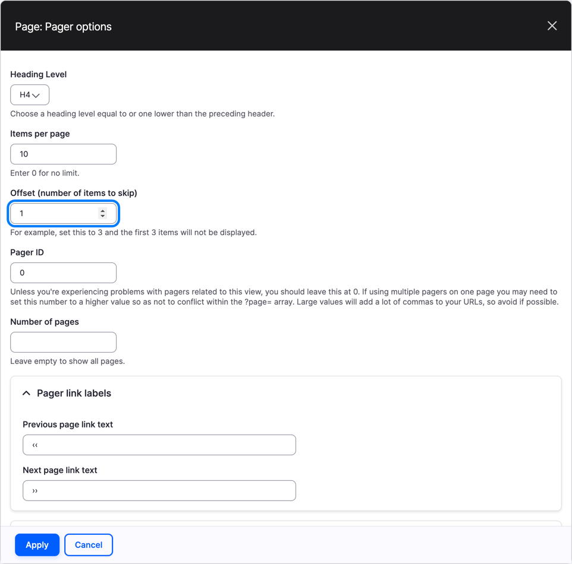
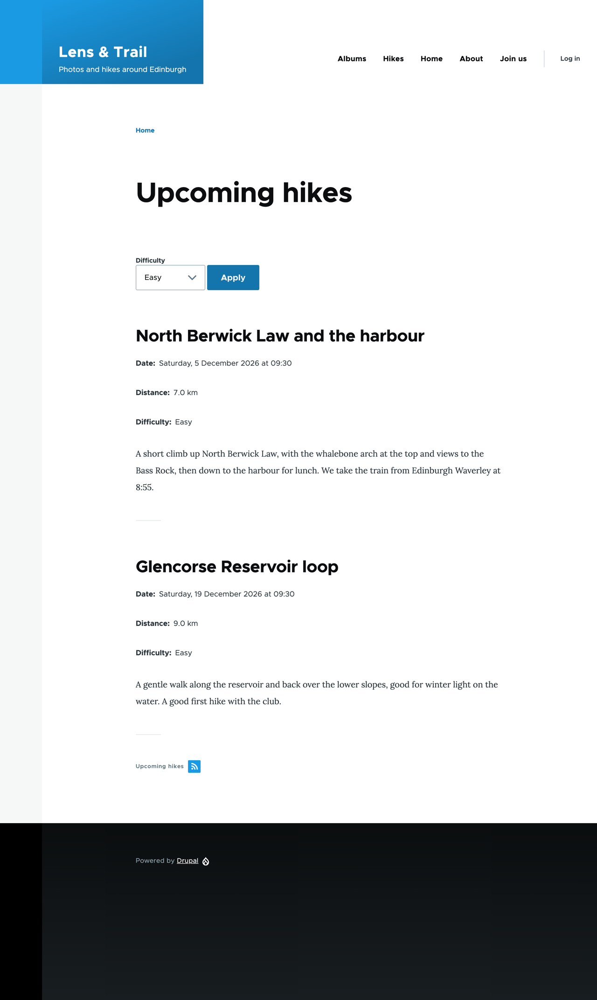
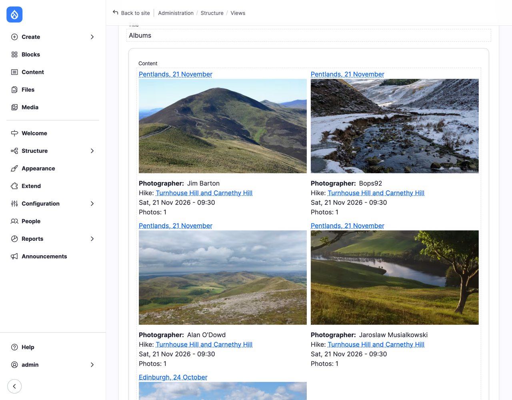
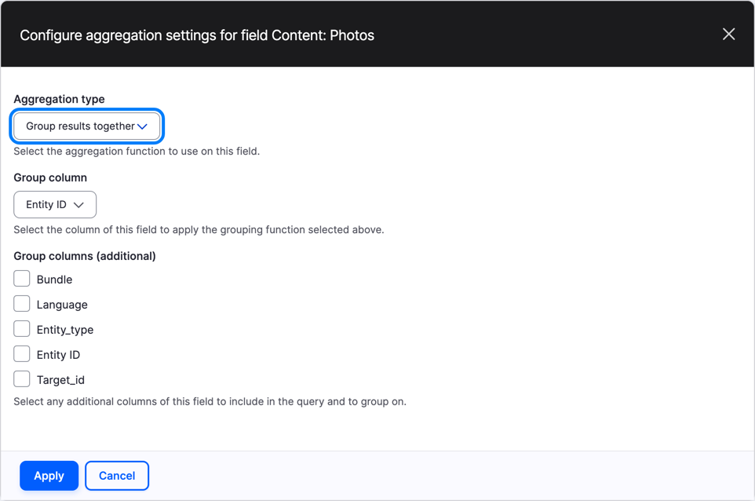
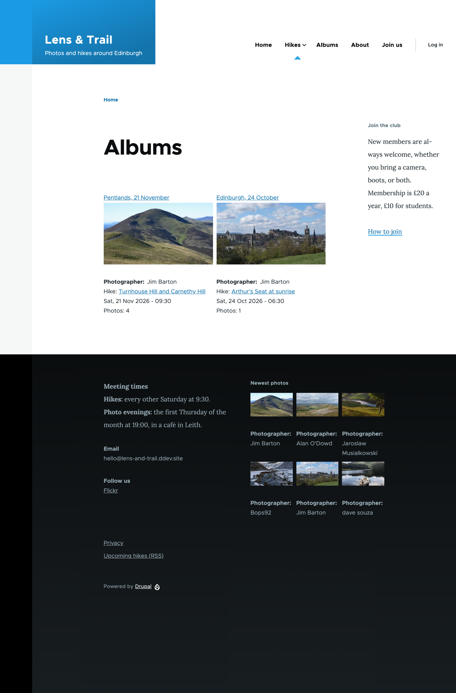
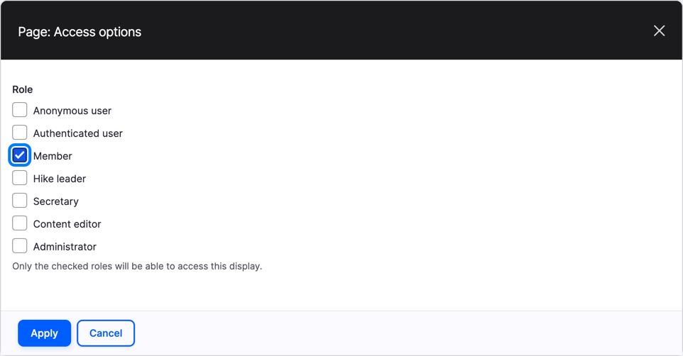
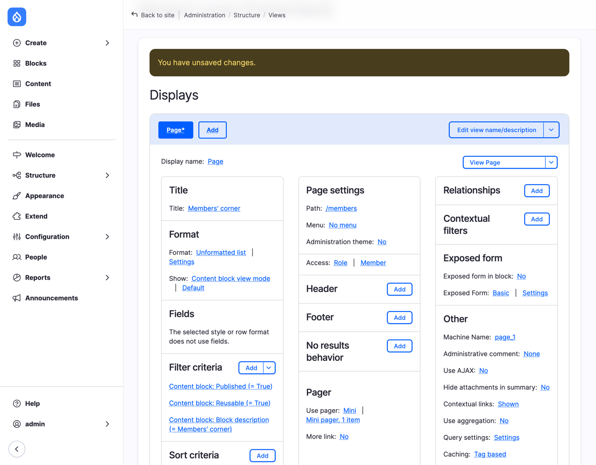
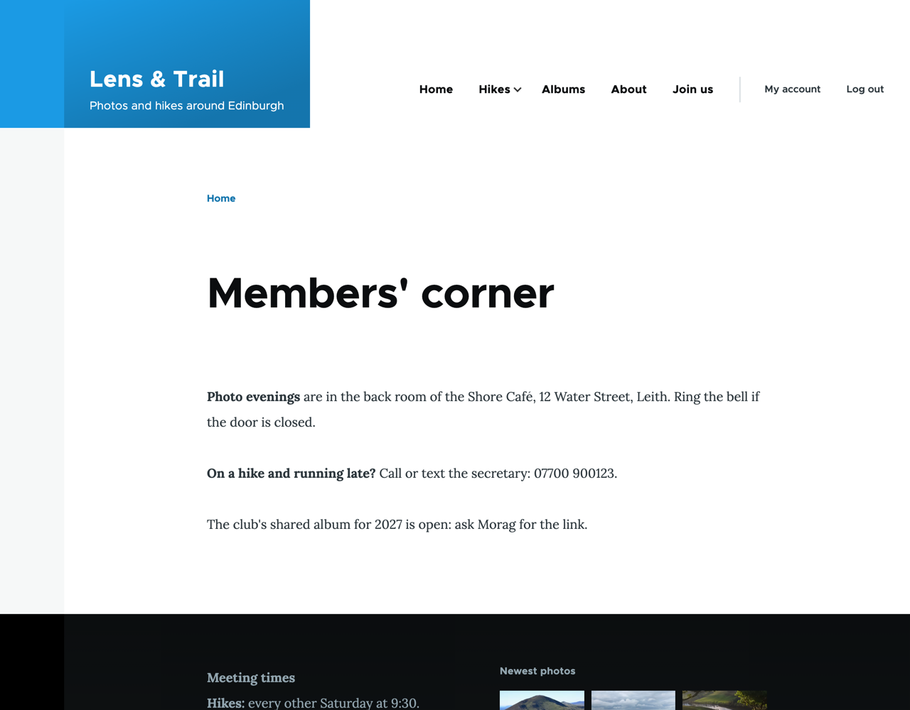
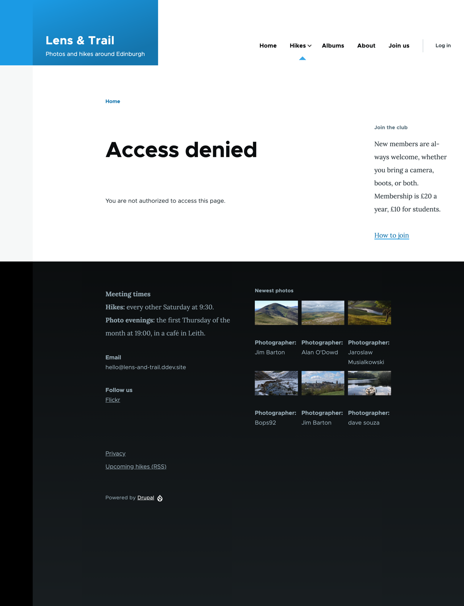

# Appendix C: Answers to the Advanced Exercises

Most exercises in this book have more than one good answer, and you'll learn the most by trying them before you look. But the exercises marked *(advanced)* go a step further than their chapter, and we don't want to leave you stuck. Here are our answers, with the reasons behind them. If you found another way that works, it's probably fine: in Drupal, there usually is more than one.

## Chapter 13, Exercise 6: the next hike first

*Show the very next hike on its own, before the list on `/hikes`, with an attachment, and skip it in the list below with the pager's **Offset**. Now choose* Easy *in the exposed filter. What goes wrong, and why? Is there a way out, or would you choose a different design?*

### What goes wrong

The straightforward version works, until a visitor uses the filter. Add an attachment that shows one hike before the page, and set the page's **Offset** to `1`, so that it skips the hike the attachment already shows. Then choose *Easy*:

- The attachment still shows the next hike of *any* difficulty: *Turnhouse Hill and Carnethy Hill*, which is Moderate.
- The list skips its first result, which is now the first *easy* hike, *North Berwick Law and the harbour*. It's on neither the attachment nor the list.

So the page shows a moderate hike under *Easy*, and hides an easy one.

### Why

An attachment is a display of its own (see "Displays, in depth" in Chapter 13). It has its own filters, and the exposed filter we added in Chapter 12 belongs to the page only: we overrode the page's filters to add it. The attachment never sees what the visitor chose. The page's offset doesn't know anything about the attachment either: it skips the first result of *its own* list, whatever that is.

The two have to agree on what they're listing. Then the attachment's first hike and the page's skipped hike are always the same one.

### The way out

Give the attachment the same exposed filter, and let it take the visitor's choice from the page.

1. Edit the **Hikes** view, and select **Add** > **Attachment**. (Not **Duplicate as Attachment** on the page: the copy would share the page's pager, and setting its number of items would change every display that shares it.)
2. Select **Display name**, and call the display `Next hike`.
3. Under **Attachment settings**, set **Attach to** to **Page**, and **Inherit exposed filters** to **Yes**.
4. Add the filter **Difficulty (field_difficulty)** for **This attachment (override)**, and turn on **Expose this filter to visitors, to allow them to change it**, with the **Label** `Difficulty`, as you did on the page in Chapter 12. Its **Filter identifier** must be the same as the page's, `field_difficulty_value`: that's how the attachment recognizes the visitor's choice.
5. Under **Pager**, select **10 items**, set **Items to display** to `1`, and select **Apply**.


*Figure C.1: An attachment that listens to the page's exposed filter*

An attachment never shows an exposed form of its own, so visitors still see one **Difficulty** select: the page's. **Inherit exposed filters** passes its value on.

6. Select the **Page** display. Under **Pager**, select **Mini**, set **For** to **This page (override)**, keep **Paged output, mini pager**, and select **Apply (this display)**. In the pager options, set **Offset (number of items to skip)** to `1`, and select **Apply**.


*Figure C.2: The page skips the hike the attachment shows*

We override the pager for the page only: **Page 2** and **Page 3**, the member's hikes and the archive, share the same pager, and they shouldn't skip anything.

7. **Save** the view, and choose *Easy* on `/hikes`.


*Figure C.3: The next easy hike first, then the other easy hikes*

The attachment shows the next easy hike, and the list starts with the one after it. Without a filter, the attachment shows the next hike of any difficulty, and the list the rest.

### A different design?

It works, but it's a fragile pair: two displays that must always have the same filters. If someone adds a filter to the page and forgets the attachment, the problem is back, and it doesn't show until a visitor uses that filter. Write it in the view's **Administrative comment**, under **Other**, so the next person knows.

If the club only wants the next hike to stand out, there are simpler designs:

- Show the next hike in a *different view mode*, such as Card, in a block above the page, without an offset: the next hike appears twice, once large and once in the list. Many sites do exactly that, and nobody minds.
- Leave the list alone, and make the first teaser look different with a theme of your own (Chapter 16 shows where that begins; our companion book, *Theming Drupal*, shows how).

The best answer to "is there a way out?" is sometimes another question: do we need this at all? That's a good question to ask in every Views design.

## Chapter 13, Exercise 7: how many photos in each album

*Show the number of photos in each album on the albums page, below the hike's date: "Photos: 4". You'll need a relationship and aggregation. What happens to the list when you add the count, and how do you get one row per album back?*

### Counting the photos

Counting works as it did for the photographers: turn on aggregation, and count an ID. This time, the IDs are the album's photos, so we need a relationship to them first.

1. Edit the **Albums** view. Under **Other**, next to **Use aggregation**, select **No**, turn on **Aggregate**, and select **Apply**.
2. Add the relationship **Media referenced from field_photos**, and select **Apply**. Don't require it: an album without photos should still be listed, with **Photos: 0**.
3. Add the field **ID** (in **Media**). Set **Aggregation type** to **Count**, and select **Apply and continue**. In the field's dialog, set **Relationship** to **field_photos: Media**, turn on **Create a label**, type `Photos`, turn on **Place a colon after the label**, and select **Apply**.

### What goes wrong

Look at the preview:


*Figure C.4: Four rows for one album, each with one photo*

*Pentlands, 21 November* is back four times, as in "Too many rows" in Chapter 13, and each copy says **Photos: 1**. The count is right, in a way: each row has one photo.

### Why

With aggregation on, Views makes one row for each different combination of the *grouped* fields. **Photos**, the field that shows the album's first photo, is grouped too, and by default it groups by its own value: the ID of the photo. With the relationship, each album has four rows, one per photo, and each row has a different photo ID. So no two rows are the same, nothing is grouped, and each count is 1.

It's the warning from the end of "Counting: aggregation": a grouped field that's different in every row means no grouping at all. The difficulty here is that the field doesn't *look* different in every row: it shows "the first photo", but it groups by "this row's photo".

### The way out

Tell the **Photos** field to group by the album instead of the photo.

4. Under **Fields**, select **Aggregation settings** next to **Content: Photos**. (Once aggregation is on, every field, sort and filter has this link.)
5. Set **Group column** to **Entity ID**, and select **Apply**.


*Figure C.5: Group the first photo by its album, not by the photo*

**Entity ID** means the item the field belongs to: the album. All four rows of *Pentlands, 21 November* now have the same values in every grouped field, so they become one row, and the count adds up the photos. The field still shows the album's first photo, because it loads the album and shows its **Photos** as before, with **Display 1 value**.

6. **Save** the view, and open `/galleries`.


*Figure C.6: Every album with its number of photos*

The **Albums from this hike** block on a hike's page uses the same fields, so it shows the number too.

### Is there another way?

Not in Views without aggregation: an album doesn't store its number of photos, so something has to count them. If you'd rather keep the view simple, the theme can count the values of the **Photos** field when it shows an album, in its template (see "Under the hood: templates" in Chapter 16, and our companion book, *Theming Drupal*). That moves the counting out of the view, though, and the next person who wonders where "Photos: 4" comes from will look in the view first.

## Chapter 15, Exercise 7: a page for members only

*The club wants a page for members only, at `/members`: where the photo evenings are, and the secretary's phone number for hike days. Visitors, and people with an account who aren't members yet, should get "Access denied", and the secretary should be able to change the text. Why doesn't a Basic page with that text work? Build it with what you know from Chapters 12 to 14.*

### Why not a Basic page

In Drupal core, seeing content is one permission for all of it: **View published content**. Anonymous user has it, so every published page is visible to every visitor. Leaving the page out of the menu doesn't help: anyone who has the address, or tries `/node/` with a few numbers, reads it. Unpublishing doesn't help either: then members can't see it, unless you give them **View any unpublished content**, which shows them everyone's drafts.

Core has no permission like "view published Basic page content". Deciding who may see *each piece* of content is the third layer of "Under the hood: access" in Chapter 15, node access grants, and core leaves that to contributed modules.

But core can protect a *page*, rather than the content on it. A view's page has an **Access** setting (Chapter 13), and one of its options is a role. So we put the text where visitors can't open it on its own, in a content block that isn't placed anywhere, and show it on a view's page that only members may open.

### The text: a content block

1. On **Content** > **Blocks**, select **Add content block**, and choose **Basic block**.
2. **Block description**: `Members' corner`. Write the text in **Body**.


*Figure C.7: The members' text, in a content block*

3. Select **Save**, not **Save and configure**: this block doesn't go in a region.

A content block has no page of its own that visitors can open. As long as nobody places it, nobody sees it, except where we show it.

### The page: a view

4. Go to **Structure** > **Views**, and select **Add view**. **View name**: `Members' corner`. Under **View settings**, **Show** **Content Block**.
5. Check **Create a page**. **Page title**: `Members' corner`, **Path**: `members`, **Items to display**: `1`. Select **Save and edit**.
6. Under **Filter criteria**, add **Block description** (in **Content block**), with **Value** `Members' corner`, and select **Apply**. Now the view lists only this block.
7. Next to **Show** under **Format**, select **Fields**, choose **Content block view mode**, select **Apply**, and keep the **Default** view mode. The block appears as it was written, not as a list of fields.
8. Under **Page settings**, select **Permission** next to **Access**, choose **Role**, and select **Apply**. Check **Member**, and select **Apply**.


*Figure C.8: Members only*


*Figure C.9: The whole view*

The wizard added the filters **Published** and **Reusable** by itself; leave them.

9. **Save** the view. Log in as Ailsa, a member, and open `/members`:


*Figure C.10: What members see*

In a private window, as a visitor:


*Figure C.11: What everyone else sees*

Lucía, before the administrator made her a member, would have seen the same: **Access denied** checks roles, not whether someone is logged in. Morag is a member as well as the secretary, so they see the page. Administrators, on the other hand, don't: a role check isn't a permission, so neither the Administrator role nor user 1 gets past it. Log in as `admin` and you get **Access denied** too. Check **Administrator** as well in step 8 if that's a problem.

### Letting the secretary change it

On the Secretary role's permissions, check **Basic block: Edit content block** and **Access the Content blocks overview page**. Morag then finds *Members' corner* on **Content** > **Blocks**, and edits it like any other block.

That permission covers *every* Basic block, including *Join the club*. If the secretary should only change the members' text, give it a block type of its own (Chapter 14), such as *Members' text*, and give the secretary that type's **Edit content block** only.

### What it doesn't do

Only the page is protected, not the block. If someone places *Members' corner* in a region, it shows there for everyone who can see that region: write that in the block's description, or keep its type for this one use.

A menu link to the page is safe: give the view's page a **Normal menu entry** in **Main navigation**, and Drupal shows it only to the people who may open the page (Chapter 15's "Under the hood: access").

And it's one page. If members-only content grows (news for members, albums only members see), a page per item gets clumsy, and that's the time for a contributed module that decides access for each piece of content, such as [Group](https://www.drupal.org/project/group). Check which version of Drupal it supports before you choose.

## Chapter 20, Exercise 6: maintenance mode from the command line

*Put the club's site in maintenance mode from the command line with Drush, check what an anonymous visitor sees, and take it out of maintenance mode again.*

Drush has three commands for maintenance mode, `maint:set`, `maint:get` and `maint:status`. `ddev drush list` shows them, under `maint`, and `ddev drush help maint:set` explains each one.

```bash
ddev drush maint:set 1
ddev drush cache:rebuild
```

`maint:set 1` switches maintenance mode on, and `maint:get` tells you whether it's on (`1`) or off (`0`).

### Why the cache rebuild

Try it without `cache:rebuild` first, and open the front page in a private window: you see the normal front page. Nothing's wrong with the command. Drupal keeps a ready-made copy of each page for visitors who aren't logged in (the Internal Page Cache module), and it hands that copy out before it even looks at whether the site is in maintenance mode. `cache:rebuild` throws the copies away, and the next visitor gets the message:

> Lens & Trail is currently under maintenance. We should be back shortly. Thank you for your patience.

(That's Drupal's own message; Chapter 20 shows where to change it.) The page comes with the HTTP status code 503, "Service Unavailable", which tells search engines that the site is away for a moment, and to come back later, rather than that the page is gone. While you're logged in as an administrator, you see the site as usual, with a reminder at the top that it's in maintenance mode.

### Taking it out again

```bash
ddev drush maint:set 0
ddev drush cache:rebuild
```

Clear the cache again, or visitors may get the stored maintenance page for a while.

`maint:status` is for scripts: it does nothing when the site is up, and fails when it's in maintenance mode, so a script that deploys a site can check that it's really back up at the end.
