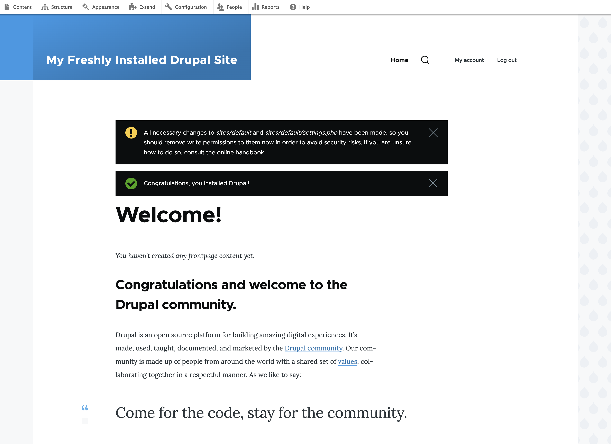
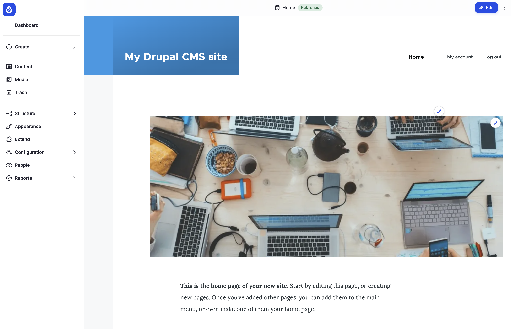

# What Is a CMS, and What Is Drupal?

I've been teaching Drupal for a long time. And every time we start, I start by thinking: "Where do I really start?" Because in order to explain "this", you really have to know about "that", and to really understand "that" you REALLY need to have basic knowledge of .... Hopefully you understand where I'm going with this.

So I've decided that I will start at one logical place, and start explaining. I'll mention some terms on the fly. Sometimes I'll explain a side term in detail right away, and sometimes I'll come back to it later. I hope that when you're done reading this book, it will all come together.

If Drupal feels a bit overwhelming at first, that's very understandable. Drupal is enterprise-level software, and if you aren't familiar with content management systems in general, it's quite a bite to take. But don't worry, we're here to guide you through the grapevine.

In this chapter we look at:

- What a content management system (CMS) is, and why you'd want one.
- What Drupal is, and the difference between Drupal core and Drupal CMS.
- The website we build throughout this book: the site of a photography and hiking club.
- A map of Drupal's building blocks: the words you'll hear again and again, and where in the book we meet each of them properly.
- If you know WordPress: what each Drupal building block is called there.

There's nothing to install in this chapter. Get yourself a cup of coffee (or tea), and let's get the big picture first. We install Drupal in Chapter 4.

## What's a CMS (and why should I use one)?

A **CMS** (*content management system*) is software that lets people create, edit, organize, and publish content, such as text, images, videos, or entire web pages, without having to code everything from scratch.

Its purpose is to make it easier for non-technical users (and technical ones too) to manage a website's content. Normally, you log in to an admin interface, add or update content through forms and editors, and the CMS stores it and displays it on your site.

Some of the best-known CMSs are WordPress, Drupal, Joomla, and Shopify. The first three are open source software (we look at what that means in Chapter 2), but Shopify is proprietary: it's owned by a company, and you rent it rather than own it.

Most CMSs have the same four parts:

- An **admin interface**, where you manage content and settings.
- A **database**, which stores your content and the information about it (who wrote it, when, in which category).
- A **template system** of some sort, which decides what your site looks like.
- A **plugin or module system**, for adding features to your site without rewriting the CMS itself.

### The alternative: a static website

The opposite of using a CMS would be a plain (*static*) website: a folder of HTML files, written by hand, and uploaded to a web server. Maintaining such a website is a headache and a half. To change anything, you edit the HTML and CSS files directly and upload them again, which means that everyone who edits the site needs to know HTML and CSS, maybe even JavaScript.

Think of what that means in practice. Our photography club meets for its hikes at a car park. If the meeting point changes, someone has to find every page that mentions it, edit each file, and upload them all again. And if the club's secretary, who doesn't know HTML, wants to post the news? They have to email someone who does, and wait.

A CMS separates the **content** (the meeting point, the news, the photos) from the **presentation** (the HTML around it). The content lives in a database, and the CMS puts the pages together when someone visits. Change the meeting point once, and every page that shows it is up to date. The secretary logs in, fills in a form, and presses **Save**.

Static sites do have their upsides. They're superfast, because the pages are prebuilt, and there's very little on the server for an attacker to break into. For a single page that never changes, a static site is fine. But if you're maintaining a site with more than four or five pages, or a site that more than one person edits, a CMS is always the wiser choice.

## What is Drupal?

Drupal is a free and open source CMS. It's written in PHP, a programming language made for the web, and it stores its content in a database such as MySQL, MariaDB, PostgreSQL, or SQLite.

Drupal has great standard features, like easy content authoring, reliable performance, and excellent security. But what sets it apart is its **flexibility**. Drupal doesn't decide for you what your content looks like. You tell it: "On this site we have hikes, and a hike has a date, a meeting point, a distance, and a difficulty." Drupal then gives you a form to enter hikes, stores them in a structured way, and lets you list, filter, and display them in any way you like. This is what we call *structured content*, and it's Drupal's strongest card.

That flexibility is why Drupal runs many large and complex websites: governments (the European Commission's sites, for example), universities, newspapers, and nonprofits, as well as many small ones. It's also why Drupal has a reputation for being harder to learn than some other CMSs. There's more to understand, because there's more you can do. That's what this book is for.

Drupal is made by a large community of people and companies all over the world, and it's free in both meanings of the word: it costs nothing, and you're free to use it, study it, change it, and share it. We tell the story of how that came to be in Chapter 3.

### Drupal core and Drupal CMS

When people say "Drupal" today, they may mean one of two things.

- **Drupal core** is Drupal itself: the software you download from drupal.org, with everything that every Drupal site needs. It comes with a set of built-in features, but it's intentionally kept lean. Most sites add more features to it.
- **Drupal CMS** is a ready-made product built on top of Drupal core, launched in 2025. It's Drupal core plus a carefully chosen selection of extra features, already installed and set up for you: an SEO toolkit, a visual page builder called *Drupal Canvas*, optional AI tools, and more. It also offers *site templates*: complete starting points for one kind of site, with their own content structure, pages, and design.

Even though they look very different out of the box, it's literally the same system, with a different setup. Drupal CMS *is* Drupal core, plus extra modules and configuration. Everything you learn about Drupal core is true on Drupal CMS too.

*Figure 1.1: Drupal core, right after installation*

*Figure 1.2: Drupal CMS, right after installation*

%% Author: both screenshots will be retaken by tools/screenshots.sh with the versions the book uses (Figure 1.2 shows Olivero; Drupal CMS 2 with the Starter template uses Mercury). %%

So which one should you use? People in the Drupal community disagree on this, and that's fine. Drupal CMS gets you further, faster, and it's a great starting point. I use it myself when I need to get a project off the ground quickly. But I strongly believe that you need to understand how Drupal works underneath, before you let a product set things up for you. Otherwise, the day something doesn't work the way you expect, you won't know where to look.

That's why we build our club site on **Drupal core** in this book, and set up every feature ourselves. Wherever Drupal CMS does something differently, or has already done it for you, I show you that too. You'll then be able to use either one, and know what's going on.

> **Drupalism: CMS, Drupal CMS, and "the CMS".** "CMS" is the general term: Drupal is a CMS, and so is WordPress. "Drupal CMS" is the product described above. Before 2025, "Drupal CMS" only ever meant "Drupal, the CMS", so when you read it in an older text, it means Drupal in general. In a recent text, check which one is meant.

## The site we build: Lens & Trail

Learning a CMS from loose examples ("let's create a test page", "let's add a field called Foo") only gets you so far. You learn how the buttons work, but not how the pieces fit together. So in this book we build one real-world website, from an empty Drupal site to a site you could put online.

**Lens & Trail** is a small photography and hiking club in Edinburgh, Scotland. Every few weeks its members go on a hike, in the Pentland Hills, along the coast, or further away in the Highlands, and they take photos along the way. Back home, they pick the best ones and show them on the club's website. Quite a few of the members are from Spain and Latin America, so the club runs its site in both English and Spanish.

The club's website needs:

- **Hikes**: an upcoming-hikes calendar, where each hike has a date, a meeting point, a distance, a difficulty, and a description.
- **Photos**, with the photographer, where the photo was taken, and when.
- **Galleries**: the photos from each hike, together.
- **Members**: people who log in, with a profile page, and who can upload their own photos.
- **News**: announcements, such as a photo competition or the annual general meeting.
- **Pages** that rarely change, such as *About the club* and *How to join*.
- **Categories**, so visitors can find all photos of mountains, or all hikes in the Pentlands.
- Everything in **English and Spanish**.

And behind the scenes, the club needs a few people to run it: a secretary who posts the news, hike leaders who add hikes, members who upload photos, and one or two administrators who keep the site safe and up to date.

Each chapter adds a piece of this, and starts where the previous one left off:

| Chapter | What we add to the Lens & Trail site |
|---|---|
| 4. Installing Drupal | The empty site, on your own computer. |
| 5. Finding Your Way Around | The club's name, slogan, and email address. |
| 6. Your First Page | *About the club* and *How to join*, laid out two ways. |
| 7. Everything Is an Entity | The *Hike* and *News* content types, with their fields. |
| 8. Media and Image Styles | Photos, with photographer and location, in the right sizes. |
| 9. Taxonomy | Categories for places and photo themes. |
| 10. Extending Drupal | New features from contributed modules and recipes. |
| 11. Views | Lists: upcoming hikes, the newest photos, a gallery per hike. |
| 12. Blocks, Regions, and Menus | The menus, and what goes in the sidebar and footer. |
| 13. Users, Roles, and Permissions | Members, hike leaders, and the secretary, each with the right access. |
| 14. Appearance | A look of the club's own. |
| 15. Nice URLs and SEO | Addresses such as `/hikes/pentland-hills-ridge`. |
| 16. Multilingual Sites | Spanish. |
| 17. AI in Drupal CMS | Help with writing and describing photos. |
| 18. Keeping Your Site Safe | Updates and backups. |
| 19. Configuration and Going Live | The site on a real server. |

## A map of Drupal's building blocks

Now let's look at the words you'll hear all the time when people talk about Drupal. Don't try to memorize them now. This is a map, so that you know roughly where everything is when we get there. Each building block gets a chapter (or a good part of one) later in the book.

One thing before we start. Most of these building blocks have something in common: Drupal treats them all as *entities*. That's a technical term I'll explain properly in Chapter 7. For now, think of an entity as "a thing Drupal stores, that you can add your own fields to". Because they're all entities, they all work in a similar way, and once you've learned one, the next one comes much faster.

### Content types and nodes

**Content types** store data in a structured way. On the club site, *Hike* is a content type, and so are *News* and *Page*. By creating a different content type for each kind of content, we can decide for each one what information it holds, what its form looks like, and how it's displayed.

A hike has a date, a meeting point, and a difficulty. A news item only needs a publishing date. And a page, such as *About the club*, normally doesn't show its date at all. Still, all of them share a title, a text area for the description, and the user who created them.

Each piece of content you create, such as the hike *Pentland Hills Ridge, 14 June*, is called a **node**. The content type is the template; the node is the content you fill into it.

> **Drupalism: content and nodes.** In the admin interface, Drupal calls nodes *content* (**Content**, **Add content**). In documentation, and when Drupal people talk, you'll hear *node* all the time. They're the same thing.

We dig into content types in Chapter 7, where we build the club's *Hike* and *News* content types.

### Fields

A **field** is one piece of information in a content type: the date of a hike, its distance, its photo. Drupal comes with many types of fields: text, numbers, dates, links, email addresses, images, references to other content, and more. Modules add more, such as an address or a map location.

Fields are what makes Drupal's content structured. Because the distance of a hike is stored as a number, not as part of a text, Drupal can sort hikes by distance, or show only the hikes under 10 kilometers. We also cover fields in Chapter 7.

### Media

**Media** are the images, videos, documents, and audio files on your site. Instead of uploading the same photo again for every page it appears on, you upload it once to the media library, and use it wherever you need it. A media item can have fields too: our photos get a photographer and a location. Media gets a chapter of its own, Chapter 9.

### Taxonomy

A **taxonomy** is a system for classifying and organizing content. You create a *vocabulary*, such as *Places*, and fill it with *terms*, such as *Pentland Hills*, *Arthur's Seat*, and *Isle of Skye*. Then you tag content with the terms, which lets visitors find all hikes and photos from the same place, and helps with filtering, grouping, and navigation. We set up the club's vocabularies in Chapter 10.

### Modules and recipes

**Modules** extend what a Drupal site can do. There's a saying in the Drupal world: "There's a module for that". If you need something that Drupal can't do out of the box, someone has very likely written a module that does it. Modules come in three kinds:

- **Core modules** are part of Drupal core, and are developed and maintained by the Drupal core team. Some are essential: the User module handles logging in, and if you could uninstall it, you'd never be able to log in to your site again. Others are optional, like the Comment module, which lets visitors comment on your content. A core module has the same version number as the core you are running.
- **Contributed modules** (*contrib modules* for short) are written by the community and shared on drupal.org, for free. There are tens of thousands of them, for things such as SEO, nicer URLs, forms, maps, and integrations with services like Stripe or Google Analytics. Some, like Pathauto, Token, and Webform, are used on hundreds of thousands of sites; others have only a handful of users. Every module has its own page on drupal.org, where you can read its documentation, see its open bugs, and even help improve it yourself.
- **Custom modules** are written for one specific site, when no existing module does what's needed. Writing modules is beyond this book, but its companion book teaches it.

A **recipe** is a newer way of adding features. It installs a set of modules and sets them up for you, in one go, for a job such as "a blog" or "an events calendar". When it's done, the recipe is gone: there's nothing to uninstall, only the result. Drupal CMS is built almost entirely out of recipes. We install our first modules and recipes in Chapter 11.

### Views

**Views** is Drupal's data-gathering tool. If you need a list of upcoming hikes, the ten newest photos, all news from last year, or a table of members, you build it with Views: you choose what to list, how to filter and sort it, and how to show it, all in the browser. Then you show the result as a page of its own, or as a block on other pages.

Views was a contributed module for many years. So many sites installed it as their very first module that it was finally moved into Drupal core, in Drupal 8. Views is one of the most powerful parts of Drupal, and gets all of Chapter 12.

### Blocks and regions

A **block** is a reusable chunk of content or functionality that you place in a part of the page: a sidebar, the header, the footer. Those parts are called **regions**, and each theme decides which regions it has.

A block can be completely static, like a short text about the club in the footer, or created on the fly, like the list of the next three hikes, built by a view. One block that comes with Drupal core displays **Powered by Drupal**. You decide for each block where it appears, and when: only on the front page, only for logged-in members, only on hikes. We place the club's first blocks in Chapter 13.

### Menus

**Menus** are collections of links that help visitors navigate your website. A site usually has several. The main menu is normally at the top of the page, a footer menu at the bottom, and the user account menu holds links such as **My account** and **Log out**. You can create as many menus of your own as you need. We build the club's menus in Chapter 13 too, together with blocks.

### Users, roles, and permissions

**Users** in Drupal can very roughly be divided into two groups. An *anonymous* user is anyone who visits your site without logging in, which is most of the people on the internet. An *authenticated* user is anyone who has logged in. You then divide authenticated users into **roles**, such as *Member*, *Hike leader*, and *Secretary*, and give each role the **permissions** it needs: who can add hikes, who can upload photos, who can publish news.

When you install Drupal, one user is always created: *user 1*, often named *admin*. User 1 is not only an administrator, it's **THE** administrator, a superuser that gets past every access check you set up. That's handy, but with great power comes great responsibility, and that's why some sites switch user 1's special powers off. We meet user 1 again in Chapter 14, where we set up the club's roles.

### Themes

**Themes** are the presentation layer of a Drupal website. A theme controls *how* content and the interface are displayed, without changing *what* the content is or *how* it's stored.

You can think of Drupal as a layered cake. Drupal core and the modules handle the data, the logic, and the features: the cake. The theme adds the frosting: the layout, the colors, the typography, and the visual style. Themes never change the content in the database.

A site has two themes. The **front-end theme** is what your visitors see. The **admin theme** is what editors and administrators see while they work. Drupal's admin theme is *Default Admin*, built from Gin, a popular contributed admin theme. It arrived as an experimental theme in Drupal 11.4, and since Drupal 11.5 and 12 it's stable, and the admin theme a new site gets. You'll see it in every screenshot of the admin interface in this book. And then there's the hidden third: many editors like to see the result as they work, so the front-end theme also shows some editing tools. Drupal Canvas works that way. We give the club a look of its own in Chapter 15.

### Configuration

Finally, a word that's easy to miss, but important. Drupal separates **content** from **configuration**. Content is what the site is about: the hikes, the news, the photos, the members. Configuration is how the site works: its name, its content types and fields, its vocabularies, its views, which modules are installed, and who may do what.

Why does that matter? Because you'll often build or change a site on your own computer first, and then move your changes to the live site. You want to move the configuration (the new *Hike* content type), but not the content (the test hikes you made up while building it). Drupal can export the configuration to files, and import it on another copy of the site. We move our first configuration from one copy of the site to another in Chapter 20.

## Coming from WordPress?

Many people come to Drupal after using WordPress, and if that's you, you already know a lot more than you think. WordPress and Drupal are both open source CMSs, both written in PHP, and both made by large, friendly communities. They solve many of the same problems, in different ways, and each has its strengths. This isn't a contest: if you know one, it helps you learn the other.

So here's a translation table: for each Drupal building block, the closest thing in WordPress, and where the two differ. If you've never used WordPress, skip ahead to the summary. You won't miss anything you need.

| Drupal | Closest in WordPress | Where they differ |
|---|---|---|
| Content type | Post type (posts, pages, custom post types) | In Drupal you create content types in the browser, with their fields. In WordPress, custom post types are usually registered in code, or with a plugin. |
| Node (content) | A post, or a page | The same idea: one piece of content. |
| Field | Custom field (often with a plugin, such as Advanced Custom Fields) | Fields are built into Drupal core, and every field has a type (a date, a number, a link...). |
| Media | Media Library | Very close. In Drupal, media items can have fields too, such as our photographer. |
| Taxonomy vocabulary | Categories and tags | WordPress comes with two taxonomies, and more need code or a plugin. In Drupal you create as many vocabularies as you need, in the browser. |
| Module | Plugin | The same role: adding features. A Drupal *plugin* is something else (see the box below). |
| Recipe | No direct equivalent | A recipe sets up modules and configuration in one go, and then it's gone. |
| Views | The Query Loop block, or a plugin | Views can list any kind of data (content, users, media, terms), with relationships between them, and show it as pages, blocks, or feeds. |
| Block, in a region | Widget, in a widget area | Not the same as a block in the WordPress block editor (see the box below). |
| Drupal Canvas, Layout Builder | The block editor and the Site Editor | Two different tools in Drupal; Chapter 8 shows both. |
| Menu | Menu, or the Navigation block | Very close. |
| Role and permissions | Role and capabilities | WordPress has six predefined roles, and new ones need code or a plugin. In Drupal you create roles in the browser, and choose each one's permissions. |
| Theme | Theme | Very close. Drupal sites also have a separate admin theme. |
| Configuration export | No direct equivalent | Drupal can export a site's configuration to files, and import it on another copy of the site. |

> **Drupalism: plugins and blocks.** Two words mean something different in Drupal than in WordPress. A WordPress *plugin* is what Drupal calls a *module*. Drupal has plugins too, but they're small pieces of code inside a module, and as a site builder you'll rarely need to think about them. And a block in the WordPress block editor is a piece of content inside a post, like a paragraph or an image. A Drupal *block* is placed in a region of the page, such as the sidebar, which makes it closer to a WordPress widget. The closest thing in Drupal to a block-editor block is a component in Drupal Canvas.

We come back to WordPress a few times later in the book, but only where knowing it helps, or where it might lead you astray.

## Summary

- A CMS stores content in a database and builds the pages from it, so that people can manage a site without knowing HTML.
- Drupal is a free, open source CMS, known for its flexibility and for structured content.
- Drupal core is Drupal itself. Drupal CMS is a product built on core, with extra features set up for you. We build on core, and show what Drupal CMS does differently.
- Throughout the book we build the Lens & Trail site, for a photography and hiking club in Edinburgh, in English and Spanish.
- Drupal's building blocks are content types (and nodes), fields, media, taxonomy, modules and recipes, views, blocks and regions, menus, users and roles, and themes. Most of them are entities, which is why they work in similar ways.
- Content is what the site is about; configuration is how it works.

## Exercises

1. **A CMS or not?** Think of three websites you use often. For each, guess whether it's built with a CMS, and who edits it. What content on it changes often, and what rarely changes?
2. **Find a module.** Go to the module listing on drupal.org (<https://www.drupal.org/project/project_module>) and find a module that could show the club's hikes on a map. On its project page, find out: how many sites use it, whether it works with Drupal 11, and whether it's covered by the Drupal security team (look for the shield icon and the text about security advisory coverage).
3. **Content, or configuration?** Sort these into content and configuration: the hike *Arthur's Seat at Sunrise*; the *Hike* content type; the site's name; a photo of Edinburgh Castle; the *Places* vocabulary; the term *Pentland Hills*; the permission that lets hike leaders add hikes.
4. **Who does what?** List the people who use the Lens & Trail site (visitors, members, and so on). For each, write down two things they need to do on the site, and two things they must *not* be able to do. Keep your list: we use it in Chapter 14.
5. **Model a hike** *(challenge)*. Write down every piece of information the club might want to store about a hike. For each, think about its type: is it text, a number, a date, a link, a photo, or a reference to something else, such as a place or a member? Which pieces would you want to sort or filter hikes by? Compare your answer with the *Hike* content type we build in Chapter 7.

## Want to know more?

- [About Drupal](https://www.drupal.org/about), on drupal.org: what Drupal is, and who makes it.
- [Drupal CMS](https://new.drupal.org/drupal-cms): the product, its features, and how to try it.
- [Site templates](https://www.drupal.org/browse/site-templates): the site templates you can start a Drupal CMS site from.
- [Case studies](https://www.drupal.org/case-studies): real sites built with Drupal, by sector.
- [Drupal User Guide](https://www.drupal.org/docs/user_guide/en/index.html): the official guide to building a site with Drupal core, kept up to date with the current version. A good second opinion on everything in this book.
