# Installing Drupal

Enough history: let's get Drupal running on your own computer. By the end of this chapter you'll have the Lens & Trail club's website installed, with a theme for visitors and an administrator account for you. It won't have any content yet (that starts in Chapter 6), but it will be *yours*, and everything we build in the rest of the book goes on top of it.

There are many ways to install Drupal. In this book we use one of them, **DDEV**, for every site we build. DDEV runs a small web server, a database and PHP for you, each in its own container, so you don't have to install and configure any of them on your computer. It's free and open source, it works the same on macOS, Windows and Linux, and it's what most of the Drupal community uses for local development. If you want to know what containers are, and how DDEV compares to the alternatives, Appendix A, *Development Tools*, explains it. You don't need to read it first.

> **Note:** "Local" means on your own computer, where only you can see the site. That's where you build and try things out. Putting a site on the internet, where everybody can see it, comes in Chapter 19.

## What you need

- A computer running macOS, Windows or Linux, with at least 8 GB of memory and a few gigabytes of free disk space.
- A terminal: **Terminal** on macOS, **Ubuntu** (inside WSL2) on Windows, and whichever terminal you like on Linux. You only need to type the commands in this chapter; you don't need to know how they work.
- An internet connection, to download Drupal and the tools.
- About an hour, the first time. Most of it is waiting for downloads.

## Installing DDEV

DDEV needs a *Docker provider*: a program that runs the containers. Then you install DDEV itself. The steps differ a little between operating systems, and they change now and then, so follow DDEV's own documentation for yours. Here's what to expect:

- **macOS:** install a Docker provider (DDEV's documentation lists OrbStack, Docker Desktop and others; any of them works), then install DDEV with Homebrew: `brew install ddev/ddev/ddev`. Then run `mkcert -install` once, so your browser trusts the local sites' certificates.
- **Windows:** DDEV runs inside WSL2, Windows' built-in Linux. You install WSL2 with an Ubuntu distribution, then run DDEV's Windows installer, which sets up Docker inside WSL2 for you. From then on, you type every command in the Ubuntu terminal, not in PowerShell.
- **Linux:** install Docker, then DDEV from its package repository (for Debian and Ubuntu, with `apt`).

The two pages to follow are DDEV's *Docker Installation* and *DDEV Installation*, linked under "Want to know more?" at the end of this chapter.

When you're done, check that it worked. Open a new terminal and type:

```bash
ddev --version
```

You should see something like `ddev version v1.25.5`. If you see "command not found", the installation didn't finish; go back to DDEV's documentation, or close the terminal and open a new one.

## A word about Composer

Drupal is made of many smaller pieces of software, and **Composer** is the tool that downloads them and keeps their versions working together. You won't need to install it: DDEV comes with it, and you run it as `ddev composer`. We look at it properly in Chapter 10, when we add modules to the site.

## Creating the Lens & Trail project

Every site you build with DDEV lives in its own folder, and DDEV calls it a *project*. Ours is called `lens-and-trail`. I keep all my projects in a folder called `websites` in my home folder, but you can put yours wherever you want.

1. Create a folder for the project, and go into it:

   ```bash
   mkdir -p ~/websites/lens-and-trail
   cd ~/websites/lens-and-trail
   ```

2. Tell DDEV what kind of project this is:

   ```bash
   ddev config --project-type=drupal12 --docroot=web
   ```

   This creates a `.ddev` folder with DDEV's settings. `--project-type=drupal12` tells DDEV to set things up the way Drupal 12 likes them (the right PHP version, for one), and `--docroot=web` says that the files the web server shows will be in a folder called `web`. DDEV takes the project's name from the folder's name. A project name can contain dashes (-) but not underscores (_).

3. Start the project:

   ```bash
   ddev start
   ```

   The first time, this takes a while: DDEV downloads the containers for the web server and the database. When it's done, it tells you the site's address: `https://lens-and-trail.ddev.site`.

4. Download Drupal:

   ```bash
   ddev composer create-project drupal/recommended-project:^12
   ```

   This fetches Drupal core and everything it needs, and puts it in the project folder. `drupal/recommended-project` is the Drupal project's own starting point for a new site, and `^12` asks for the newest Drupal 12.

%% Until Drupal 12.0.0 is released (planned for the week of 7 December 2026), this needs `drupal/recommended-project:^12@beta` (or `@rc`). Drop this note after the release. %%

5. Add Drush:

   ```bash
   ddev composer require drush/drush
   ```

   **Drush** is Drupal's command-line tool. You don't need it to install Drupal, but it's handy for a lot of things, and we use it a few times in this chapter: you'll recognize its commands by `ddev drush` in front of them.

%% No released Drush supports Drupal 12 yet (2026-11-04: Drush 13 needs Guzzle 7, and Drupal 12 uses Guzzle 8). The test site runs 14.x-dev, which needs `minimum-stability dev`. Check before publication that a stable Drush works with `ddev composer require drush/drush`. %%

> **On Drupal 11:** use `--project-type=drupal11` in step 2, and `drupal/recommended-project:^11` in step 4. Everything else is the same.

We now have all of Drupal's files, but no website yet: Drupal still has to create its database tables and its first user. That's the installer's job.

## Running the installer

Open the site in your browser:

```bash
ddev launch
```

`ddev launch` opens the project's address in your default browser. Because Drupal isn't installed yet, it takes you to the installer.

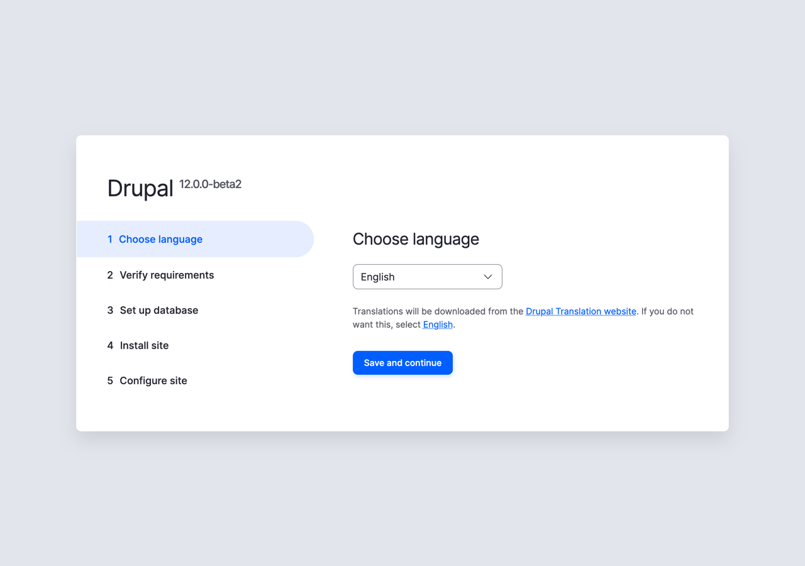
*Figure 4.1: The installer's first step, Choose language*

The first step is **Choose language**. Pick **English** and select **Save and continue**. You can pick another language here, and Drupal downloads its translation; we keep the site in English for now, and add Spanish in Chapter 16, as a second language for the club's members.

Then the installer goes through three steps by itself, so you'll see them in the list on the left, but you won't have to do anything:

- **Verify requirements** checks that the server has everything Drupal needs: the right PHP version, enough memory, and so on. DDEV took care of all of it.
- **Set up database** connects Drupal to its database. DDEV already created one and told Drupal where it is.
- **Install site** creates the tables, and installs the modules that make up a standard Drupal site. This takes a minute.

> **On Drupal 11:** the installer asks one more question, after the language: **Choose profile**. Pick **Standard**. A *profile* is a set of modules and settings to start with; Drupal 12 always uses Standard, so it doesn't ask.

### Configure site

The last step is a form, **Configure site**. It's long, so let's go through it.

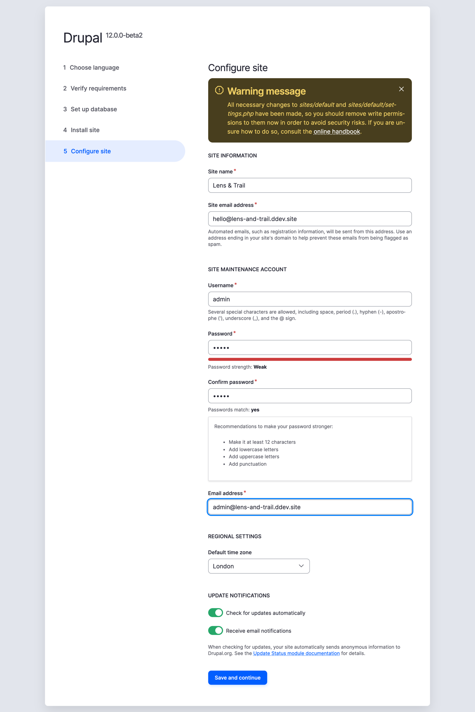
*Figure 4.2: The Configure site form, filled in for Lens & Trail*

**Site information**

- **Site name:** `Lens & Trail`. Visitors see it in the browser tab and, with most themes, at the top of every page. You can change it later.
- **Site email address:** `hello@lens-and-trail.ddev.site`. This is the *From* address on every email the site sends: a welcome email for a new member, a password reset link, and so on. On a real site, it should be an address that exists, on the site's own domain, or the emails tend to end up in spam folders. Locally it doesn't matter: DDEV catches every email the site sends, and doesn't deliver any of them; `ddev mailpit` opens a page where you can read them.

**Site maintenance account**

This is the first user, the site's administrator, who can do anything on the site.

- **Username:** `admin`.
- **Password** and **Confirm password:** I use `12345` for sites on my own computer, and so does the book. Drupal shows you that it's a weak password, and it is.
- **Email address:** `admin@lens-and-trail.ddev.site`. This is *your* address, as the administrator: the site sends you a password reset link to it, and security notifications (see below).

> **Warning:** `12345` is fine for a local site that only you can reach. Never use it on a site that's on the internet: every attacker tries it first. Chapter 18 has more about keeping a live site safe.

**Regional settings**

- **Default time zone:** `London`. Drupal fills in the time zone of the computer you're installing from, so it shows your own. Mine said Reykjavik, because that's where I live. But the time zone is the *site's*, not yours: the club is in Edinburgh, so its hikes and meetings need UK time. And it makes a difference, even between two places that look alike. Reykjavik is on GMT all year, while the UK moves its clocks forward an hour in the summer, so a hike starting at 9:00 in July would show up an hour off.

**Update notifications**

- **Check for updates automatically** and **Receive email notifications:** leave both checked. Drupal then checks drupal.org regularly for new versions of Drupal and of your modules, and emails the administrator when there's a security update. On a live site that's important; locally it doesn't hurt.

Select **Save and continue**. A moment later, you're logged in to your new Drupal site.

> **Using Drush instead:** Drush can do the whole installation in one command, without the browser:
>
> ```bash
> ddev drush site:install --site-name="Lens & Trail" --account-name=admin --account-pass=12345 -y
> ```
>
> It asks whether it may drop (delete) all the tables in the database. On a new project that's fine: there's nothing there. But it really does delete everything, so never run it on a project that has a site you want to keep. The browser installer is the one we use in this book, because you see what Drupal asks, and why.

## A first look around

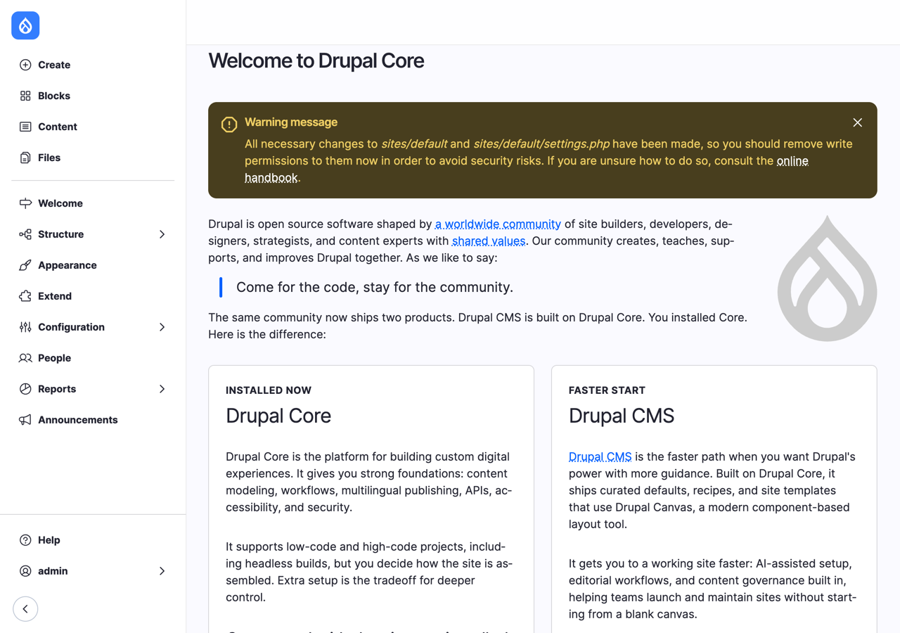
*Figure 4.3: The Welcome page, the first thing you see after the installation*

You land on a page called **Welcome to Drupal Core**, with the Navigation sidebar on the left. It explains the difference between Drupal core, which you just installed, and Drupal CMS. Read it, if you like: it says the same as Chapter 1, only shorter. And the quote from Chapter 2 is there: "Come for the code, stay for the community." 🙂

The yellow **Warning message** at the top says that you should "remove write permissions" to `sites/default` and `sites/default/settings.php`. `settings.php` is the file where Drupal stores how to connect to the database, among other things. The installer needed to write to it; now that it's done, the warning says, nobody should be able to change it, in case someone breaks into the server. On a live server, that matters. On your own computer, inside DDEV, it doesn't, and you can ignore the warning. You'll see the same warning on the **Status report** (**Reports** > **Status report**, `/admin/reports/status`), which lists everything Drupal knows about its own health.

Now let's see what we have. There are three things that may surprise you.

**There are no content types.** Go to **Structure** > **Content types** (`/admin/structure/types`). The list is empty. A *content type* is a kind of content, like a page or a news item (Chapter 7 explains them properly), and older versions of Drupal came with two, Basic page and Article. Drupal 12 leaves that to you, because every site needs different ones. We create the first one, Basic page, in Chapter 6.

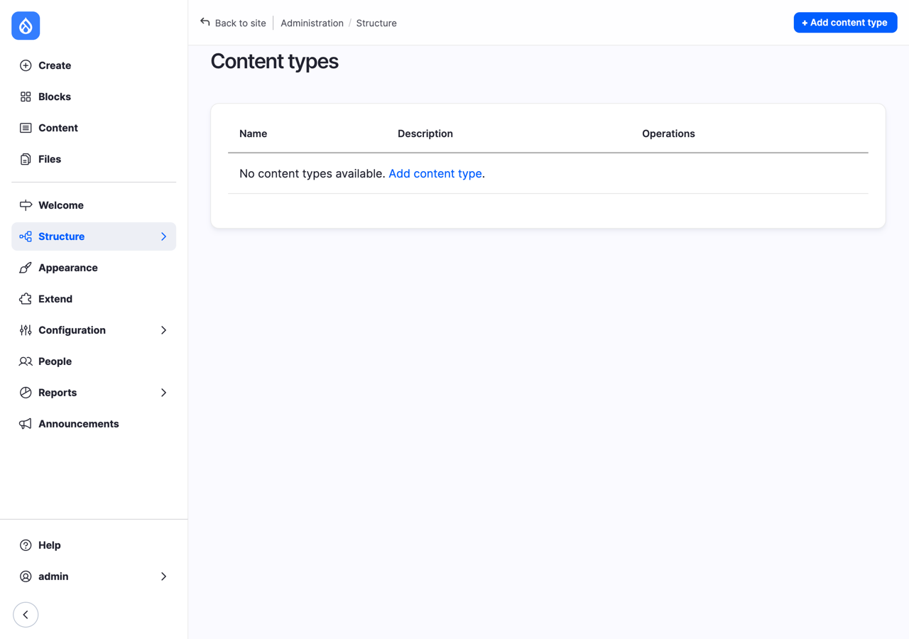
*Figure 4.4: No content types yet*

**There's no theme for visitors.** A *theme* decides what the site looks like (Chapter 14 is about themes). Go to **Appearance** (`/admin/appearance`): the only theme installed is **Default Admin**, the theme of the administration pages you're looking at. Drupal 12 core doesn't come with a theme for visitors: Olivero, the theme earlier versions installed, moved out of core, and is now a contributed project you download, like a module. We do that next.

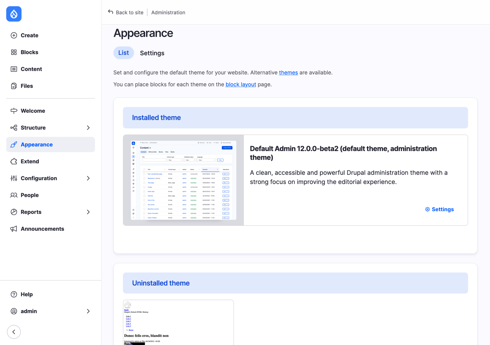
*Figure 4.5: The Appearance page of a new site: Default Admin, and no theme for visitors*

**Visitors can't see anything.** Open the site in a private browser window, where you're not logged in, and you get **Access denied**. The front page of a new site is that Welcome page, and it's only for administrators. That's fine while there's no content; we give the club a real front page once there's something to show, in Chapter 6.

### Installing a theme for visitors

We install **Olivero**, the theme that came with Drupal 9, 10 and 11. It's clean and accessible, and good enough for us until Chapter 14, where we look at themes properly.

1. In the terminal, in the project folder, download it:

   ```bash
   ddev composer require drupal/olivero
   ```

2. In the browser, go to **Appearance** (`/admin/appearance`). Olivero is now listed under **Uninstalled themes**.
3. Under Olivero, select **Install and set as default**.

Downloading and installing are two separate steps in Drupal, and you'll do them often. Composer puts the files in the project; installing it in Drupal turns it on. Now open the site's address in your private window again. It still says Access denied, but now in Olivero, with the site's name, Lens & Trail, at the top.

The administration pages keep **Default Admin**: Drupal has two themes at a time, one for visitors and one for the administration pages, so you can change what the site looks like without changing the tools you work with.

> **On Drupal 11:** Olivero is part of core, and the Standard profile already set it as the default theme. Skip this section.

%% Mercury, Drupal CMS's theme, replaces Olivero here once it has a stable Drupal 12 release (see the backlog). %%

### Logging in again

You're logged in now, but some day you won't be, and you'll have forgotten the password (not `12345`, though 😉). Log in at `/user/login`, or let Drush make you a one-time login link:

```bash
ddev drush uli
```

`uli` is short for *user login*. It prints a link that logs you in as the administrator, once. Copy it into the browser's address bar.

## Starting and stopping

DDEV's containers use memory, so stop a project when you're done working on it:

```bash
ddev stop
```

Your site, its files and its database are all kept, and you pick up where you left off with:

```bash
ddev start
```

`ddev launch` also starts a stopped project, and opens the site in the browser as well. A few other commands you'll use:

- `ddev describe`: the project's address, whether it's running, and the details of its database.
- `ddev list`: all your DDEV projects, and which of them are running.
- `ddev poweroff`: stops every project and DDEV itself, when you need the memory back.

> **Note:** DDEV's addresses use port 443, the standard port for `https`. If another program on your computer already uses it, DDEV picks another one, and the site's address gets a port number, such as `https://lens-and-trail.ddev.site:8443`. `ddev describe` always shows the right address.

## Installing Drupal CMS

Drupal CMS is installed the same way, with a different project. We build the club's site on Drupal core, as I explained in the Preface, but it's worth having a Drupal CMS site next to it: whenever this book says **On Drupal CMS**, you can try it there. You can do this section now or later.

1. Create a second project, next to the first one:

   ```bash
   mkdir -p ~/websites/lens-and-trail-cms
   cd ~/websites/lens-and-trail-cms
   ddev config --project-type=drupal11 --docroot=web
   ddev start
   ddev composer create-project drupal/cms
   ```

   At the time of writing, Drupal CMS (version {{ number:drupal_cms_version }}) runs on Drupal 11, so the project type is `drupal11`. It includes Drush, so there's nothing more to add.

2. Run `ddev launch`. Drupal CMS has its own installer, with three screens.

%% Screenshots and the text below are from Drupal CMS 2.2.8, on Drupal 11.4 (2026-11-04). Check the project type, the screens and the template list before publication. %%

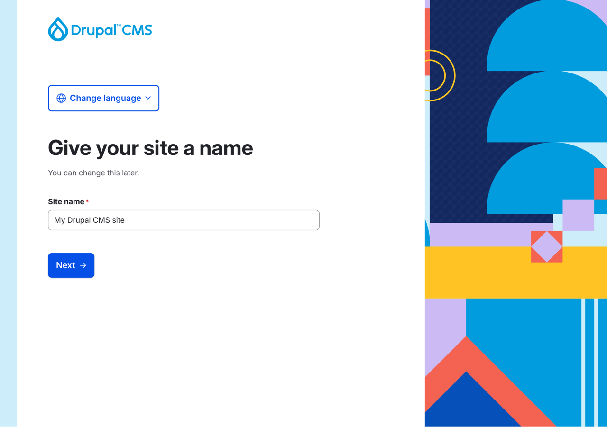
*Figure 4.6: Drupal CMS's installer starts with the site's name*

**Give your site a name.** Type `Lens & Trail` and select **Next**.

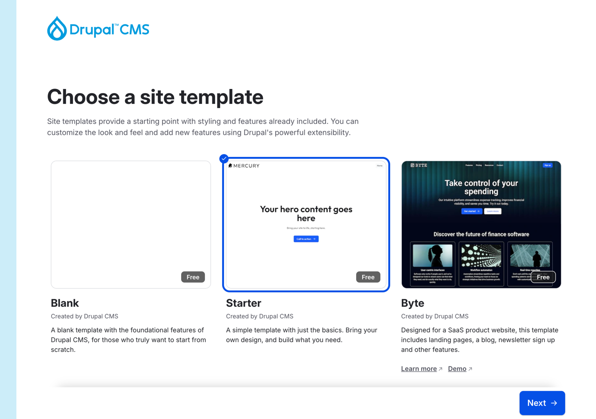
*Figure 4.7: Choosing a site template*

**Choose a site template.** A *site template* is a ready-made starting point for a particular kind of site: modules, a theme, content types and settings, and sometimes example content, all chosen for that use. There are more than twenty, from **Blank** to templates for a portfolio, an event, a restaurant or a nonprofit, and a few premium (paid) ones from companies. New templates appear all the time, so your list will look different from mine. Site templates are built from recipes, which we look at in Chapter 10. Choose **Starter**, the plainest one that still has a theme, and select **Next**.

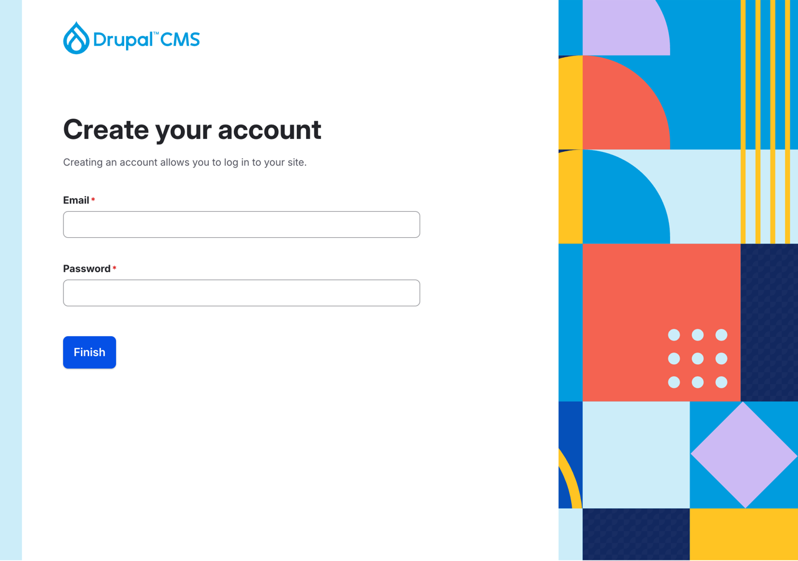
*Figure 4.8: Creating the administrator account*

**Create your account.** Notice the difference from core's installer: Drupal CMS asks for an **Email** instead of a username, and you log in with your email address. Type `admin@lens-and-trail-cms.ddev.site`, the password `12345` (the same warning applies), and choose **London** as the **Default time zone**. Select **Finish**.

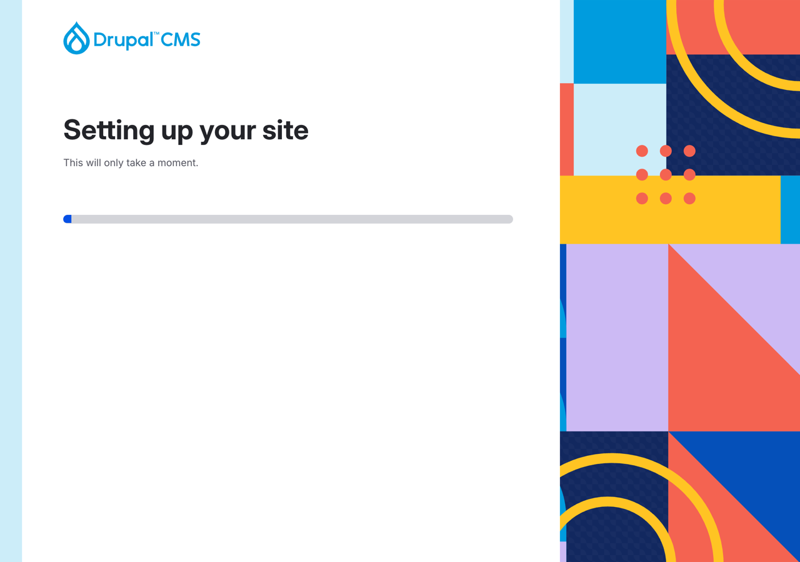
*Figure 4.9: Drupal CMS installs the site template*

The installation takes a minute or two, and then you land on Drupal CMS's dashboard.

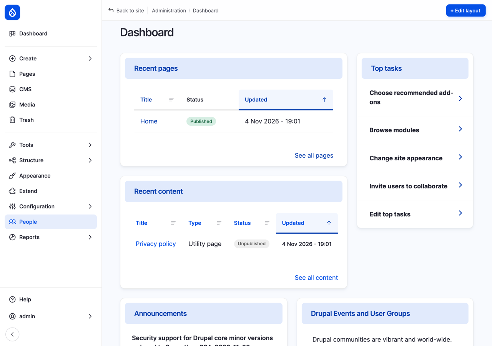
*Figure 4.10: A new Drupal CMS site, with the Starter template*

Look around, and compare it to the core site. The Starter template gave this site a content type, **Utility page**, a theme for visitors, **Mercury**, and a different admin theme, **Gin**. That's the whole idea of Drupal CMS: the decisions we're about to make by hand in the coming chapters are made for you, with a sensible default.

## Other ways to try Drupal

DDEV is the way we install Drupal in this book, but it isn't the only one. Two need no installation at all, and they're great for a first look, or to show Drupal to someone else:

- **The Drupal CMS Launcher** is a desktop app for macOS, Windows and Linux. Download it from drupal.org, open it, and it installs and runs a Drupal CMS site for you; select **Visit site** to open it in the browser. When you quit the app, the site is paused, and your changes are kept. It's a one-button application, and it's made for trying Drupal CMS, not for building a site you'll put online: for that, use DDEV.
- **Drupal Forge** runs a Drupal site for you in the cloud, in your browser, free for 30 days. Nothing to install at all.

And if you already use **Lando**, another tool like DDEV, Drupal works there too. Appendix A compares them.

## Troubleshooting

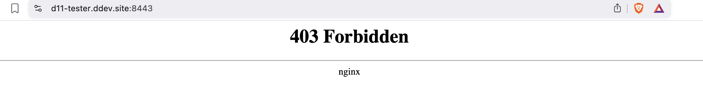
*Figure 4.11: 403 Forbidden: the web server has nothing to show yet*

- **403 Forbidden, instead of the installer.** The web server is running, but there's no Drupal in the `web` folder yet. Most likely, `ddev composer create-project` didn't run, or it failed. Run it again, and read what it says at the end.
- **"Command not found: ddev".** Close the terminal and open a new one. If it still says that, DDEV isn't installed: see "Installing DDEV".
- **DDEV says Docker isn't running.** Start your Docker provider (OrbStack, Docker Desktop, or the one you installed) and try again.
- **Your browser says the connection isn't secure.** Run `mkcert -install` once, and restart the browser.

## Summary

You can now:

- install DDEV, and check it with `ddev --version`;
- create a DDEV project, and download Drupal core and Drush into it with `ddev composer`;
- install Drupal with the browser installer, and know what each field of the Configure site form is for;
- find your way to the Status report, Content types and Appearance on a new site, and know why each looks the way it does;
- download and install a theme for visitors, and set it as the default;
- start, stop and launch a project, and log in with `ddev drush uli`;
- install Drupal CMS with a site template, and know the other ways to try Drupal.

## Exercises

1. Stop the Lens & Trail project with `ddev stop`, and then run `ddev describe`. What does it say? Start it again with `ddev launch`, and check that your site is still there.
2. Open the **Status report** (`/admin/reports/status`). Find the versions of Drupal, PHP and the database. Are there any errors or warnings? For each one, write down in a sentence what you think it means; we'll come back to some of them in Chapter 18.
3. Log out, and log in again with `ddev drush uli` instead of your password.
4. Make a throwaway site: a third project, called `sandbox`. Download Drupal and Drush as in "Creating the Lens & Trail project", and install it with `ddev drush site:install` instead of the browser. Log in, look around, then delete it with `ddev delete` (run it in the project's folder; it asks before it deletes the database). Then delete the folder. Throwaway sites are a good habit: you can try anything there, without breaking the club's site.
5. *(challenge)* Install Drupal CMS again, in yet another project, but choose a different site template. What did that template give the site that Starter didn't: content types, a theme, example content? Delete the project when you're done.

## Want to know more?

- DDEV's documentation: [Docker Installation](https://ddev.readthedocs.io/en/stable/users/install/docker-installation/), [DDEV Installation](https://ddev.readthedocs.io/en/stable/users/install/ddev-installation/), and the [Quickstart](https://ddev.readthedocs.io/en/stable/users/quickstart/) for Drupal and many other systems.
- [Installing Drupal](https://www.drupal.org/docs/getting-started/installing-drupal), in drupal.org's documentation.
- [Drush](https://www.drush.org/), its documentation and every command.
- [Olivero](https://www.drupal.org/project/olivero), the theme's project page.
- [The Article and Page content types are removed from the Standard profile and recipe](https://www.drupal.org/node/3590571), the change record about the missing content types.
- [The Drupal CMS Launcher](https://new.drupal.org/drupal-cms/launcher) and [Drupal Forge](https://www.drupalforge.org/).
- [Composer](https://getcomposer.org/), if you're curious before Chapter 10.
