# Laying Out Pages

In Chapter 6, the club got its first pages, and in Chapter 7 its first real content types, with fields of their own. Every page so far looks the way Drupal decides: the title, then the fields, one under the other. In this chapter we take control of how content looks. First with **Manage display**, the classic Drupal way, which decides how every item of a content type is shown. Then with the two tools for laying out a page by hand: Layout Builder in Drupal core, and Drupal Canvas in Drupal CMS.

We start where Chapter 7 left us: the Basic pages *About the club*, *How to join* and *Welcome*, the *Hike* content type with its first hike, *Turnhouse Hill and Carnethy Hill*, and the *News* content type with its first news item, all three under content moderation.

## How content is displayed: Manage display

Let's look at the hike from Chapter 7 again, the way a visitor sees it.

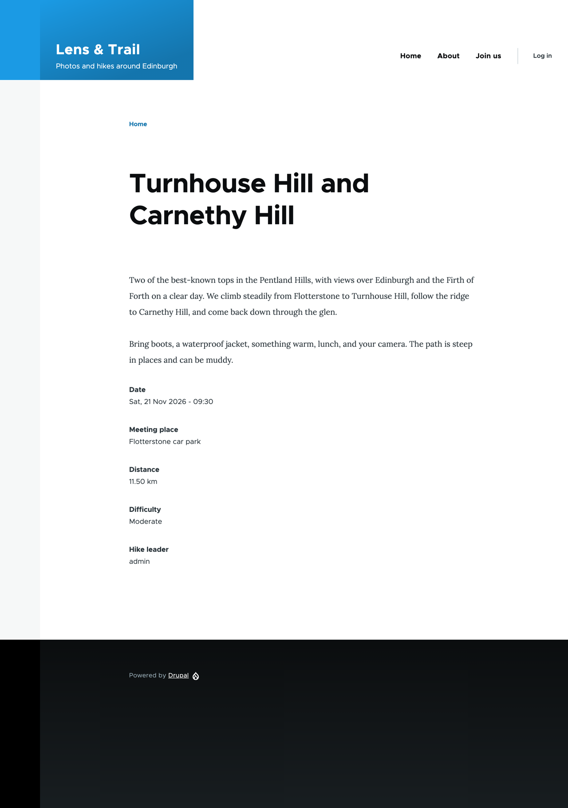
*Figure 8.1: The hike as Chapter 7 left it*

Everything is there, but it doesn't read like a hike notice. The description comes first, and the facts a member looks for (when, where, how far) are at the bottom. Each label sits on a line of its own above its value. The date is abbreviated ("Sat, 21 Nov 2026 - 09:30"), and the distance says "11.50 km", although we stored 11.5. None of this is a problem with the content: it's the *display*, and the display is something we decide, once, for every hike.

### The Manage display tab

You've been here once before: in Chapter 6, we hid the Body label of Basic page on this tab. Now we use the rest of it.

1. Go to **Structure** > **Content types**, and select **Manage display** for Hike. You see a list of *view modes*: **Default** under **Enabled view modes**, and **Full content**, **RSS** and **Teaser** under **Disabled view modes**. We come back to view modes later in this chapter; for now, all you need to know is that Default is the display Drupal uses for the hike page.

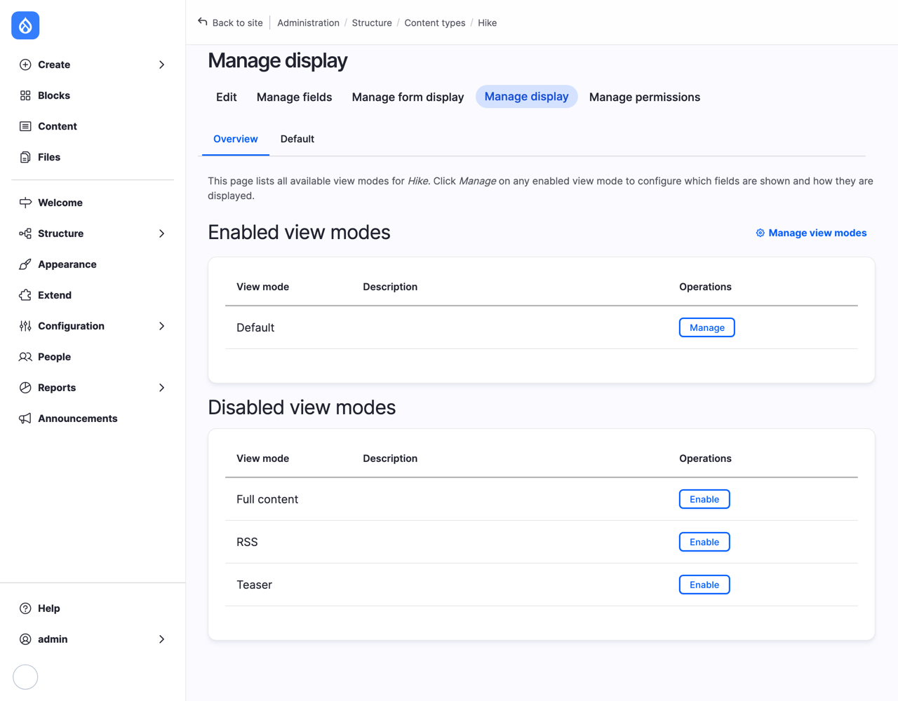
*Figure 8.2: Hike's view modes*

2. Select **Manage** for **Default**. Now you see a table with a row for each field, much like **Manage form display** in Chapter 7. This time it's not about the form, but about what visitors see.

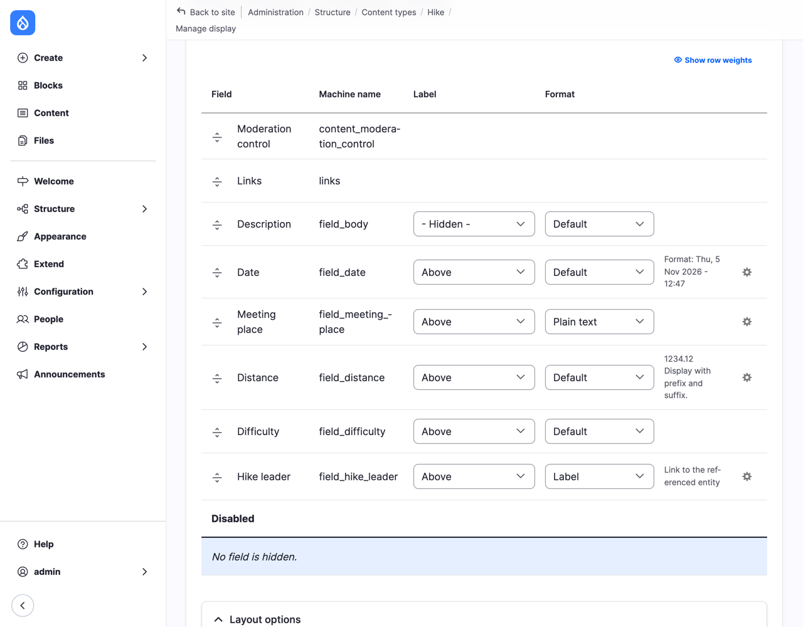
*Figure 8.3: The Default display of Hike*

Each row has the field's name and machine name, and two choices. **Label** decides whether the field's label is shown, and where. **Format** decides how the value is shown: Drupal calls this the field's *formatter*. Some formatters have settings of their own: you see a summary of them next to the select (for the date, today's date in the chosen format), and a cog to change them. At the bottom there's a **Disabled** area: a field you drag there isn't shown at all. The value is still stored, and you can still see it on the edit form; it's only left out of this display.

Two rows aren't fields. **Moderation control** is the little form that lets an editor publish a draft from the page itself, and only editors who can do that ever see it. **Links** holds links that other modules add to content, such as **Read more** in a list. On the hike page itself it's empty, so we leave both where they are.

### Facts first: the order

We want the facts first, and the description below them.

1. Drag **Description** by its handle (the arrows at the start of the row) to below **Hike leader**. Drupal marks the row with an asterisk: changed, but not saved yet. Nothing changes on the site until you select **Save**.

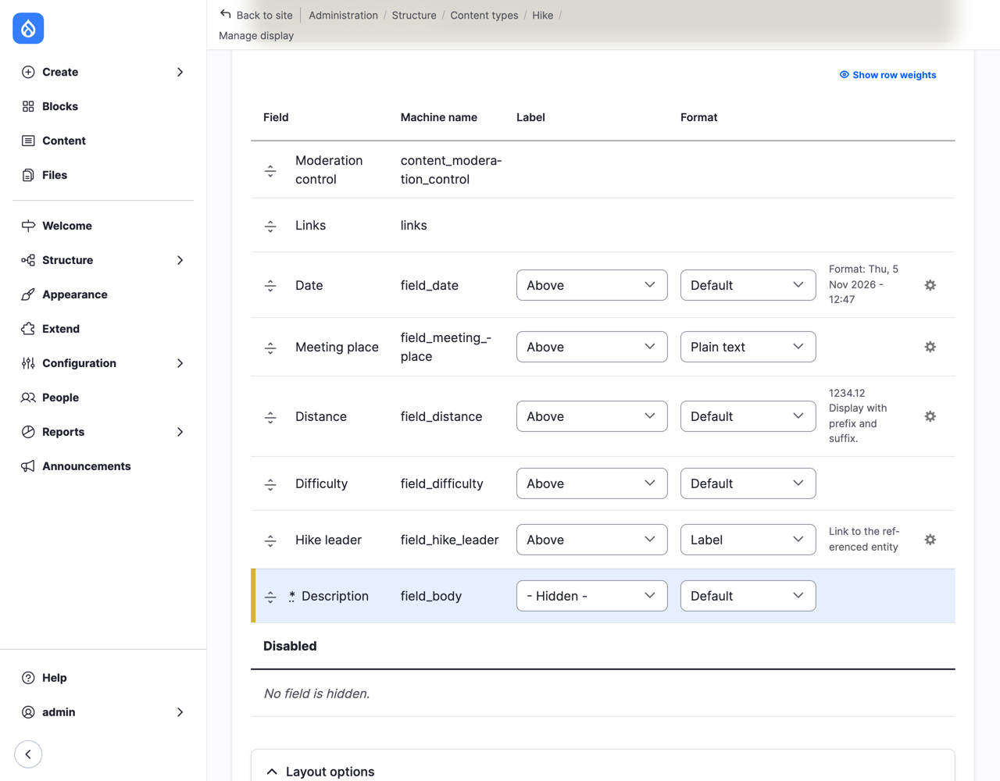
*Figure 8.4: The description at the bottom*

If dragging is hard for you (on a touch screen, say, or with a keyboard), select **Show row weights**. Each row then gets a **Weight** select: rows with lower numbers come first. This works everywhere Drupal lets you drag rows, and you'll meet it again with menus and blocks.

### Labels

The **Label** select has four choices:

- **Above**: the label on a line of its own, above the value. This is what Drupal starts with.
- **Inline**: the label in front of the value, on the same line: "Distance: 11.5 km".
- **- Hidden -**: no label at all. Right for the description, where the text speaks for itself.
- **- Visually Hidden -**: the label isn't shown on screen, but it's still in the page, for screen readers. Use it when sighted visitors understand a value from where it sits, but someone who listens to the page wouldn't. A date in the corner of a card is a good example: anyone who sees it knows it's a date, but a screen reader would only read out "Saturday, 21 November".

2. Set **Label** to **Inline** for Date, Meeting place, Distance, Difficulty and Hike leader. Description is already **- Hidden -**: when we re-used Body in Chapter 7, Drupal copied its display settings from Basic page, where we hid the label in Chapter 6.

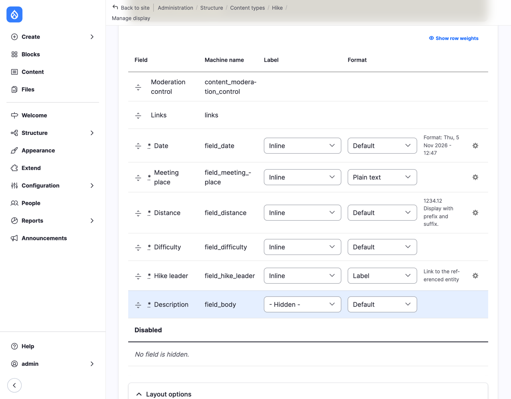
*Figure 8.5: Inline labels for the facts*

### Formatters and their settings

Now the values themselves. We start with the distance.

3. Select the cog at the end of the **Distance** row. The row opens with the **Default** formatter's settings: the **Thousand marker**, the **Decimal marker**, the **Scale**, and **Display prefix and suffix**. Set **Scale** to `1`, and select **Update**.

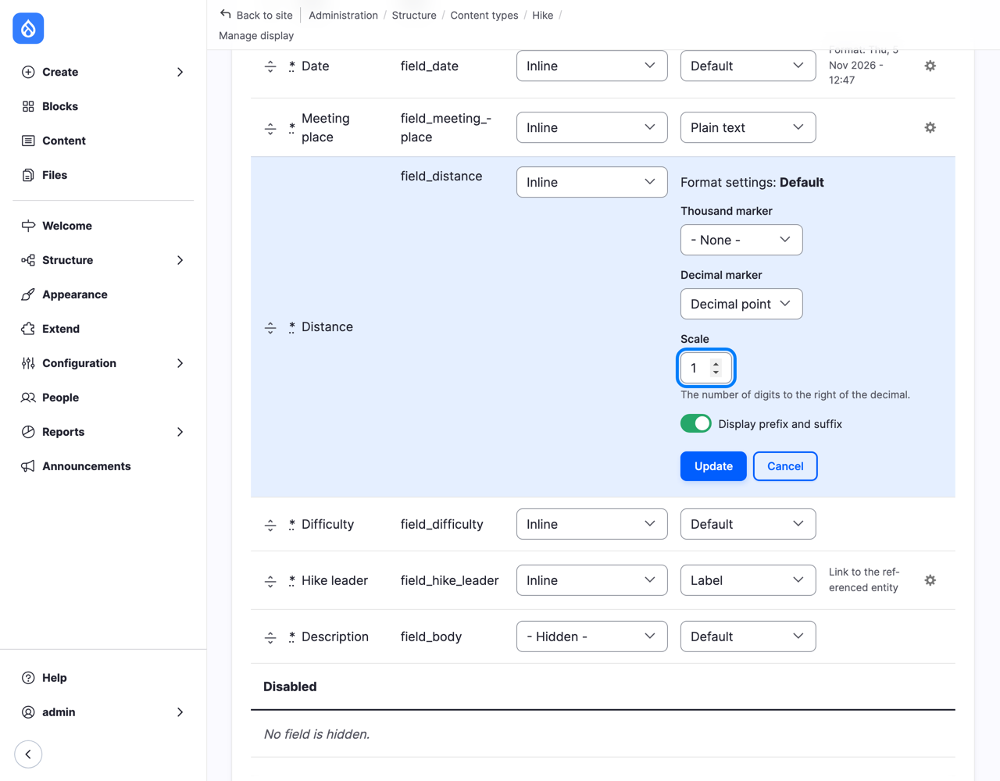
*Figure 8.6: One decimal for the distance*

Here's something worth noticing. In Chapter 7 we set the Distance *field's* scale to 1, and the formatter still showed two decimals. The field's scale is about what is *stored*: how many decimals Drupal keeps in the database. The formatter's scale is about what is *shown*. They're two separate settings, in two separate places, and that's Drupal's way all over: the field stores, the widget edits, the formatter shows. **Display prefix and suffix** is what puts " km" after the number; switch it off, and the hike says "11.5".

4. Select the cog for **Hike leader**. The **Label** formatter shows the user's name, and **Link label to the referenced entity** makes the name a link to the user's profile. Switch it off, and select **Update**.

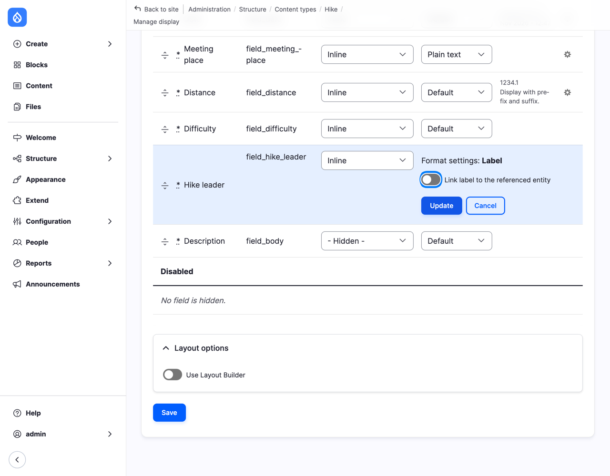
*Figure 8.7: The hike leader's name without a link*

Why? On our site, visitors aren't allowed to see user profiles (it's the **View user information** permission, which Chapter 15 is about). A link that leads to "Access denied" is worse than no link at all.

Look at the other two fields while you're here. **Difficulty** has two formatters: **Default** shows the name of the choice ("Moderate"), and **Key** shows the machine name ("moderate"). **Description** has **Default**, the whole text, and **Trimmed**, which cuts it after a number of characters; we use that one soon.

5. Select **Save**.

> **Drupalism: formatter.** A formatter is a way of showing a field's value. The field decides what is stored, and the formatter only decides how it looks. You can change the formatter at any time, and nothing happens to the content: change it back, and the hike looks as before.

> **One reference, three formatters.** The Hike leader field doesn't store a name. It stores a number: the ID of the user, 1 for our admin account. Every formatter starts from that number. **Label** looks up the user and shows their name. **Entity ID** shows the number itself, "1", which is of no use to a visitor, but it shows you what is really stored. **Rendered entity** shows the whole user, the way one of the *user's* view modes displays it (with their picture, for example). Same data, three ways of showing it. Once you see a reference like this, you understand most of Drupal's displays.

### A date format of our own

The date is the last fact to fix. Its **Default** formatter shows the date in one of the site's *date formats*, and none of them says what we want: "Saturday, 21 November 2026 at 09:30". The closest, **Default long date**, has a dash before the time. So we make a format of our own. Date formats belong to the whole site, so we can use the new one for News and for lists of hikes later too.

1. Go to **Configuration** > **Regional and language** > **Date and time formats**, and select **Add format**.
2. Type `Day, date and time` as the **Name**.
3. Type `l, j F Y \a\t H:i` as the **Format string**. Under the field, Drupal shows the current date and time in the new format, so you can check it as you type.
4. Select **Add format**.

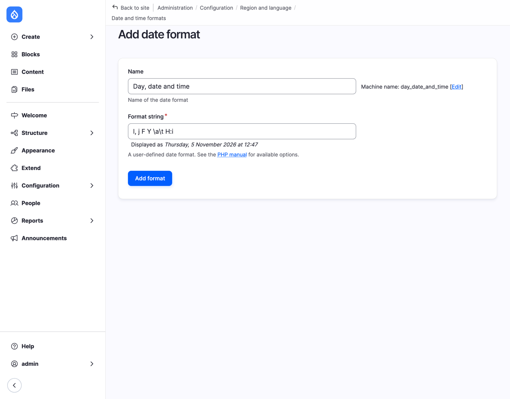
*Figure 8.8: The new date format*

The format string looks like a cat walked over the keyboard, I know. ;-) Each letter stands for a part of the date: `l` is the day of the week ("Saturday"), `j` the day of the month without a leading zero, `F` the month's name, `Y` the year with four digits, `H` the hour from 00 to 23, and `i` the minutes. Everything else is printed as it is, such as the comma and the spaces. A letter with a backslash in front of it is printed as itself too, so `\a\t` gives you the word "at". The letters come from PHP, the language Drupal is written in, and the **PHP manual** link under the field lists them all.

5. Go back to Hike's **Manage display**, select the cog for **Date**, set **Date format** to **Day, date and time**, select **Update**, and then **Save**.

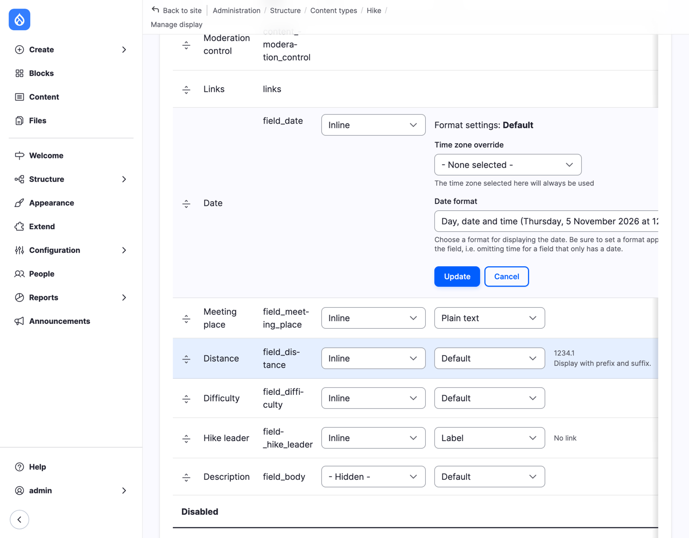
*Figure 8.9: The hike's date in the new format*

Now look at the hike again.

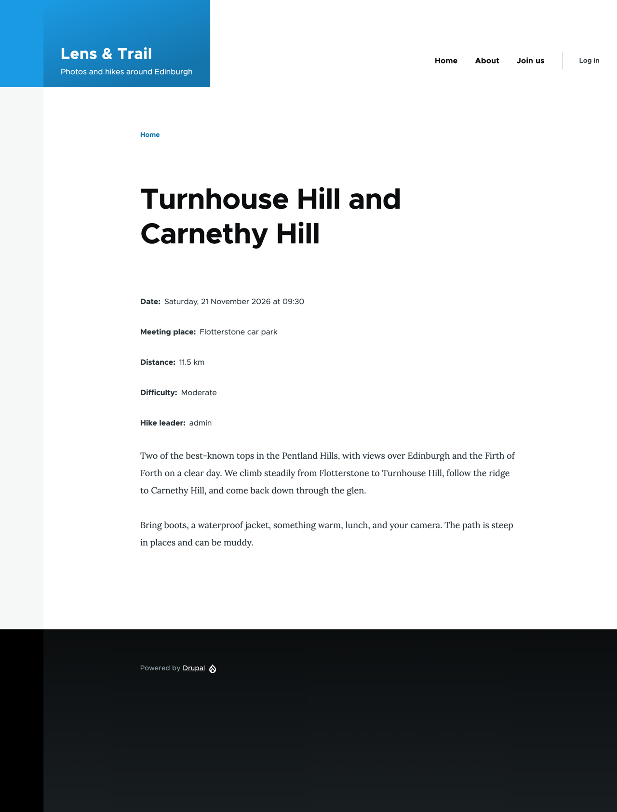
*Figure 8.10: The hike, facts first*

That's a hike notice. And because we changed the content type's display, not the hike, every hike the club adds from now on looks the same, without anyone thinking about it.

> **Try it:** The **Date** formatter also has **Time ago**, which shows how far away the date is (something like "2 weeks 1 day hence") instead of the date itself. Choose it, look at the hike, and change it back to **Default**. (The words come from the formatter's settings: change **Future format** to `in @interval`, and the hike says "in 2 weeks 1 day". We go with the real date, because a hike notice is printed and shared, and "in 2 weeks" is wrong a day later.)

### View modes: one hike, several looks

So far, a hike only has its own page. But the club will want to show hikes in other places too: a list of upcoming hikes, with the date, the distance and a few lines of the description, and a small box on the front page with only the date and the difficulty. Each of those is a *view mode*: a named way of showing the same content.

> **Drupalism: view mode.** A view mode is a named display. **Default** is the one every content type has. **Full content** is for the content's own page, **Teaser** for lists, and **RSS** for news feeds. You can add your own. A view mode that isn't enabled for a content type uses Default instead: that's why the hike page, which asks for Full content, shows the Default display we set up.

Let's set up **Teaser** for hikes.

1. On Hike's **Manage display**, select **Enable** for **Teaser**. Drupal makes the Teaser display as a copy of Default, so it starts with our order, labels and formats.
2. Select **Manage** for Teaser, and drag **Meeting place** and **Hike leader** to **Disabled**. In a list, they'd be too much.
3. Set the **Format** of Description to **Trimmed**, select its cog, set **Trimmed limit** to `200` characters, and select **Update**.
4. Select **Save**.

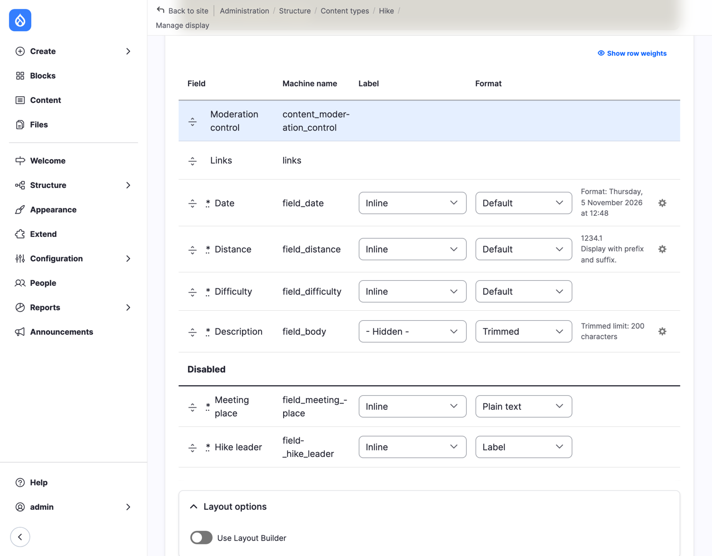
*Figure 8.11: The Teaser display of Hike*

Now our own view mode, for the box on the front page.

1. Go to **Structure** > **Display modes** > **View modes**, and select **Add view mode** for **Content**.
2. Type `Card` as the **Name**, and `A small box with the date and the difficulty, for the front page.` as the **Description**.
3. Under **Enable this view mode for the following Content types**, check **Hike**, and select **Save**.

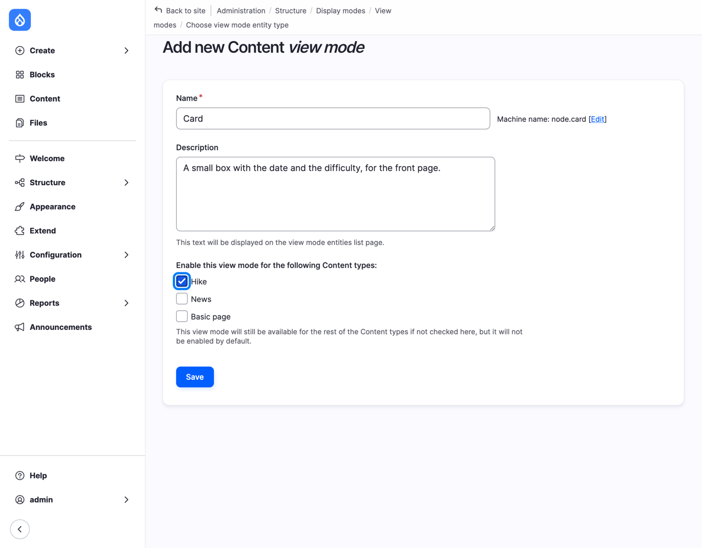
*Figure 8.12: Adding the Card view mode*

4. Go to Hike's **Manage display** again. **Card** is now under **Enabled view modes**. Select **Manage**.
5. Drag everything except **Date** and **Difficulty** to **Disabled**, set both their labels to **- Hidden -**, make sure Date uses **Day, date and time**, and select **Save**.

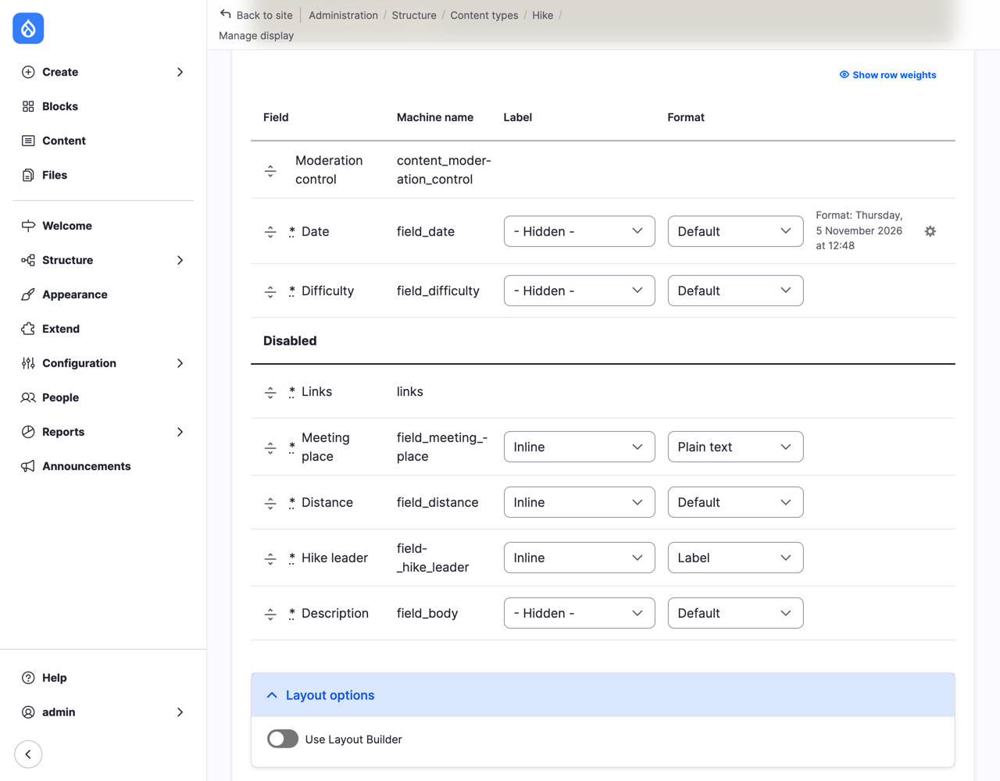
*Figure 8.13: The Card display of Hike*

If you go to the site now, you won't see the teaser or the card anywhere. That's not a mistake: no page *uses* them yet. A list of hikes is something we build with Views, which picks a view mode for each item in the list. We do that in Chapter 12, and then the teasers and cards we set up here appear in it, as they are.

> **Try it:** Give News a teaser too. **Enable** Teaser for News, set Body to **Trimmed**, with a **Trimmed limit** of `300` characters, and save. A list of news will use it in Chapter 12.

> **On Drupal CMS:** Drupal CMS comes with view modes already set up. Its Utility page has **Card** and **Teaser** next to **Default**, and you'll see two things we haven't used. First, the **Featured image** is a reference to a media item, shown with **Rendered entity**: the image is displayed by one of the *media item's* view modes, **Hero** on the page, and smaller ones in the card and the teaser. That's the "one reference, three formatters" idea at work: a view mode inside a view mode. Second, the teaser and the card don't trim the page's text; they show the **Description** field instead, a summary the editor writes, which is disabled on the full page. And Drupal CMS has the **Field Group** module, which adds **Add field group** at the top, for wrapping several fields in a box or tabs.

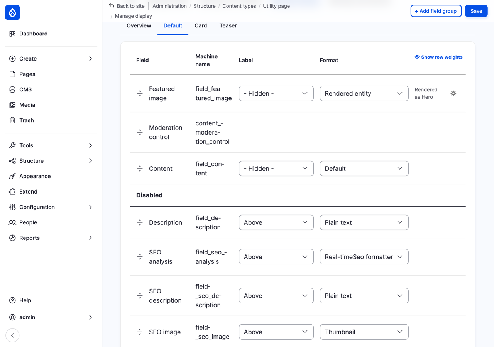
*Figure 8.14: The Utility page's display on Drupal CMS*

## Laying out a page by hand

**Manage display** shows the fields one under the other, in the same way for every item of a content type. This is the classic way to build a Drupal site, and for content with a fixed structure, such as a hike, it's still the best way: every hike looks the same, and editors fill in fields instead of arranging the page. But it can't put two things side by side, and it can't give one page a layout of its own.

Sometimes, though, you want to arrange a page yourself: two columns, a box on the side, a big photo at the top. Drupal has two tools for this, and you'll meet both in real projects:

- **Layout Builder**, part of Drupal core. You divide the page into *sections* with columns, and place *blocks* in them: the page's own fields, menus, lists, or boxes of text. It works on a content type's display, and, if you allow it, on a single page.
- **Drupal Canvas**, the page builder that comes with Drupal CMS. You build the page in a visual editor, from *components* such as headings, texts, cards and grids, and see the result as you work.

Neither is the "right" one. Canvas is newer and more visual, and it's where Drupal CMS is heading. Layout Builder has been in core since Drupal 8.7, and many developers prefer it, or prefer plain field displays, because they keep pages consistent. We build *How to join* both ways, and you can judge for yourself.

## Layout Builder

Layout Builder is already installed on your site: the Navigation sidebar uses it, so Drupal installs it with the sidebar. We only have to turn it on for Basic page.

> **Warning: turning Layout Builder on is a one-way street.** When you check **Use Layout Builder**, Drupal moves every field of that display to **Disabled**, because from then on the layout places them. If you turn Layout Builder off again, Drupal asks you to confirm ("All customizations will be removed. This action cannot be undone."), and the fields *stay* under **Disabled**: the order, labels and formatters you set up are gone, and the content type shows nothing but its title until you set up the display again. For Basic page that's only the body, so we can go ahead. For a content type with a display you've worked on, such as Hike, don't turn it on for **Default**. Enable another view mode, such as **Full content**, and use Layout Builder there: Exercise 5 shows how. (This changed in Drupal 11.3; older tutorials may tell you the fields come back.)

1. Go to **Structure** > **Content types** > **Manage display** for Basic page, and **Manage** the **Default** view mode.
2. At the bottom, under **Layout options**, check **Use Layout Builder**.
3. Check **Allow each content item to have its layout customized**. Without it, every Basic page shares one layout, which you design once for the content type, its *template*. With it, each page can also have a layout of its own.
4. Select **Save**.

The field list disappears, and a **Manage layout** button takes its place: from now on, the layout decides how a Basic page is shown. Every page still uses the template, which shows the body, so nothing changes on the site yet.

Now let's give *How to join* two columns: the text on the left, and the club's meeting times in a box on the right.

1. Go to the *How to join* page, and select **Layout** in the **More actions** menu (or go to `/node/2/layout`). You see the page in editing mode, with the message "You are editing the layout for this Basic page content item." Because the site has content moderation, there's also **Current state** and **Change to**, as on the edit form; leave it at **Published**, so the new layout goes online when you save it.

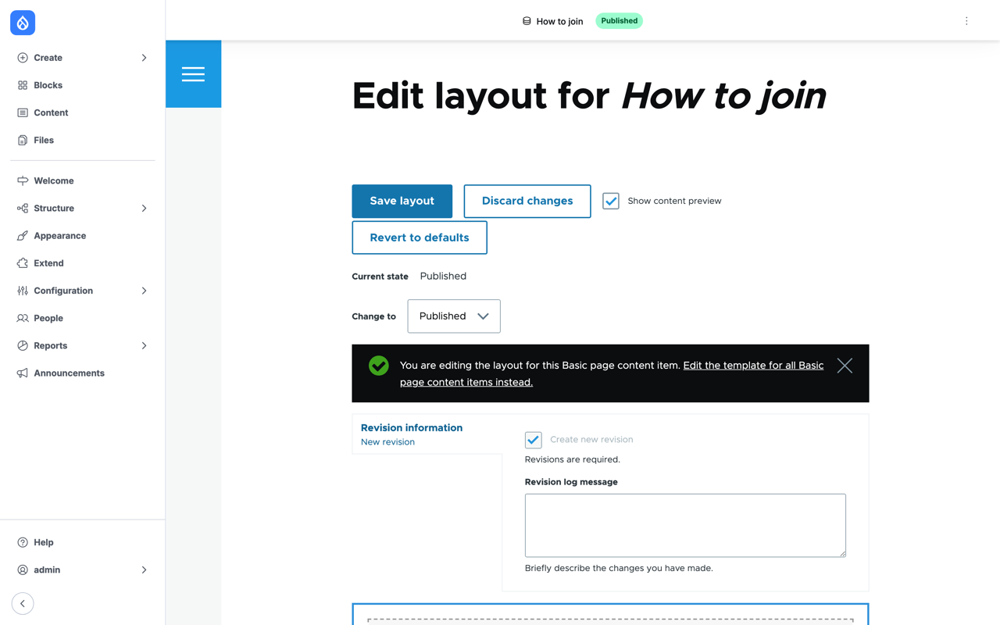
*Figure 8.15: Editing the layout of How to join*

2. Select **Add section** at the top. A panel opens on the right, with the layouts to choose from: **One column**, **Two column**, **Three column** and **Four column**. (**Navigation layout** is the sidebar's own, and of no use on a page.) Select **Two column**.

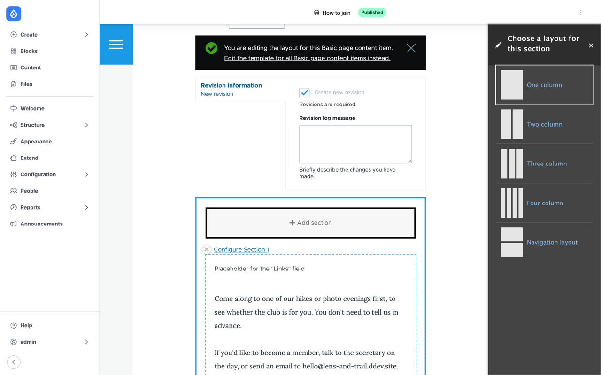
*Figure 8.16: Choosing a layout for the new section*

3. Set **Column widths** to **67%/33%**, and select **Add section**.

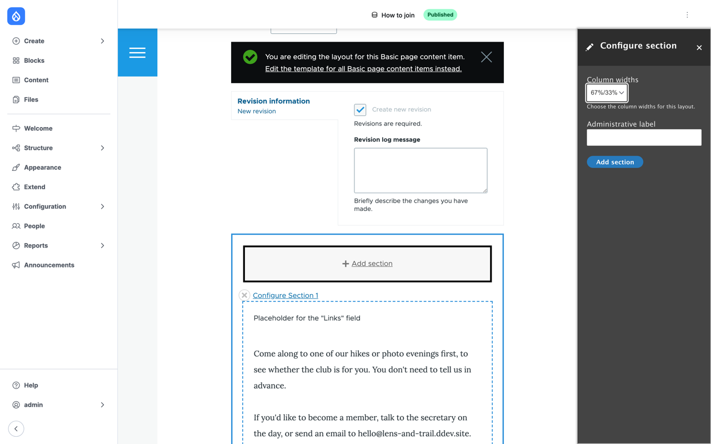
*Figure 8.17: The section's column widths*

4. In the new section, select **Add block** in the **Second region**. The panel lists the blocks you can place; select **Create content block** at the top.

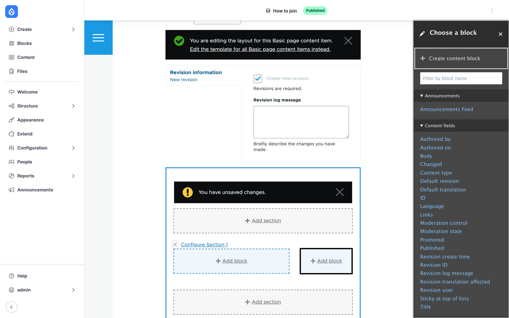
*Figure 8.18: Choosing a block for the second region*

5. Type `When and where` as the **Title**, and this as the **Body**:

   Hikes: every other Saturday, at 9:30. We send the meeting place to everyone who is coming a week before.

   Photo evenings: the first Thursday of the month, at 19:00, in the back room of a café in Leith.

   Then select **Add block**.

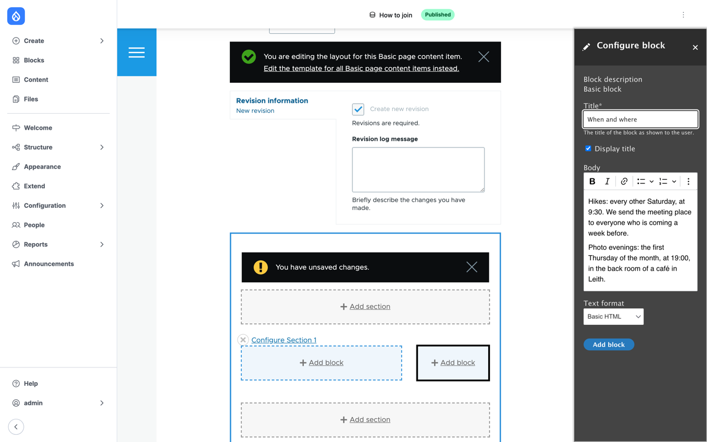
*Figure 8.19: The When and where block*

6. Select **Add block** in the **First region**. Under **Content fields**, select **Body**, set **Label** to **- Hidden -**, and select **Add block**.

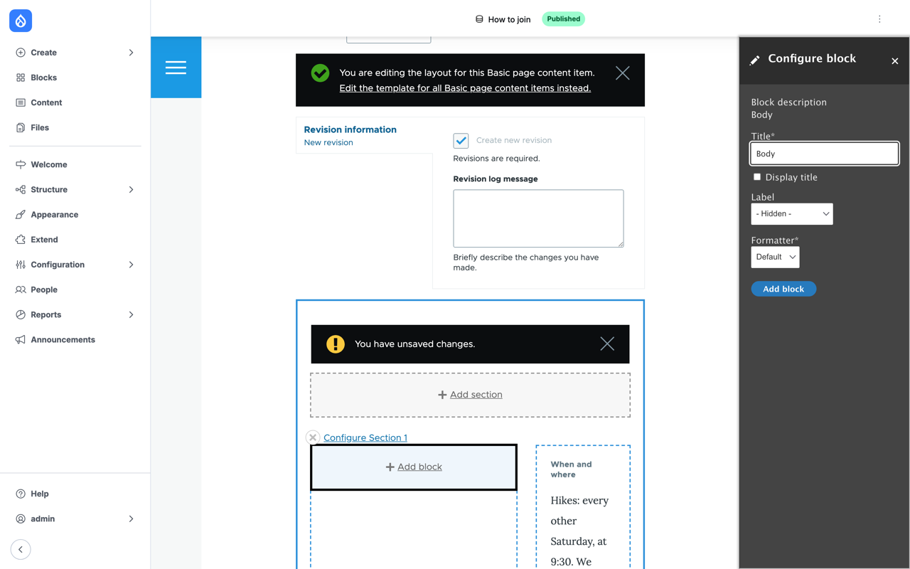
*Figure 8.20: Placing the body in the first region*

7. The old one-column section is still below, with the body in it a second time. Select **Remove Section 2**, and confirm with **Remove**.

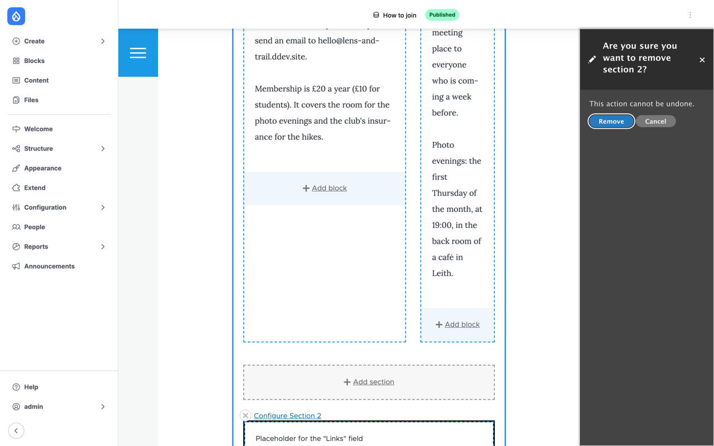
*Figure 8.21: Removing the old section*

8. At the top, write `Two columns, with the meeting times on the right.` in **Revision log message**, and select **Save layout**.

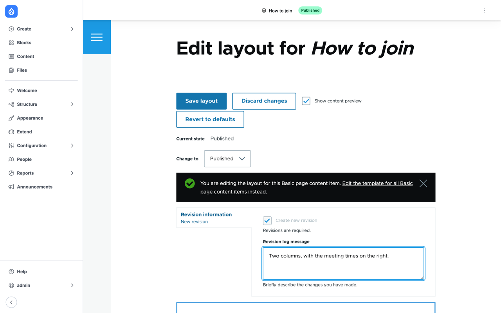
*Figure 8.22: Saving the layout*

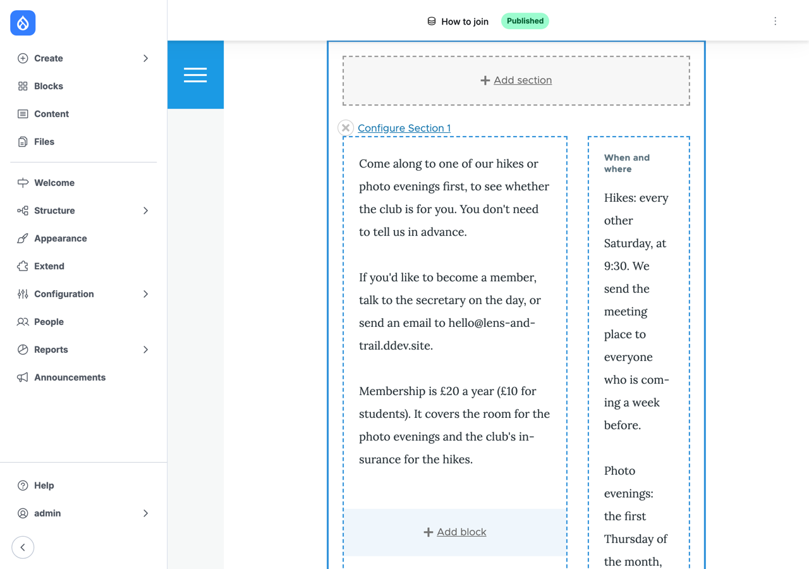
*Figure 8.23: The finished layout*

Until you select **Save layout**, nothing changes for visitors: Layout Builder keeps your work as a draft, and says "You have unsaved changes." **Discard changes** throws the draft away. **Revert to defaults** removes the page's own layout, so it uses the content type's template again.

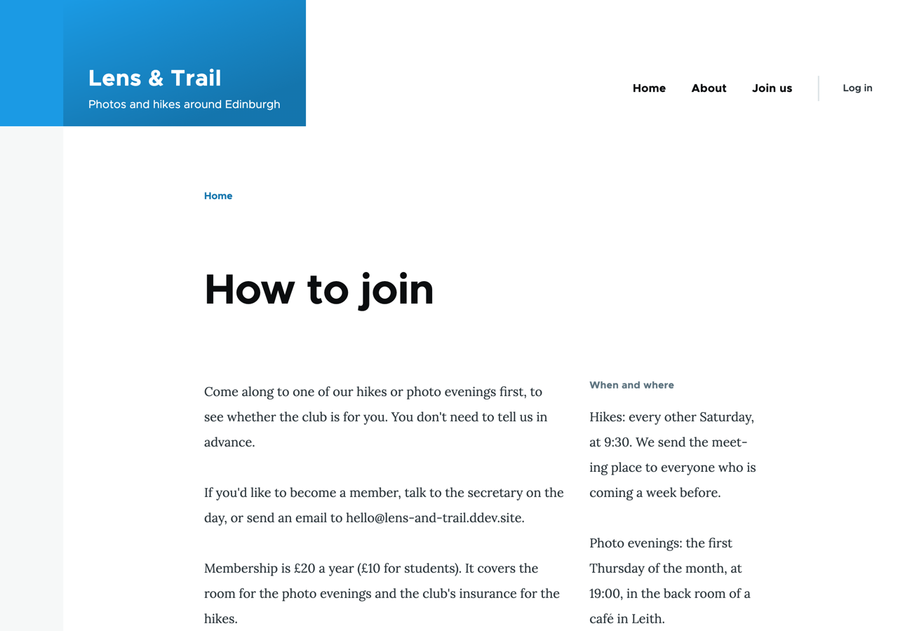
*Figure 8.24: How to join, laid out with Layout Builder*

The *When and where* box is a block that belongs to this page only. Chapter 14 is about blocks you can reuse on many pages, such as a box in every page's footer.

## Drupal Canvas

> **On Drupal CMS:** Canvas is part of Drupal CMS, but it doesn't support Drupal 12 yet: its newest version, {{ number:canvas_version }}, needs Drupal 11.3 or later, but not 12. So we build the Canvas version of *How to join* on the Drupal CMS site from Chapter 4, if you made one.
>
> In Canvas, a page isn't a node with a body field. It's a kind of content of its own, called **Page**, with its own list under **Pages** in the sidebar (`/admin/content/pages`). Select **Add Page**, and the Canvas editor opens.
>
> 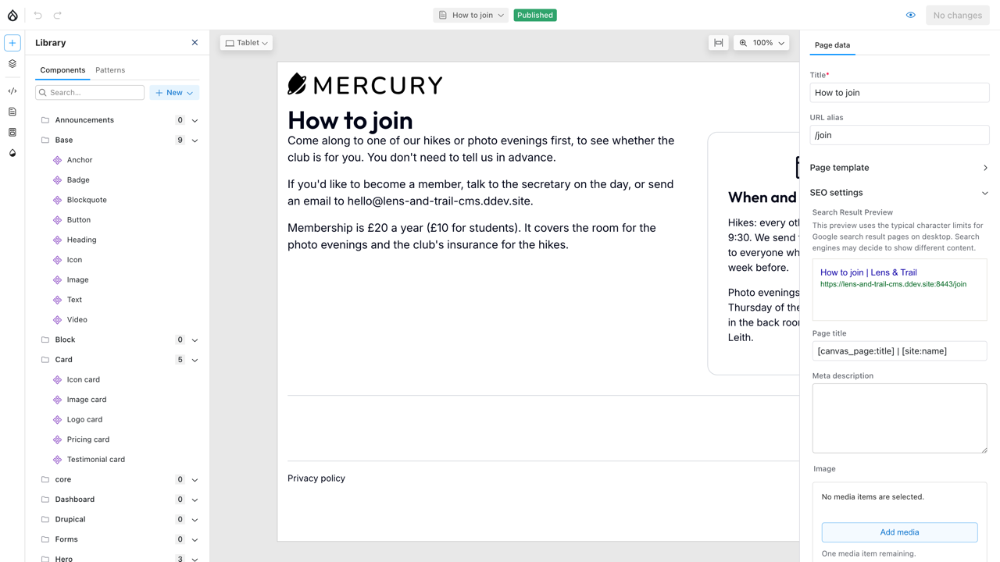
> *Figure 8.25: The Canvas editor*
>
> In the middle is the page, as visitors will see it, in the site's theme (Mercury, on the Starter template). Above it, you can switch between desktop, tablet and phone sizes. On the left is a row of buttons:
>
> - **Library**: the *components* you can put on the page. **Base** has the simple ones, such as **Heading**, **Text**, **Image** and **Button**; **Card** and **Hero** have bigger boxes; **Layout** has **Grid**, **Section** and **Group**, which hold other components.
> - **Layers**: the page's components as a tree, which is often the easiest way to select one, or to see what's inside what.
> - **Code**, **Pages**, **Templates** and **Brand kit**: writing your own components, the list of pages, the templates pages are built on, and the site's colors and fonts. We leave them for now; building your own component is a topic for later.
>
> On the right, **Page data** has the page's **Title**, **URL alias** and **SEO settings**, and when you select a component, a **Settings** tab with that component's settings.
>
> To build *How to join*:
>
> 1. In **Page data**, type `How to join` as the **Title** and `/join` as the **URL alias**.
>
> 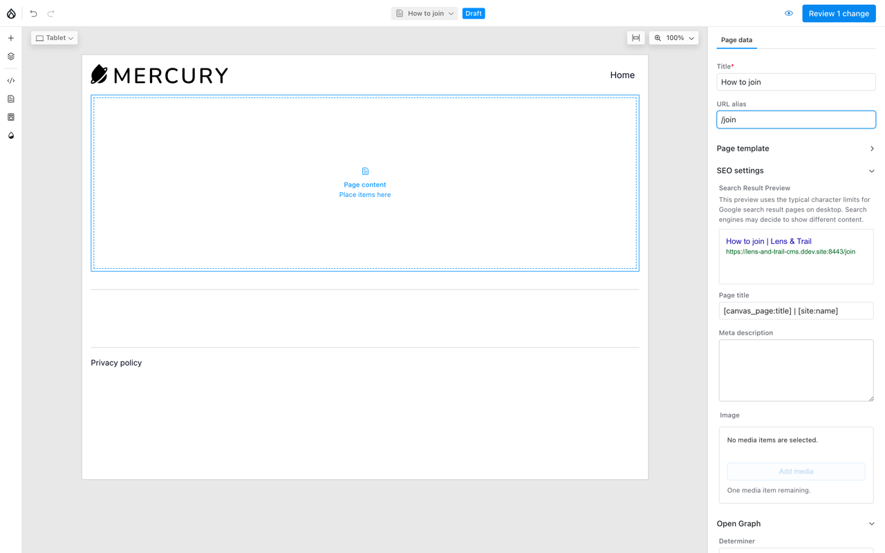
> *Figure 8.26: The page's title and URL alias*
>
> 2. Open the **Library**, and drag a **Heading** onto the page, where it says "Place items here". Its settings open on the right: type `How to join` as the **Heading**, and set **Heading level** to **1**.
>
> 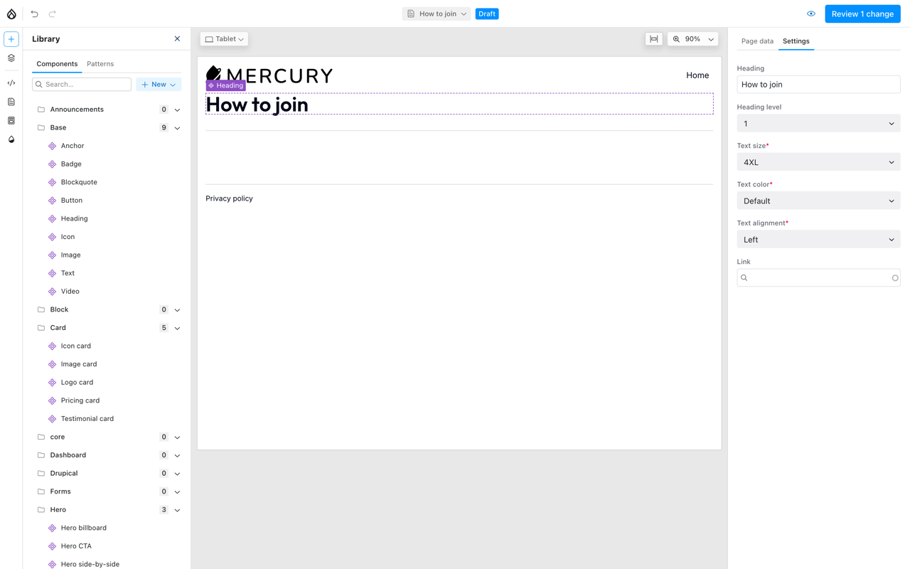
> *Figure 8.27: The heading, at level 1*
>
> 3. Drag a **Grid**, from **Layout**, onto the page below the heading. Set **Columns** to **2 columns 67%-33%**. The grid is empty for now, a thin box below the heading.
>
> 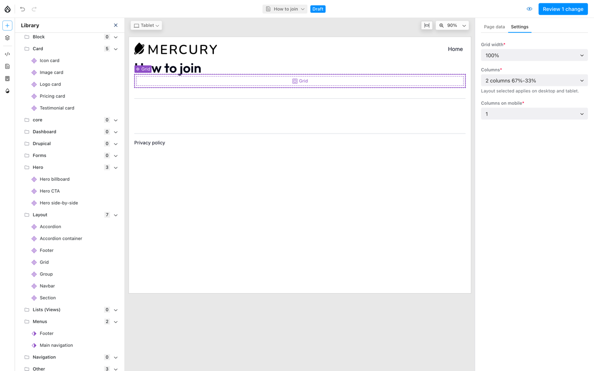
> *Figure 8.28: The grid, with two columns*
>
> 4. Drag a **Text** into the grid, and replace the example text with the three paragraphs of *How to join*.
>
> 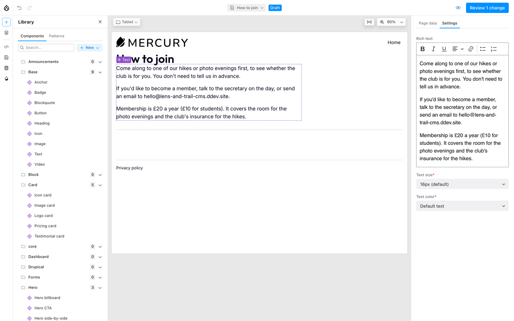
> *Figure 8.29: The text, in the grid*
>
> 5. Drag an **Icon card**, from **Card**, into the grid, after the text. This is the fiddly part: drag and drop puts it in the wrong place more often than not, for example after the grid instead of inside it. Don't worry, you can put it right in **Layers**. Right-click the **Icon card** there, and select **Move** > **Move into** > **Grid (Grid)**. That puts the card first in the grid, so right-click the **Text** and select **Move** > **Move up**, to put the text back on the left.
>
> 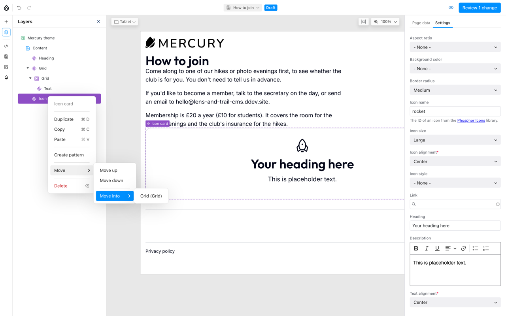
> *Figure 8.30: Moving the card into the grid*
>
> 6. Select the **Icon card**, and set **Icon name** to `calendar-dots`, **Heading** to `When and where`, **Description** to the meeting times, and **Text alignment** to **Left**.
>
> 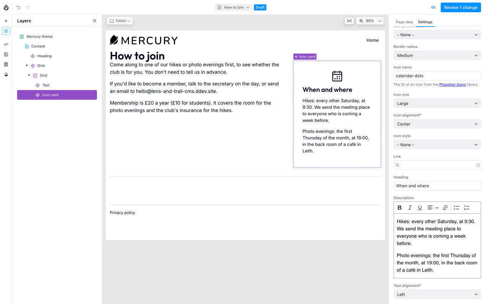
> *Figure 8.31: The When and where card*
>
> 7. Canvas saves your work as you go, as a draft. When the page looks right, select **Review 1 change** at the top right, check **How to join**, and select **Publish 1 selected**.
>
> 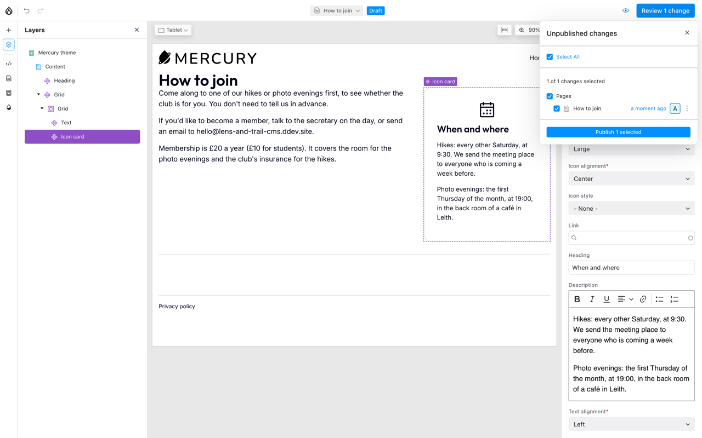
> *Figure 8.32: Publishing the page*
>
> The same right-click menu works for every component: **Move up**, **Move down** and **Move into** put a component that landed in the wrong place where you want it.
>
> 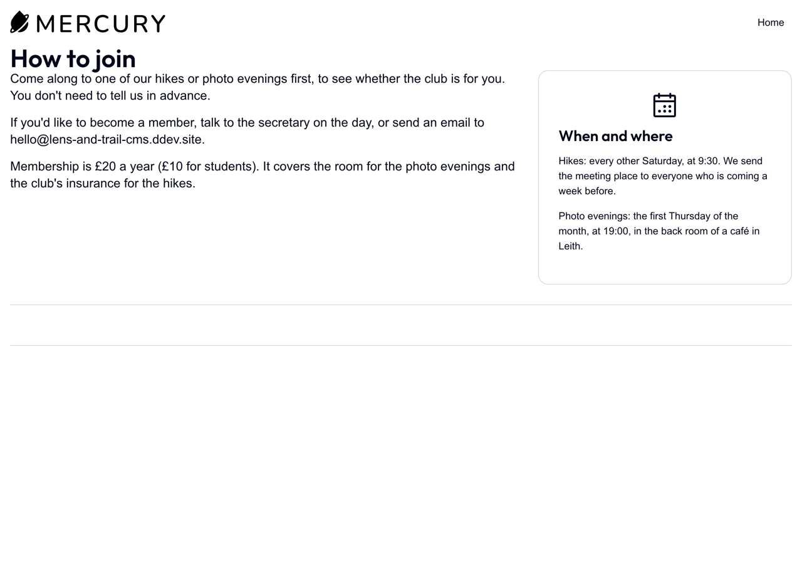
> *Figure 8.33: How to join, built with Canvas*

## Which one should I use?

| | Field display | Layout Builder | Drupal Canvas |
|---|---|---|---|
| Where it comes from | Drupal core | Drupal core | Drupal CMS (a contributed module) |
| Who arranges the page | The site builder, once per content type | The site builder for the template; editors per page, if allowed | Editors, per page |
| What you arrange | Fields | Sections and blocks | Components |
| Best for | Content with a fixed structure: hikes, news, events | Content types where some pages need their own layout | Landing pages and one-off pages |

Many sites use more than one: plain field displays for hikes and news, and Canvas or Layout Builder for the front page and a few special pages.

> **Coming from WordPress?** Canvas will feel familiar: like the WordPress block editor, you build a page from pieces (Canvas calls them components, WordPress calls them blocks) and see the result as you go. Two differences matter. A Drupal *block* is something else, a box placed on the page, closer to a WordPress widget (see the box in Chapter 1). And in Drupal, structured content such as a hike usually isn't laid out by hand at all: it has fields, and the content type's display decides how every hike looks.

## Summary

You can now:

- decide which fields a content type shows, in which order, and with which labels and formatters;
- add a date format of your own, and use it in a field's display;
- use view modes to show the same content in different ways;
- lay out a page with Layout Builder, and, on Drupal CMS, with Canvas;
- tell when to use a field display, Layout Builder, or Canvas.

## Exercises

1. Add a picture to your own account (go to **People**, and **Edit** your user; the field is **Picture**). Then, on Hike's Default display, change the **Format** of Hike leader to **Rendered entity**, with the **Compact** view mode. What does the hike page show now? Which entity type's display decided that? Change it back to **Label** when you're done.
2. Add a second date format, `Short day`, that shows a date as "Sat 21 Nov". (The `D` letter gives the short name of the day, and `M` the short name of the month.) Use it for the Date on Hike's **Card** display. Why might a card use a shorter format than the hike page?
3. Use Layout Builder to give *About the club* a layout of its own, with a box on the side that says when the club was founded (make up a year). Then select **Revert to defaults**. What happens to the box?
4. *(challenge)* Change the Basic page *template*, at **Manage display** > **Manage layout**, so that every page has a one-line box at the bottom: "Questions? Write to hello@lens-and-trail.ddev.site." Which pages get the box, and which don't? Why?
5. *(challenge)* Make the hike page look like the picture below: the description on the left, and the facts in a column on the right, with their labels above. Don't turn on Layout Builder for Hike's **Default** display: Drupal would move every field we set up in this chapter to **Disabled**, and they don't come back when you turn it off again. Instead, **Enable** the **Full content** view mode for Hike (it starts as a copy of Default), and turn on Layout Builder there. The hike page uses Full content as soon as it's enabled. When you're done, select **Disable** for Full content (under the arrow next to **Manage**), and the hike page goes back to the Default display, untouched.

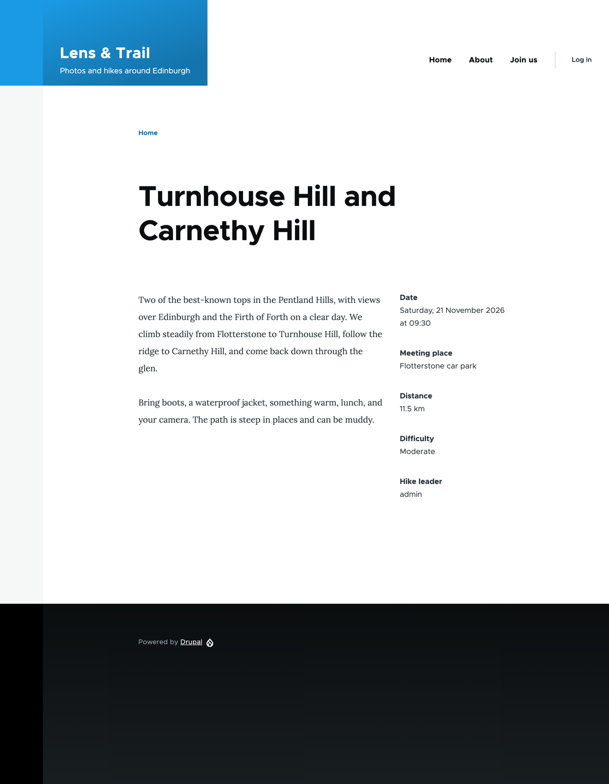
*Figure 8.34: Make it look like this*

## Want to know more?

- [Changing content display](https://www.drupal.org/docs/user_guide/en/structure-content-display.html), in the Drupal User Guide: Manage display, labels and formatters, step by step.
- [Concept: View modes and formatters](https://www.drupal.org/docs/user_guide/en/structure-view-modes.html), in the Drupal User Guide.
- [The date format letters](https://www.php.net/manual/en/datetime.format.php), in the PHP manual: every letter you can use in a date format.
- [Field Group](https://www.drupal.org/project/field_group), the module Drupal CMS uses to group fields in boxes and tabs.
- [Layout Builder](https://www.drupal.org/docs/8/core/modules/layout-builder), drupal.org's documentation of the module, with templates and per-page layouts.
- [Drupal Canvas](https://www.drupal.org/project/canvas), the project page of the contributed module, with its newest version and the Drupal versions it supports.
- [The WordPress Block Editor](https://wordpress.org/documentation/article/wordpress-block-editor/), on wordpress.org, if you'd like to compare.
