# Users, Roles, and Permissions

So far, one person has built the whole site: you, logged in as `admin`. A club site isn't like that. The secretary keeps the news up to date, hike leaders announce their hikes, members share their photos and comment on each other's albums, and visitors read along. Each of them needs to do some things on the site, and must not be able to do others.

This chapter is about who can do what. We look at the site's user accounts, give the club three *roles* (Member, Hike leader and Secretary), decide what each role may do with *permissions*, let visitors apply for an account, and keep the spam out. Along the way, we give members a profile, and finally keep the promise from Chapter 6: hike leaders write their hikes as drafts, and the secretary publishes them.

If you did Exercise 4 in Chapter 1 (who does what on the club's site), get your list out now. We start where Chapter 14 left us: the club's blocks and menus in place, and still only one account, yours.

## People

Go to **People** (`/admin/people`).

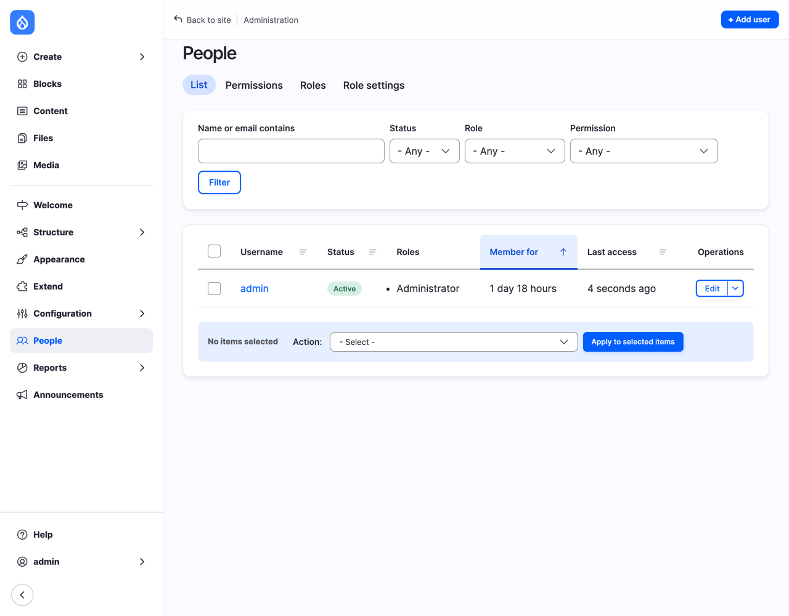
*Figure 15.1: The People page, with one user*

Every account on the site is listed here, with its **Status** (active or blocked), its **Roles**, how long it's been a member, and when it was last used. Above the list, you can filter by name or email, status, role, or even by permission: "who on this site may administer users?" is a question worth asking now and then.

A *user* in Drupal is an account: a username, an email address, a password, and whatever fields you add. Like content, media and terms, users are entities (Chapter 7), which is why you can give them fields, show them in different ways, and list them with Views. A person usually has one account, and an account belongs to one person: shared logins make it impossible to tell who did what.

### User 1

The account you created during the installation is *user 1*, and it's special. User 1 gets past every permission check: whatever the permissions say, user 1 may do it. Chapter 1 called it **THE** administrator, and that's no exaggeration.

That's handy while you build a site, and dangerous once it's live. If someone gets user 1's password, they own the site. So on a live site:

- Give user 1 a long, unique password, and an email address only you can read.
- Don't use it day to day. Create an account of your own with the **Administrator** role for your everyday work, and keep user 1 for emergencies.
- Don't call it `admin`. That's the first username anyone tries.

Since Drupal 10.3, you can even switch user 1's special powers off: then it's an ordinary account with whatever roles it has. That's a setting in a file, not in the browser (`security.enable_super_user: false` in the site's `services.yml`), and we come back to it in Chapter 21, when the site goes live.

On our test site, we keep using `admin`: it's on your own computer, and nobody else can reach it.

## Roles

A **role** is a group of accounts with the same permissions. Instead of deciding for each person what they may do, you decide it once for each role, and give people roles. Go to **People** > **Roles** (`/admin/people/roles`).

Drupal comes with four:

- **Anonymous user**: everyone who isn't logged in. Most of the people who visit any site.
- **Authenticated user**: everyone who is logged in, whatever other roles they have.
- **Content editor**: a starting point for people who edit content. On Drupal 12 core, it has only a handful of permissions, such as the content overview and the administration theme.
- **Administrator**: every permission, including the ones added by modules you install later.

> **Drupalism: role.** Two of the four roles are different from the others. Nobody is *given* **Anonymous user** or **Authenticated user**: Drupal decides. Everyone who isn't logged in is anonymous, and every account that logs in is authenticated, in addition to its other roles. So a permission you give **Authenticated user** goes to every account on the site, including the ones you create later. Roles add up: someone with the roles Member and Hike leader may do everything either role may do. And **Administrator** is a role, not a person, and not user 1: an account with the Administrator role gets every permission there is, but user 1 doesn't even need a role.

### The club's roles

The club has three kinds of people with accounts:

- **Members** have paid their membership. They create albums of their own photos, comment without waiting for approval, and see each other's profiles.
- **Hike leaders** announce hikes. They write them as drafts, and the secretary checks and publishes them.
- **The secretary** runs the site's content: publishes hikes, writes news, edits anything that needs editing, approves comments, and looks after member accounts.

Is that a role for every *job*, or for every *person*? Always for every job. When Jordi, a hike leader, becomes secretary next year, he gets another role; nobody has to change any permissions.

1. On **Roles**, select **Add role**.
2. **Role name**: `Member`. The machine name, `member`, appears next to it.

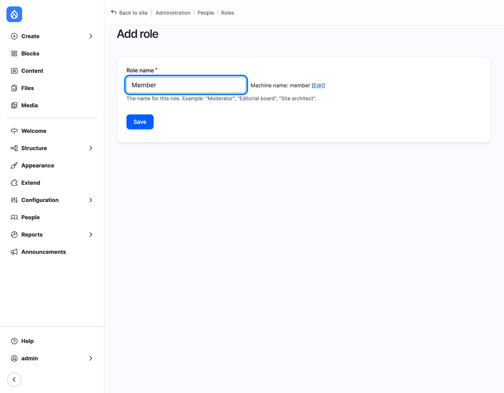
*Figure 15.2: Adding a role*

3. Select **Save**.
4. Add two more: `Hike leader` and `Secretary`.

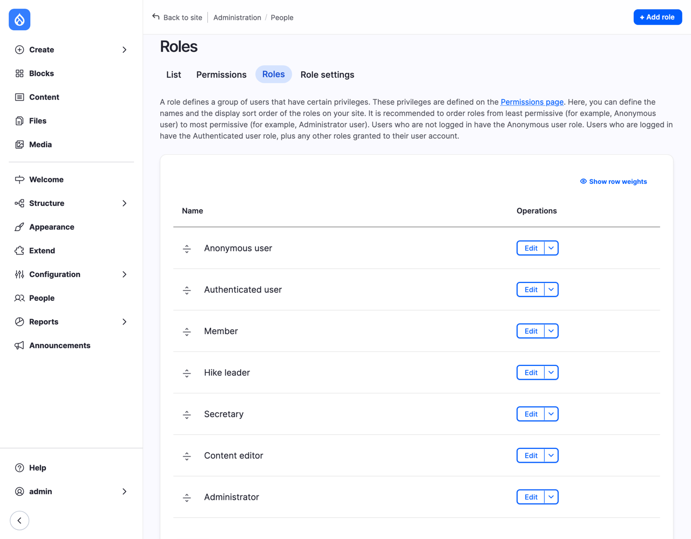
*Figure 15.3: The club's roles, from least to most powerful*

Drag the new roles between **Authenticated user** and **Content editor**, and select **Save**. The order doesn't change what anyone may do, but the help text at the top of the page recommends it: from least to most permissive, so the permissions page reads from left to right like a ladder.

We don't use **Content editor** on the club's site. You could delete it, but it does no harm, and it's a reminder that roles are only names: what counts is what you give them.

## Permissions

A **permission** is one thing a role may do: "Hike: Create new content", "Skip comment approval", "Administer users". Modules bring their own; this site has over two hundred. There are two ways to look at them.

On **Roles**, the menu next to each role has **Edit permissions**, which shows one column: everything this role may do. That's the best way to set up a new role. Open it for **Member**.

At the top, the **Filter** box narrows the long list down. Type `comment`:


*Figure 15.4: Members' comments don't wait for approval*

Members need these permissions (type a word from each in the filter box to find it, and check it):

| Permission | Why |
|---|---|
| **Skip comment approval** | Members' comments appear immediately. |
| **Gallery: Create new content**, **Gallery: Edit own content**, **Gallery: Delete own content** | Members make albums of their own photos, and only theirs. |
| **Image: Create new media**, **Image: Edit own media** | To upload the photos for an album (Chapter 9). |
| **View user information** | Members can see each other's profiles. Visitors can't. |

Select **Save permissions** at the bottom.

Notice the pairs: **Edit own content** and **Edit any content**, **Delete own content** and **Delete any content**. *Own* means content the person created; *any* means everyone's. Members may edit their own albums, but not each other's, and that's the difference between a club site and a free-for-all.

Then **Authenticated user**: open its permissions, and *uncheck* **Skip comment approval**. The comment recipe in Chapter 11 gave every logged-in account that permission; now only members get it. Everyone else who has an account (someone who registered but hasn't paid yet, say) can still comment, but a person approves their comments first. Save.

### Hike leaders and the secretary

Hike leaders write hikes, and only their own:

| Permission | Why |
|---|---|
| **Hike: Create new content**, **Hike: Edit own content** | To write and update their hikes. |
| **Editorial workflow: Use Create New Draft transition** | Hikes go through the Editorial workflow (Chapter 7): a hike leader may save drafts, nothing else. |
| **View own unpublished content**, **View the latest version** | To see their drafts, and the draft of a hike that's already published. |
| **Access the Content overview page**, **Access navigation bar**, **View the administration theme** | To find their hikes on **Content**, with the administration sidebar and theme. |


*Figure 15.5: Hike leaders may only create drafts*

Each transition of a workflow (Chapter 6) is a permission of its own. That's how the Editorial workflow decides who may do what: a hike leader who may only use **Create New Draft** can't publish, however hard they try.

The secretary does the most:

| Permission | Why |
|---|---|
| **Hike: Edit any content**, **Basic page: Edit any content**, **Gallery: Edit any content**, **News: Edit any content**, **News: Create new content**, **News: Delete own content** | To edit anything that needs editing, and write the news. |
| All five **Editorial workflow** transitions | To publish, archive and restore. |
| **View any unpublished content**, **View the latest version**, **Access the Content overview page** | To see everyone's drafts. |
| **Administer comments and comment settings** | To approve, edit and delete comments. |
| **Club info: Edit content block** | To change the meeting times in the footer (Chapter 14). |
| **Administer users** | To activate, block and edit accounts. (Read the warning below before you give it.) |
| **Access navigation bar**, **View the administration theme**, **Use the administration pages** | To work in the administration pages. |

The other way to look at permissions is all roles at once: **People** > **Permissions** (`/admin/people/permissions`), one column per role. It's too wide to set up a role, but it's the best way to check one permission across the site.

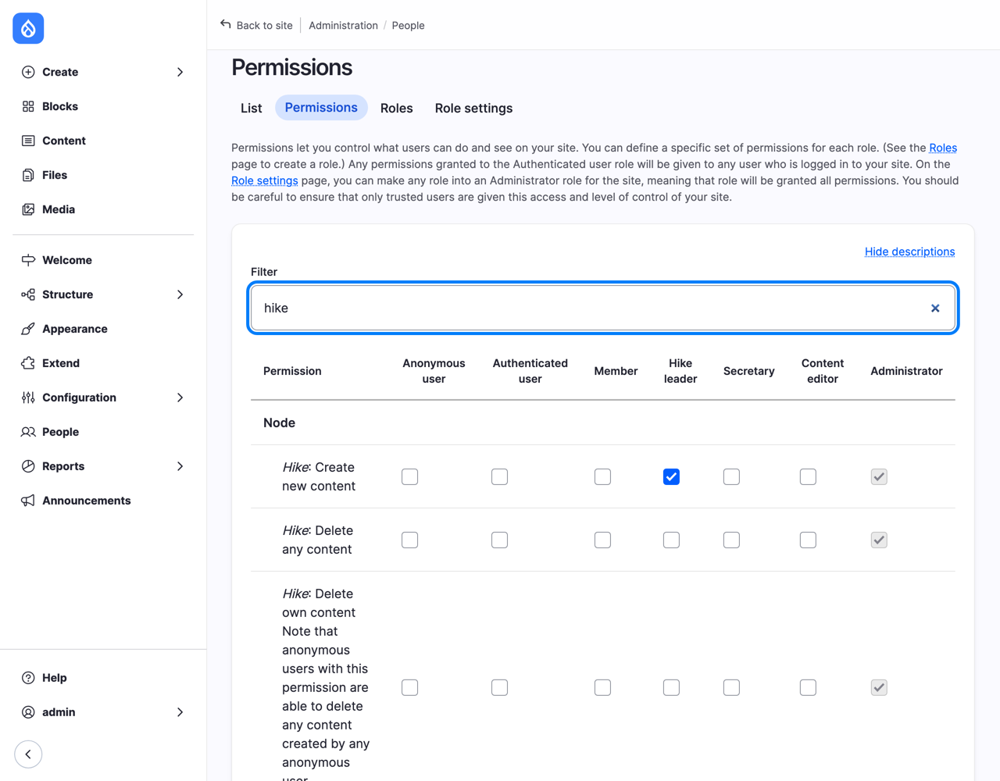
*Figure 15.6: All the roles at once*

The **Administrator** column is checked and greyed out everywhere: that role gets every permission, automatically. Which role that is, is set on the **Role settings** tab.

Some permissions are marked *Warning: Give to trusted roles only; this permission has security implications.* under their names. (If you don't see that, select **Show descriptions** above the list.) Take that warning literally: **Administer users**, **Administer roles and permissions**, **Administer text formats and filters**, and **Use the Full HTML text format**, for example, each let someone do things far beyond what their name suggests.

> **Administer users is a lot of trust.** With **Administer users**, the secretary can block, delete and edit any account, including changing its email address and password. *Any* account: the administrator's too. Whoever can change the administrator's password can log in as the administrator. So **Administer users** is, in effect, the keys to the site. Give it only to someone you'd trust with those.
>
> What the secretary *can't* do with it is give anyone a role: the **Roles** checkboxes appear only for people with **Administer roles and permissions**. That's why, on our site, the secretary activates accounts, and the administrator makes people members. A contributed module, [Role Delegation](https://www.drupal.org/project/role_delegation), lets you allow the secretary to give out *some* roles, such as Member, and not others. As we write this, it supports Drupal 11, but not yet Drupal 12.

## The club's first accounts

Now the people. The secretary first:

1. On **People**, select **Add user**.
2. **Email address**: `morag@example.com`. **Username**: `morag`.
3. Leave **Email user with password setup instructions** on.
4. Under **Roles**, check **Member** and **Secretary**.


*Figure 15.7: The secretary's account*

5. Select **Create new account**.

You never learn Morag's password, and you shouldn't. Drupal emails them a link where they set it themselves. (Turn off **Email user with password setup instructions**, and the form asks for a password and a status instead, for the rare case where you must set them yourself.)

> **Where's the email?** Your DDEV site doesn't send email out into the world: it catches every message in **Mailpit**, a mailbox for testing. Type `ddev mailpit` in the project's folder, and it opens in your browser, with the message to `morag@example.com`. On a live site, email needs setting up properly, so that it arrives and isn't marked as spam; that's for Chapter 21.

> **Try it:** Add two more accounts: `jordi` (`jordi@example.com`), with the roles **Member** and **Hike leader**, and `ailsa` (`ailsa@example.com`), with **Member** only.

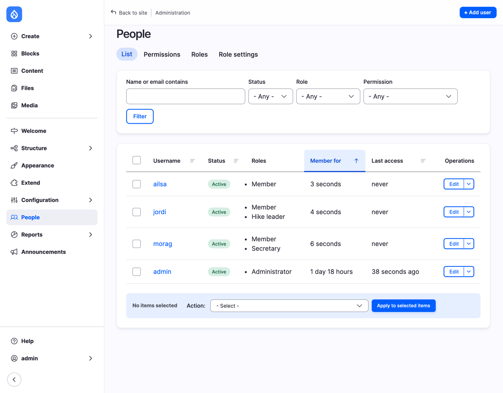
*Figure 15.8: The club, so far*

To see the site as one of them, open a private window and log in as them. (On your test site, you can set their passwords on their **Edit** form, or with `ddev drush user:password jordi 12345`.) That's the best way to test permissions: not as `admin`, who can do everything anyway. (Logging in and out gets tiring; Exercise 9 looks for a faster way.)

## Letting visitors apply for an account

The club gets new members every month, and nobody wants to type their details in. Let them apply themselves. Go to **Configuration** > **People** > **Account settings** (`/admin/config/people/accounts`).


*Figure 15.9: Visitors may apply; someone approves*

**Who can register accounts?** has three answers:

- **Administrators only**: nobody can register; accounts are created on **People**. That's what Drupal sets at installation, and what our site had until now.
- **Visitors**: anyone can create an account, and it's active immediately.
- **Visitors, but administrator approval is required**: anyone can apply, and the account stays blocked until someone with **Administer users** activates it.

Choose **Visitors, but administrator approval is required**. Leave **Require email verification when a visitor creates an account** on: the new account gets its password through the email address it gave, so nobody can register with someone else's address. Select **Save configuration**.

Further down the same page are the **Emails** Drupal sends: the welcome emails, the one to the administrator when someone applies, the password reset, and others. You can change every one of them; the bracketed words, such as `[user:display-name]`, are replaced with the account's details when the email is sent.

### Someone applies

A **Create new account** link now appears next to **Log in**. Open `/user/register` in a private window.

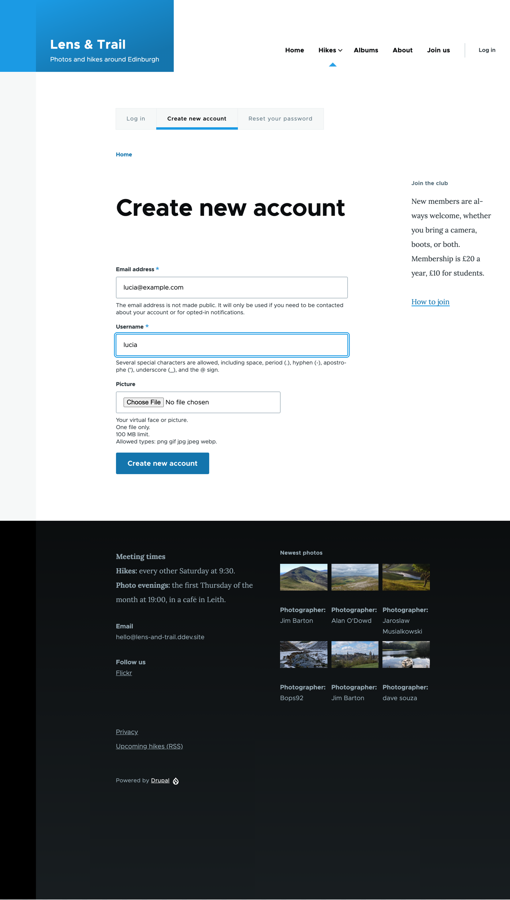
*Figure 15.10: Applying for an account*

Lucía fills in her email address and a username, and selects **Create new account**.

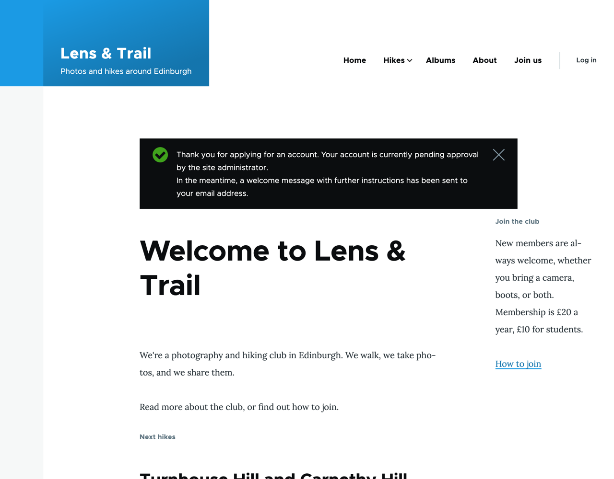
*Figure 15.11: Waiting for approval*

Two emails go out: one to Lucía, saying her application is waiting, and one to the address in **Notification email address** on Account settings (or the site's own address), saying someone has applied, with a link to the account.

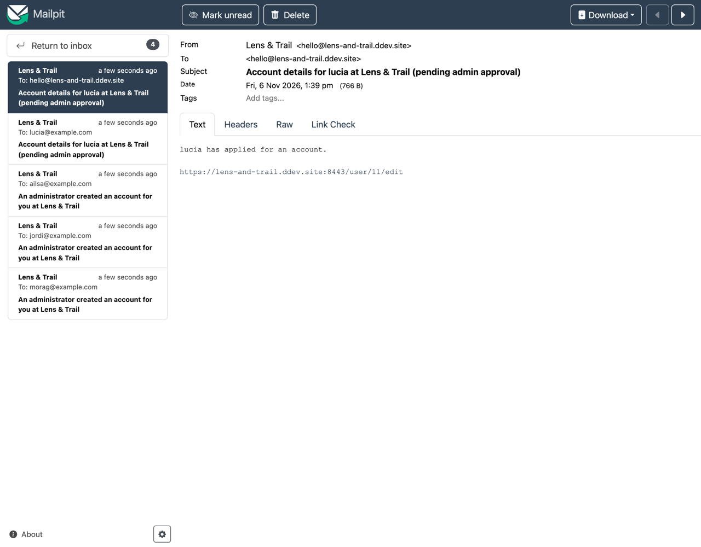
*Figure 15.12: The club's mailbox: someone has applied*

### Approving an account

On **People**, Lucía's account is listed as **Blocked**:

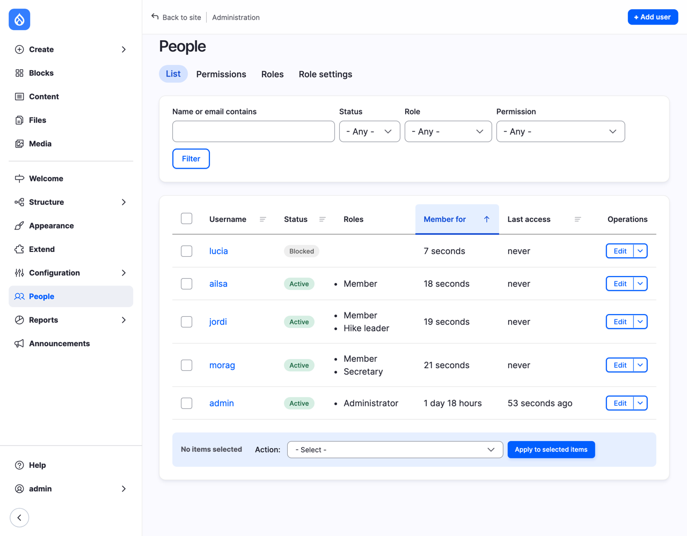
*Figure 15.13: A new application, blocked until approved*

Morag, the secretary, checks that Lucía has paid, opens her account with **Edit**, sets **Status** to **Active**, and selects **Save**.


*Figure 15.14: The secretary activates the account*

Look at what the secretary sees: a **Password** field (the warning above, in action), **Status**, and no **Roles**. Lucía gets an email that her account has been approved, and can log in.

She's now an authenticated user, but not a member. Before the administrator gives her the role, she comments on an album, and her comment doesn't appear: it waits on **Content** > **Comments** > **Unapproved comments**.

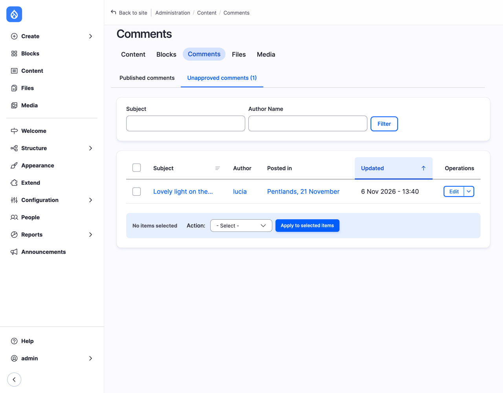
*Figure 15.15: A comment waiting for approval*

The secretary can publish it from there, with the bulk actions below the list.

### Making someone a member

Giving a role is the administrator's job on our site. On **People**, check the box next to **lucia**, choose **Add the Member role to the selected user(s)** under **Action**, and select **Apply to selected items**.

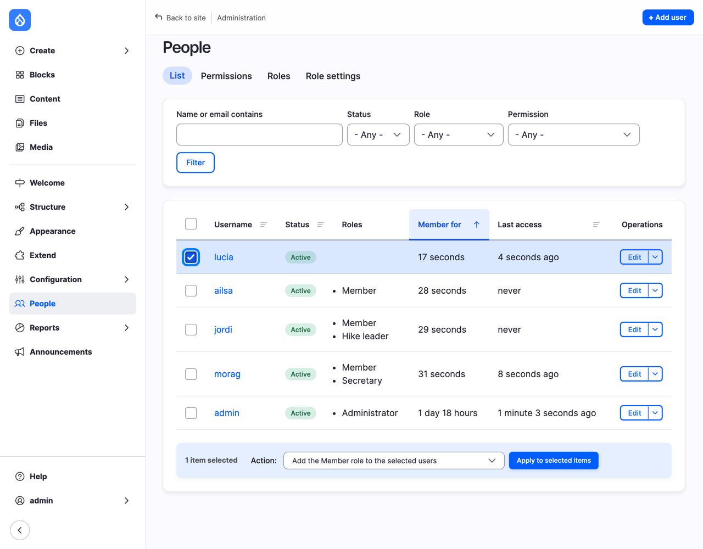
*Figure 15.16: Making Lucía a member*

The bulk actions work on many accounts at once: at the start of the club's year, the administrator can select everyone who's paid and add the role in one go, or remove it from those who haven't.

## Keeping the spam out

Why not let visitors register without approval? It's one click on Account settings, and for some sites it's the right choice. But understand what you're opening before you choose it.

Within days of a site going live, programs that crawl the web find its registration form, and start creating accounts: dozens a day, then hundreds. None of them are people. With open registration, every one of them is an active, authenticated user, with everything you gave **Authenticated user**:

- **Comments.** If authenticated users may comment without approval, the spam goes straight onto your pages: links to casinos, pills and worse, under your members' photos.
- **Profiles.** If accounts have fields, such as a website or "About me", spammers fill them with links, and search engines find those pages.
- **Email.** Every registration sends a welcome email to an address that may not exist, or belongs to someone who never asked for it. Enough of those, and email providers start treating *all* of your site's email as spam, including the password resets your members need.
- **Cleaning up.** Deleting thousands of accounts, and everything they created, takes time, and finding the one real person among them takes longer.

Approval stops the accounts from doing anything, but not from being created: the secretary's mailbox still fills up with applications. So protect the registration form itself.

### CAPTCHA

A **CAPTCHA** is a small test that people pass and programs don't, such as typing the letters in a distorted image. The contributed [CAPTCHA](https://www.drupal.org/project/captcha) module adds one to the forms you choose, and it supports Drupal 12.

1. Download it with Composer, as in Chapter 11:

   ```
   ddev composer require drupal/captcha
   ```

2. On **Extend**, filter on `captcha`, check **CAPTCHA** and **Image CAPTCHA**, and select **Install**.

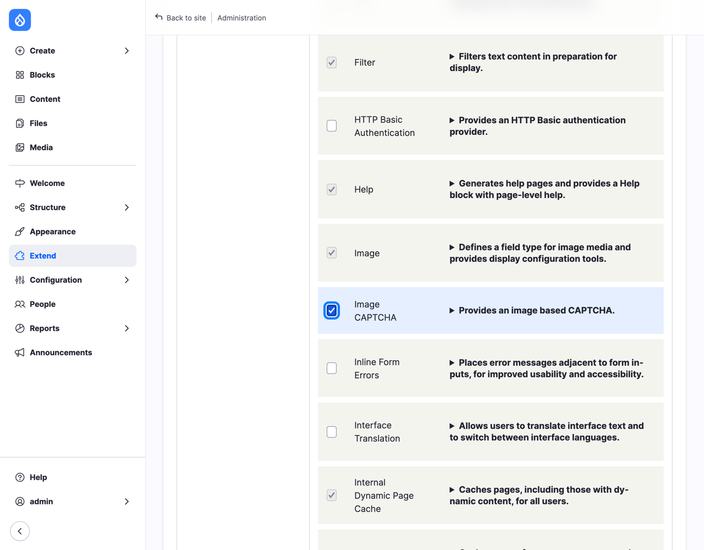
*Figure 15.17: Installing CAPTCHA and Image CAPTCHA*

3. Go to **Configuration** > **People** > **CAPTCHA settings**. Set **Default challenge type** to **Image (from module image_captcha)**, and select **Save configuration**.
4. Select the **CAPTCHA Points** tab. A *CAPTCHA point* is a form that can have a challenge. Select **Enable** next to **user_register_form** (registration) and **user_pass** (the password reset, which spammers use to send email through your site).

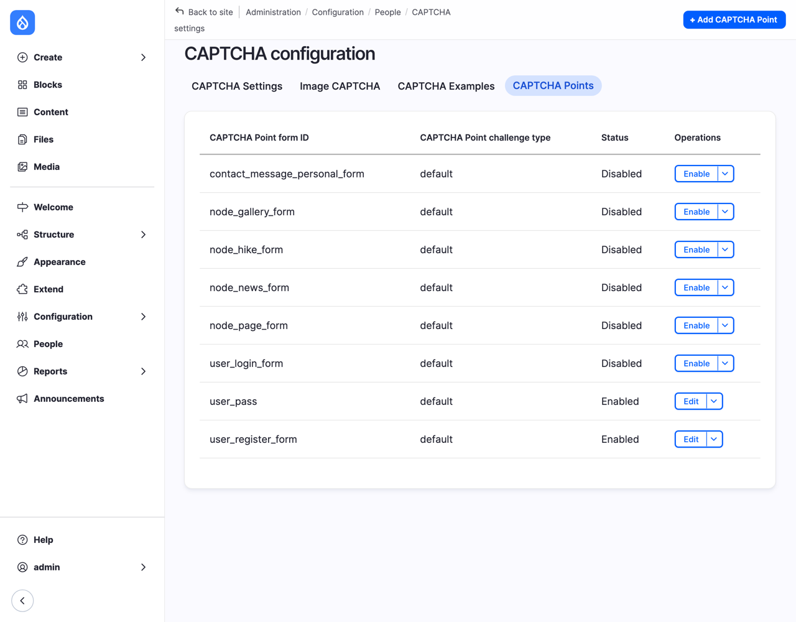
*Figure 15.18: CAPTCHA on registration and the password reset*

Open `/user/register` in a private window again:


*Figure 15.19: The registration form, with a CAPTCHA*

People with the **Skip CAPTCHA** permission never see the test. Logged-in members don't need it, and you, testing as `admin`, won't see it at all: always test in a private window.

How good is a CAPTCHA? The **Math** challenge ("What is 3 + 5?") stops the simplest programs, and the image challenge a few more. Determined spammers solve both, with software or with people paid by the hundred. A stronger challenge comes from a service that watches how the visitor behaves, rather than asking a question: contributed modules connect Drupal to [reCAPTCHA](https://www.drupal.org/project/recaptcha), [Cloudflare Turnstile](https://www.drupal.org/project/turnstile) and [Friendly Captcha](https://www.drupal.org/project/friendlycaptcha), each with its own costs and privacy questions (the visitor's browser talks to someone else's server). Check which version of Drupal each supports before you choose.

A different trick is the *honeypot*: a field that's hidden from people, which programs fill in anyway, and a check on how fast the form was submitted. Nobody fills in a registration form in one second. The [Honeypot](https://www.drupal.org/project/honeypot) module does both, without asking visitors anything, and works well next to a CAPTCHA. As we write this, it supports Drupal 11 but not yet Drupal 12.

No single tool stops all spam. Approval, a CAPTCHA, and comments that wait for people you don't know yet, together, make the club's site more trouble than it's worth to a spammer, and that's the goal.

### Passwords and logins

Drupal protects the login form by itself. After five failed logins for one account within six hours, or fifty from one address within an hour, it refuses more attempts for a while. (Drupal calls this *flood control*.) The password strength indicator on Account settings shows people how strong their new password is, but it doesn't stop them from choosing a weak one.

To *require* strong passwords (a minimum length, or a password that hasn't appeared in known data breaches), the [Password Policy](https://www.drupal.org/project/password_policy) module adds rules for each role, so you can be stricter with the secretary than with members. As we write this, it supports Drupal 11 but not yet Drupal 12.

## Profiles

A user is an entity, so it can have fields, like a hike. The club wants members to say what camera they use, and a little about themselves. Go to **Configuration** > **People** > **Account settings**, and select the **Manage fields** tab.

1. Add a **Plain text** field, **Short text**, called `Camera`.
2. Add a **Plain text** field, **Long text**, called `About me`.

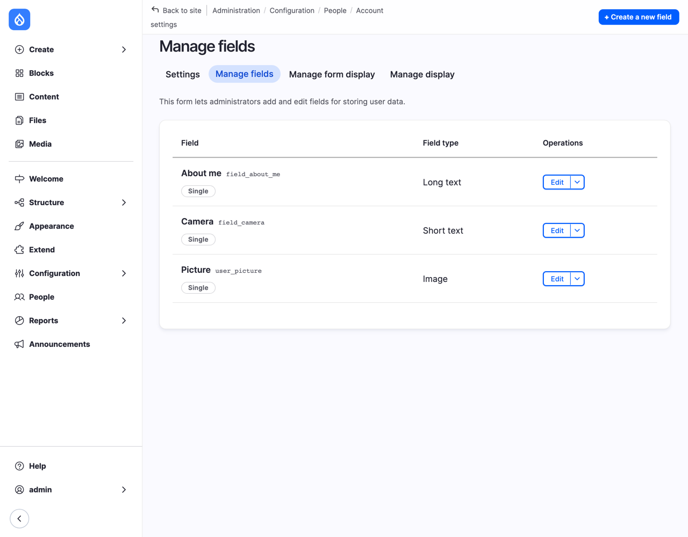
*Figure 15.20: Fields on the user*

**Picture** was there already: the Standard installation adds it. Members fill in their fields on their own **Edit** form, under **My account**.

Every account has a page of its own, its *profile*, at `/user/` and its number. Log in as Ailsa, and open Jordi's:


*Figure 15.21: A member's profile*

There's the **Hikes** tab from Chapter 13, with the hikes he leads. Visitors who aren't logged in get "Access denied" on the same page: only roles with **View user information** may see profiles, and we gave it to members. That's why, in Chapter 8, we didn't link the hike leader's name on hike pages: for visitors, the link would lead nowhere.

**Manage display** on the same page decides what a profile shows, exactly as for content (Chapter 8), and **Manage form display** what the edit form asks for. The registration form has a form display of its own, **Register**, so you can keep it short: an email address and a username, and the rest later.

Careful with personal information. Anything on a profile is visible to everyone with **View user information**, and core can't show a field to some roles and hide it from others. A phone number for hike leaders only, for example, needs a contributed module, such as [Field Permissions](https://www.drupal.org/project/field_permissions) (which, as we write this, supports Drupal 11 but not yet Drupal 12). Ask only for what the club needs, and tell members who will see it.

### Time zones

Dates on the site, such as a hike's start time, are shown in the site's time zone: London, which we set in Chapter 5. A member who's spending the winter in Buenos Aires might prefer to see them in their own. Go to **Configuration** > **Regional and language** > **Regional settings**:


*Figure 15.22: Time zones for users*

With **Users may set their own time zone** on (it is, by default), every account has a **Time zone** under **Locale settings** on its edit form, and the site shows dates in it. New accounts get the site's time zone, unless you choose otherwise below. For a club that meets in Edinburgh, London is the right default: a hike at 9:30 is at 9:30 in the Pentlands, wherever you read about it from. That's a good reason to leave members' time zones alone, and a good reminder that "dates in your own time zone" isn't always what people want.

## Hike leaders and the secretary at work

Two promises are left. In Chapter 7, the **Hike leader** field could choose from every account on the site; now there's a role for it.

1. Go to **Structure** > **Content types** > **Hike** > **Manage fields**, and select **Edit** next to **Hike leader**.
2. Set **Filter by** to **User role**, and under **Restrict to the selected roles**, check **Hike leader**.

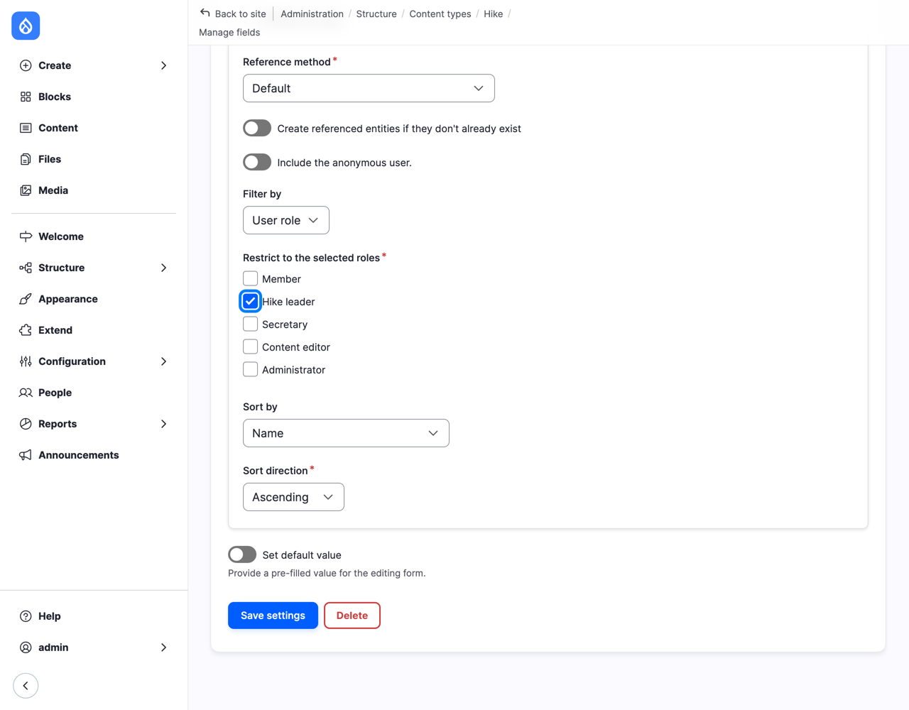
*Figure 15.23: Only hike leaders can lead a hike*

3. Select **Save settings**.

That leaves the hikes we made before there were hike leaders: their **Hike leader** is **admin**, and admin doesn't have the Hike leader role. Drupal doesn't go back and check them, so nothing changes on the site today, but the next time someone saves one of those hikes, Drupal says the reference isn't allowed, and the hike won't save until it has a real leader. Let's give them one now.

> **Try it:** Go to **Content**, open each hike with **admin** as its hike leader (*Arthur's Seat at sunrise*, *North Berwick Law and the harbour* and *Pentland Hills ridge*, and any other hike you gave admin), select **Edit**, choose **jordi** under **Hike leader**, and **Save**. The list offers only jordi now: he's the club's only hike leader so far.

Now log in as Jordi, and add a hike: *Arthur's Seat by night*, on a Saturday in January at 17:30, from the St Margaret's Loch car park in Holyrood Park, 5 km, Moderate, with himself as **Hike leader**: the list now offers hike leaders only.


*Figure 15.24: A hike leader can only save a draft*

**Save as** offers only **Draft**: the only transition Jordi may use. His sidebar is short, too: **Create** and **Content**, because that's all his roles allow. He saves the draft.

Morag, the secretary, sees it on **Content**, marked **Unpublished**:

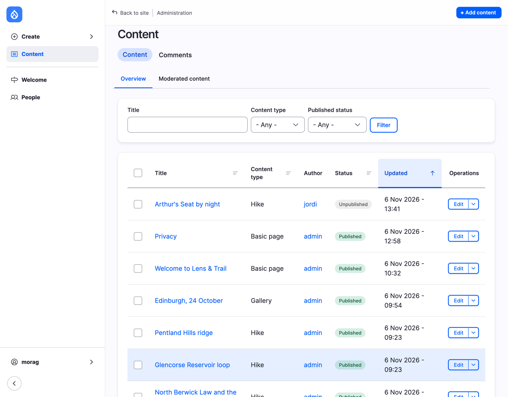
*Figure 15.25: The draft, waiting for the secretary*

The **Moderated content** tab lists only content in the workflow that isn't published yet: a handy to-do list. They open the hike, check the details, and under **Change to**, choose **Published**.

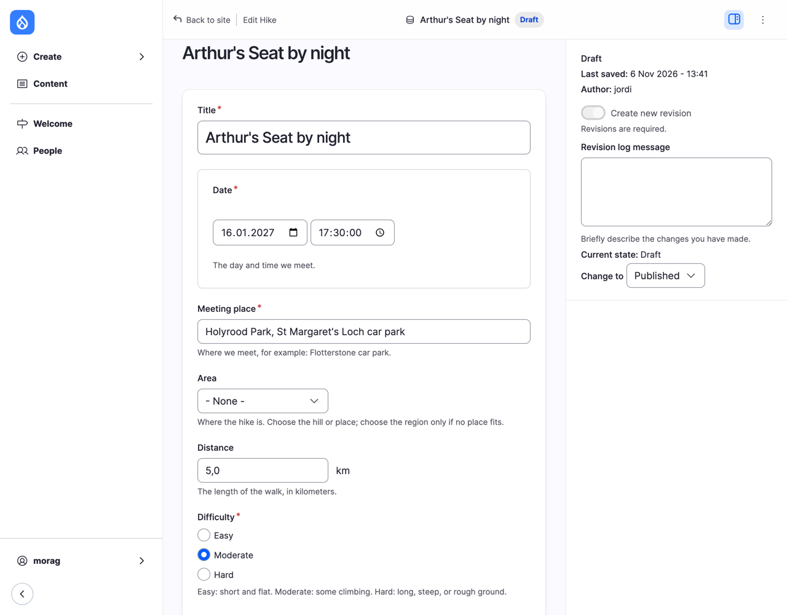
*Figure 15.26: The secretary publishes the hike*

When Jordi edits his hike after that (the meeting place has changed, say), his change is a new draft. Visitors keep seeing the published version until Morag publishes the new one. That's the Editorial workflow doing exactly what Chapter 6 promised.

> **Under the hood: access.** How does Drupal decide whether Jordi may edit a hike? It asks in layers, and every layer can only say "allowed", "forbidden" or "no opinion":
>
> 1. **Permissions.** Does any of his roles have "Hike: Edit any content", or "Hike: Edit own content" and is he the hike's author? This is the layer you set on the permissions page, and it answers most questions.
> 2. **Entity access.** Modules can add rules for a single item: Content Moderation, for instance, checks which transitions he may use on this hike, and whether he may see its latest draft. A single "forbidden" from any module wins over every "allowed".
> 3. **Node access grants.** For content only, modules can keep a list of who may see or edit each item, such as "only members of the Pentland group may see this hike". Core has none of its own; contributed modules such as [Group](https://www.drupal.org/project/group) use it. When a site's access seems to ignore the permissions page, look here.
>
> Views asks the same questions (Chapter 12's **Access** setting is the first layer for the whole page, and its query leaves out content a visitor may not see), and so do menus: a menu link to a page you may not see isn't shown. User 1 gets past every *permission*, but not checks of other kinds: a page that only one role may open (an option in Views) is closed to user 1 too, unless user 1 has that role.

> **On Drupal CMS:** People, roles and permissions work the same way, with the same four roles. Two differences. Drupal CMS's **Content editor** is a role you can use as it is: it may create and edit pages, Canvas pages and media, publish and unpublish through its workflow, schedule publishing, and use the trash, which is close to our secretary, without the accounts. And people can log in with their email address instead of their username, thanks to the Login Email or Username module: one thing less for members to forget. Registration starts as **Administrators only**, as on core, and no spam protection is installed.

> **Coming from WordPress?** WordPress comes with ready-made roles: Administrator, Editor, Author, Contributor and Subscriber, and Super Admin on a multisite network. Each is a fixed set of *capabilities*: an Author may publish their own posts, a Contributor may write them but not publish them. Drupal comes with almost nothing ready-made, and you build roles from permissions, as we did. If you're used to WordPress, our Hike leader is a Contributor for hikes only, and our Secretary an Editor who also looks after accounts. The difference is in the details: in WordPress, adding a role or changing what a role may do takes code (`add_role()`) or a plugin; in Drupal, it's the permissions page, and a role can be as narrow as one content type.

## Summary

You can now:

- find, filter and edit the site's accounts on **People**, and explain why user 1 is special and how to protect it;
- explain the four built-in roles, and why Anonymous user and Authenticated user are different from the others;
- create roles for the jobs on a site, and give them permissions, one role at a time or all at once;
- tell *own* from *any* permissions, and recognize the permissions that need trust, such as **Administer users**;
- create accounts, and find the emails Drupal sends in Mailpit;
- let visitors apply for an account, approve it, and give roles in bulk;
- explain what open registration invites, and protect forms with a CAPTCHA;
- add fields to users, and decide who may see profiles;
- let users choose their time zone, or decide that they shouldn't;
- use workflow permissions so that some people write drafts and others publish them.

## Exercises

1. Log in as Ailsa, a member, and create an album of your own. Then try to edit Jordi's album: what happens, and which permission decides it?
2. The registration form asks for a picture. Remove **Picture** from the **Register** form display, so applicants only give an email address and a username. Does the field disappear from members' **Edit** form too?
3. Change the email Drupal sends when an account is approved (**Account activation**, on Account settings), so it welcomes the person to the club and points them to the next hike. Approve a test account, and read the result in Mailpit.
4. Create an account for yourself with the **Administrator** role, log in with it, and check that you can do everything you need. Why is that better than using `admin` every day?
5. *(challenge)* The club wants hike leaders to see each other's phone numbers, but nobody else. Can you do it with core alone? Which module would you look for, and how would you check whether it supports your version of Drupal?
6. *(challenge)* Go back to your list from Chapter 1, Exercise 4. For each thing someone must *not* be able to do, find the permission (or the missing permission) that stops them. Is there anything on your list that permissions can't express?
7. *(advanced)* The club wants a page for members only, at `/members`: where the photo evenings are, and the secretary's phone number for hike days. Visitors, and people with an account who aren't members yet, should get "Access denied", and the secretary should be able to change the text. Why doesn't a Basic page with that text work? Build it with what you know from Chapters 12 to 14. (The answer is in Appendix C.)
8. *(challenge)* Some members want others to know their pronouns: Morag, for example, uses they/them. Add a **Pronouns** field to user accounts, and fill it in for Morag. Which field type would you choose: a list of choices, or plain text, and what does each mean for someone whose pronouns aren't on your list? Should it be required, and should it be on the registration form? Who sees it on the profile, and is that what members expect when they fill it in?
9. *(challenge)* Logging out and back in as Jordi, Morag or Ailsa to test what they may do gets tiring. Find a contributed module that lets a site builder switch to another account and back with one click. Use the questions from Chapter 11: does it support your version of Drupal, is it covered by the security advisory policy, and how many sites use it? Then think about who should be allowed to use it: why is switching to someone else's account as much trust as **Administer users**?

%% Author: the module is Masquerade (https://www.drupal.org/project/masquerade). 8.x-2.2 supports ^10.3 || ^11 || ^12 and is covered by the security advisory policy (checked 2026-11-06). Not named in the text on purpose, so readers practice finding modules. %%

## Want to know more?

- [Managing User Accounts](https://www.drupal.org/docs/user_guide/en/user-chapter.html), the chapter on users, roles and permissions in the Drupal User Guide.
- [Security considerations](https://www.drupal.org/docs/administering-a-drupal-site/security-in-drupal), on drupal.org, for user 1 and permissions that need trust.
- The contributed modules in this chapter: [CAPTCHA](https://www.drupal.org/project/captcha), [Honeypot](https://www.drupal.org/project/honeypot), [Password Policy](https://www.drupal.org/project/password_policy), [Role Delegation](https://www.drupal.org/project/role_delegation) and [Field Permissions](https://www.drupal.org/project/field_permissions).
- [Mailpit](https://ddev.readthedocs.io/en/stable/users/usage/developer-tools/#email-capture-and-review-mailpit), in DDEV's documentation.
- For comparison, WordPress's [Roles and Capabilities](https://wordpress.org/documentation/article/roles-and-capabilities/).
