# Multilingual Sites

Many of the club's members came to Scotland from Spain and Latin America, and the About page says so: you hear as much Spanish as English on the trail. It's time the website caught up. In this chapter, Lens & Trail gets a second language, Spanish, and everything a visitor sees gets translated: the buttons and messages Drupal writes itself, the hikes, pages, news and albums, the terms, the photos' descriptions, the menus and blocks, the views, and even the labels of the fields.

That sounds like one job, and in most systems it is. In Drupal, it's three, because a page is made of three kinds of text: text that comes with Drupal and its modules ("Log in", "Save"), text that we set up while building the site (a view's title, a field's label), and the content itself (a hike, a term). Each kind is translated in its own place, by its own module. Once you see the three, multilingual Drupal makes sense, and it's one of the things Drupal does better than almost anything else.

We also give the club a translator. Lucía, who joined in Chapter 15, has offered to translate the hikes, and we make a role for her that lets her do exactly that, and nothing more. On Drupal CMS, we translate a Canvas page with Canvas Translate, a module that puts the English and the Spanish side by side.

We start where Chapter 17 left the club's site: Olivero in the club's colors, with all the content, views, blocks and roles of the earlier chapters, and an address for every page from Pathauto.

## Four modules

Everything multilingual in Drupal core comes from four modules. Go to **Extend** (`/admin/modules`) and look for the **Multilingual** group:

- **Language** lets you add languages, decide which one a visitor gets, and give everything on the site a language. The other three need it.
- **Interface Translation** translates the text that comes with Drupal and its modules, the *interface*, and downloads the translations for it.
- **Content Translation** translates content: nodes, terms, media, blocks, menu links, users.
- **Configuration Translation** translates the things we set up: views, field labels, date formats, the site's slogan.

Check all four, and select **Install**.

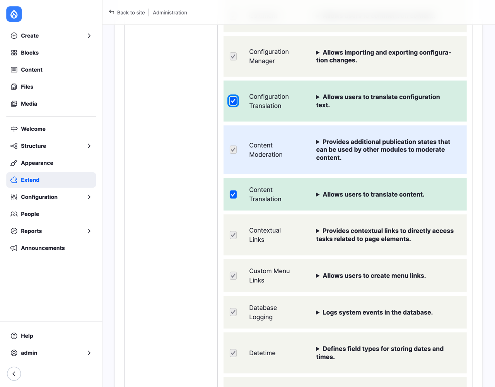
*Figure 18.1: The four multilingual modules*

> **Drupalism: three translations.** Drupal splits translation into three, because a page holds three kinds of text, which live in different places:
>
> - **Interface translation**: the text written into Drupal's code and its modules' code, such as "Log in", "Save" or "Home". Volunteers translate it once, for everyone, on drupal.org, and your site downloads it. You can change a translation if you don't like it.
> - **Configuration translation**: the text we typed while building the site, and that Drupal keeps as configuration (Chapter 7): a view's title, a field's label, a block's title, the site's slogan, a date format.
> - **Content translation**: the content itself: a hike, a page, a term, a photo's alternative text, a menu link.
>
> When something on a Spanish page is still in English, the first question is always "which of the three is it?". The answer tells you where to translate it.

## Adding Spanish

Go to **Configuration** > **Region and language** > **Languages** (`/admin/config/regional/language`). There's one language on the list, English, the language we installed the site in (Chapter 4). Select **Add language**, choose **Spanish** from **Language name**, and select **Add language**.

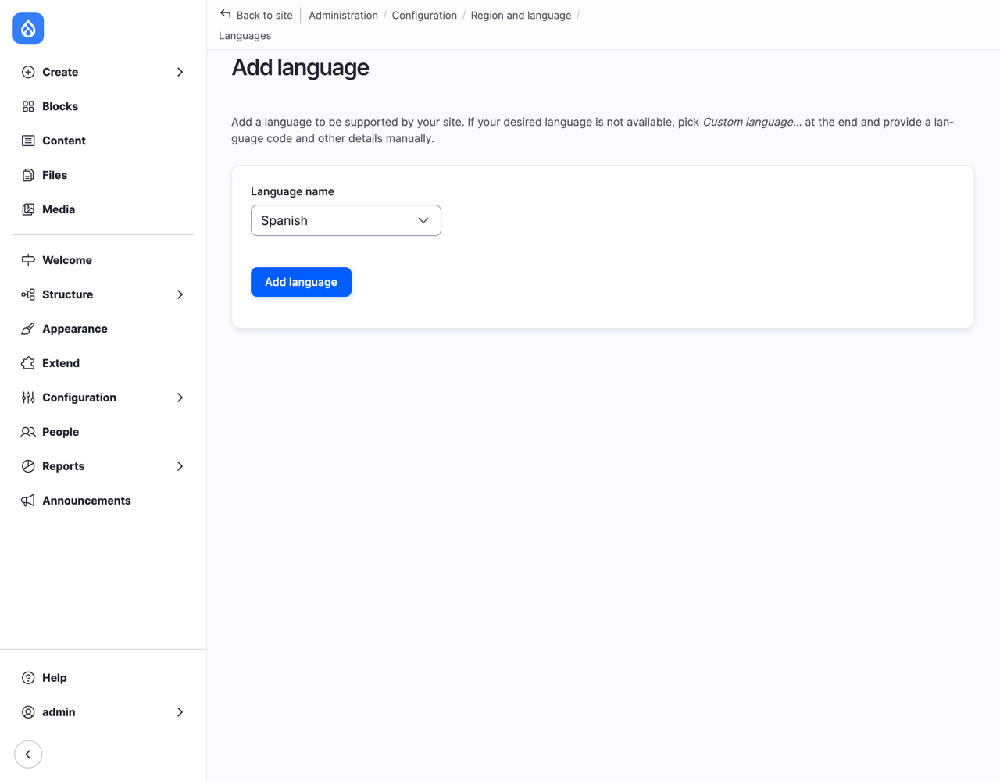
*Figure 18.2: Adding Spanish*

The **Custom language...** at the end of the list is for a language Drupal doesn't know, or a variant of one it knows, such as Spanish as it's spoken in Mexico. We keep to plain Spanish, with the code `es`. The club's members come from all over the Spanish-speaking world, so we write a neutral Spanish that most of them read without noticing where it comes from: "tú", "estacionamiento", "teléfono". If your site is for one country, a variant such as `es-MX` with its own words is a good idea; Drupal treats it as a language of its own.

Drupal now does something you didn't ask for: it downloads the Spanish translation of the interface. It takes a minute, with a progress bar. When it's done, the list has two languages, and a message tells you how many translations were imported:

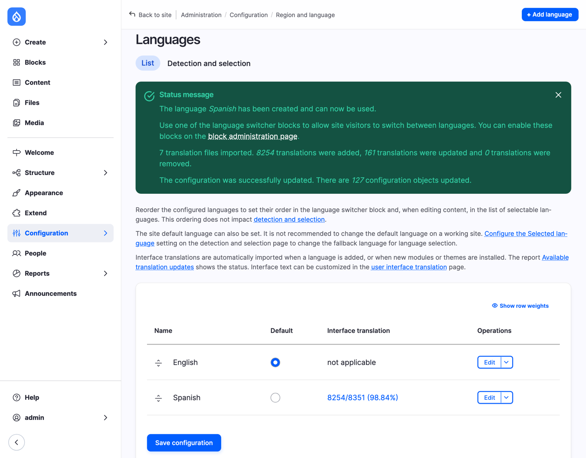
*Figure 18.3: Spanish, with almost all of the interface translated*

The number under **Interface translation** is how much of the interface has a Spanish translation: almost all of it. The translations come from *localize.drupal.org*, where volunteers translate Drupal core and contributed modules into dozens of languages. Your site downloads a module's translations when you install it. Translations get better over time, and **Reports** > **Available translation updates** (`/admin/reports/translations`) shows whether there are newer ones, and downloads them. To have cron check for you (Chapter 11), set **Check for updates** to **Weekly** under **User interface translation** > **Settings** (`/admin/config/regional/translate/settings`).

Not every module is translated: a module that's new, or rarely used, may have no Spanish yet. Its text stays in English until someone translates it, on localize.drupal.org (thank you!) or on your site. We do that later in this chapter.

### What a visitor sees

Open the front page in a private window, and put `/es` after the address: `https://lens-and-trail.ddev.site:8443/es`.

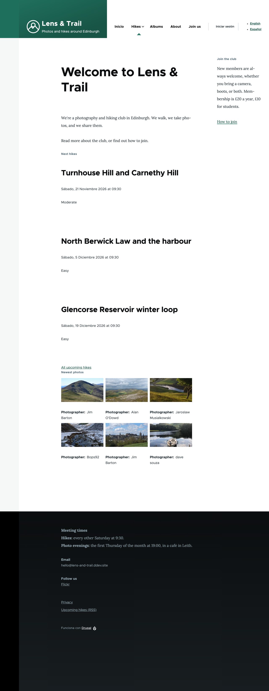
*Figure 18.4: The front page at /es: the interface is Spanish, everything else is English*

Look at what changed: **Inicio** (Home) and **Iniciar sesión** (Log in) in the header, and "Funciona con Drupal" (Powered by Drupal) at the bottom. That's interface translation: text from Drupal's code. Everything else is still English, because it's configuration (the menu, the slogan, the block titles, the field labels) or content (the welcome text, the hikes). Look at the dates, too: "Sábado, 21 Noviembre 2026 at 09:30". The names of the day and month are interface text, translated; the "at" is ours, from the date format we made in Chapter 8, which is configuration. Three kinds of text, on one line.

## Which language? Detection and selection

How did Drupal know you wanted Spanish? From the `/es` in the address. Go to **Languages** > **Detection and selection** (`/admin/config/regional/language/detection`):

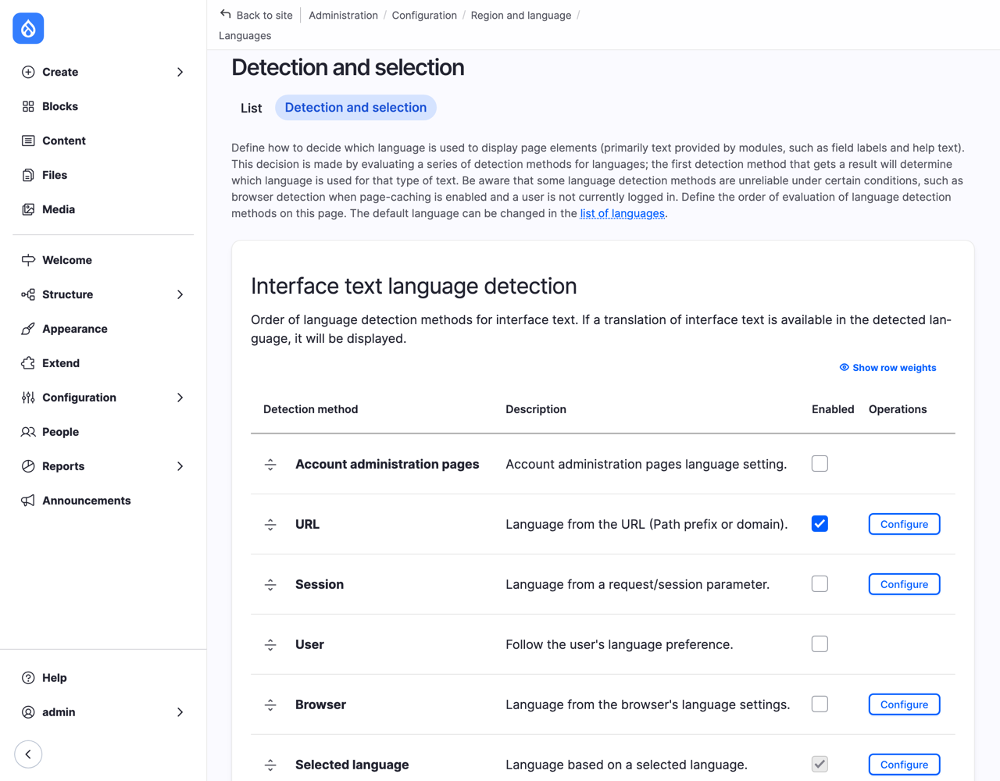
*Figure 18.5: How Drupal decides which language to show*

Drupal tries the *detection methods* from the top down, and the first one that finds a language wins:

- **Account administration pages**: a language for the administration pages, which each user picks on their account form. Useful for a translator who wants Drupal's own screens in English, whatever language the content is in.
- **URL**: the language from the address. On by default, and the one we use.
- **Session**: the language from a parameter in the address, such as `?language=es`, remembered for the visit.
- **User**: the language each user picks on their account form, for logged-in users.
- **Browser**: the language the visitor's browser asks for. Every browser sends a list of the languages its user prefers; Drupal can follow it.
- **Selected language**: the site's default language, English, when nothing else finds one. Always on, always last.

Why not turn **Browser** on, so that Spanish speakers get Spanish without looking for it? It's tempting, and a lot of sites do it. But it has a catch, which the text at the top of the page warns about: for visitors who aren't logged in, Drupal keeps finished pages in a cache, and hands the same page to everyone who asks for that address. The first visitor's language would decide the language for the next ones. It also means that the same address shows different things to different people, which confuses search engines, and people sharing a link. We keep the language in the address: `/es` is Spanish, everything else is English, for everyone. A Spanish speaker arriving at the English page uses the language switcher, which we add in a moment.

Select **Configure** next to **URL**:

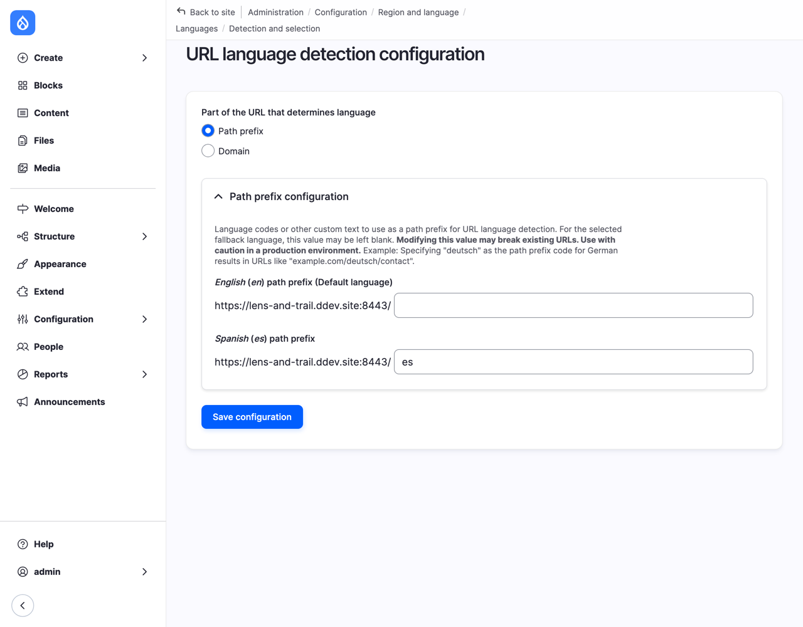
*Figure 18.6: The URL prefixes: nothing for English, es for Spanish*

**Path prefix** puts the language at the start of the path: `/es/...`. The other choice, **Domain**, gives each language its own domain, such as `lensandtrail.es`, which needs a domain for each language and a server that knows them all. Path prefixes need nothing. English, the default language, has an empty prefix, so the English pages keep the addresses they've always had, and every link to them still works. Leave this as it is.

> **Under the hood: content language.** There are two languages on every page: the *interface language*, for the interface and configuration, and the *content language*, for the content. Normally they're the same, and Drupal hides the second. Check **Customize Content language detection to differ from Interface text language detection settings** at the bottom of Detection and selection, and you can set the content language apart: a site in English with content in five languages, say. We don't need it.

### A language switcher

Visitors need a way to switch. Language adds a block for it, **Language switcher**. Go to **Structure** > **Block layout**, and select **Place block** next to the **Secondary menu** region, the one with **Log in** in it (Chapter 14). Find **Language switcher**, and select **Place block**. Uncheck **Display title**, because the links speak for themselves, and select **Save block**.

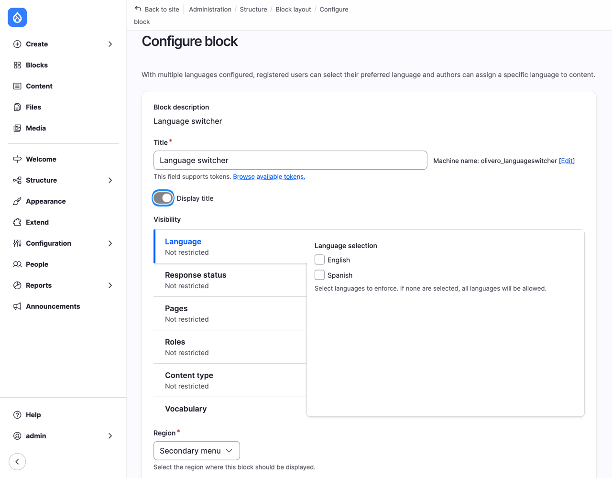
*Figure 18.7: The language switcher, placed next to Log in*

The block lists every language, each in its own name, **English** and **Español**, and links to the same page in the other language. On a page that has no Spanish translation, the Spanish link still works: it shows the Spanish interface around the English content, as in Figure 18.4. Visitors who read only Spanish then know at least where they are, and what they can do.

> **Try it:** open the front page, and switch languages with the switcher. Then open a hike, and switch again. Which parts change?

## What can be translated

Now the content. Drupal doesn't translate every piece of content by default, and it doesn't translate every field: you decide, on **Configuration** > **Region and language** > **Content language and translation** (`/admin/config/regional/content-language`).

At the top, under **Custom language settings**, check the kinds of content the club translates: **Content**, **Taxonomy term**, **Media**, **Content block** and **Custom menu link**. A section opens for each. In each one, check the box in front of every type you want to translate: for **Content**, that's all four of ours, **Basic page**, **Hike**, **News** and **Album**; for **Taxonomy term**, both vocabularies; for **Media**, **Image**; for **Content block**, both block types; and **Custom menu link**.

When you check a type, Drupal checks all its fields, and shows them under it. Now comes the part that needs thinking: which fields hold words?


*Figure 18.8: The hike's translatable fields: the ones with words in them*

For a hike, the **Description** and the **Meeting place** are words, and change with the language. The **Date**, **Distance** and **Difficulty** are the same in every language: the hike doesn't happen on another day in Spanish. If they were translatable, each translation would have its own date, and someone moving the hike to Sunday would have to remember to move it in both. So we uncheck them. The same for **Area**, **Hike leader** and **Photo**: they point to a term, a user and a media item, which are the same in both languages. The term and the photo have translations of their own, so the Spanish hike shows the Spanish term and the Spanish alternative text anyway. For the other types, keep **Body** and uncheck the rest.

> **Why translate Published or Changed?** Some of the checked fields at the top of each type look odd: **Published**, **Authored by**, **Authored on**, **Changed**, **URL alias**. They're checked by default, and for good reasons. A translation can be published or not on its own: the English hike can be online while the Spanish is still being written. Its author is the translator. Its **Changed** date is when the translation last changed, which tells you if it's older than the English. And each translation has its own address, which we need for Spanish aliases. Leave them checked.

**Hide non translatable fields on translation forms** is on, and greyed out, for the types under content moderation (Chapter 15). When someone translates a hike, the form shows only the translatable fields; the others, such as the date, they change on the English form. For moderated content, Drupal insists, so that two people editing two languages can't change the same date at once. For the photos, check the **Image** field, and uncheck its **File** column, so that only the alternative text and title are translated: the Spanish photo is the same file, with Spanish alternative text.

Select **Save configuration** at the bottom.

## Spanish addresses

Before we translate anything, think about addresses. A Spanish hike at `/es/hikes/turnhouse-hill` would work, but it's half English. We'd like `/es/excursiones/turnhouse-hill`. In Chapter 17, Pathauto made our addresses from patterns, and a pattern can be for one language.

Go to **Configuration** > **Search and metadata** > **URL aliases** > **Patterns** (`/admin/config/search/path/patterns`), and select **Add Pathauto pattern**. Set it up as in Chapter 17: **Pattern type** **Content**, **Path pattern** `/excursiones/[node:title]`, **Content type** **Hike**. Now a new setting has appeared, **Languages**, because the site has two. Check **Spanish**, give it the **Label** `Excursiones`, and **Save**.

![The Add Pathauto pattern form: pattern type Content, path pattern /excursiones/[node:title], content type Hike, and the Languages checkboxes with Spanish checked](images/18-pattern-es.png)
*Figure 18.9: A pattern for Spanish hikes*

Make Spanish patterns for the others in the same way:

| Label | Pattern type | Path pattern | For |
|---|---|---|---|
| Álbumes | Content | `/albumes/[node:title]` | Album |
| Noticias | Content | `/noticias/[node:title]` | News |
| Zonas | Taxonomy term | `/zonas/[term:parents:join-path]/[term:name]` | Areas |
| Temas fotográficos | Taxonomy term | `/temas-fotograficos/[term:name]` | Photo themes |

There's one more step, and it's the one people forget. Pathauto uses the first pattern that fits, from the top of the list down. Our English patterns from Chapter 17 have no language, which means they fit every language, Spanish too. If they come first, the Spanish hikes get English addresses. Drag the Spanish patterns above the English ones (or select **Show row weights** and give them lower numbers), and select **Save**.

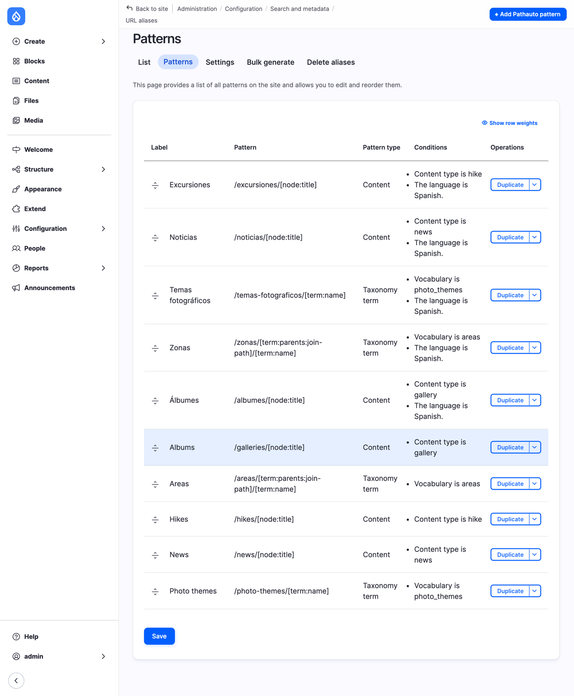
*Figure 18.10: Spanish patterns first, because English fits every language*

Two settings from Chapter 17 matter now. **Transliterate prior to creating alias** is on, so letters such as "á" and "ñ" become "a" and "n": an album called "Álbum de otoño" gets `/albumes/album-de-otono`. Addresses with accents work in modern browsers, but they turn into strings such as `%C3%B1` when people copy them, so plain letters are friendlier. And **Strings to Remove** is a list of English words. "the", "of" and "a" disappear from addresses; "el", "de" and "la" don't, so the Spanish addresses are a little longer. That's fine. (The list is one for all languages, so adding Spanish words would take them out of English addresses too, where "de" and "la" might be part of a name.)

## Translating content

Let's translate the About page. Open it, and you'll see a new tab: **Translate**. Select it.

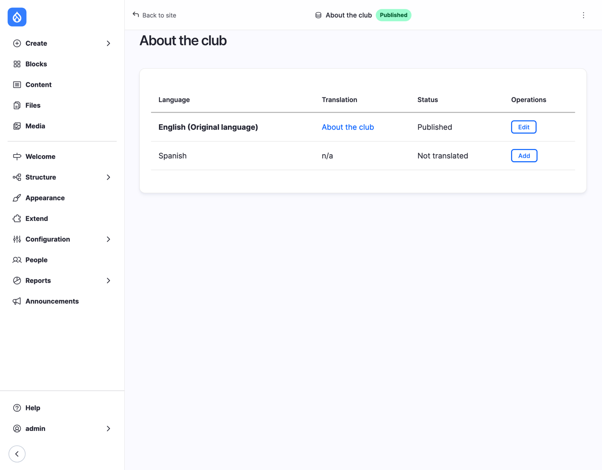
*Figure 18.11: The Translate tab: one row per language*

Every language has a row: English, the original, and Spanish, not translated yet. Select **Add** in the Spanish row.

The form that opens is the page's edit form, with the English text in it, ready to be replaced. But look at the address: `/es/node/1/translations/add/en/es`. It starts with `/es`, so the interface is in Spanish: **Título**, **Guardar (esta traducción)**. That's the URL detection at work again: a translation form in Spanish is easier for a Spanish translator. If you'd rather keep the administration pages in English, that's what **Account administration pages** in Detection and selection is for.

Notice also that the field labels, **Body** for example, are still in English. They're configuration, which we translate later.

Fill in the Spanish from `examples/club/spanish.md`, where you'll find all the Spanish texts of this chapter: the [title, the text and the address](../examples/club/spanish.md) of every page, hike, news item, album, term, photo and block. The About page is "Sobre el club", at `/sobre-el-club`. The Basic pages have no pattern, so we type their addresses by hand, as we did in English.

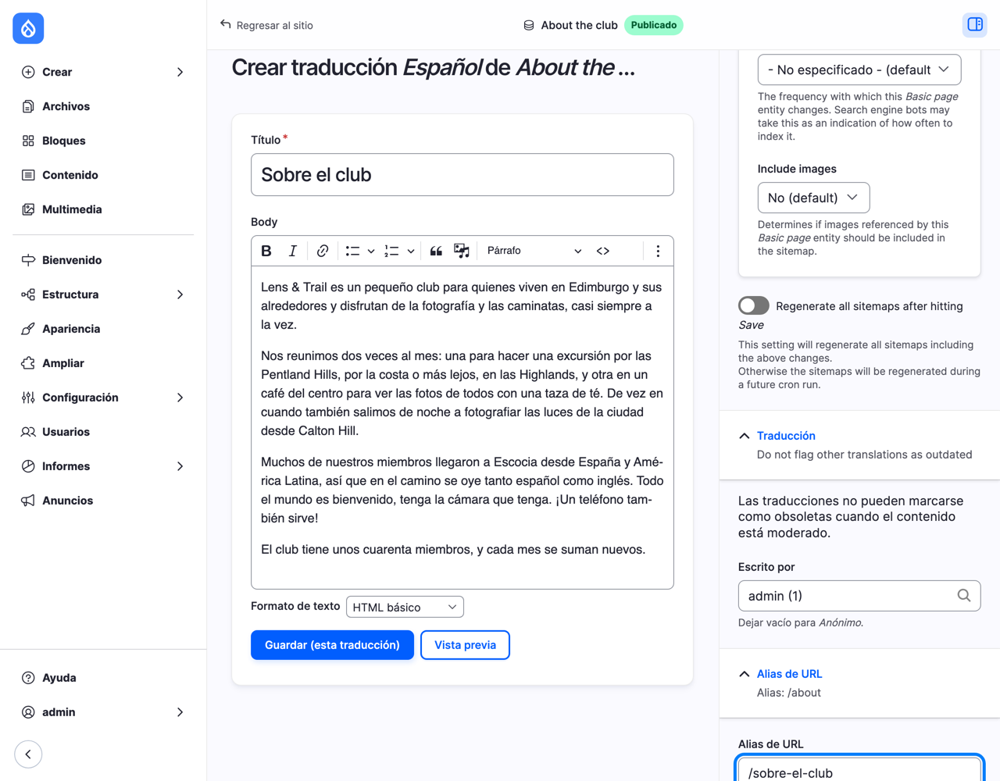
*Figure 18.12: Translating the About page, on a form in Spanish*

Select **Guardar (esta traducción)**. Back on the Translate tab, Spanish has a row of its own now, and `/es/sobre-el-club` is the About page in Spanish.

### Translating a hike

Now the Turnhouse hike. Open its **Translate** tab, and select **Add** in the Spanish row.


*Figure 18.13: A hike's translation: only the fields with words in them*

The warning at the top is the setting from Figure 18.8 at work: the fields that are the same in every language, such as the date and the distance, aren't on this form. To change them, use the link to the English form.

In the sidebar, look at **URL alias**. You might expect the Spanish pattern to make the address, but **Generate automatic URL alias** is off. We turned it off in Chapter 17, to keep `/hikes/turnhouse-hill`, and Pathauto keeps that setting for the hike, not for each translation: off in English means off in Spanish. So we type the Spanish address ourselves, `/excursiones/turnhouse-hill`. For every other hike, the setting is on, and the pattern makes the address when you save.

Fill in the Spanish title, meeting place and description, and select **Guardar (esta traducción)**.

> **Try it:** translate the rest of the club's content, with the texts in `examples/club/spanish.md`: the other Basic pages and hikes, the news item and the albums, the terms of both vocabularies, the photos (in **Content** > **Media**, the Spanish name and alternative text), the two content blocks (**Content** > **Blocks**), and the menu links (each link's **Translate** in the menu's operations). It's a long list. That's how translating a site feels: there's always one more thing. Leave *Arthur's Seat by night* in English, for Lucía.

When you're done, go to **Content**. There's a new filter and a new column, **Language**, and every translated item is listed twice, once in each language:


*Figure 18.14: The Content page lists each translation as a row of its own*

And on **URL aliases**, every Spanish item has a Spanish address, with **Spanish** in the **Language** column:

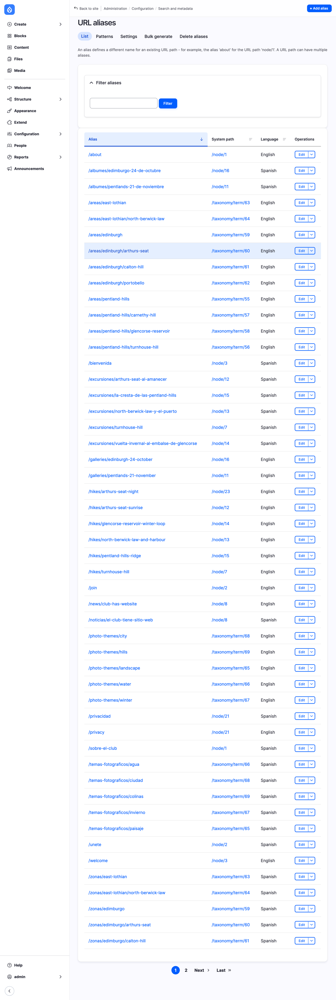
*Figure 18.15: An address for every language*

> **Under the hood: translations.** A translation isn't a copy of the hike: it's the same hike, the same node with the same ID, with a second set of values. In the database, a node's fields are stored in tables with a row for each language, and a column, `langcode`, that says which. The hike's date, which isn't translatable, is stored once, and both languages read it. That's why `/node/7` and `/es/node/7` are the same hike, why a translation has no ID of its own, and why the Content page lists it twice: it lists rows, and the hike now has two. Configuration translations are stored apart, as *overrides*: the Spanish title of a view is a small piece of configuration that says "in Spanish, replace the title with this", and when you export configuration (Chapter 7), you'll find them in a folder of their own, `language/es`. Interface translations live in two tables of their own, one with the English strings and one with the translations.

## Views in two languages

Open `/es/excursiones` (the Spanish address of the Hikes view, which we give it with a URL alias, below). Something's wrong:

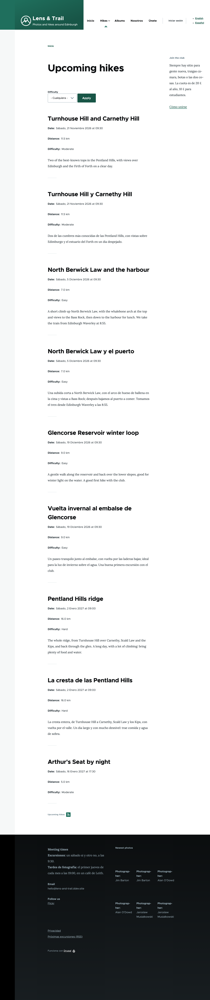
*Figure 18.16: Every translated hike, twice*

Every translated hike is there twice, once in English and once in Spanish. That's the Content page from Figure 18.14 again, and for the same reason: the view lists rows, and a translated hike has two. Views doesn't hide translations from you, because sometimes you want them all, as on the Content page.

What we want is each hike once, in the visitor's language, or in English if it has no Spanish. That takes two settings in the view. Edit the Hikes view (Chapter 12), and select the **Block** display, the front page's list.

First, the rows. Add a filter (**Filter criteria** > **Add**), search for **Default translation**, select it in the **Content** category, and choose **True**:

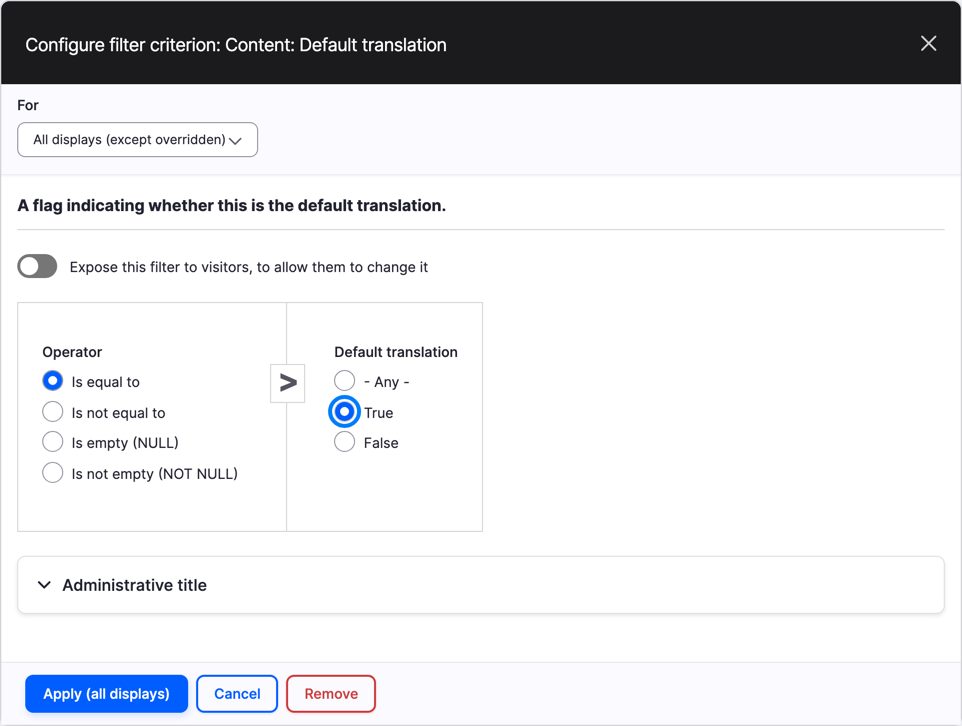
*Figure 18.17: Only the original row of each hike*

The *default translation* is the language a piece of content was created in: English, for all of ours. With this filter, each hike is one row again, the English one. Select **Apply (all displays)**.

Second, the language each row is shown in. Open **Advanced** on the right, and select the link next to **Rendering Language**. It says **Content language of view row**: each row is shown in its own language, which, after our filter, is English. Choose **Interface text language selected for page** instead: each hike is shown in the language of the page, Spanish at `/es`, English elsewhere. A hike without a Spanish translation is shown in English, which is what we want.

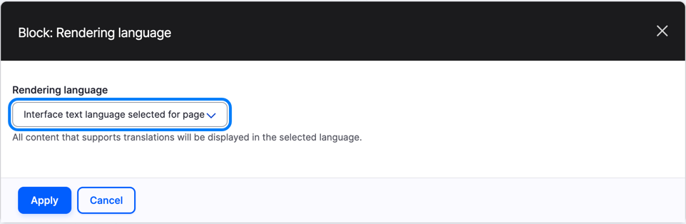
*Figure 18.18: The rendering language: by default, each row in its own language*

Select **Apply**, then do the same for the view's other displays: unlike filters, **Rendering Language** is set on each display, and a display doesn't take it from the others. Then **Save**.

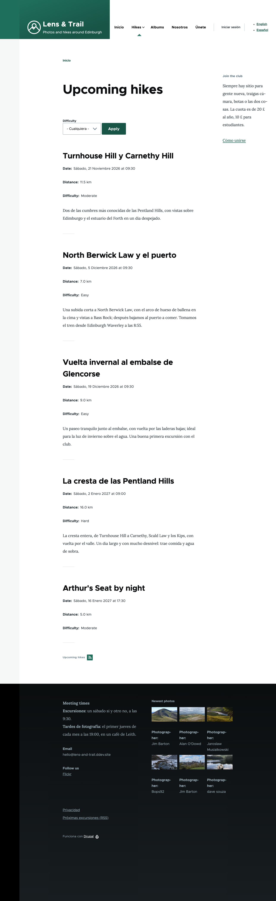
*Figure 18.19: Each hike once, in Spanish where there's a translation*

Each hike, once, in Spanish, and *Arthur's Seat by night* in English, because nobody has translated it yet. The page title, "Upcoming hikes", and the field labels are still in English: they're configuration, and we're getting there.

Do the same for the club's other views: Albums, Photos, Photo credits, Photographers and the hike leaders' table from Chapter 13. The Albums view has one more thing to fix: its block on a hike's page reaches the hike through a relationship (Chapter 13), so it needs a second **Default translation** filter, set to that relationship. (Drupal's own taxonomy term page, a view too, already has it right: it has a filter on **Translation language** instead, which shows the rows in the page's language and hides the others. That works when everything has a translation, which isn't the case for us.)

Last, the view's address. The Hikes page is at `/hikes` in every language: views don't have an alias field, and Pathauto's patterns are for content and terms. Give it Spanish addresses by hand, on **URL aliases** > **Add alias**: **System path** `/hikes`, **URL alias** `/excursiones`, **Language** **Spanish**. In the same way, `/hikes/archive` gets `/excursiones/archivo`, and `/galleries` gets `/albumes`.

## Translating configuration

Now the third kind of text. Go to **Configuration** > **Region and language** > **Configuration translation** (`/admin/config/regional/config-translation`):

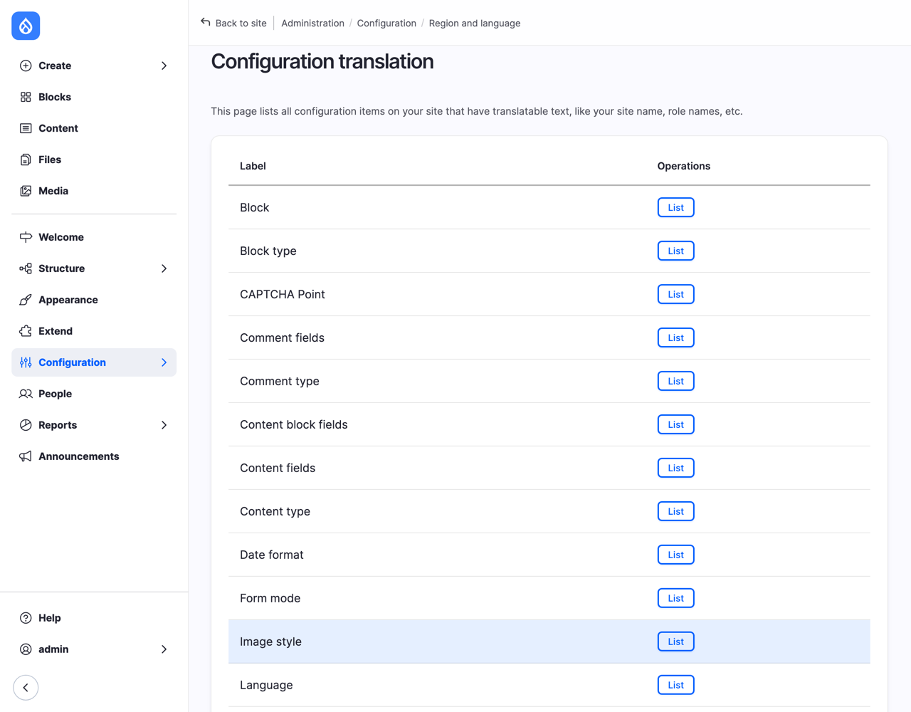
*Figure 18.20: Everything we set up that has words in it*

This is a list of everything we've built that has words in it. Select **List** on a row, and **Translate** on the item, to translate it. Most of them also have a **Translate** tab or operation where they live: a view has a **Translate** tab next to **Edit**, a field a **Translate** operation on **Manage fields**, and **Basic site settings** a **Translate** tab.

Start with the Hikes view. On its **Translate** tab, select **Add** for Spanish. The form shows the English on the left, and a box for the Spanish on the right, display by display: the titles, the **More** link, the text when there are no hikes, the menu link and the field labels.

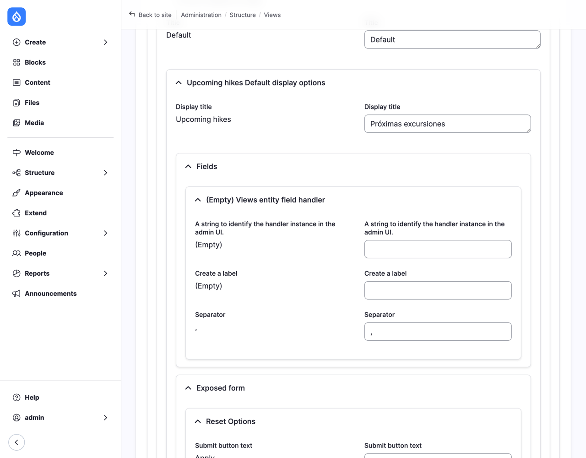
*Figure 18.21: Translating a view, display by display*

Fill in the Spanish (the texts are at the end of `examples/club/spanish.md`), and select **Save translation**. Then go through the rest:

- **System information** (the site's slogan): "Fotos y excursiones por Edimburgo".
- The field labels of the hikes and albums (**Content fields**), the photos (**Media fields**) and the Club info block (**Content block fields**): **Fecha**, **Punto de encuentro**, **Distancia**, **Dificultad**, **Guía**, **Zona**, **Descripción**, and so on. **Difficulty**'s list of choices is translated with the field's storage settings, on the same form: **Fácil**, **Moderada**, **Difícil**.
- The other views: Albums, Photos and their titles and menu links.
- The **Join the club** block's title, in **Block layout**: "Únete al club".
- The **Day, date and time** date format from Chapter 8: `l, j \d\e F \d\e Y, \a \l\a\s H:i`. The letters are the same as in English; the backslashes keep "de" and "a las" from being read as letters of the format.

Why a date format in Spanish? Because a date isn't only words. The English "Saturday, 21 November 2026 at 09:30" becomes "Sábado, 21 de Noviembre de 2026, a las 09:30" in Spanish: the order, the little words and the punctuation all change. That's why a date format is configuration, translated per language.

The menu links in **Main navigation** are content, not configuration: you translated them with the rest of the content. The menu's own name is configuration, but visitors never see it.

### Interface text of your own

Last, the interface. Most of it is translated, but you may want to change a translation, or translate a string nobody has translated yet. Go to **Configuration** > **Region and language** > **User interface translation** (`/admin/config/regional/translate`). Search for an English string, such as `Log in`, in **Spanish**:

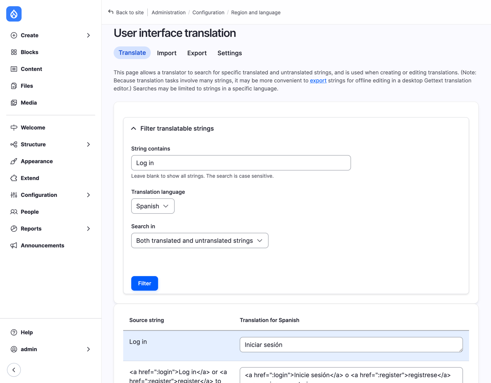
*Figure 18.22: Every interface string, and its translation*

Change the Spanish, and select **Save translations**. Your change is marked as *customized*, and the next download from localize.drupal.org doesn't overwrite it.

### The club in Spanish

Open `/es`:


*Figure 18.23: The front page, all in Spanish*

Everything is in Spanish: the menu, the slogan, the welcome text, the hikes with their dates and difficulties, the photo credits, the blocks in the sidebar and the footer. Open a hike, at `/es/excursiones/turnhouse-hill`:

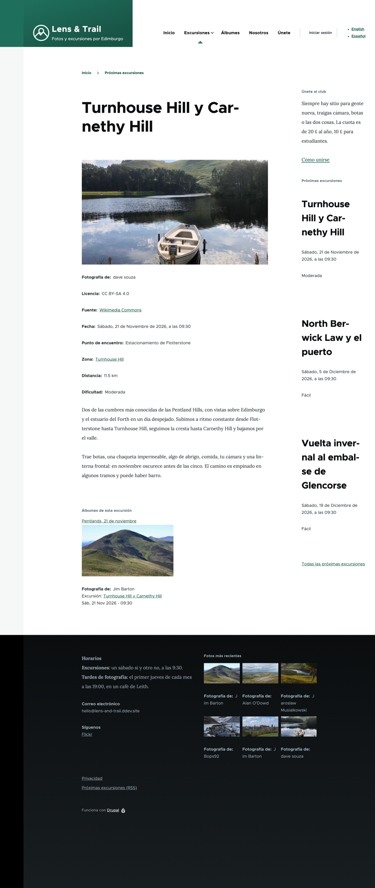
*Figure 18.24: A hike in Spanish: content, configuration and interface together*

Look at the main menu, too. Spanish words are longer: "Excursiones" for "Hikes", "Álbumes" for "Albums". When the menu doesn't fit next to the logo, Olivero folds it into a **Menú** button, and in Spanish that happens on a laptop's screen, which is 1280 pixels wide, where the English menu still fits. (The screenshots of the Spanish pages in this chapter are a little wider.) We made it better by calling About "Nosotros" in the menu, rather than "Sobre el club", but not enough. Translations are often a third longer than English, so test a new language on a small screen and on a big one, and keep menu labels short.

### What Layout Builder doesn't translate

Now open *How to join* in Spanish, at `/es/unete`:

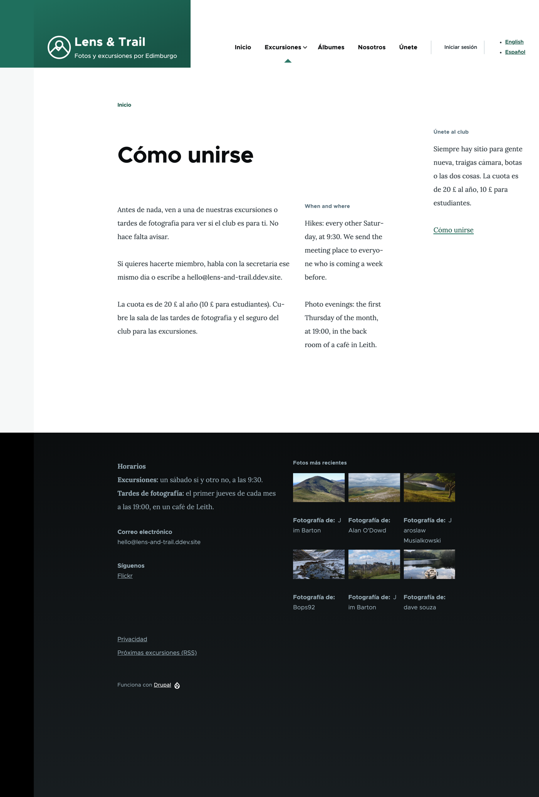
*Figure 18.25: How to join, with the When and where block still in English*

The text is Spanish, but the **When and where** block next to it isn't. That's the inline block we added in Chapter 8, with Layout Builder, on this page's own layout. Drupal core can't translate it: a page's layout belongs to the original language, and the **Layout** tab isn't there on a translation. If a translation could have a layout of its own, the two languages could drift apart, with different blocks in different places, and core doesn't want to decide how that should work.

There are ways out. One is to put text that needs translating in fields, not inline blocks, and let the layout show the fields. That's the field-based approach of Chapter 8, and it's the one we'd recommend for a site in more than one language. Another is a contributed module, Layout Builder Asymmetric Translation, which gives each translation a layout of its own (see the box at the end of this chapter). And Canvas, on Drupal CMS, translates pages in its own way, which we see in a moment.

## A translator for the club

Lucía has offered to translate the hikes. We'd like her to translate, and nothing else: not to change the English, not to move a hike to another date. That's a role (Chapter 15). Go to **People** > **Roles**, add a role called `Translator`, and give it these permissions:

- **Create translations** and **Edit translations**, from Content Translation.
- **Translate Hike content item**, **Translate Basic page content item**, **Translate News content item** and **Translate Album content item**: one for each content type she may translate.
- **Editorial workflow: Use Publish transition.**, so that she can publish her translations, and **View the latest version**.
- **View the administration theme** and **Access navigation bar**, so that she can find her way around.

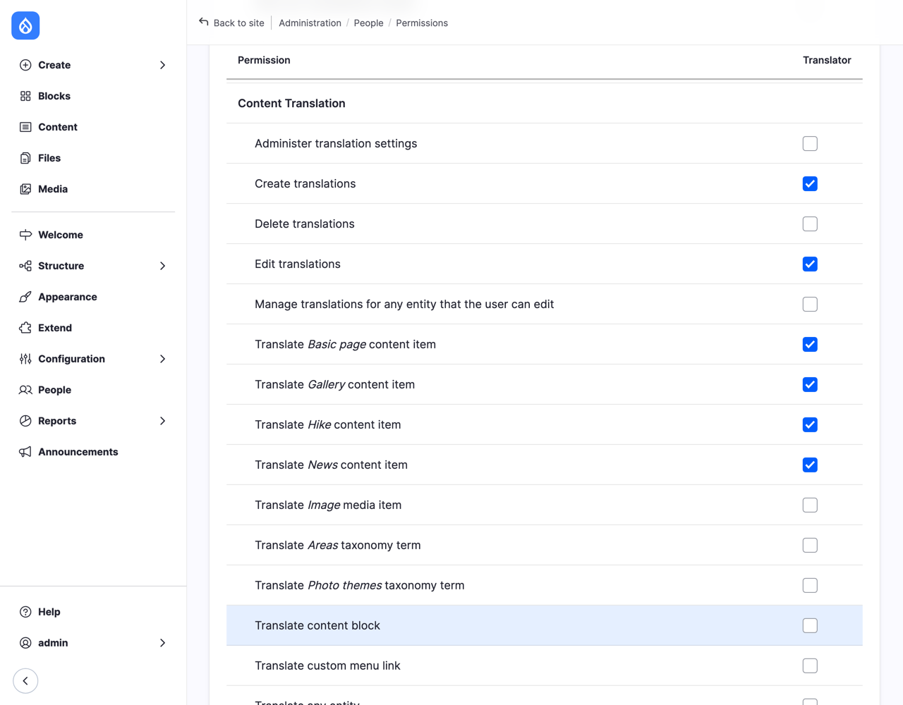
*Figure 18.26: The Translator role*

Note what isn't there: **Hike: Edit any content**. Lucía can't edit a hike, only its translations. Then give Lucía the role, on her account form.

When Lucía opens *Arthur's Seat by night* and its **Translate** tab, she can add a Spanish translation, but she can't edit the English. The translation form she gets is the same as ours, without the fields that aren't hers to change:

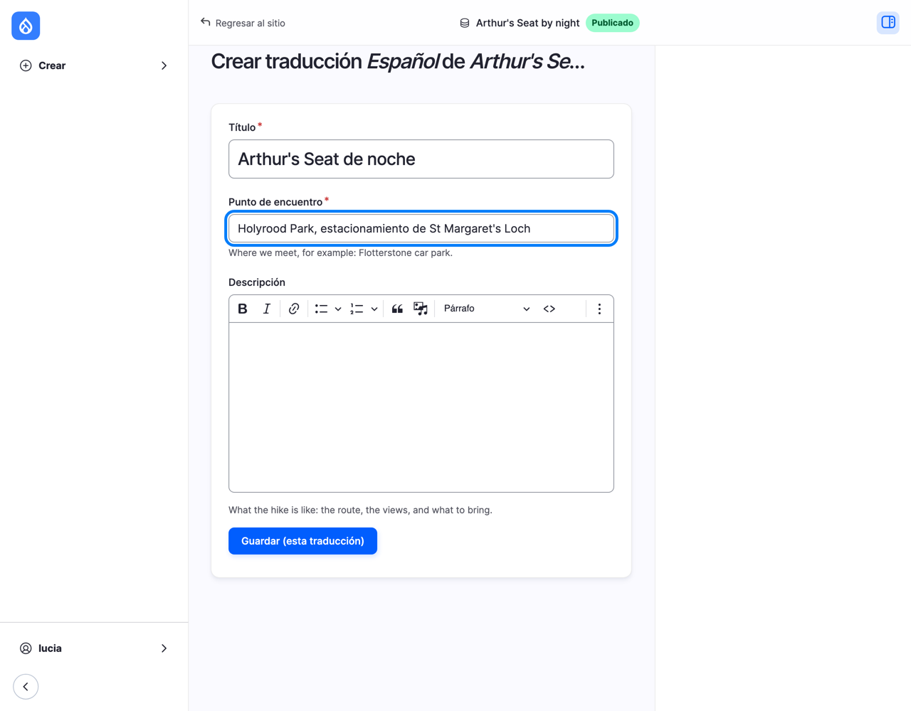
*Figure 18.27: Lucía translates a hike: the words, and nothing else*

She saves it, and it's published, in Spanish, with a Spanish address from the pattern. On the hike's **Translate** tab, both languages are now published:

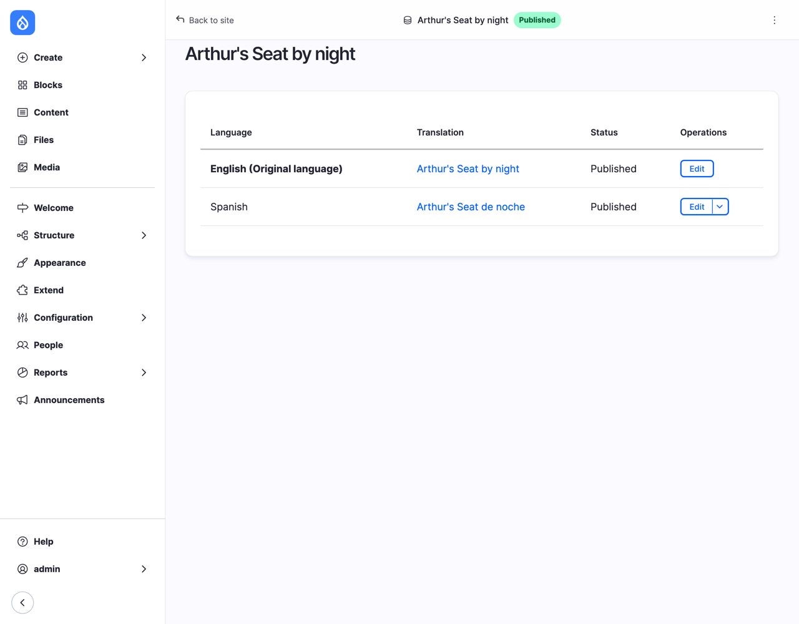
*Figure 18.28: Two languages, two published translations*

Each translation has its own moderation state, so the English hike can be published while the Spanish one is still a draft, or the other way round. You can see it on the **Translate** tab, in the **Status** column. We'd have liked Lucía to save her translations as drafts, for Morag to check and publish, as the club does with news. As we write this, Drupal 12 doesn't let her: the moderation state is hidden from users who can translate but not edit, and her translation can't be saved as a draft. So she publishes them herself, and Morag reads them afterwards.

%% The draft-for-Morag workflow was the plan from the grill (moderation per translation, "Yes, briefly"). On 12.0.0-beta2 it fails: content_translation hides every form element not marked #multilingual for translate-only users, and Default Admin puts the moderation select inside `meta`/`advanced`, which it makes plain containers without #multilingual. Saving then fails with "You do not have access to transition from Published to Published". Tested fix: mark both #multilingual in `FormHooks::ensureAdvancedSettings()`. No d.o issue found (2026-11-06). The author chose to have Lucía publish until it's fixed; see the PROJECT-LOG backlog. %%

## On Drupal CMS

Drupal CMS doesn't install the multilingual modules, so everything in this chapter so far works the same there: install the four modules, add Spanish, choose what to translate, and translate. The Basic pages, news and events of Drupal CMS are content types, translated as above.

The Canvas pages are different. Each page is a *Canvas page* (Chapter 8), with its text in the inputs of its components: the heading's text, the text block's text, the card's title. Content Translation translates fields, and all the inputs of a page's components are in one field, **Component input values**. Canvas Translate, a contributed module, comes with Drupal CMS, and translates them one by one, in Canvas. It's a beta, so expect it to change; it's also marked as not covered by drupal.org's security advisory policy (Chapter 11) until its first stable release.

Install **Canvas Translate** on **Extend**, with the four modules (it needs Language and Content Translation). Then, on **Content language and translation**, check **Page** under **Custom language settings**, and check its fields: Canvas pages are created with fields that can't be translated, and Canvas Translate needs at least **Title**, **Meta description**, **Component input values**, **URL alias** and **Image**.


*Figure 18.29: Canvas pages, with their fields translatable*

> **A bug to work around.** As we write this, Canvas Translate stops with "Something went wrong on our end" on a new Drupal CMS site. The cause is a small mistake in the data of Drupal CMS's Basic page template: the heading's link is stored as empty text, and Canvas can't read it. Until it's fixed, remove the empty link with a short script. Save [remove-empty-heading-links.php](../examples/canvas-translate/remove-empty-heading-links.php) in your project folder, and run it:
>
> ```
> ddev drush php:script remove-empty-heading-links.php
> ```
>
> It changes nothing on the page: the heading had no link.

%% Canvas 1.12.0 (Drupal CMS 2.2.8): `ComponentInputsTranslatablesExtractor::extractTranslatables(): Argument #2 ($config_data) must be of type array, string given`, because node.page.full's Mercury Heading has `"url": ""`. No issue found in the Canvas or Canvas Translate queues (2026-11-06). See the PROJECT-LOG backlog: open an issue, link it here, and drop this box when it's fixed. %%

Open Canvas, and select **Translate** in the sidebar, the icon with the two letters (or go to `/canvas/app/canvas_translate`). The dashboard lists every Canvas page, template and page region with words in it, with its state in each language:

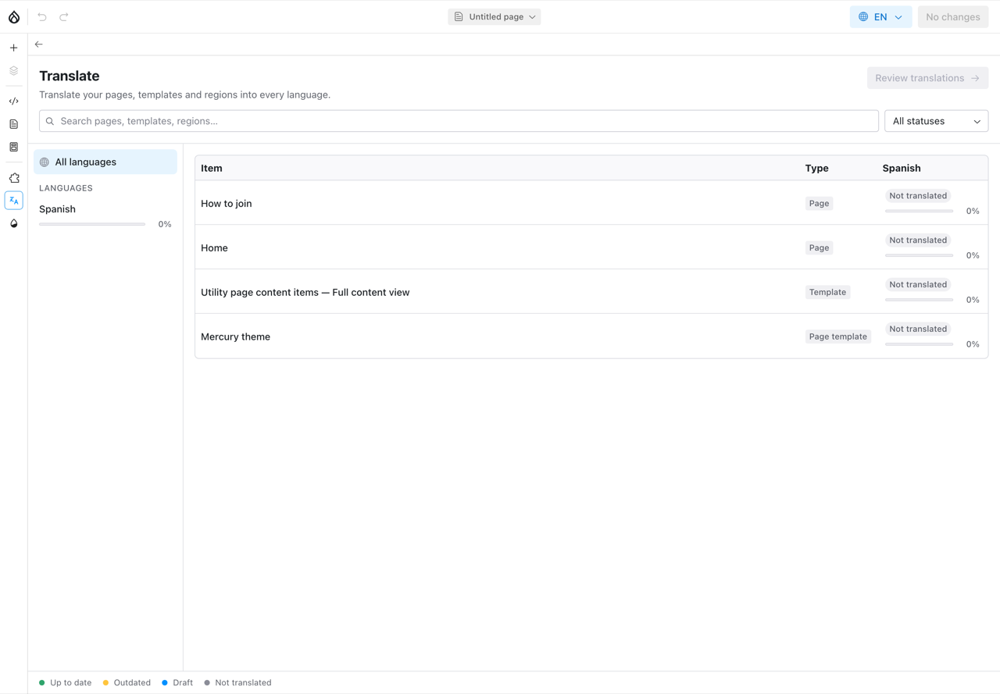
*Figure 18.30: Canvas Translate's dashboard*

Select **Not translated** in the row of *How to join*. The editor shows the English on the left, read-only, and a box for the Spanish on the right, component by component: the page's title and description, the heading, the text, and the card with its title and text. Rich text gets an editor of its own, with the formatting of the English.

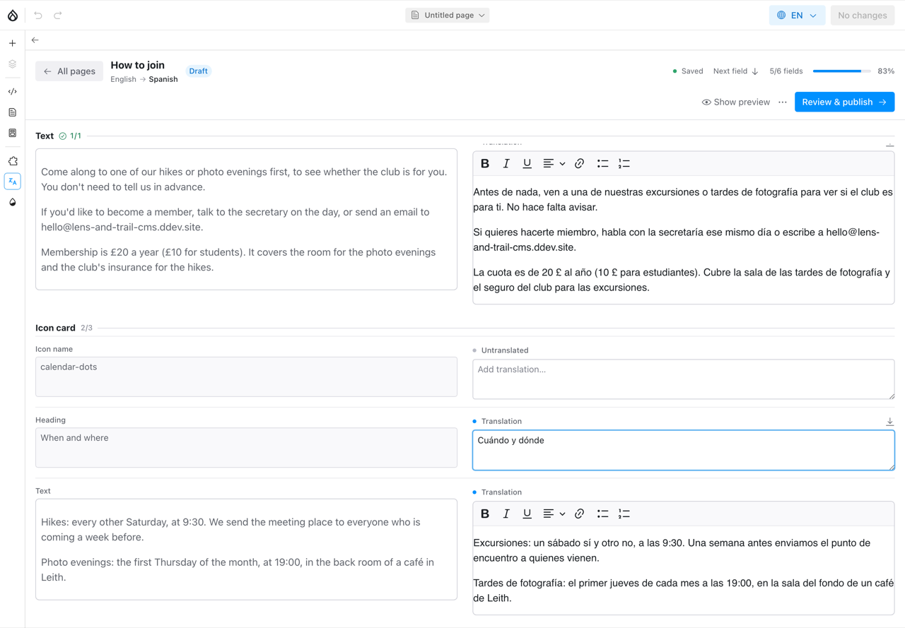
*Figure 18.31: English on the left, Spanish on the right*

Fill in the Spanish. The icon's name, `calendar-dots`, isn't for visitors to read; leave it. Canvas Translate saves as you type, as a *draft*: nothing is published yet. The **5/6 fields** at the top counts what's left, and **Next field** takes you to it.

Select **Review & publish**. Every page with a draft is listed; select *How to join*, and **Publish selected**.

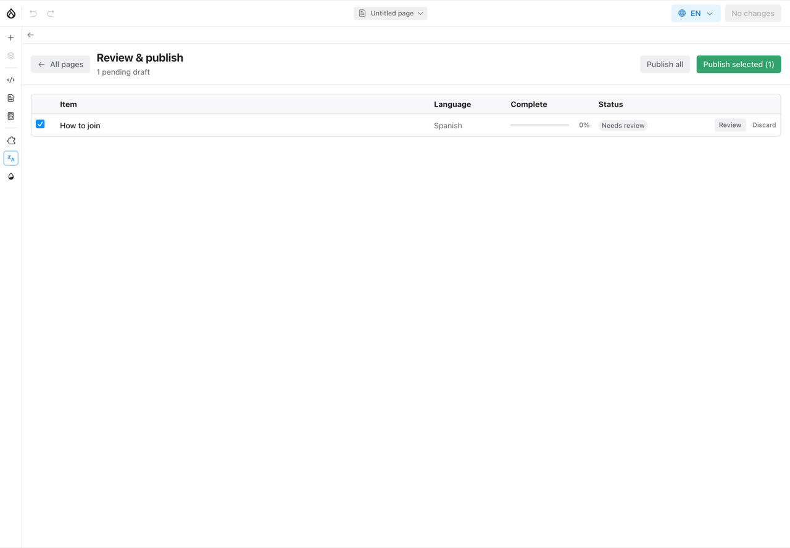
*Figure 18.32: Review, then publish*

And here is *How to join* in Spanish, the card too:

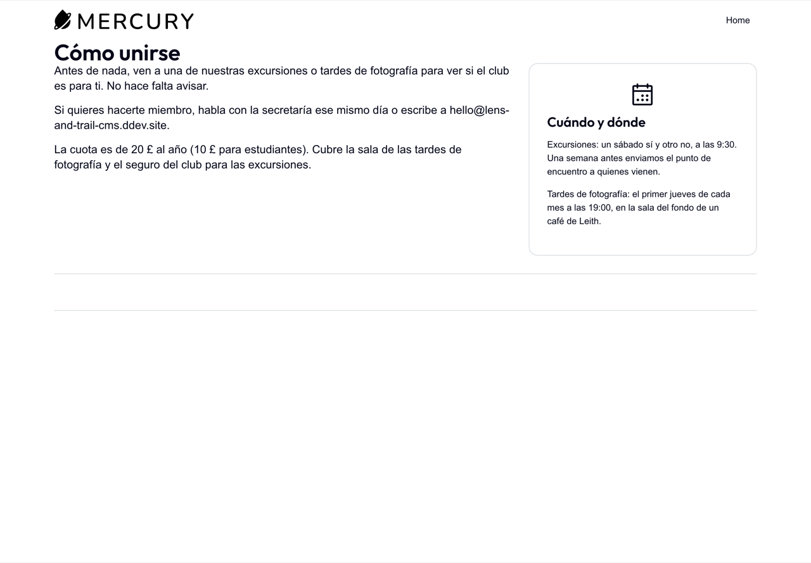
*Figure 18.33: The whole Canvas page in Spanish, card included*

Compare it to Figure 18.25: the card, which is part of the page's layout, is in Spanish too. Canvas keeps the layout the same in every language and translates the text in it, which is what most sites need. Canvas Translate also translates templates and page regions, such as the text in the header and footer, in the same way, and keeps track of translations that are out of date: when the English changes, the Spanish is marked **Outdated**.

Canvas Translate can also suggest translations with AI, through a submodule, Canvas Translate AI. That's for Chapter 19.

## Coming from WordPress?

> **Coming from WordPress?** WordPress itself is one language per site: you choose the site's language under **Settings** > **General**, and WordPress shows its own screens and messages in that language, from translations made by volunteers, as Drupal does. But WordPress's own documentation says it "does not support a bilingual or multilingual blog out-of-the-box": for content in more than one language, you need a plugin, such as Polylang or WPML, or a multisite network with a site for each language. Drupal does all three translations in core, in the four modules of this chapter. The closest thing to Drupal's interface translation is WordPress's language packs; to its content translation, a plugin's translated posts; and there's no WordPress word for configuration translation, because a WordPress site keeps much less of its setup as text you can translate.

## Translating with contributed modules

> **Contributed modules for multilingual sites.** Core does the translating; contributed modules help around it. Some are already on the club's site:
>
> - **Pathauto** makes patterns per language, as we did, and transliterates letters such as "ñ" in addresses.
> - **Simple XML Sitemap** (Chapter 17) lists every translation in the sitemap, with an `hreflang` link from each language to the others. That tells search engines that `/excursiones/turnhouse-hill` is the Spanish version of `/hikes/turnhouse-hill`, not a copy of it. Core adds the same links to the head of every translated page.
> - **Redirect** gives each redirect a language, so an old Spanish address can go to the new Spanish page.
> - **Metatag** translates its defaults with Configuration Translation, and the meta tags of a page with the page's translation.
>
> And some that aren't:
>
> - **Layout Builder Asymmetric Translation** gives each translation a layout of its own, for when How to join should look different in Spanish. As we write this, it has no release for Drupal 12 yet.
> - **Translation Management Tool** (TMGMT) is for sites with a lot to translate: it sends content to translators or translation services, and back, with jobs and reviews.

## Summary

You can now:

- name the three kinds of text on a Drupal page, interface, configuration and content, and the module that translates each;
- add a language, and keep its interface translations up to date from localize.drupal.org;
- choose how Drupal detects a visitor's language, and explain why we keep the language in the address;
- add a language switcher;
- decide which content and which fields are translatable, and why a date or a distance isn't;
- translate content, and give translations addresses of their own with Pathauto patterns per language;
- make a view show each item once, in the page's language, with English when there's no translation;
- translate views, field labels, date formats, blocks and the site's slogan, and change an interface translation;
- explain why Layout Builder's inline blocks aren't translated, and what to do about it;
- make a role for a translator who can translate but not edit;
- on Drupal CMS, translate a Canvas page with Canvas Translate.

## Exercises

1. Spanish writes the names of months in lowercase: "21 de noviembre", not "21 de Noviembre". Find the month names in **User interface translation**, and fix them. Which other pages of the site change? Did the day at the start of the date, "Sábado", need to change too?
2. Translate the Photographers view from Chapter 13, and give its page a Spanish address. Check that each photographer is listed once at `/es`.
3. Add a third language, French, but don't translate anything. Open the front page at `/fr`. What's in French already, and what isn't? Then think: would you rather show an English page at `/fr`, or no French at all until the content is ready? (Look at the **Languages** list's **Edit** for each language, and at Detection and selection.)
4. Lucía would like Drupal's own screens in English, but to translate into Spanish. Set this up for her, with **Account administration pages** in Detection and selection, and her account form.
5. *(challenge)* Change *How to join* on Drupal core so that the When and where text is translated too, without a contributed module. (Hint: Chapter 8, field-based layouts.)
6. *(challenge)* On Drupal CMS, translate the Mercury theme's page template in Canvas Translate. Which texts does it hold, and where do visitors see them?

## Want to know more?

- Drupal's [Multilingual guide](https://www.drupal.org/docs/multilingual-guide), with a page for each of the four modules, language detection and administration languages.
- [localize.drupal.org](https://localize.drupal.org/), where Drupal's interface is translated, and where you can help.
- [Canvas Translate](https://www.drupal.org/project/canvas_translate) and [Canvas](https://www.drupal.org/project/canvas) on drupal.org.
- [Layout Builder Asymmetric Translation](https://www.drupal.org/project/layout_builder_at), and the [Translation Management Tool](https://www.drupal.org/project/tmgmt).
- For comparison, WordPress's [Multilingual WordPress](https://developer.wordpress.org/advanced-administration/wordpress/multilingual/) and the [Polylang](https://wordpress.org/plugins/polylang/) plugin.
