# Keeping Your Site Safe

Back in Chapter 2 we said that with open source, updates, security, and backups are your job, or the job of whoever you pay. This chapter shows how to do that job. It's the least glamorous chapter in the book, and maybe the most important one: a site that nobody updates gets broken into sooner or later, and a site without a backup is one bad afternoon away from being gone.

The good news is that it's a routine, not a talent. You learn where Drupal tells you that something needs doing, how to read a security announcement, how to make a backup you can trust, and how to update without breaking the site. Then you do it every week or so, the way you take out the bins.

This chapter uses three sites, because each one shows something the others can't:

- **The club's Drupal core site**, where Chapter 18 left it. We update a module with Composer, and we stage a small "emergency" to see what Drupal shows when the site is out of date.
- **The club's Drupal CMS site**, where Chapter 19 left it. Drupal CMS can update itself from the browser, and we let it.
- **A Drupal 11 site.** Drupal 12 is new, and most sites out there run Drupal 11. So we built one, the way the club's site would look if it had started a year earlier, and we get it ready for the next major version.

## Why this matters more every year

%% For the author: the request was "updates are getting more frequent, partly because of AI". All numbers here are from drupal.org's own advisory list (counted 2026-11-07), PSA-2026-11-02 and the Alpha-Omega post of 29 October 2026. We left out a widely shared claim about an exploit built with AI in 51 minutes: we couldn't find a primary source for it. %%

For a long time, keeping a Drupal site safe meant one evening a month. The Drupal Security Team published a handful of announcements a month, Drupal core had a security release every few months, and most sites could plan for it.

That has changed, and it's changing fast. The security team published 85 security advisories in 2024, and 137 in 2025. In 2026, by the beginning of November, it had published 335. Drupal core alone had 8 advisories in 2024, 8 in 2025, and 16 in 2026.

A big part of the reason is AI. The same tools that write code (Chapter 19) are good at reading it, and that includes looking for security holes. Researchers, students, and volunteers now point AI tools at open source code and report what they find. In a public service announcement in November 2026, the security team wrote that Drupal is enduring a "tsunami" of security reports because of AI tools. In May 2026 the Drupal Association started the **Drupal AI Security Initiative**, with a grant from the Alpha-Omega project, to handle the flood: in its first five months, June to October 2026, it published 256 advisories, more than in the 30 months before it. Before the initiative, Drupal averaged about eight advisories a month. In October 2026 it was 106.

This is good news and bad news at the same time. Good, because every one of those holes is fixed, and found by someone who reported it rather than by someone who used it. Bad, because attackers have the same tools, and they're quick. In May 2026 Drupal core had a highly critical security hole (SA-CORE-2026-004, an SQL injection). Two days after the fix came out, the security team reported that "exploit attempts are now being detected in the wild": attackers were already trying it on sites that hadn't updated yet.

And it changes how long each version of Drupal is looked after. From 2027, each minor version of Drupal core (11.5, 12.1, and so on) gets security fixes for eight months, not twelve, so that the security team has less old code to fix. In practice this means: update often, a little at a time, and don't let a site fall behind. That's what the rest of this chapter is about.

## Kinds of releases

Chapter 3 explained how to read a Drupal version number, such as 11.4.12. Each part of the number is a different kind of update, and they come with different amounts of risk:

- **Patch releases** (11.4.11 to 11.4.12) fix bugs, and sometimes security holes. Nothing should change for a site builder, except that something broken now works. Install them soon.
- **Minor releases** (11.4 to 11.5) add new features, and keep everything that worked working. They come twice a year, in June and December. Install them within a few months: the previous minor version only gets security fixes for a while.
- **Major releases** (11 to 12) remove old code that has been marked for removal for a while, and that's what can break a module. They come every two years. We look at one at the end of the chapter.

Contributed modules and themes use the same idea, with their own version numbers: Project Browser 2.1.5 to 2.1.6 is a patch release, and 2.1 to 2.2 a minor one. (Some older modules still have version numbers like 8.x-1.15; read them as 1.15.)

### When updates come out

Drupal core has fixed release windows, so you can plan for them:

- **Security releases** for core start at noon New York time, usually on the third Wednesday of the month. Most months there isn't one, but keep the time free.
- **Bug fix releases** usually come out in the week of the first Wednesday of the month.
- **Minor and major releases** come in June and December. Drupal 12.0.0 and Drupal 11.5.0 come out in the week of 7 December 2026.

For a really serious hole, the security team warns you a few days ahead. On 12 October 2026, it announced "a Drupal core security release for all supported branches on October 14, 2026", rated 19 out of 25, and "urges you to reserve time for core updates at that time because exploits might be developed within hours or days." That's the time to clear your calendar.

Advisories for contributed projects don't have a window: they come out when a fix is ready, and these days that's several times a week.

## Security advisories

When the security team fixes a hole, it publishes a **security advisory**, often shortened to **SA**, on <https://www.drupal.org/security>. Each one has a number, such as SA-CORE-2026-014 for Drupal core or SA-CONTRIB-2026-315 for a contributed project, and a title that tells you the three things you need to know first: which project, how serious, and what kind of hole. For example:

> Drupal core - Critical - Remote code execution - SA-CORE-2026-014

Open it, and you'll find:

- **Description**: what's wrong, in general terms. The advisory never explains how to use the hole: that would help attackers more than you. SA-CORE-2026-014 says the hole is in Field UI, that it "is not directly exploitable with core alone", but that several contributed modules open a path to it, one of them without logging in.
- **Solution**: which version to update to. Here, Drupal 11.4.10 for sites on 11.4, 11.3.19 for sites on 11.3, and 10.6.19 for Drupal 10. It also says which versions get no fix at all, because they're no longer supported.
- Sometimes a **mitigation**, something you can do until you've updated. Here: uninstall the Field UI module, which you only need while building the site (Chapter 7) anyway.
- **Reported by** and **Fixed by**: the people who found and fixed it. Security work is community work, too.

### How serious is it?

Every advisory has a **security risk** score, from 0 to 25, worked out from six questions: how hard is it to use the hole, does the attacker need to be logged in (and with what role), how much data can they see, how much can they change, is there already a known exploit, and does it affect every site, or only sites set up in an uncommon way. The score gives the advisory its label:

| Score | Label |
| --- | --- |
| 0 to 4 | Not critical |
| 5 to 9 | Less critical |
| 10 to 14 | Moderately critical |
| 15 to 19 | Critical |
| 20 to 25 | Highly critical |

The label tells you how fast to act. A highly critical hole in a module you use: today, if you can. A moderately critical one that needs the attacker to log in with a role your site doesn't give to strangers: this week. Either way, you update; the score only tells you how much of a hurry you're in.

> **Note:** You'll also see **public service announcements**, or **PSAs**. They're not about one hole: they warn about an upcoming release (like the one on 12 October), announce the end of support for a version, or change a policy (like the eight months of security support).

### Which projects are covered?

The security team covers Drupal core, and contributed projects whose maintainers opted in. On a project's page, that's the shield and the sentence "Stable releases for this project are covered by the security advisory policy", from Chapter 11. Only **stable** releases are covered: development versions, alphas, betas and release candidates aren't, even for a project with the shield. That matters for us. In Chapter 17 we installed development versions of Pathauto and Redirect on our Drupal 12 site, because their stable releases didn't support Drupal 12 yet. That's fine while we learn. On a live site, switch back to a stable release as soon as there is one.

### Getting told

You don't want to depend on remembering to look. Pick at least one of these:

- **Email.** Log in on drupal.org, go to your user profile, choose **Edit** and then **My newsletters**, and subscribe to the security announcements.
- **RSS**, if you use a feed reader: <https://www.drupal.org/security/rss.xml> for core, `/security/contrib/rss.xml` for contributed projects, `/security/psa/rss.xml` for PSAs, and `/security/all/rss.xml` for everything.
- **Social media**: the security team posts on Mastodon as `@drupalsecurity@drupal.community`, and on Bluesky as `drupalsecurity.bsky.social`.

> **Try it:** Subscribe to the security announcements, in whichever way you read things anyway. Then open <https://www.drupal.org/security> and read the newest advisory. Does it affect a project the club's site uses?

## What your site tells you: Available updates

Your site checks for updates on its own, with the **Update Status** module from Chapter 3. It's installed on both of our sites. Once a day it asks drupal.org for the newest releases of everything installed, and compares.

1. Go to **Reports** > **Available updates** (`/admin/reports/updates`).

2. Above the list, select **Update available**, to hide everything that's up to date.

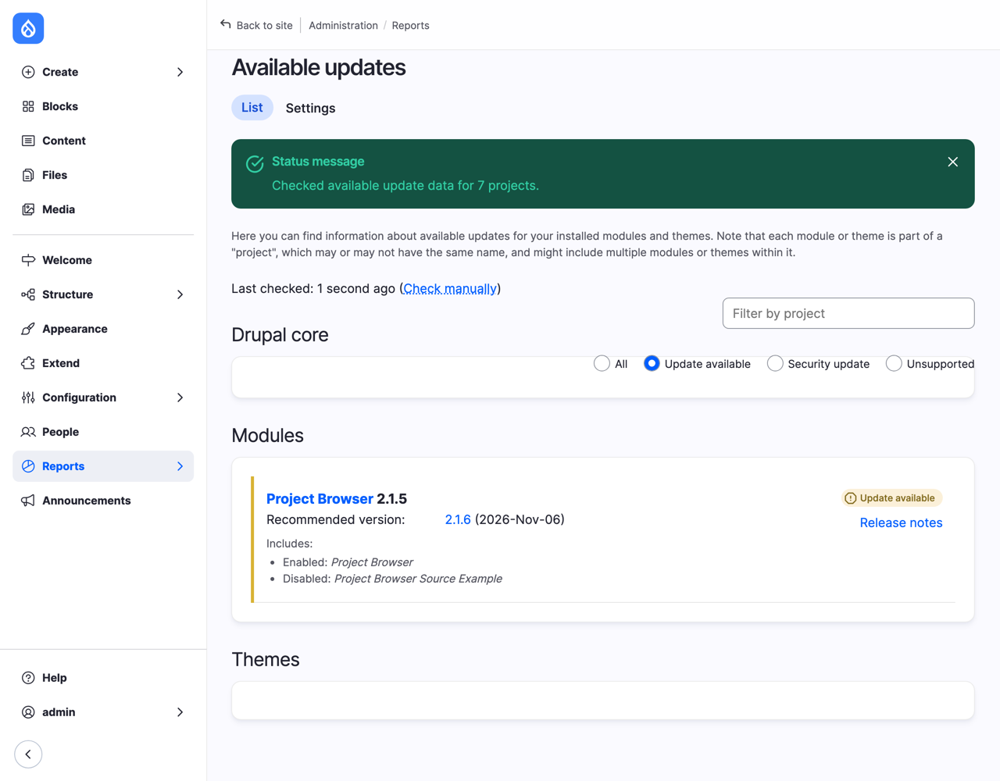
*Figure 20.1: Available updates on the club's site: one module has a new release*

Drupal core and most modules are up to date. Project Browser isn't: it has 2.1.5, and 2.1.6 came out on 6 November. The other filters, **Security update** and **Unsupported**, show only the projects that need you most. The report shows each project's state with a color and a word:

- Green, **Up to date**.
- Yellow, **Update available**: a newer release that isn't a security release. Plan it.
- Red, **Security update required!**: a newer release fixes a security hole in the version you have. Don't plan it, do it.
- Red too, for a version that's no longer supported (the **Unsupported** filter): it gets no more fixes at all, and you need a newer major or minor version.

Each release has **Release notes**: read them before you update. They list what changed, and sometimes say what to check or do after the update.

**Check manually** asks drupal.org again right now. You'll want that on the day of a security release, when the daily check may not have run yet.

### Who gets told

The report only helps if someone looks at it. Let the site send an email instead.

1. Select the **Settings** tab (`/admin/reports/updates/settings`).

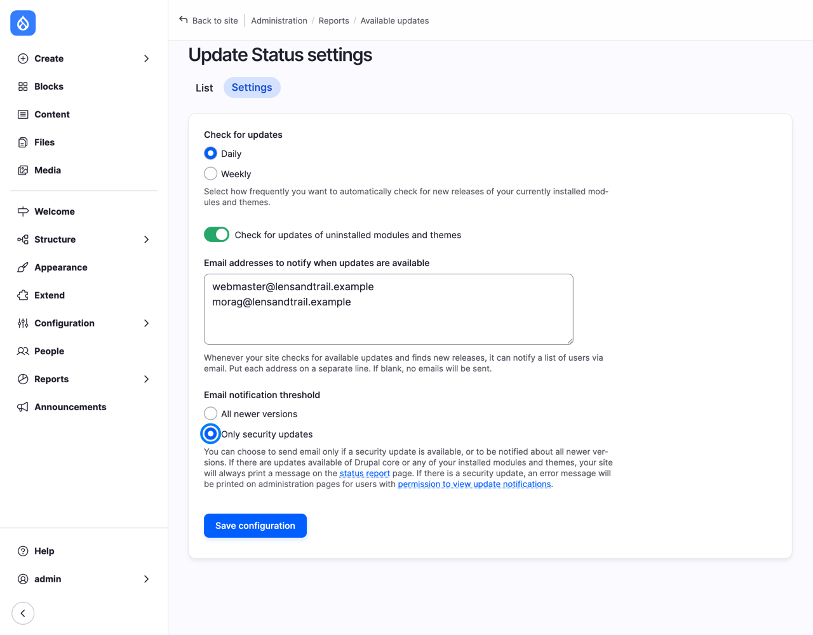
*Figure 20.2: Who gets an email about updates, and when*

- **Check for updates**: **Daily** or **Weekly**. Daily. Security doesn't wait a week.
- **Check for updates of uninstalled modules and themes**: an uninstalled module's code is still on the server, and if it has a security hole, it can still be a problem. Better still, remove code you don't use with Composer (Chapter 11).
- **Email addresses to notify when updates are available**: one address per line. Use an address that a person reads, and more than one if more than one person looks after the site. The club uses the webmaster's address, and Morag's.
- **Email notification threshold**: **All newer versions**, or **Only security updates**. With **All newer versions** you get an email every day until you've updated everything. That's useful for a site you look after closely; for a site you only check on now and then, **Only security updates** makes sure the emails that come are the ones that matter.

> **Note:** Your site can only check if it can reach drupal.org, and it can only send email if it's set up to send it. On your own computer, DDEV catches every email the site sends (run `ddev mailpit` to see them), so nothing reaches a real inbox. On a live site, check that the emails arrive. Chapter 21 covers the live server.

> **Drupalism:** "Update" means three different things in Drupal. A **software update** is a new release of core or a module, the subject of this chapter. A **database update** is a small program in the new release that changes your database to fit the new code: `update.php`, or `drush updatedb`, which we meet below. And on the Available updates screen, an **update** is the release itself. When someone says "run the updates", ask which ones. Usually they mean the database updates, after the software updates.

## Backups first

Before we update anything, a backup. Not because updates usually go wrong (they don't), but because when they do, a backup turns a disaster into a lost hour.

A Drupal site is made of three things, and a backup needs all three:

- **The code**: Drupal core, the modules, the themes. With Composer, the code is described by two files, `composer.json` and `composer.lock` (Chapter 11), and Composer can download it all again. Keep those two files, and any code of your own, in Git (Appendix A).
- **The database**: all the content, the users, and the configuration.
- **The files**: everything people uploaded, in `web/sites/default/files` (and in the private files folder, if the site has one).

The configuration is in the database too, and Chapter 21 shows how to export it to files, which go in Git with the code.

### On your own computer: DDEV snapshots

On your own computer, the quickest backup is a DDEV **snapshot**: a copy of the database, saved in the project's `.ddev` folder.

```bash
ddev snapshot --name before-updates
ddev snapshot --list
ddev snapshot restore before-updates
```

`restore` replaces the database with the snapshot, so everything since the snapshot is gone. We've been taking snapshots for the screenshots in this book, after every chapter. A snapshot is only the database: it doesn't save the code or the files. Before a Composer update, also keep a copy of `composer.json` and `composer.lock`, or commit them to Git first, so you can go back to them.

### A real backup with Drush

On a live server there's no DDEV, but there's Drush, and Drush can back up all three parts in one go. First make a folder for the backups, next to `web/`, not inside it:

```bash
mkdir backups
ddev drush archive:dump --destination=/var/www/html/backups/lens-and-trail.tar.gz
```

Inside DDEV, your project folder is called `/var/www/html`, so that's where the archive lands: in `backups/`, in your project folder. (On a live server, leave out the `ddev`, and give the full path to your own backup folder.) `archive:dump` puts three things in one archive: the database, the files, and the code that Composer can't download again: `composer.json`, `composer.lock`, `settings.php`, and any code of your own. It leaves out Drupal core, the contributed modules and the `vendor` folder, because `composer install` brings them back from the lock file.

If you only want the database, `sql:dump` writes it to one file:

```bash
ddev drush sql:dump --gzip --result-file=/var/www/html/backups/lens-and-trail.sql
```

The file is a long list of SQL commands that rebuild the database. You can read it in a text editor (unzip it first), which is reassuring the first time.

> **Warning:** A backup is as secret as the site: it has every user's email address and (hashed) password. Never save backups in the web folder, where anyone could download them, never commit them to Git (add `backups/` to your `.gitignore` file), and don't send them around by email.

### A backup you haven't restored isn't a backup

Every site owner who's lost a site had a backup. It was empty, or a year old, or on the same server that died. Three rules:

- **Test the restore.** Now and then, restore a backup into a copy of the site (your own computer is fine) and check that it works. For the database, that's one command: `ddev import-db --file=backups/lens-and-trail.sql.gz`. The archive from `archive:dump` has the database in it too, as `database/database.sql`.
- **Keep it somewhere else.** The usual rule is **3-2-1**: three copies, on two different kinds of storage, one of them in another place. For a small club: the host's backups, plus a weekly copy on the webmaster's computer, plus one in a cloud storage service the club already uses.
- **Automate it.** A backup that depends on someone remembering stops after a few weeks. Most hosting companies make daily backups of the database and files: find out how often, how long they keep them, and how you get one back, before you need it.

> **On Drupal CMS:** Without a command line, the **Backup and Migrate** module makes backups from the browser. Install it from Project Browser (search for "Backup and Migrate"), then go to **Configuration** > **Development** > **Backup and Migrate** (`/admin/config/development/backup_migrate`). **Quick Backup** takes the **Default Drupal Database** and **Download**s it to your computer, or saves it on the server. Under **Schedules** it can make one every day, and keep the last few, and **Restore** puts a backup back.
>
> 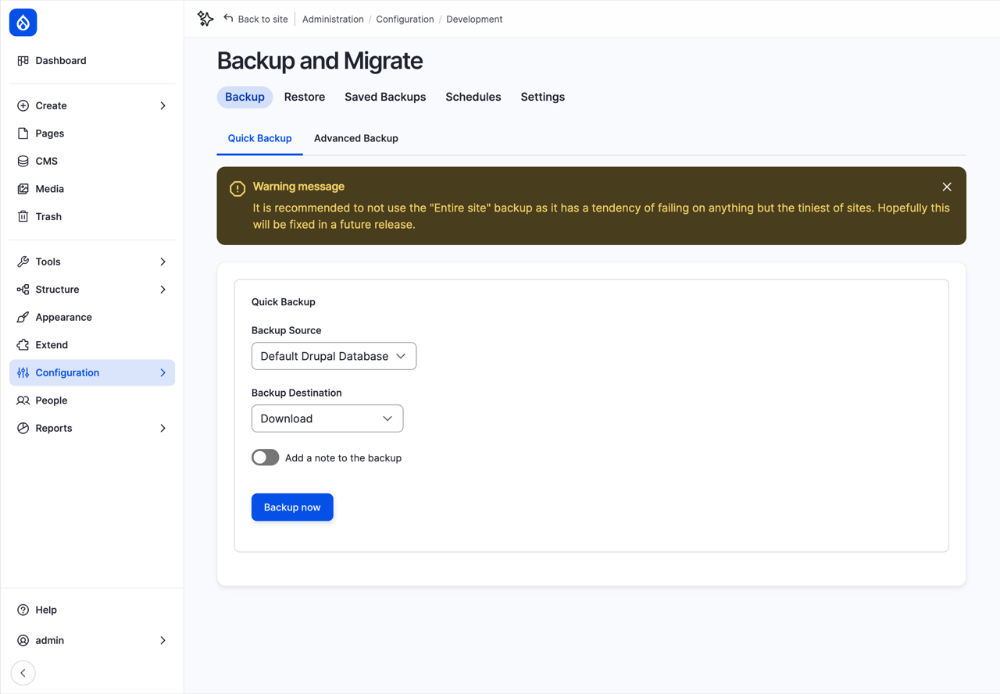
> *Figure 20.3: Backup and Migrate on the Drupal CMS site*
>
> It backs up the database, and on request the public and private files, but not the code. Keep the code in Git, as always. Take its own warning seriously, too: it recommends not using its **Entire site** backup, which "has a tendency of failing on anything but the tiniest of sites".

%% For the author: Backup and Migrate 5.1.5 requires ^10.3 || ^11, so it doesn't install on Drupal 12 yet; that's why it's only in the Drupal CMS box. Check before publication. %%

## Updating with Composer

Now the update itself, on the club's core site. Project Browser has a new release (Figure 20.1). Before we start:

> **Try it:** Take a snapshot of the site, and keep a copy of the two Composer files.
>
> ```bash
> ddev snapshot --name before-updates
> mkdir -p backups && cp composer.json composer.lock backups/
> ```

### Read the release notes

Click **Release notes** for 2.1.6 on Available updates. They say what was fixed, and whether we need to do anything. A patch release almost never needs anything, but it's a habit worth having: once in a while, the notes say "clear the cache" or "this release needs PHP 8.3".

### Update the code

Appendix B explains what the commands below do under the hood. First, ask Composer what's out of date:

```bash
ddev composer outdated "drupal/*"
```

It lists each Drupal package with a newer release: the version we have, and the newest one. Then update Project Browser:

```bash
ddev composer update drupal/project_browser --with-all-dependencies
```

`composer update` with a package name updates only that package, and `--with-all-dependencies` (or `-W`) lets it update the libraries the package needs too. Composer stays within the version constraint in `composer.json`, which for Project Browser is `^2.1`: anything from 2.1 up to (but not including) 3.0. So we get 2.1.6. A new major version, 3.0, would need you to change the constraint yourself, on purpose.

### Update the database

The new code may come with database updates. Run them:

```bash
ddev drush updatedb
```

Drush lists the database updates it's about to run, asks you to confirm, and runs them, with the site in maintenance mode while it does. Most patch releases don't have any, and Drush says "No pending updates". Then clear the cache:

```bash
ddev drush cache:rebuild
```

Without Drush, the same is on a page: go to `/update.php` and follow the steps. Then reload **Available updates**: Project Browser is green.

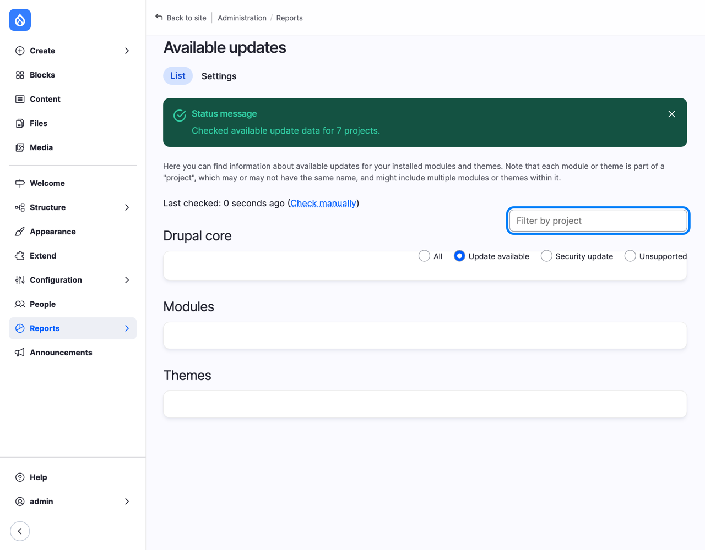
*Figure 20.4: Everything up to date*

Finally, look at the site. Click through the pages that matter, and the ones built with the module you updated. If something's wrong, you have the snapshot and the two Composer files: restore them, run `ddev composer install`, and you're back where you started.

> **Note:** On a live site, don't update on the live server first. Update on your own computer (or a copy of the site, often called a **staging** site), test it there, commit `composer.json` and `composer.lock` to Git, and then run `composer install` and `drush updatedb` on the live server. `composer install` installs exactly what the lock file says, the versions you tested, and nothing newer. Chapter 21 goes through it.

### Updating Drupal core

Updating core works the same way, with a different package name. Core is several packages that belong together, so update them together:

```bash
ddev composer update "drupal/core-*" --with-all-dependencies
ddev drush updatedb
ddev drush cache:rebuild
```

`"drupal/core-*"` means every package whose name starts with `drupal/core-`: `core-recommended`, `core-composer-scaffold`, and the rest. Core releases more often have database updates than modules do.

### An update "emergency"

In our workshops we like to show what an out-of-date site looks like, because the first time you see it should be on a site that doesn't matter. Here's how. (Don't do this on a site that matters. We do it on our own computer, and put it back right after.)

The club's site runs Drupal 12.0.0-beta2. Let's go back to beta1, a release with known security holes. In `composer.json`, the line for core says:

```json
"drupal/core-recommended": "^12",
```

The `^` means "this version or anything newer in the same major version". Without it, Composer takes exactly the version you name. Change the line to:

```json
"drupal/core-recommended": "12.0.0-beta1",
```

and ask Composer to install it:

```bash
ddev composer update "drupal/core-*" --with-all-dependencies
```

When we first ran this workshop, Composer happily went back to the old version. Not anymore. Since version 2.9, Composer refuses to install a release that has a known security advisory, and tells you which advisories it found:

```text
Your requirements could not be resolved to an installable set of packages.
  ...
  found drupal/core[12.0.0-beta1] but these were not loaded, because they are
  affected by security advisories ("SA-CORE-2026-016", "SA-CORE-2026-015",
  "SA-CORE-2026-014").
```

Those are the three core advisories from 14 October 2026. That's a real safety net. Composer won't let you go back to a release with a known hole, even by accident, for example by pinning a version and forgetting about it.

For the workshop, we tell Composer to install it anyway, this once:

```bash
ddev composer update "drupal/core-*" --with-all-dependencies --no-blocking
```

Now go to **Reports** > **Available updates**, and select **Check manually**.

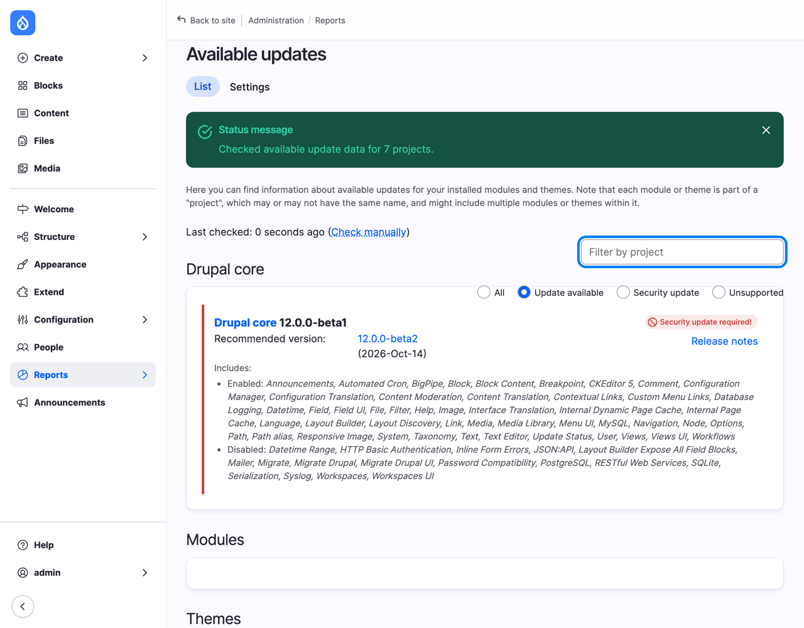
*Figure 20.5: What an out-of-date site looks like*

Red, **Security update required!**, with the release to update to, and links to the advisories it fixes. The **Status report** (`/admin/reports/status`) counts it among its errors, and on almost every other admin page, people with the **View update notifications** permission get a red message: "There is a security update available for your version of Drupal. To ensure the security of your server, you should update immediately!" You can't miss it, and that's the point.

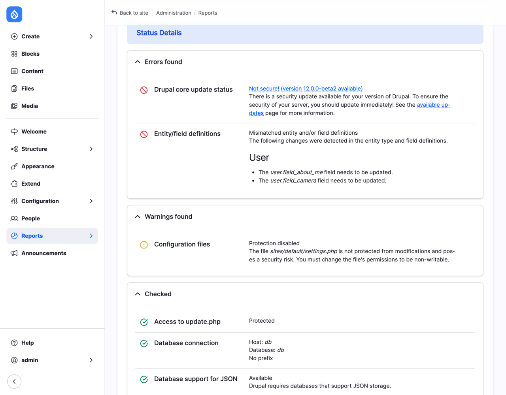
*Figure 20.6: The Status report shows it too*

%% For the author: the figure also shows "Mismatched entity and/or field definitions" for user.field_about_me and user.field_camera. That error is on the club's core site anyway (state ch20-start), not caused by the downgrade; see PROJECT-LOG open items. Retake the figure once it's sorted out. %%

Now put it right. Change the line in `composer.json` back to `"^12"`, and update:

```bash
ddev composer update "drupal/core-*" --with-all-dependencies
ddev drush updatedb
```

Reload **Available updates**: green again.

> **Note:** `--no-blocking` exists for rare cases, such as a project's maintainers having to install an old version on purpose to test something. Never use it to get past a block on a real site. The block is telling you something.

### composer audit

Composer can also check what you already have:

```bash
ddev composer audit
```

`composer audit` checks every package in `composer.lock` against the public lists of security advisories, including Drupal's, and lists the ones that are affected. It also lists **abandoned** packages, ones their maintainers have stopped looking after. Composer runs it on its own after every `require` and `update`: that's the "security vulnerability advisories" message from Chapter 11. On our site it finds nothing, which is what we want.

`composer audit` and Available updates overlap, but they're not the same. Available updates knows about Drupal projects only, but tells you about all new releases. `composer audit` knows about every PHP library on the site (and there are many: Appendix B), but only tells you about security holes. Use both.

> **Note:** Composer 2.11 added a **cooldown** setting (`cooldown.period` under `policy` in `composer.json`), which makes Composer wait a number of days before it installs a release that's brand new. It's a protection against a different danger: an attacker taking over a project's account and publishing a poisoned release. It's off by default, and a security release is exactly the release you don't want to wait for, so we leave it off.

## Maintenance mode

While you update a live site, visitors may see errors for a moment, or save a form halfway through. **Maintenance mode** shows them a short message instead, while administrators can still use the site.

1. Go to **Configuration** > **Development** > **Maintenance mode** (`/admin/config/development/maintenance`).
2. Check **Put site into maintenance mode**, and change the message if you like: "Lens & Trail is being updated. Back in a few minutes."
3. Select **Save configuration**.

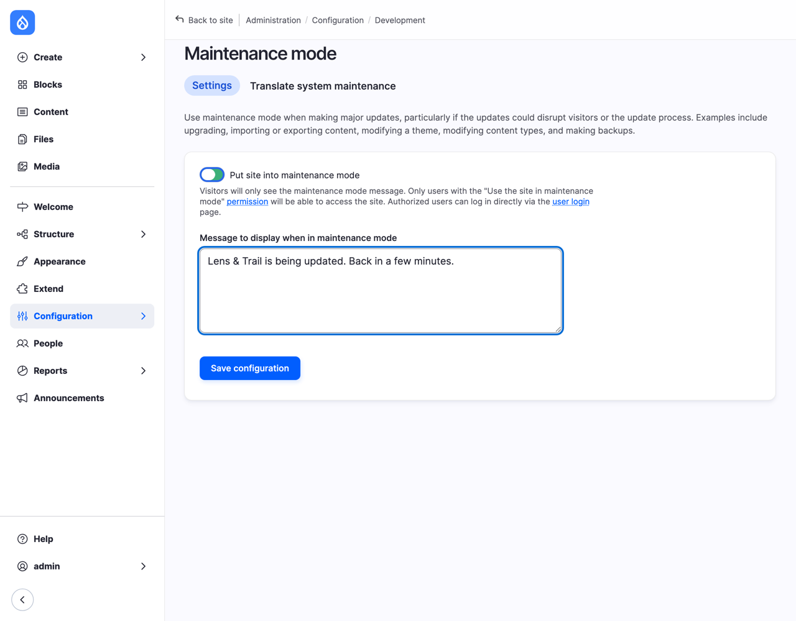
*Figure 20.7: Maintenance mode*

Don't forget to switch it off again afterwards. `drush updatedb` and Drupal CMS's automatic updates put the site in maintenance mode on their own, while the database updates run, and take it out again.

## On Drupal CMS: updates from the browser

Drupal CMS can do all of this without a terminal. It comes with **Automatic Updates**, a contributed module, and **Package Manager**, an experimental module in Drupal core. Package Manager runs Composer for you, on the server, and Automatic Updates uses it to update Drupal core, modules and themes from the browser.

Our Drupal CMS site runs Drupal 11.4.11, and 11.4.12 is out.

1. Go to **Reports** > **Available updates**. Drupal core has an **Update now** link, and so do some of the modules.

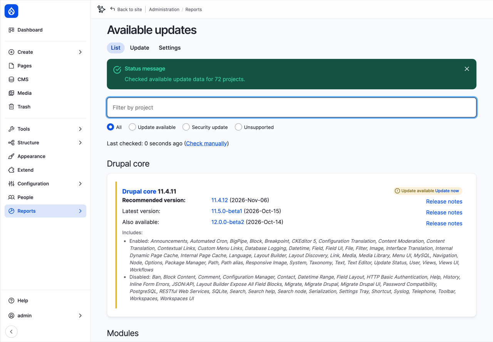
*Figure 20.8: Available updates on Drupal CMS*

2. Select **Update now** for Drupal core, or open the **Update** tab (`/admin/reports/updates/update`). The page takes a while to load: it's checking that the site can update itself.

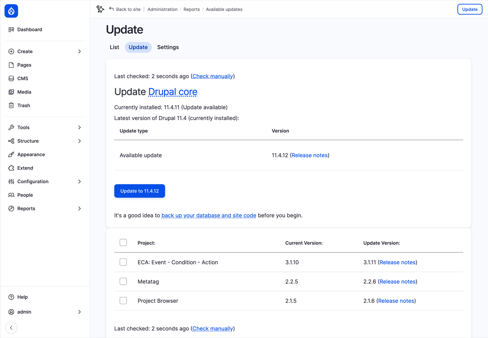
*Figure 20.9: Ready to update core*

   Below core, the page lists the modules with updates, each with a checkbox: select the ones you want, and the **Update** button at the top updates them in the same way. We do core first, on its own.
3. Read the line under the button: "It's a good idea to back up your database and site code before you begin." It is. Do it.
4. Select **Update to 11.4.12**. Package Manager makes a copy of the site's code in a separate folder, a **stage**, and runs Composer there. A progress bar shows it working. The live site keeps running in the meantime.

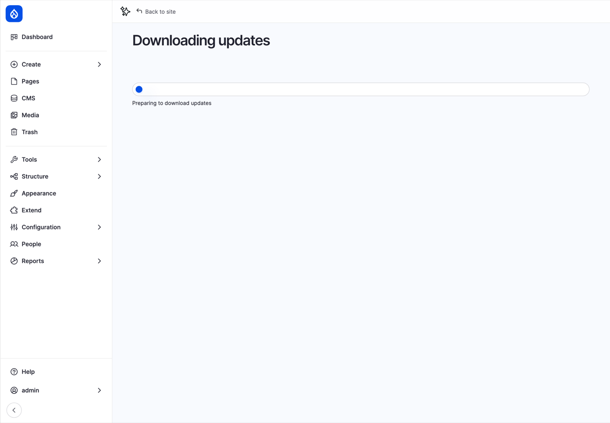
*Figure 20.10: Downloading the update into a stage*

5. When it's done, you see **Ready to update**: "Drupal core will be updated to 11.4.12". Leave **Perform updates with site in maintenance mode (strongly recommended)** on.

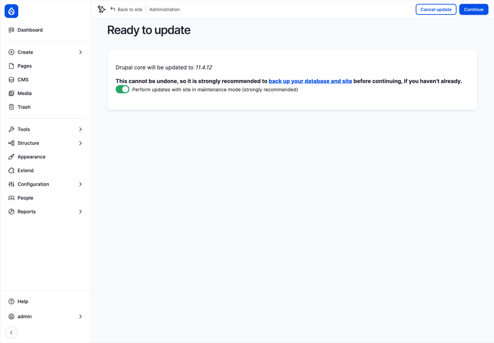
*Figure 20.11: The last step before the update*

6. Select **Continue**. Package Manager copies the updated code from the stage over the site's code, runs the database updates, and takes the site out of maintenance mode.

7. You're back on **Available updates**, with "Update complete!", and Drupal core 11.4.12 is green.

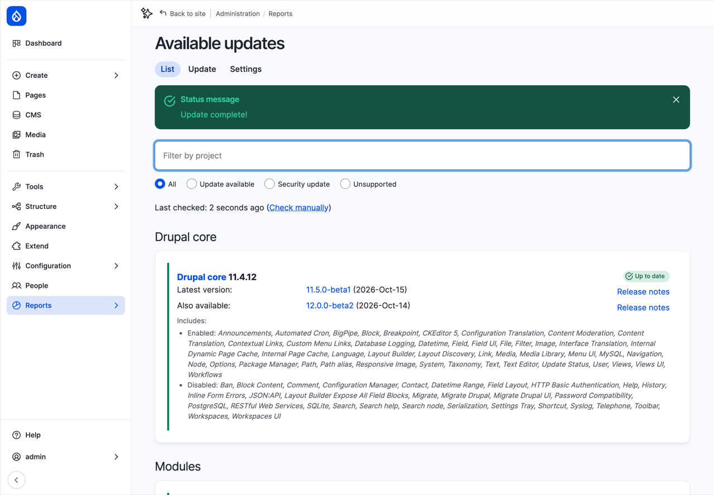
*Figure 20.12: Drupal CMS has updated itself*

On our site, the whole update took a few minutes. Then look at the site, as after any update.

Only one update can be in progress at a time. If an update stops halfway, for example because you closed the browser, the next attempt says "Cannot begin an update because another Composer operation is currently in progress", with a **Delete existing update** button. It deletes the stage, not the site: your site is still on the old version, and you can start again.

### Before it lets you update

Package Manager checks a long list of things before it starts: that Composer works, that the code can be written to, that nobody has changed the code by hand, that there's enough disk space. You can run the checks yourself at `/admin/automatic_updates/status`; on our site they say "No issues found. Your site is ready for automatic updates". If one fails, the update doesn't start, and the message tells you why. On a server where the web server can't write to the code (many hosts are set up like that, for good reasons), Automatic Updates can't work, and you update with Composer, as on the core site.

### Unattended updates

Drupal CMS can also update core with nobody watching.

1. Go to **Reports** > **Available updates** > **Settings**.

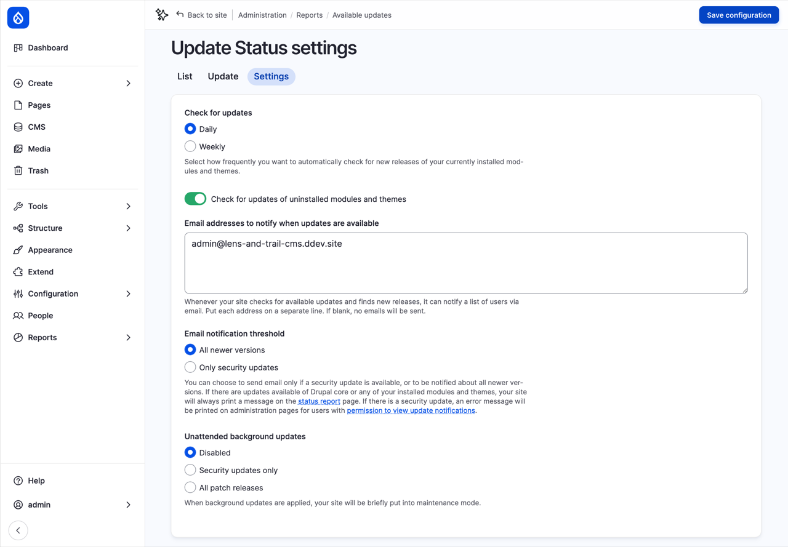
*Figure 20.13: Unattended background updates*

2. Under **Unattended background updates**, choose:
   - **Disabled**: nothing happens on its own. The default.
   - **Security updates only**: patch releases that fix a security hole are installed on their own.
   - **All patch releases**: every patch release of the minor version you're on.

Minor and major updates are never unattended: they always need a person. And "When background updates are applied, your site will be briefly put into maintenance mode."

Should the club switch it on? For a small site with nobody checking it every week, **Security updates only** is a good choice: a security release installed at night, with nobody watching, is far safer than one waiting a week for the webmaster to come back from holiday. It needs a server where the site can write to its own code, and it needs cron (Chapter 21). And it doesn't replace the backups: keep those running.

## Getting ready for Drupal 12

Drupal 12.0.0 comes out in December 2026. Drupal 11 is supported until December 2028, so there's no hurry, but it's good to know early what stands between your site and the next major version. That's why we built a Drupal 11 site.

> **Try it:** If you'd like to follow along, build the same site. These commands make a Drupal 11.4 site with the club's contributed modules, and some generated content:
>
> ```bash
> mkdir lens-and-trail-d11 && cd lens-and-trail-d11
> ddev config --project-type=drupal11 --docroot=web
> ddev composer create-project "drupal/recommended-project:^11.4"
> ddev composer require drush/drush drupal/pathauto drupal/redirect drupal/metatag drupal/simple_sitemap drupal/diff drupal/module_filter
> ddev composer require --dev drupal/devel "drupal/upgrade_status:^5@alpha"
> ddev drush site:install standard --site-name="Lens & Trail" --account-pass=12345 -y
> ddev drush pm:install pathauto redirect metatag simple_sitemap diff module_filter devel_generate upgrade_status -y
> ```
>
> Then generate a few pages at **Configuration** > **Development** > **Generate content**.

%% For the author: our test site was pinned to 11.4.11 (composer update "drupal/core*" -W --with drupal/core-recommended:11.4.11), so it shows a patch update. The commands above haven't been run from scratch in exactly this form: our site got its Basic page type from the Standard profile, with generated pages. Check before publication. %%

### First, the patch release

The site runs 11.4.11, and Available updates says 11.4.12 is out. It also lists 11.5.0-beta1 and 12.0.0-beta2, as **Also available**: those are test releases, for trying, not for live sites. Do the patch update first, with Composer, as before. Upgrade from an up-to-date site: it's one thing at a time, so when something goes wrong, you know what it was.

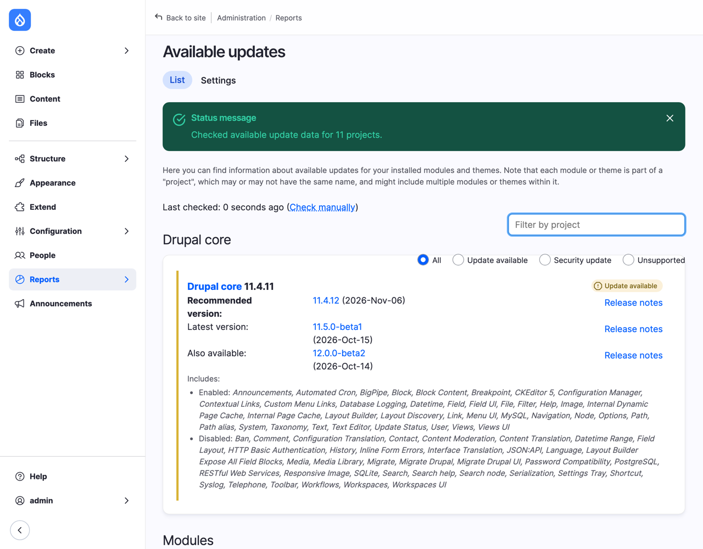
*Figure 20.14: A Drupal 11 site, with three kinds of new release*

### Upgrade Status

The **Upgrade Status** module checks a site for the next major version. It's a development tool: install it on your own computer, with `--dev` as above, never on the live site.

1. Go to **Reports** > **Upgrade status** (`/admin/reports/upgrade-status`).

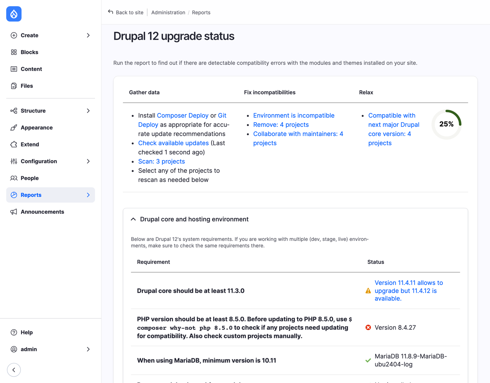
*Figure 20.15: Upgrade Status on the Drupal 11 site*

The report has three steps: **Gather data**, **Fix incompatibilities**, and **Relax**. At the top it checks the environment, and on our site it finds the first real problem:

- **Drupal core**: at least 11.3.0. We have it.
- **PHP**: Drupal 12 needs at least PHP 8.5, and our site runs 8.4. Upgrade Status suggests `ddev composer why-not php 8.5.0` first: it lists the packages that don't allow PHP 8.5 yet. On DDEV, changing PHP is one line, `ddev config --php-version=8.5`, and `ddev restart`. On a live server, ask the host. Drupal 11.4 runs on PHP 8.5 too, so switch PHP first, check the site still works, and only then upgrade Drupal: one thing at a time.
- **Database**: MariaDB 10.11 or newer. Fine.

Then the projects, sorted by what to do with them. Each contributed module either declares that it supports Drupal 12, or it doesn't yet. Under **Compatible with next major Drupal core version**, our site has Token, Metatag, Diff and Module Filter. Under **Collaborate with maintainers**, it has Pathauto, Redirect and Simple XML Sitemap, whose newest stable releases don't support Drupal 12 yet (we met that in Chapter 17), and Devel. Devel is a nice example of a project that's partly ready: the Devel module itself declares Drupal 12, but its Devel Generate submodule doesn't. For those, there's nothing for a site builder to fix: we wait for a release, or we help (Chapter 22). Upgrade Status can also scan each module's code (select the projects, then **Scan selected**) and list what would break, line by line. That list is for the module's maintainers, and it's mostly a sign of how much work is left.

Under **Remove**, it lists projects that are on the server but not installed: "Why invest in updating them to be compatible if you are not using them?" On our site that's Chaos Tools, and three core themes, Stable 9, Stark and Starterkit. Upgrade Status calls those three "Custom theme", which they aren't: they're Drupal 11's own, and they go away with Drupal 11's code when you upgrade. Chaos Tools is a different story. Pathauto runs without it, but Pathauto's Composer file still asks for it (`ddev composer why drupal/ctools` tells you so), so we can't remove it ourselves. It goes when Pathauto stops asking for it. Upgrade Status's advice is good, but it's advice: check before you remove anything.

%% For the author: Upgrade Status 5.0.0-alpha3 also lists Claro and Default Admin as "Custom theme, Incompatible", which looks like a bug in the alpha; we left that out. Check with the newest Upgrade Status before publication. %%

### The upgrade itself

%% For the author: "Only prepare now" (2026-11-07). Write this section once Drupal 12.0.0 is out (week of 7 December 2026), on the lens-and-trail-d11 site (snapshot ch20-start; composer files in .ddev/ch20-start.composer.*): PHP 8.5, update to 11.5, then 12.0 (change the constraints to ^12, composer update "drupal/core-*" -W, updatedb), what Upgrade Status says along the way, and the modules without Drupal 12 releases (Pathauto, Redirect, Simple XML Sitemap as of today). %%

## Live-site safety basics

Updates and backups are most of it. The rest is a short list of habits, most of which you've met already:

- **Strong passwords, and fewer administrators.** `12345` is only for your own computer (Chapter 4). On a live site, the first user (user 1) can do everything, whatever its roles say: give it a long, random password, keep it in a password manager, and use a normal administrator account day to day. Give people the roles they need, and no more (Chapter 15).
- **Read the Status report.** `/admin/reports/status` lists the errors and warnings Drupal knows about: a security update, a `settings.php` that the web server can write to, a missing "trusted host" setting (which stops attackers from pretending your site is at another address). In Chapter 4 we asked you to write down what its warnings meant. Go back to it now: most of them are about safety.
- **Don't show errors to visitors.** Error messages help attackers. At **Configuration** > **Development** > **Logging and errors** (`/admin/config/development/logging`), set **Error messages to display** to **None** on the live site. The errors still go to the log, under **Reports** > **Recent log messages**.
- **Only what you need.** Every module is code that can have a hole. Uninstall and remove what you don't use, and keep development modules, such as Devel and Upgrade Status, off the live site. Some sites uninstall Field UI and Views UI on the live site too: you build on your own computer, and the live site only runs. SA-CORE-2026-014 is a good argument for it.
- **Trusted text formats.** **Full HTML** lets people add scripts to a page. Only give it to roles you trust completely (Chapter 15).
- **HTTPS everywhere.** Your host should give you a certificate, usually free. Chapter 21 covers it.

> **Note:** If you find a security hole in Drupal core or a contributed project, don't post it in the public issue queue, where attackers read along. Report it to the security team, privately: the project's page on drupal.org has a **Report a security vulnerability** link in its sidebar, and <https://www.drupal.org/docs/develop/issues/issue-procedures-and-etiquette/reporting-a-security-issue> explains how. The team works with the maintainers on a fix, and publishes the advisory once it's out.

## Coming from WordPress?

WordPress has updated itself since version 3.7: minor core releases and translations install on their own, and since 5.6, new sites update to major versions on their own too. Plugins and themes don't update themselves by default, only in special cases. A WordPress site with nobody looking after it gets its core security fixes anyway, and that's a big part of why WordPress has the reputation it has.

Drupal core doesn't update itself. A site built with Composer, like our core site, is updated by a person, or by a deployment process a person set up. Drupal CMS comes closest to WordPress: with unattended updates on, it installs core's patch releases on its own. Modules, in both, are still a person's job. So if you're used to WordPress, the habit to learn is the weekly look at **Available updates**, and the emails from your site.

## Summary

In this chapter you learned:

- Why updates come more often every year, partly because AI tools find security holes faster than ever.
- The kinds of releases (patch, minor, major), when they come out, and how much risk each one brings.
- How to read a security advisory and its risk score, which projects the security team covers, and how to get the announcements.
- How **Available updates** tells you what needs updating, and how to make the site email you.
- What a site is made of (code, database, files), and how to back it up with DDEV snapshots and Drush, and on Drupal CMS with Backup and Migrate.
- How to update a module and core with Composer, run the database updates, and how Composer refuses to install a release with a known hole.
- How to update Drupal CMS from the browser, and what unattended updates do.
- How to check a Drupal 11 site for Drupal 12 with Upgrade Status.
- A short list of habits for keeping a live site safe.

## Exercises

1. Subscribe to the security announcements. Read the three newest advisories, and for each one write down the project, the risk label, whether an attacker needs to log in, and whether it affects the club's site.
2. Set up the update emails on the club's site: daily checks, your own address, **Only security updates**. Run `ddev mailpit` and check whether an email arrives after **Check manually**. (If everything is up to date, there's nothing to send. Why is that a good thing?)
3. Make a full backup of the club's site with `drush archive:dump`. Delete a page. Then take `database/database.sql` out of the archive (double-click the archive, or `tar -xzf`), and restore it with `ddev import-db --file=`. Is the page back? What would you lose if you restored a backup from last week?
4. Run `ddev composer outdated "drupal/*"` and `ddev composer audit` on the club's site. For each package listed, decide: update now, plan it, or wait. Write down why.
5. Write the club's update routine: who checks **Available updates**, how often, who gets the emails, where the backups are, and what happens when a highly critical advisory comes out while the webmaster is on holiday. Half a page is enough.
6. *(advanced)* Put the club's site in maintenance mode from the command line with Drush, check what an anonymous visitor sees, and take it out of maintenance mode again. (The answer is in Appendix C.)

## Want to know more?

- [Security advisories](https://www.drupal.org/security) on drupal.org, with the RSS feeds, and the [security risk levels](https://www.drupal.org/drupal-security-team/security-risk-levels-defined).
- [Drupal core release cycle](https://www.drupal.org/about/core/policies/core-release-cycles/schedule): the release windows and the support dates.
- [PSA-2026-11-02](https://www.drupal.org/psa-2026-11-02), on security support for minor versions, and Alpha-Omega's [256 advisories in five months](https://alpha-omega.dev/blog/256-advisories-in-five-months-results-from-the-drupal-ai-security-initiative/).
- [Updating Drupal core with Composer](https://www.drupal.org/docs/updating-drupal/updating-drupal-core-via-composer), in the drupal.org documentation.
- [Automatic Updates](https://www.drupal.org/project/automatic_updates), [Upgrade Status](https://www.drupal.org/project/upgrade_status), and [Backup and Migrate](https://www.drupal.org/project/backup_migrate).
- Composer's [policy settings](https://getcomposer.org/doc/06-config.md#policy), for blocking and the cooldown.
- [How to report a security issue](https://www.drupal.org/docs/develop/issues/issue-procedures-and-etiquette/reporting-a-security-issue).
- For comparison, WordPress's [Configuring automatic background updates](https://developer.wordpress.org/advanced-administration/upgrade/upgrading/).
